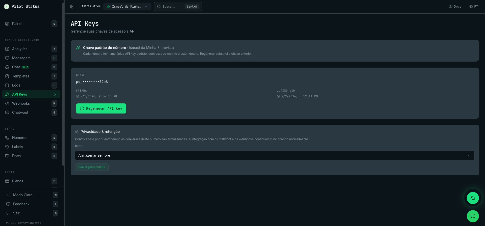

# API keys — list, regenerate, rotate

Every request to the Pilot Status API requires an API key in the `x-api-key` header — the raw key (`ps_...`). MCP connectors and OAuth apps use an OAuth access token in `Authorization: Bearer` instead. `x-api-key-id` is **not** a credential: sent alone, it gets `401 API_KEY_ID_ONLY_NOT_ACCEPTED`.

All keys use the `ps_` prefix. Keys created from 2026-10-28 on also carry their kind — `ps_number_`, `ps_workspace_` or `ps_account_`. This page covers number keys; for workspace keys (primary and named) and account keys, see [Key types](/api/key-types) and [Create workspaces](/api/workspaces#workspace-keys).

<Frame caption="The API Keys page — each number has one default key (shown masked) with a Regenerate action, plus per-number privacy & retention.">
  
</Frame>

## Key scopes

| Scope | Bound to | Where to find it |
| --- | --- | --- |
| **Number-scoped** (default) | One WhatsApp number — all action/data endpoints for that number (send, status, groups, templates, media, calls…) | Dashboard → **API Keys** page (one default key per number; **Regenerate**) |
| **Tenant-scoped** (workspace key) | The tenant (no number) — account-level management: `/v1/numbers/*`, `/v1/remote-pairing/*`, `/v1/api-keys`, `/v1/branding`, `/v1/webhooks/*`, `/v1/subscription/*`, `/v1/billing/*`. It also acts on any number with `x-whatsapp-number-id`. | Dashboard → **Workspace keys** (`/workspace-api-keys`) |
| **Account key** | You, the user — any workspace you are a member of, picked with `x-workspace-id`, with your role there | Dashboard → **Profile** → **API** tab |

There are **no sub-keys** (no parent/child). Number keys are **regenerated**, not created: each WhatsApp number has one default number-scoped key. A workspace has one **primary** workspace key and can add **named** ones (see [Workspace keys](/api/key-types#workspace-keys)).

A tenant-scoped key on a per-number action endpoint gets **403 `TENANT_SCOPE_NOT_ALLOWED`**; a number-scoped key on a tenant-only endpoint gets **403 `NUMBER_SCOPE_NOT_ALLOWED`**. A number-scoped key that tries to create a number (`POST /v1/numbers`, `/v1/numbers/meta`, `/v1/numbers/remote-pairing`) gets **403 `NUMBER_KEY_CANNOT_CREATE_NUMBER`**: use a workspace key or an account key.


## GET /v1/api-keys — List keys (tenant-scoped only)

A number-scoped key gets **403 `NUMBER_SCOPE_NOT_ALLOWED`**. With an account key (`x-workspace-id`), it requires the **Owner** role, since it returns keys in plaintext; regenerating a number's key (`POST`) requires **Owner or Admin**. With an OAuth/MCP token, both require the **Owner** role, checked on every call, and each one is recorded in the audit log ([details](/integrations/mcp-server#secrets-and-api-keys-over-oauth)); any other role gets **403 `OAUTH_SECRET_REQUIRES_OWNER`**. If that audit record cannot be written, nothing is revealed or rotated and the answer is **500 `OAUTH_SECRET_AUDIT_UNAVAILABLE`** — retry. An OAuth token consented for specific numbers only gets **403 `NUMBER_SCOPE_NOT_ALLOWED`**. Workspace keys are not listed here. Returns a **lean flat array — one item per number** — with `numberId`, `number`, `displayName`, `keyId`, `keyLast4`, plus the real usable value (`key`, `revealable: true`). Legacy keys come back with `key: null` and `revealable: false` — regenerate that number to obtain a usable value.

<Note>
  **One entry per number — the most recently created key.** A number can hold more than one key, and the listing now collapses them to the newest one instead of returning a row per key. The older keys are **not** revoked: they keep authenticating, they just stop being listed. Keys with no number attached are still listed individually.
</Note>

```bash
curl "https://pilotstatus.com.br/v1/api-keys" \
  -H "x-api-key: ps_your_tenant_scoped_key"
```

```json
[
  { "numberId": "wn_1", "number": "5511999999999", "displayName": "Suporte", "keyId": "k_aaa", "keyLast4": "wxyz", "key": "ps_4f1c...real...wxyz", "revealable": true },
  { "numberId": "wn_2", "number": "5511888888888", "displayName": "Vendas",  "keyId": "k_bbb", "keyLast4": "abcd", "key": null, "revealable": false }
]
```

## POST /v1/api-keys — Regenerate one number's key (tenant-scoped only)

Send the target number in `whatsappNumberId`: its previous default key is **rotated/invalidated** and the new raw `key` is returned **once**. There is no "create another key" — each number has exactly one default key. Unknown number → **404 `NUMBER_NOT_FOUND`**. A missing or empty `whatsappNumberId` → **400** `{ "error": "Validation error", "details": … }`. It accepts the number's id or its instance id from `GET /v1/numbers`. The response is `200`. A body that is not valid JSON → **400 `INVALID_BODY`**, and no key is rotated ([Malformed JSON body](/api/overview#malformed-json-body)).

```bash
curl -X POST "https://pilotstatus.com.br/v1/api-keys" \
  -H "Content-Type: application/json" \
  -H "x-api-key: ps_your_tenant_scoped_key" \
  -d '{ "whatsappNumberId": "wn_1" }'
```

```json
{
  "numberId": "wn_1",
  "keyId": "k_new",
  "keyPrefix": "ps_number_",
  "keyLast4": "wxyz",
  "key": "ps_number_...newreal...",
  "createdAt": "2026-06-28T15:00:00.000Z"
}
```

<Warning>
  Regeneration **rotates** the chosen number's single default key — the previous key stops working immediately. If the number is connected to a native Chatwoot inbox and the new key cannot be pushed to it, the previous keys are deliberately left valid so the inbox does not break — that is how a number ends up holding more than one working key. The full raw key is shown only once in the response: store it now.
</Warning>

## POST /v1/api-keys/regenerate — Rotate the caller's own key

Rotates the **calling key's own scope** key (works for both scopes): the current key is invalidated and the new raw key is returned **once** in the response, with status `201`.

- **With a number key**, it rotates that number's default key.

- **With a workspace key** (primary or named), it rotates the workspace's **primary** key. Named keys are not touched: a named key that calls it keeps working.
- **With an account key and `x-workspace-id`**, it rotates that workspace's primary key. Requires the **Owner** role.
- **With an OAuth/MCP token** consented for the whole workspace, it rotates the primary key too — only while the user is the **Owner**, checked on every call and recorded in the audit log (`403 OAUTH_SECRET_REQUIRES_OWNER` otherwise; `500 OAUTH_SECRET_AUDIT_UNAVAILABLE` if the record cannot be written, and nothing is rotated).
- **A token consented for specific numbers, or an account key of a member restricted to some numbers**, gets **403 `NUMBERS_GRANT_NOT_ALLOWED`**.

```bash
curl -X POST "https://pilotstatus.com.br/v1/api-keys/regenerate" \
  -H "x-api-key: ps_current_key"
```

```json Response (201)
{
  "id": "k_new",
  "name": "Tenant API Key",
  "key": "ps_workspace_...newreal...",
  "keyPrefix": "ps_workspace_",
  "keyLast4": "wxyz",
  "scope": "tenant",
  "whatsappNumberId": null,
  "createdAt": "2026-06-28T15:00:00.000Z"
}
```

With a number key, `name` is `"Default API Key"`, `keyPrefix` is `"ps_number_"`, `scope` is `"number"` and `whatsappNumberId` names the number.

## Privacy & data retention

The **API Keys** page also hosts the per-number **Privacy & retention** panel (the same control appears on the **Numbers** page). It governs whether — and for how long — this number's conversations and message content are stored. It never affects delivery: the **Chatwoot integration and webhooks keep working in every mode** (they run upstream of storage).

| Mode | What it does |
| --- | --- |
| **Store indefinitely** (`STORE_INDEFINITE`, default) | Keep all inbound and outbound messages and conversations forever. |
| **Store for X days** (`STORE_X_DAYS`) | Keep only the last _N_ days (`piiRetentionDays`, an integer between **1 and 3650**). A daily job hard-deletes chat records older than the window and redacts PII from older log entries. |
| **Don't store / relay only** (`RELAY_ONLY`) | Never persist chat. Messages are still relayed — webhooks fire and Chatwoot mirrors — but `/chat` and `/logs` stay empty for this number and inbound media is not re-hosted. |

The policy lives on the number and is changed in the dashboard on the API Keys page (Privacy & retention panel) or on the number's settings in Numbers. For the full behavior — how each mode affects the dashboard and the `/v1` read endpoints, and how redacted reads look — see [Data Retention & PII Modes](/trust/data-retention).

## Security best practices

- Use API keys only on the **backend** (never in the browser).
- Store keys in environment variables / a secret manager.
- Treat responses containing raw keys as sensitive (do not log them).