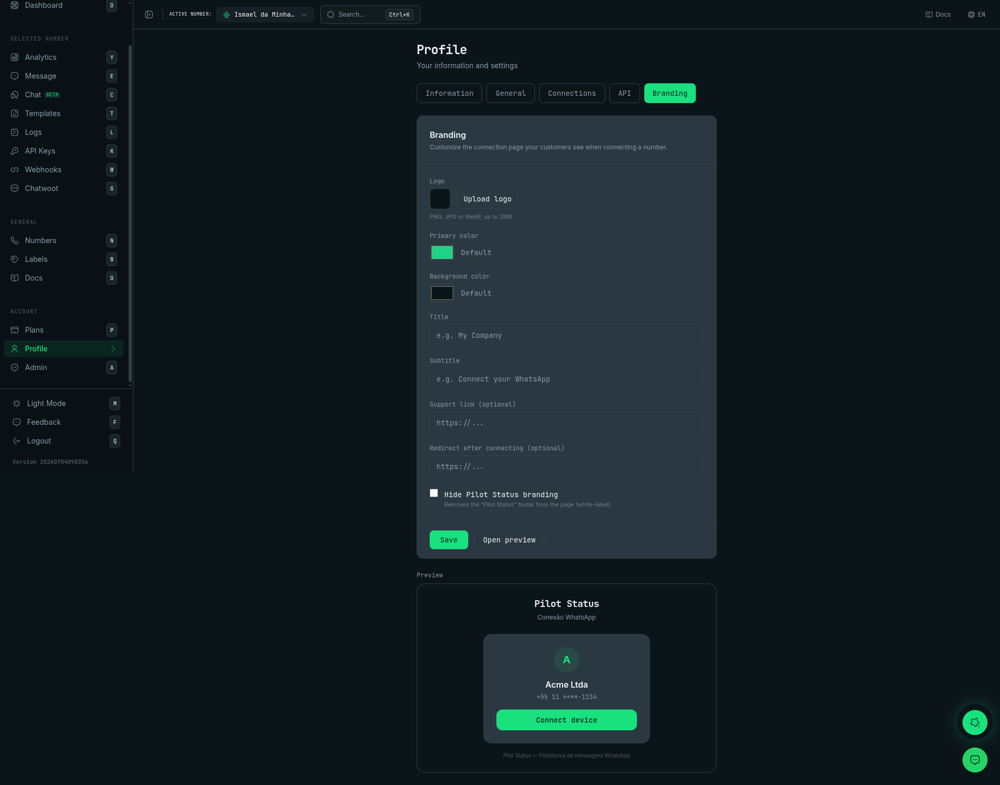

# Connect page branding (white-label)

The public **connect page** (`/connect/{token}`) — where your end customer scans the QR code or runs Meta Embedded Signup to connect a WhatsApp number (see [Remote Pairing](/api/numbers/remote-pairing)) — can be **branded per tenant**. Your customers see **your** brand instead of "Pilot Status".

<Frame caption="Profile → Branding — logo, colors, title, support link, white-label toggle, and a live preview of the customer connect page.">
  
</Frame>

## What you can customize

| Field | Type | Notes |
| --- | --- | --- |
| `logoUrl` | https URL | Shown in the header instead of the company name. |
| `primaryColor` | hex `#RRGGBB` | Buttons, accents, highlights. |
| `backgroundColor` | hex `#RRGGBB` | Page/card background. |
| `companyName` | string (≤ 60) | Header title (replaces "Pilot Status"). |
| `subtitle` | string (≤ 120) | Header subtitle (replaces "Conexão WhatsApp"). |
| `supportUrl` | https URL | Renders a "Need help?" link. |
| `defaultRedirectUrl` | https URL | Where to send the user after a successful connection. |
| `hidePilotStatusBranding` | boolean | **White-label**: hides the "Pilot Status" footer. |

Colors are stored as hex and converted to the page's theme automatically.

## Four ways to configure it

Resolution precedence (highest → lowest):

```text
URL query param  >  per-link override  >  tenant branding (dashboard/API)  >  Pilot Status default
```

### 1) Dashboard (recommended)

**Profile → Marca**: upload a logo, pick colors, set the title/subtitle/support link, toggle white-label, and see a **live preview**. This branding applies to **all** of the tenant's connect links.

### 2) Public API — GET / PUT /v1/branding

<Note>
  Requires a **tenant-scoped** credential: a workspace key, or an account key / OAuth token whose user is **Admin or Owner** (`403 PERMISSION_DENIED` below that). Number-scoped keys get `403` (`NUMBER_SCOPE_NOT_ALLOWED`). Both `GET` and `PUT` need the same permission.
</Note>

<CodeGroup>

```bash Read
curl "https://pilotstatus.com.br/v1/branding" \
  -H "x-api-key: ps_your_tenant_scoped_key"
```

```bash Update
curl -X PUT "https://pilotstatus.com.br/v1/branding" \
  -H "Content-Type: application/json" \
  -H "x-api-key: ps_your_tenant_scoped_key" \
  -d '{ "companyName": "Acme", "primaryColor": "#1fd286", "hidePilotStatusBranding": true }'
```

</CodeGroup>

Response (both):

```json
HTTP 200
{ "branding": { "companyName": "Acme", "primaryColor": "#1fd286", "hidePilotStatusBranding": true, "logoUrl": null, "backgroundColor": null, "subtitle": null, "supportUrl": null, "defaultRedirectUrl": null } }
```

All `PUT` fields are optional — send `null` to clear a field, omit a key to leave it unchanged. Colors must be `#RRGGBB`, URLs must be `https://` (at most 2048 characters); otherwise `400` `{ "error": "Validation error", "details": … }`. Any other key is refused with `400 UNKNOWN_FIELDS` — `unknownFields` lists them — and nothing is saved. That includes `button`: the button skin is **not stored** at the workspace level, it only applies per link (in the `branding` of a pairing link). Until 2026-11-09 unknown keys, `button` among them, were dropped with a `200`. A workspace that never saved branding reads all fields `null` and `hidePilotStatusBranding: false`. A body that is not valid JSON returns `400 INVALID_BODY` and nothing is changed — it is no longer read as an empty update. See [Malformed JSON body](/api/overview#malformed-json-body).

**Logo upload** (dashboard session): `POST /api/branding/logo` accepts a multipart `file` (PNG / JPG / WebP, ≤ 2 MB) and returns `{ url, key, mimeType, fileName, sizeBytes }`. Use the returned `url` as `logoUrl` in `PUT /v1/branding`.

### 3) Per-link override

When you create a pairing link, pass a `branding` object to override branding for **just that link** (it is snapshotted onto the token and overrides the saved tenant branding):

```bash
curl -X POST "https://pilotstatus.com.br/v1/numbers/remote-pairing" \
  -H "Content-Type: application/json" \
  -H "x-api-key: ps_your_token_here" \
  -d '{
    "name": "Customer João",
    "number": "+5511999999999",
    "branding": { "companyName": "Customer João Co.", "primaryColor": "#2563eb" }
  }'
```

### 4) URL query params (cosmetic only)

Append whitelisted, sanitized params to a connect link to tweak appearance on the fly. These are **cosmetic only** — they never change which tenant/number is paired:

```text
/connect/{token}?primary=%231fd286&title=Acme&hideBranding=1
```

Supported: `logo` (https), `primary` (hex), `bg` (hex), `title`, `subtitle`, `support` (https), `hideBranding` (`1`/`true`).

## Public branding endpoint

The connect page reads its branding from:

- `GET /v1/remote-pairing/{token}` → includes a resolved `branding` object, **or**
- `GET /v1/connect/{token}/branding` → `{ branding }` (used by the Meta Embedded Signup flow; no API key needed; always `200`, falling back to Pilot Status defaults for an unknown token). The resolved `branding` has `logoUrl`, `primaryColor`, `primaryColorHsl`, `backgroundColor`, `backgroundColorHsl`, `companyName`, `subtitle`, `supportUrl`, `hidePilotStatusBranding` and, for a per-link override, `button`.

## Notes

- Branding is **per tenant**; a single saved branding applies to every connect link, with optional per-link and query-param overrides on top.
- `hidePilotStatusBranding: true` removes the Pilot Status attribution (white-label). Use it to present the connection flow fully under your own brand.
- Query-param overrides are intentionally limited to appearance; the token still gates the actual pairing.