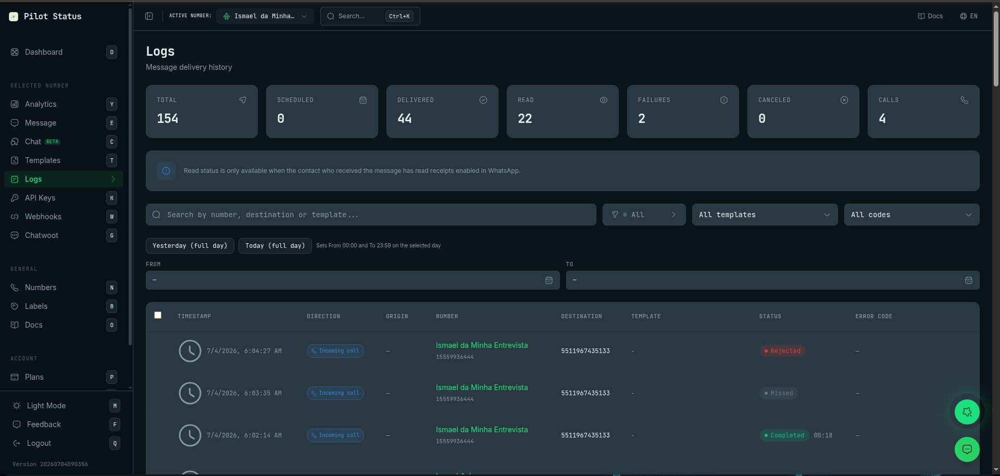

WhatsApp Business Calling lets you place and receive **voice calls** with your customers over WhatsApp, through the `/v1/calls*` API.

## Supported providers

Calling works on **two** connection paths — and behaves differently on each:

| Provider | What it is | Media model |
| --- | --- | --- |
| **META** (Meta Cloud API) | Official WhatsApp Business number | **Signaling-only** — Pilot Status relays SDP (RFC 8866); audio flows **browser ↔ WhatsApp** directly over WebRTC |
| **Unofficial API** (QR code connection) | A number connected by scanning a QR code | **Server-side media** — no SDP; audio runs on the server. You start/answer/reject/hang up through the API and push audio or open a realtime stream via dedicated endpoints |

<Warning>
  Any other number type returns `400 FEATURE_NOT_SUPPORTED`. The error message: _"Calling is only supported on Meta Cloud API numbers and unofficial API (QR code connection) numbers"_ On the unofficial API, calling is available only on the **current QR code connection**; numbers still on the older QR connection return `400 FEATURE_NOT_SUPPORTED` (reconnect the number to get calling). An unofficial number that is not connected returns `409 WHATSAPP_INSTANCE_NOT_CONNECTED`.

  **Coexistence numbers cannot call.** Meta allows calling only on numbers connected directly to the Cloud API. A number that is still on the WhatsApp Business app (coexistence) returns `400 CALLS_NOT_AVAILABLE_COEXISTENCE` on initiate, accept, pre-accept and the permission endpoints, before any request reaches Meta. Listing, rejecting and terminating existing calls still work. The `coexistence` field of `GET /v1/numbers/{id}` tells you which numbers are affected.
</Warning>

<Note>
  **Enabling calling on an official (Meta Cloud) number has two Meta-side prerequisites:** (1) a messaging tier of `TIER_2K` (2,000 msgs/24h) or higher — Meta's gate for the Calling API (attempting it below that returns Meta error `138015`); **and** (2) the WABA must have the **`calls` webhook field subscribed** (or SIP configured) — otherwise Meta returns `138018` (_"technical pre-requisites not met"_). Pilot Status turns calling on **automatically** when you connect the number and re-tries as the messaging tier climbs, so a fresh number in a low tier (e.g. `TIER_250`) simply can't take calls yet. The tier that counts is the **number's own** `messaging_limit_tier` — not the Business Portfolio limit (`whatsapp_business_manager_messaging_limit`), which is a different, usually higher number and does not unlock calling. You can also trigger it manually with the **Enable calling** button in the number's Meta details on the **Numbers** page — it reports back `ENABLED`, `PENDING_TIER` (tier still below 2K), or `PENDING_WEBHOOK` (subscribe the `calls` webhook field on the WABA / set up SIP, then retry). Unofficial API (QR code connection) numbers have no such gate.
</Note>

<Warning>
  **A number in coexistence with the WhatsApp Business app cannot use calling at all.** When a number keeps running in the WhatsApp Business app on the phone and is only _connected_ to the Cloud API, Meta never registers it as a full Cloud API number: `POST /{phone-number-id}/register` is refused with _"Register endpoint is not available for SMB businesses"_, and every write to the calling settings answers Meta error **`141000`** — _"The phone number is not a valid Cloud API number"_. Messaging keeps working normally; only calling is blocked, and no tier increase or webhook subscription changes that. Tell-tale signs in the number's Meta details: `code_verification_status: NOT_VERIFIED`, `name_status: NON_EXISTS`, and no PIN enabled. The only way out is migrating the number off the WhatsApp Business app onto the Cloud API (it then has to be registered and reach `TIER_2K`), which also removes it from the app on the phone.
</Warning>

## Call types

| Type | Who starts it | Billing |
| --- | --- | --- |
| **BIC** — Business-Initiated Call | You call the customer | On META, billed by **Meta directly on your WABA** (per minute, 6-second pulses, only when answered). On unofficial API numbers there is no Meta per-minute charge. |
| **UIC** — User-Initiated Call | The customer calls you | Free |

Pilot Status **does not charge** anything for calls.

### Meta pricing for business-initiated calls (official numbers)

On Meta Cloud API numbers, BIC minutes are billed by **Meta directly on your WABA** ([official pricing](https://developers.facebook.com/documentation/business-messaging/whatsapp/calling/pricing)):

- **User-initiated calls are free** — always, on both providers.
- BIC duration is measured in **6-second pulses**; any fractional pulse counts as a whole pulse (a 56-second call = 9.33 → **10 pulses**).
- The per-pulse rate depends on the **destination country** and your **monthly volume tier** (same tier-accrual structure as WhatsApp messaging). When a call crosses a tier boundary, the **entire call is priced at the cheaper (higher-volume) rate**.
- A **valid payment method on the WABA is required** to place calls — without one, calls fail with Meta error `131044`.
- **Call-permission request messages** are billed as normal messages, not as call minutes.
- Rates are published per currency on Meta's rate cards (BRL rate card effective July 1, 2026).

## Capability support by provider

| Capability | Endpoint | META | Unofficial API (QR) |
| --- | --- | :-: | :-: |
| Place a call (BIC) | `POST /v1/calls` | ✅ SDP offer **required** | ✅ **no SDP** |
| List calls | `GET /v1/calls` | ✅ | ✅ |
| Get one call | `GET /v1/calls/{callId}` | ✅ | ✅ |
| Accept (UIC) | `POST /v1/calls/{callId}/accept` | ✅ SDP answer **required** | ✅ **no SDP** |
| Pre-accept | `POST /v1/calls/{callId}/pre-accept` | ✅ | ❌ |
| Reject | `POST /v1/calls/{callId}/reject` | ✅ | ✅ |
| Terminate / hang up | `POST /v1/calls/{callId}/terminate` | ✅ | ✅ |
| Play an audio file into the call | `POST /v1/calls/{callId}/play` | ❌ | ✅ **unofficial only** |
| Realtime media session (PCM16 WS) | `POST /v1/calls/{callId}/realtime-session` | ❌ | ✅ **unofficial only** |
| Get / update calling settings | `GET`·`PUT /v1/calls/settings` | ✅ | ❌ |
| Get call permissions | `GET /v1/calls/permissions` | ✅ | ❌ |
| Request call permission | `POST /v1/calls/permissions/request` | ✅ | ❌ |

A capability that a provider doesn't support returns `400 FEATURE_NOT_SUPPORTED`.

## How each provider handles media

### META — signaling only

Pilot Status relays the SDP (signaling only — it never touches the audio); audio flows **browser ↔ WhatsApp** directly. Your WebRTC client produces the SDP offer/answer. There is nothing server-side to play into, so `play` and `realtime-session` do not apply. The dashboard **/chat** page includes a built-in **softphone** (available on both connection paths). Before a BIC, the customer must grant **call permission** (`/v1/calls/permissions`); calling **settings** (`/v1/calls/settings`) and **pre-accept** are Meta-only.

### Unofficial API (QR code connection) — server-side media (no SDP)

`POST /v1/calls` and `/accept` take **no `sdp`** — the call connects and audio is processed on the server. Start, answer, reject and hang up use the same endpoints as META (`POST /v1/calls`, `/accept`, `/reject`, `/terminate`). You then drive audio with the two unofficial-only endpoints:

- `POST /v1/calls/{callId}/play` — the backend downloads your audio file (the URL is validated server-side) and plays it into the call; pass `hangupAfterPlay: true` to end the call automatically when playback finishes (notification bots need no client-side timer).
- `POST /v1/calls/{callId}/realtime-session` — opens a full-duplex **PCM16 WebSocket** session; the body `{ "mode": "talk" | "listen" }` is required (`talk` sends and receives audio, `listen` only receives). The returned `wsUrl` is on a dedicated public media host and its token is single-use with a short (~2 min) TTL; connect to it directly (it is not proxied through the API).

Unofficial API numbers need no BIC **permission** grant, have no calling **settings** surface and no **pre-accept** (those are Meta concepts) — those endpoints return `400 FEATURE_NOT_SUPPORTED`.

## Migration / compatibility layer

If you already have code written against the native calling API of the QR code connection, the compatibility layer proxies its `/call/*` endpoints (start, answer, reject, hangup, list, get, media/play, media/realtime/session) — point your base URL at `/api/layer/evolution-go/` and your existing calling code keeps working. The realtime WebSocket (`/call/media/realtime/ws/*`) is reached **directly** on a dedicated public media host (the HTTP layer does not upgrade WebSockets); frontend/manager routes are not proxied.

## Follow call progress with webhooks

Subscribe to `call.ringing`, `call.connected`, `call.ended` (includes `duration` in seconds when answered), `call.missed`, and `call.permission_updated`. `call.ringing`, `call.connected`, `call.ended` and `call.missed` fire for both META and unofficial API numbers; `call.permission_updated` is **META-only** (the unofficial API has no permission model).

<Frame caption="Calls in the Logs page — each call appears with direction, status (Completed with duration, Missed, Rejected), and its own CALLS counter.">
  
</Frame>

## Next steps

<CardGroup cols={2}>
  <Card title="Calls API Reference" icon="phone" href="/api/calls/endpoints">
    Every endpoint, parameters, and per-provider behavior.
  </Card>

  <Card title="Voice Calls Guide" icon="book-open" href="/guides/voice-calls">
    Step-by-step: place a call, answer, permissions, softphone.
  </Card>
</CardGroup>