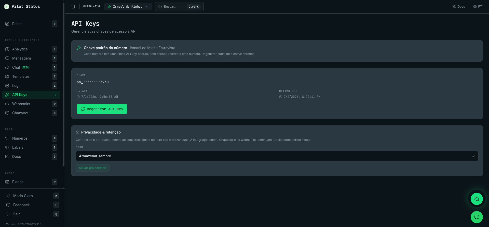

# Pilot Status API Overview

Pilot Status is a platform for sending WhatsApp messages (transactional and marketing/bulk) with template control, versioning, and operational visibility via dashboard, API, and webhooks.

## Base URL

```text
https://pilotstatus.com.br/v1
```

## Authentication

Every request requires an API key sent in the `x-api-key` header. Keys use the `ps_` prefix. MCP connectors and OAuth apps authenticate instead with an OAuth access token in `Authorization: Bearer` — see [Key types](/api/key-types#what-each-credential-can-call).

<Warning>
  Never send a `ps_` key as `Authorization: Bearer`: a Bearer value is read as an OAuth access token, so a key sent there is refused with `401` (`Invalid or expired access token`). `Authorization: Bearer` is only for the OAuth access tokens Pilot Status issues to MCP connectors and OAuth apps. When `x-api-key` is present, the Bearer header is ignored.
</Warning>

```bash
curl "https://pilotstatus.com.br/v1/messages/msg_abc" \
  -H "x-api-key: ps_your_key_here"
```

<Frame caption="Get (or regenerate) your key on the dashboard's API Keys page — one default key per number.">
  
</Frame>

### Key scopes

| Scope | Bound to | Can call |
| --- | --- | --- |
| **Number-scoped** (default) | One WhatsApp number | All action/data endpoints for that number: `POST /v1/messages/send`, message status, cancel, groups, newsletters, templates, analytics, media |
| **Tenant-scoped** (workspace key) | The tenant (no number) | Tenant-level management: `/v1/numbers/*`, `/v1/remote-pairing/*`, `/v1/api-keys`, `/v1/branding`, `/v1/webhooks/*`, `/v1/subscription/extra-numbers`, `/v1/billing/*`, and `/v1/embed/sessions` (connect surface) |
| **Account key** (`ps_account_`) | You, the user | `/v1/workspaces*` (create workspaces and their keys), and everything a workspace key can do in any workspace you belong to, picked with `x-workspace-id`, with your role there |

See [API Authentication](/api/authentication) and [Key types](/api/key-types) for details.

## Core concepts

- **Template**: a versioned message model referenced by `templateId` on API sends. For **Meta** numbers, templates are submitted to Meta for approval; for **unofficial (Pilot Status web)** numbers, they are created locally without an approval step.
- **Message**: a send attempt created by `POST /v1/messages/send`.
- **Webhooks**: delivery events (sent/delivered/read/failed) and inbound messages (reply/received/group).
- **Read receipts**: `READ` status, `readAt`, and the `message.read` webhook only occur when the recipient contact has WhatsApp read receipts enabled.

## Typical integration flow

<Steps>
  <Step title="Create templates">
    Create templates in the dashboard (`/templates`).
  </Step>
  <Step title="Connect WhatsApp">
    Configure your WhatsApp number/instance in the dashboard (`/profile` and `/numbers`).
  </Step>
  <Step title="Create an API key">
    Create an API key on the `/api-keys` page.
  </Step>
  <Step title="Send messages">
    Send messages with [`POST /v1/messages/send`](/api/messages/send).
  </Step>
  <Step title="Track delivery">
    Query status with [`GET /v1/messages/{messageId}`](/api/messages/status) and/or consume events via webhooks.
  </Step>
</Steps>

## Common HTTP errors

| Status | Meaning |
| --- | --- |
| `400` | Invalid payload (e.g., phone not in E.164, missing required fields) |
| `401` | Missing or invalid credential (`x-api-key` or OAuth `Authorization: Bearer`). The body carries only `error` — e.g. `Invalid API key` — and no `code` |
| `403` | Valid key, but operation blocked (e.g., wrong key scope) |
| `404` | Resource not found within the key's scope — or `ROUTE_NOT_FOUND`, the endpoint does not exist ([below](#unknown-endpoint)) |
| `429` | Rate limit exceeded, on the endpoints that document a limit |

## Malformed JSON body

A request body that is **not valid JSON** — truncated (`{"quantity": 3`), with a trailing comma, form-encoded — is refused before anything runs:

```json
{
  "error": "The request body is not valid JSON | O corpo da requisição não é um JSON válido",
  "code": "INVALID_BODY"
}
```

- **Status `400`, code `INVALID_BODY`.** It is a permanent client error: fix the payload, do not retry it as is. Nothing is sent, charged, created or changed. On `POST /v1/messages/send` the refusal does not reserve the `Idempotency-Key`, so the corrected retry can reuse it.
- **An empty body is not malformed.** On routes whose body is optional, sending no body keeps the route's documented default — for example, `POST /v1/subscription/extra-numbers` with no body still buys `quantity = 1`. Routes that require a body (`messages/send`, `templates`, `messages/cancel`, `messages/read`, `messages/typing`, `webhooks`) answer this same `400 INVALID_BODY` to an empty body.
- **Valid JSON that is not an object** (`null`, an array, a string) is not covered by this check: each route answers it with its own validation. On `POST /v1/webhooks` and `PATCH /v1/webhooks/{id}` it is `400 INVALID_BODY` with `"The request body must be a JSON object | O corpo da requisição deve ser um objeto JSON"`.
- Authentication and permission run first: a bad key still answers `401`/`403`, not `400`.

Branch on `code`, not on the message. Before this check, a malformed body answered `500` on some routes and was silently read as `{}` on others.

## Unknown endpoint

A path under `/v1` that matches no endpoint answers `404` with JSON — any method, no authentication needed:

```json
{
  "error": "Not found",
  "code": "ROUTE_NOT_FOUND",
  "message": "No such endpoint: POST /v1/..."
}
```

`message` names the method and path that were called. If you get `ROUTE_NOT_FOUND`, check the URL against this reference before anything else. An existing path called with a method it does not support answers `405` with an empty body.

## Warnings (WhatsApp / anti-spam)

<Warning>
  High-volume and unsolicited sending can trigger WhatsApp anti-spam mechanisms (rate limits, blocks, and bans). You are responsible for opt-in/consent and compliance with applicable laws and WhatsApp policies.
</Warning>