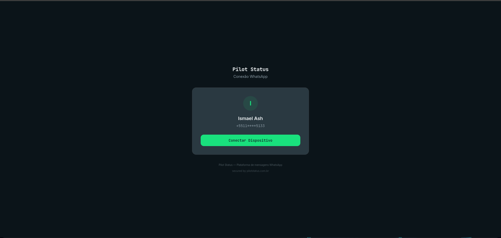

The connect page is the public page at `https://connect.pilotstatus.com.br/connect/<token>`. You send it to a customer so **they** can connect their WhatsApp number to **your** workspace, without an account in your dashboard and without you ever seeing their phone.

It is not a dashboard screen. It opens without login, and the token in the URL is the only credential. This page describes what the person on the other side sees. To **embed** it in your own app (iframe, `postMessage` events, button mode, button styling), read [Embed the Connect Page](/integrations/embed-connect).

<Frame caption="The hosted connect page, with the tenant's logo, colors and title.">
  
</Frame>

## Where the link comes from

You create the link. There are two ways:

- **In the dashboard**: the **Numbers** screen's connect flow can generate a remote pairing link instead of showing the QR code to you. See [Numbers](/dashboard/numbers).
- **Over the API or MCP**: [`POST /v1/numbers/remote-pairing`](/api/numbers/remote-pairing), or the MCP tool `numbers_remote_pairing`. The response carries `remotePairingUrl`.

The link decides which flow the customer sees:

| Link | Flow on the page | Lifetime |
| --- | --- | --- |
| Pilot Status web number (QR, the default) | QR code plus pairing code | **24 hours**, single-use |
| Meta, `metaFlow: "embedded"` | Facebook Embedded Signup button | **30 minutes** |
| Meta, `metaFlow: "credentials"` | Form for the Cloud API credentials | **30 minutes** |

## What the customer sees

The page is in **Portuguese** only. Labels below are quoted as they appear.

### Header and footer

At the top is your logo, or your company name if there is no logo, with a subtitle. Both come from your branding. The browser tab shows your company name, or *Conectar WhatsApp*.

At the bottom:

- *Pilot Status — Plataforma de mensagens WhatsApp*, unless your branding hides Pilot Status.
- A **Precisa de ajuda?** link, if your branding has a support URL.
- A small **secured by pilotstatus.com.br** link. It always shows and cannot be removed on the full page.

### QR pairing (Pilot Status web number)

1. The card shows the number's name, its initial and the masked number (for example `+5511****9999`), plus a **Conectar Dispositivo** button (*Preparando...* while it loads).
2. After the click, the page shows **Escaneie o QR Code** with:
   - a **Código de pareamento** that copies on click (**Copiar código**),
   - the QR code,
   - the countdown **Expira em Ns**. Each QR lasts 40 seconds and the page fetches a new one by itself.
3. The instructions say: open WhatsApp on the phone, go to **Menu > Dispositivos conectados > Conectar um dispositivo**, and scan the QR code or type the pairing code.
4. Once the phone links, the page shows **Conectado com sucesso!** — *O número WhatsApp foi conectado. Você pode fechar esta página.*

If the workspace cannot take another number (for example, its plan limit is reached), the customer reads a neutral message: *Este número não pode ser conectado agora. Fale com quem enviou este link.* Plan details never show on this page. A temporary failure says *Erro ao gerar QR Code. Tente novamente.* and offers **Tentar novamente**.

### Official number, Embedded Signup

1. The card shows **Conectar WhatsApp Business**: *you will log in to Facebook and pick the number of your official WhatsApp account (Meta Cloud API). No credentials are needed here.*
2. The button reads **Continuar com o Facebook** by default. Your link's button styling can change the label. It opens Meta's dialog, where the customer picks or creates the business account and the number.
3. On a phone, a notice suggests opening the link on a computer, because the Meta connection may not finish on mobile. This notice is skipped when the link uses the redirect flow, which is built for mobile.
4. If the customer comes back to the page after finishing in Facebook but the page never got the result, it offers **Concluiu no Facebook? Finalizar conexão**. That opens a phone field (*Informe o número que você conectou no WhatsApp Business*) and a **Finalizar conexão** button. Afterwards the page says the request was received: the number appears in the dashboard shortly if Meta connected it, otherwise the Pilot Status team gets in touch.
5. On success: **Conectado com sucesso!**

### Official number, credentials form

**Conectar WhatsApp Business** asks for the credentials of the official account, found in Meta Business / WhatsApp Manager. All fields are required:

| Field | Example placeholder |
| --- | --- |
| **Nome** | *Ex.: Atendimento principal* |
| **Número** | `+55 11 99999-9999` |
| **Phone Number ID** | `123456789012345` |
| **WABA ID** | `098765432109876` |
| **System Token** | `EAA...` (hidden input) |
| **App Secret** | `abcdef123456...` (hidden input) |
| **App ID** | `1234567890` |

There is also a checkbox, on by default: **Receber as mensagens automaticamente na Pilot Status (recomendado).** With it on, Pilot Status points the webhook of the account (WABA) at itself, with no manual steps.

<Warning>
  This redirects the webhooks of the **whole WABA**. If a number in that account already sends events to another integration, that integration stops getting them. Unchecking it means the webhook must be set up by hand in Meta later. The hosted page does **not** show the Callback URL or Verify token. The workspace Owner gets them from the number's card on the [Numbers](/dashboard/numbers) screen.
</Warning>

The customer submits with **Conectar**. The page never shows the token or the secret back.

### After connecting, expiring, errors

- **Redirect**: if the link was created with a `redirectUrl` and the page is not embedded, the browser goes there about 2.5 seconds after **Conectado com sucesso!**. Embedded pages instead send `connect:paired` to the host app.
- **Expired or used link**: **Link expirado** — *Este link de pareamento expirou ou já foi utilizado. Solicite um novo link ao seu fornecedor.* The customer cannot renew it. You create a new link.
- **Network errors**: messages such as *Erro de conexão. Verifique sua internet.* Errors that can be retried show **Tentar novamente**.

## Branding

The look comes from, in order of precedence:

1. Cosmetic URL parameters. These apply only once the token is valid.
2. The link's own `branding`.
3. Your workspace branding ([`/v1/branding`](/api/branding)).
4. Pilot Status defaults.

The full table is in [White-label / branding](/integrations/embed-connect).

## Who can create the link

Creating a pairing link is connecting a number, so it needs the `numbers:connect` permission. **Owner** and **Admin** have it; Agent and Analyst do not. The same permission applies over the API and MCP. The person who opens the link needs no account and no role.

## Do it via API / MCP

| Step | Public API | MCP tool |
| --- | --- | --- |
| Create the link | [`POST /v1/numbers/remote-pairing`](/api/numbers/remote-pairing) | `numbers_remote_pairing` |
| Watch the number connect | [`GET /v1/numbers/{id}/status`](/api/numbers/status) | `numbers_status` |
| Get notified when it connects | [Webhooks](/dashboard/webhooks), or `connect:paired` when embedded | — |
| What the customer does on the page | Only on the page. The token endpoints it calls are public and tied to the link. | — |

## Related

- [Embed the Connect Page](/integrations/embed-connect): iframe, button mode, `postMessage` events, button styling.
- [Embedded Signup in your app](/guides/embedded-signup).
- [Remote pairing API](/api/numbers/remote-pairing).
- [Numbers](/dashboard/numbers).
