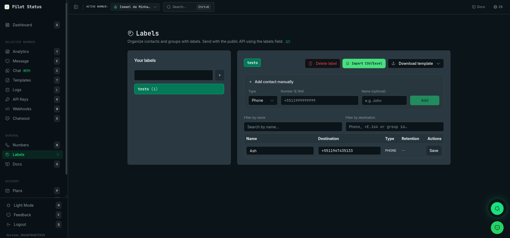

The **Labels** screen (`/labels`) organizes your contacts and WhatsApp groups into named lists, such as `vip` or `customers`. You use a label to load recipients into a bulk send on the [Message](/dashboard/send-messages) screen, and your integration can tag contacts automatically by passing `labels` on [`POST /v1/messages/send`](/api/messages/send).

Labels belong to the **workspace**, not to a number: every number of the workspace sees the same labels.

<Frame caption="The Labels page — organize contacts and groups into labels, import from CSV/Excel, then pass labels on POST /v1/messages/send.">
  
</Frame>

## How to reach it

In the sidebar, click **Labels**, in the **Workspace** group (keyboard shortcut: `B`). The page title is **Labels**, with the subtitle **Organize contacts and groups with labels. Send with the public API using the labels field.** The link icon next to it opens this documentation site.

## Who can do what

| Action | Owner | Admin | Agent | Analyst |
| --- | --- | --- | --- | --- |
| Open **Labels**, see labels and contacts | Yes | Yes | Yes | No |
| Create a label, add, import, edit and copy contacts | Yes | Yes | Yes | No |
| **Delete label** | Yes | Yes | No | No |
| See the **Data retention (PII)** warning | Yes | Yes | No | No |

The permissions behind it: `contacts:read` opens the screen, `contacts:manage` creates labels and changes contacts, and `contacts:delete` deletes a label (it removes every contact link of the label). The retention warning depends on reading the API keys (`apikeys:read`), which only Owner and Admin have. See [Roles and permissions](/concepts/roles-and-permissions).

There is no plan gate on this screen.

## What you see

### Data retention (PII) warning

When at least one of your API keys has a retention of 0 days, a warning titled **Data retention (PII)** appears at the top: **Some API key has retention 0: numbers may be erased automatically per retention policy. Contacts from the public API show the key retention.** See [Data retention & PII modes](/trust/data-retention).

### Your labels

The left card, **Your labels**, lists every label with its contact count, for example `vip (12)`. Click a label to select it; the first label is selected when the page opens. Each label gets a color automatically, worked out from its name; there is no color to pick. Labels are listed in alphabetical order.

To create a label, type its name in the field at the top of the card and press `Enter` or click **+**. Names are snake_case: lowercase letters, numbers and `_` (the field converts what you type). Creating a label whose name already exists selects the existing one instead of making a copy. The screen says **Label created**.

### The selected label

The right card shows the selected label's name and its actions. With no label, it says **Create or select a label.**

- **Delete label** — Owner and Admin only. Opens the **Delete label?** dialog: **This cannot be undone. All contacts linked to this label will be removed.**, with the number of contacts, and **Cancel** or **Delete**. The contacts are unlinked from this label only; the same destinations stay in other labels.
- **Import CSV/Excel** — adds the contacts of a `.xlsx`, `.xls` or `.csv` file to the selected label. See [Import contacts](#import-contacts).
- **Download template** — downloads an import model (**Excel (.xlsx)** or **CSV (.csv)**) with the columns `name`, `destinationNumber` and `groupId` and two example rows.

### Add contact manually

Under **Add contact manually**:

1. Pick the **Type**: **Phone** or **Group**.
2. Type the **Number (E.164)**, such as `+5511999999999`, or the **Group id**, which must end with `@g.us`.
3. Optionally type the **Name (optional)**.
4. Click **Add**.

An invalid number shows **Invalid number (use E.164, e.g. +5511999999999)**; a group id without `@g.us` shows **Group id must end with @g.us**. On success, the screen says **Contact added**. If you leave the name empty on a phone contact, Pilot Status tries to fill it with the name the number uses on WhatsApp, when one is available.

### Contact list

The contacts of the selected label. Narrow the list with **Filter by name** and **Filter by destination** (a phone in any format, E.164 or a group id); **Clear filters** resets both. An empty label says **No contacts yet. Use the form above, import CSV/Excel, or send messages with labels via the API.**

| Column | What it shows |
| --- | --- |
| **Name** | The contact's name, editable. |
| **Destination** | The phone (E.164) or group id, editable. |
| **Type** | `PHONE` or `GROUP`. |
| **Retention** | Only for contacts added through the API: the retention of the API key that added them, such as `30d`, or **0 days (PII off)** in amber. Contacts added in the dashboard show `—`. |
| **Actions** | **Save** and **Copy to…** |

The **Retention** column is how you tell which contacts came from the API: they are the ones with a value there. The API key itself is never shown.

### Edit a contact

Change the name or destination in the row, then click **Save** on that row. Edited rows turn amber with **Unsaved**, and a banner reminds you: **There are unsaved changes. Click Save on each row to persist.** Changing a destination to one that the label already has fails with **Destination already exists in this label**. A phone needs at least 8 digits, or you get **Invalid number**. A new group id that does not end in `@g.us` is not applied: after **Save** (the screen says **Saved**), the row keeps its previous group id.

### Copy a contact to another label

In **Copy to…**, search and pick another label. The contact is linked to that label too (**Contact copied**). If the destination is already there, it is not duplicated; an empty name on the target is filled in. A copied contact that came from the API keeps its **Retention** in the new label.

<Note>
  The screen has no button to remove a single contact from a label, and no export. To drop one contact, delete and recreate the label, or import the list you want into a new label.
</Note>

## Import contacts

Select a label, click **Import CSV/Excel** and pick the file. The import:

- reads the phone from a column named `destinationNumber`, `number`, `numero`, `telefone` or `phone`, and the name from `name`;
- treats a row as a **group** when the `groupId` column (or `group_id`, `group`, `grupo`) ends with `@g.us`;
- skips rows whose phone is not a valid E.164 number;
- updates the name of a destination already in the label when the label has it with an empty name;
- for a phone row with no name, tries to fill the name with the one the number uses on WhatsApp.

If no row is valid, the screen says **No valid contacts in file**. Otherwise it says **Import finished** and reloads the list; if the upload fails, it says **Import failed**.

## Values on this screen

Nothing here is shown only once. Labels and contacts stay until you delete them, unless the [retention](/trust/data-retention) of the API key that added a contact erases it.

## Do it via API / MCP

| Dashboard action | API (`/v1`) | MCP tool |
| --- | --- | --- |
| Tag a destination with labels when sending (creates the label if needed) | The `labels` field of [`POST /v1/messages/send`](/api/messages/send) — see [Labels](/api/labels) | `messages_send` with `labels` |
| Send to everyone in a label | Load the label on the [Message](/dashboard/send-messages) screen | Dashboard only |
| List labels and contacts, create a label, add, import, edit, copy contacts, delete a label | — | Dashboard only |
