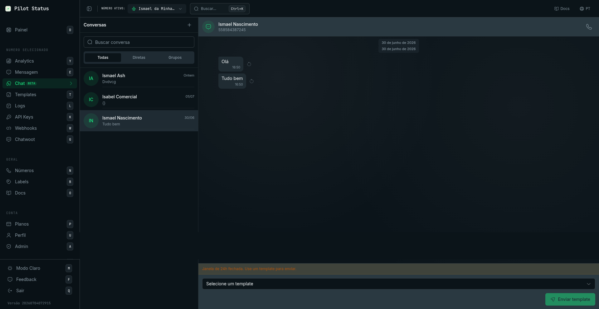
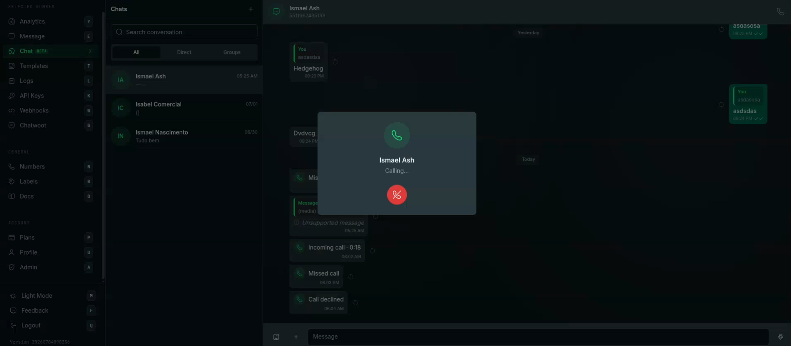

The **Chat** screen is a WhatsApp inbox inside the dashboard. You read and answer the conversations of one WhatsApp number at a time — direct chats, groups and channels — from any browser, while your API integration keeps running on the same number.

<Frame caption="The Chat inbox — conversation list, message thread, and a template composer shown when the 24-hour window is closed.">
  
</Frame>

## How to get here

Sidebar → **Chat** (marked beta), or go straight to `/chat` (keyboard shortcut **C**). A conversation has its own URL, `/chat/<conversationId>`: opening it (or reloading it) opens that conversation directly, even when it is not on the first page of the list.

The screen always works on the **Active number** chosen in the dashboard header. Switch the number in the header to see another number's inbox; each number has its own conversations, and the open conversation closes when you switch.

- **No number connected:** the screen is locked with **"Connect a number to continue"** and an **Add Number** button.
- **No number selected:** you see **"Select a number"** — _"Pick a WhatsApp number to view and reply to conversations."_
- **Shared test number selected** (the **Test** number): you can browse, but every send, call and forward is refused with _"Test number: select one of your numbers to send in chat."_

The same screen can also be embedded in your own product — see [Embed chat](/integrations/embed-chat).

<Note>
  Chat is a paid-plan feature: the [Plans](/plans) page lists it as not included in **Free**.
</Note>

## Who can use it

| Role | What they get |
| --- | --- |
| **Owner**, **Admin** | Everything on this screen. |
| **Agent** | Everything on this screen, but only on the numbers their admin gave them access to (see [Members](/dashboard/members)). |
| **Analyst** | **No access.** Analysts do not have the chat permission — reading customer conversations is exactly what the role is meant to keep out of reach. The **Chat** entry does not appear for them. |

Reading conversations needs the chat permission; sending, reacting, forwarding, pinning, starring, deleting, retrying and organizing chats (archive, pin, clear, delete) need the send permission; starting a new chat needs the contacts permission; calls need the calls permission. Owner, Admin and Agent have all four.

## What features you see depends on the number

The screen hides what the number's connection cannot do:

| | Official number (Meta Cloud API) | Unofficial number (Evolution GO) | Unofficial number (Evolution v2) |
| --- | --- | --- | --- |
| Text, media, voice notes, templates, list messages, stickers | Yes | Yes | Yes |
| **Groups** and **Newsletter** filters | No | Yes | Yes |
| Typing / recording presence shown to the contact | No | Yes | Yes |
| **Call** (softphone) | Yes | Yes | No |
| 24-hour window for free-form messages | **Yes** | No | No |

## The conversation list (left pane)

The header reads **Chats**, with a **New chat** (**+**) button.

- **Search conversation** — filters the list by name or number.
- **Filter chips** — **All**, **Unread**, **Favorites**, **Direct**, **Groups**, **Newsletter**. Each chip except **All** shows how many unread conversations it holds. **Groups** and **Newsletter** only appear on unofficial numbers. Chips that do not fit go under **More filters**.
- **Archived** — a row on top of the **All** list when you have archived chats. It opens its own view (**Archived**, with a back arrow): _"These chats stay archived when new messages are received."_
- **Each row** shows the photo, name (or number), last-message preview, time, an unread badge (**99+** above 99) and a pin icon for pinned chats. A group without a name shows as **Unnamed group** / **Group #id**; a channel as **Channel** / **Channel #id**.
- **More options** on a row (hover on desktop, long-press on mobile): **Pin chat** / **Unpin chat**, **Archive chat** / **Unarchive chat**, **Add to favorites** / **Remove from favorites**, **Mark as read** / **Mark as unread**.

Rules behind those actions:

- You can pin at most **3** chats per number. Pinning an archived chat unarchives it; archiving a pinned chat unpins it.
- **Favorites are personal**: each user has their own, and they never show for a teammate. Archive, pin and unread state are shared by everyone in the workspace.
- Opening a conversation marks it as read.

Empty states: **No conversations yet.**, **No unread chats.**, **No archived chats.**, and under **Favorites** _"No favorite chats. Add one from the chat's menu."_

## Start a new chat — "New chat" panel

Click **+** (**New chat**). The left pane switches to the **New chat** panel:

- **Search name or number** — searches your saved contacts (**No contacts found.** when nothing matches). Click a contact to open the conversation.
- **Start by number** — opens a dialpad: **Choose country code**, the **Phone number** field, **Backspace**, and **Start chat**. Pilot Status opens the existing conversation with that number, or creates it.

On an official number, a new conversation starts with the 24-hour window closed, so the first message has to be a template.

## The thread (right pane)

Click a conversation to open it. The header shows the photo, the name and, below it, the phone number, **Group**, **Newsletter** or **Business account** (for WhatsApp Business contacts). Header buttons:

- **Search messages** — the search panel: **Search this conversation** and **Go to a date** (jumps to the first message of that day). **No messages found** when nothing matches.
- **Call** — only for direct conversations on numbers that support calls (see [Calls](#calls-softphone)).
- **More options** (**⋮**) — the conversation menu, see below.
- Clicking the name opens **Contact info** / **Group info**.

Messages you sent are on the right, received ones on the left. On each sent message:

| Tick | Meaning |
| --- | --- |
| Clock | **Sending** — queued, not yet accepted by WhatsApp. |
| ✓ | **Sent** |
| ✓✓ | **Delivered** |
| ✓✓ blue | **Read** |
| Red **!** | **Failed** — with **Not delivered —** and WhatsApp's reason, and a **Try again** button. |

Other markers: an **App** badge (_"Sent from app"_) on messages sent from the phone itself, a star for messages you starred, a pin for pinned messages, **Forwarded** / **Forwarded many times** labels, reaction chips under the bubble, and call bubbles (**Incoming call**, **Outgoing call**, **Missed call**, **Call not answered**, **Call declined**, **Call failed**).

Banners and badges you may see:

- **Came from an ad** / **Came from a post** on a message that arrived from a Click-to-WhatsApp ad, with **View performance**.
- **Came from the form {form}** when the contact came from a Meta lead form.
- _"Messages are not stored for this number (relay-only mode)."_ — the number's privacy mode keeps no history, so the inbox stays empty.
- **content unavailable** in place of a name or a message when the number's privacy settings hide it.
- **Media unavailable** — _"The message arrived, but the file was not stored — there is nothing to download."_; **Loading media…** while a file is still being processed.

If the thread fails to load you see **Could not load messages.** with **Try again**.

### Message actions

Right-click a message (desktop) or long-press it (mobile):

| Action | What it does |
| --- | --- |
| **Message info** | Opens the **Message info** dialog (see below). |
| **Reply** | Quotes the message in the composer (**Replying to** … **Cancel reply**). You can also swipe the message on mobile. |
| **Copy** | Copies the text. |
| **Forward** | Opens the **Forward message** dialog. Greyed out with _"This message cannot be forwarded"_ for locations, contact cards, calls, deleted messages and media whose file is gone. |
| **Pin** / **Unpin** | Pins the message for the whole workspace. On Evolution GO numbers the pin is also applied in WhatsApp; on other numbers it exists only in Pilot Status. |
| **Star** / **Unstar** | Adds it to your **Starred messages**. Stars are personal. |
| **Select messages** | Enters multi-select (see below). |
| **Delete** | Deletes the message **in Pilot Status only** (_"Message deleted."_). It is **not** deleted from the contact's WhatsApp. |

**React:** hover a message and pick one of 👍 ❤️ 😂 😮 😢 🙏, or **More reactions**. Pick the same emoji again (or click your own chip) to remove it. Reactions are offered in direct conversations only, and on official numbers only on messages the contact sent.

**Select messages** (also in the **⋮** menu) replaces the composer with a bar: **Selected messages**, **Star**, **Copy**, **Forward** and **Cancel**.

### Message info dialog

| For a message you sent | For a message you received |
| --- | --- |
| **Sent**, **Delivered**, **Read** timestamps. | **From** (in groups), **Type**, **Received**, **Message ID**, **File**, **Media type**. |

The **Message ID** is WhatsApp's id of the message (the `wamid` on official numbers). It is the same id the API and webhooks use for that message.

### Forward message dialog

Title **Forward message** (or **Forward N messages** from **Select messages**). _"The message is re-sent as a new message to each chosen conversation."_ Search with **Search by name or phone**, tick up to **5** conversations (**Choose up to 5 conversations**, then **Limit of 5 conversations reached**) and click **Forward**. Conversations that failed are listed under **Not forwarded to:**. Forwarding is not available on the test number.

### Shared contact dialog

A received contact card shows **Message** (opens a chat with that number) and **View contact** (or **View all** for several). The dialog, **Shared contact** / **Shared contacts** — _"Received in this conversation as a contact card."_ — lists each name, organization, phone (**Copy phone**, **Message**) and email (**Copy email**).

### Media viewer

Click an image or video to open it full screen. You can browse with **Previous** / **Next**, **Zoom in** / **Zoom out**, and use **Reply**, **React**, **Star**, **Forward**, **Download** and **Go to message**.

### Starred messages

**Starred messages** (from the **⋮** menu or the info pane) lists the messages you starred in this conversation, with **Load more**. Click one to jump to it.

## The composer

- **Message** field — **Enter** sends. Your draft is kept per conversation, even after you close the chat.
- **Send template** — switches to the template composer (optional, except when the 24-hour window is closed).
- **Attach** (**+**) — **Document**, **Photos & videos**, **Camera**, **List** and **Sticker**. You can also paste files or drag them onto the thread (_"Drop to attach to the conversation"_).
- **Record voice message** (shown when the field is empty) — the recording bar has **Cancel recording**, **Pause** / **Resume** and **Send voice message**.

### Media preview

Images and videos open a preview before sending: **Add a caption...**, **Emoji**, **Add more** and **Send**. Stickers must be exactly **512×512 pixels**, or you get _"A sticker must be exactly 512x512 pixels — this one is {width}x{height}."_

### List message

**Attach → List** opens **List message**: **Message text**, **Button text** (e.g. _View options_), then sections with **Section title (optional)** and rows with **Row title**, **Description (optional)** and **Row ID (optional)**. Use **Add section** / **Add row** and click **Send list**.

### Templates and the 24-hour window

On an **official (Meta) number** you can send free-form messages (text, media, lists, voice notes) only within **24 hours** of the contact's last message. Outside it the composer shows _"24h window closed. Use a template to send."_ and becomes the template composer, which you cannot cancel until the contact writes again.

In the template composer: **Select a template** (the number's approved templates; **No approved templates.** when there are none), fill each variable (**Value**), check the **Preview** and click **Send template**. If a send cannot be confirmed you see _"Could not confirm the template was sent. Retry — it will not be sent twice."_ with **Retry**.

Unofficial numbers have no 24-hour window: **Send template** is just a shortcut.

The composer is replaced by a notice in two cases: **Only admins can send messages** (an announcement group where your number is not admin) and **You can't send messages to this channel** (a channel your number cannot post to).

## Calls (softphone)

On direct conversations of **official (Meta)** and **Evolution GO** numbers, **Call** in the header (or in the info pane) places a WhatsApp voice call from your browser. Incoming calls ring on the open screen.

<Frame caption="Voice calls in /chat — the built-in softphone rings in place, and call events (incoming, missed, declined) show up as bubbles in the conversation.">
  
</Frame>

The call panel shows the contact and the state — **Incoming call…** (**Answer**, **Decline**), **Calling…**, **Connecting…**, the call timer (**Mute** / **Unmute**, **Hang up**), **Call ended** or **Call failed** (**Close**). Failure reasons it can show:

- _"Allow microphone access to place calls."_
- _"This browser does not support calling."_
- _"The contact hasn't allowed calls yet. Request permission in the conversation."_ (official numbers)
- _"Calling is not enabled for this number."_ (official numbers)
- _"The WhatsApp Business account (WABA) has no payment method. Business calls are billed by Meta — add a card in WhatsApp Manager."_

See [Calls overview](/api/calls/overview) for how calling works and how to enable it.

## Conversation menu (⋮)

| Item | What it does |
| --- | --- |
| **Contact info** / **Group info** | Opens the info pane. |
| **Search** | Opens message search. |
| **Starred messages** | Your starred messages in this chat. |
| **Select messages** | Multi-select. |
| **Export chat** → **Text (.txt)** / **Spreadsheet (CSV)** | Downloads the conversation (_"Chat exported"_). |
| **Archive** / **Unarchive** | Moves it to or from **Archived**. |
| **Pin** / **Unpin** | Pins it on top of the list (max 3). |
| **Add to favorites** / **Remove from favorites** | Your personal **Favorites** filter. |
| **Mark as unread** | Puts the unread dot back. |
| **Close chat** | Closes the thread (same as **Esc**). |
| **Clear chat** | Asks **Clear this chat?** first. |
| **Delete chat** | Asks **Delete this chat?** first. |

### Clear this chat? / Delete this chat?

- **Clear chat** — _"Messages up to now will no longer show here. The chat stays in the list."_ The thread, media list, search and export then start after that moment. Nothing is deleted.
- **Delete chat** — _"The chat leaves the list until a new message arrives."_ The messages are kept.

Both buttons are **Cancel** and **Clear chat** / **Delete chat**. Neither touches the contact's WhatsApp.

## Contact info / Group info pane

Opens on the right (full screen on mobile). It shows the photo, name and number — or, for a group, **Group · N members** — plus:

- **Call** and **Search** buttons.
- **Description** (groups).
- **Media, links and docs** — opens the media browser with **Media**, **Links** and **Docs** tabs and **Load more**. Click an item to open it or jump to its message. _"Media is not stored for this number."_ on relay-only numbers.
- **Starred messages** — your starred messages in this chat.
- Group members — each member with an **Admin** badge where it applies, **See all (N)**, **Search member by name or number**, **Show more**, and **Message {phone}** to open a direct chat with a member. _"Couldn't load the participants right now."_ if the member list fails.
- **Archive chat**, **Pin chat**, **Mark as unread**, **Export chat** (**Text (.txt)** / **Spreadsheet (CSV)**), **Clear chat** and **Delete chat** — the same actions as the **⋮** menu.

## Values on this screen

Nothing on this screen is shown only once. Every value can be opened again at any time:

- **Message ID** of a received message: **Message info**.
- Delivery timestamps of a sent message: **Message info**.
- The contact's number: the thread header or the info pane.
- Files: **Download** in the media viewer, or **Media, links and docs**.

## Do it via API / MCP

API calls use a number-scoped API key; the MCP tools wrap the same endpoints.

| Dashboard action | API | MCP tool |
| --- | --- | --- |
| Conversation list | [`GET /v1/conversations`](/api/conversations) | `conversations_list` |
| Read a thread | [`GET /v1/messages/history`](/api/messages/history) | `messages_history` |
| Read group messages | [`GET /v1/messages/group`](/api/messages/group-messages) | `messages_group` |
| Unread messages / unread counts | [`GET /v1/messages/unread`](/api/messages/unread), `GET /v1/messages/unread/counts` | `messages_unread`, `messages_unread_counts` |
| Mark as read | [`POST /v1/messages/read`](/api/messages/read) | `messages_mark_read` |
| Typing indicator | [`POST /v1/messages/typing`](/api/messages/typing) | `messages_typing` |
| Send text, media, voice note, sticker, list or template; new chat with a number | [`POST /v1/messages/send`](/api/messages/send) — see [text](/api/messages/send-text), [media](/api/messages/send-media), [interactive](/api/messages/send-interactive) | `messages_send` |
| Message info (status, timestamps) | [`GET /v1/messages/{id}`](/api/messages/status) | `message_get` |
| Try again on a failed message | [`POST /v1/messages/{id}/resend`](/api/messages/resend) | — (API or dashboard) |
| Download a received file (official numbers) | [`GET /v1/media/{mediaId}`](/api/media-download) | `media_get` |
| Call, answer, decline, hang up | [`/v1/calls`](/api/calls/endpoints) | `call_initiate`, `call_accept`, `call_reject`, `call_terminate` |
| Group info and members | [`GET /v1/groups/{groupId}`](/api/groups) | `group_info`, `groups_list` |
| Channels | [`GET /v1/newsletters`](/api/newsletters) | `newsletters_list` |
| Reply (quote), react, forward | — | **Dashboard only** |
| Star, pin or delete a message | — | **Dashboard only** (group message pins: `POST /v1/groups/{groupId}/pin`, `group_pin`) |
| Archive, pin, favorite, mark as unread, clear, delete or export a chat | — | **Dashboard only** |

Related: [Webhook events](/api/webhooks/events) (receive the same messages in real time) · [Chatwoot](/dashboard/chatwoot) (answer from Chatwoot instead).
