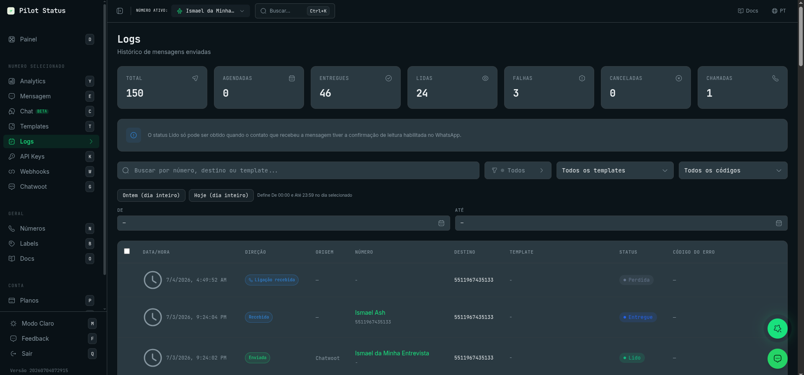
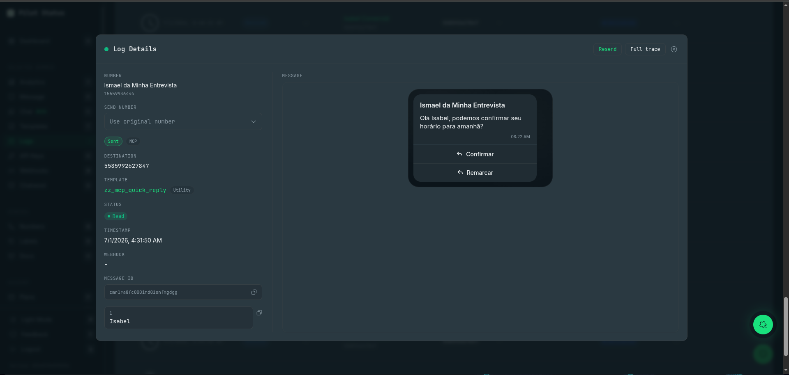
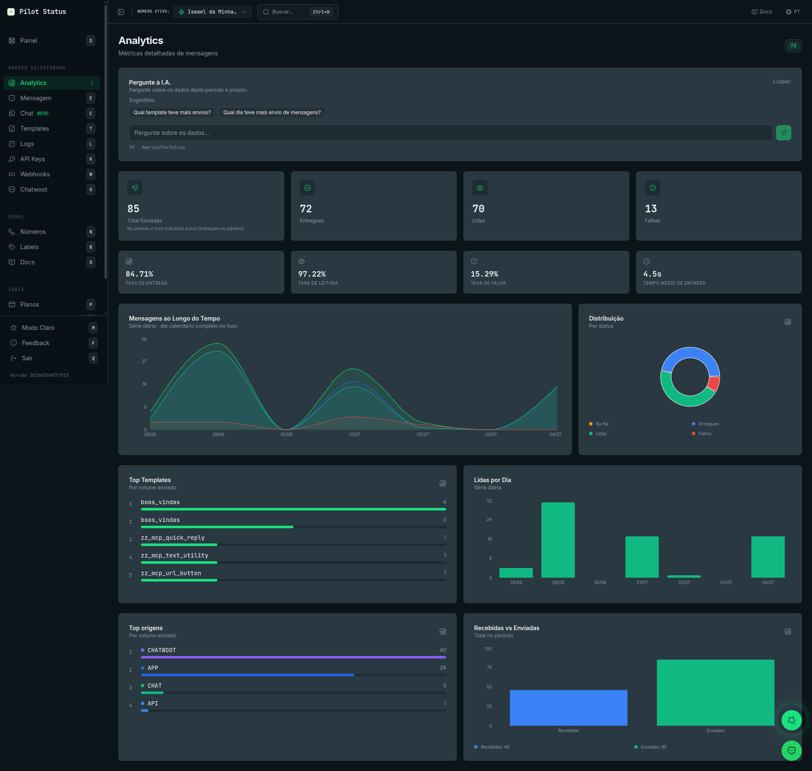

Pilot Status records every message that passes through your numbers and shows that data on two screens: **Logs**, a searchable history of individual messages and calls, and **Analytics**, aggregate metrics for a period. Both screens show the number chosen in the header's number selector, not the whole workspace.

## Logs

**Logs** (`/logs`) is where you check what happened to a specific message: whether it was delivered, why it failed, what exactly was sent, and to whom. You can also resend failed messages and cancel scheduled sends from here.

Open it from the sidebar: **Logs**, in the **Selected Number** group (keyboard shortcut: `L`). The page title is **Logs**, with the subtitle **Message delivery history**.

<Frame caption="The Logs page — stat cards (total, scheduled, delivered, read, failures, canceled, calls), filters, and the message table.">
  
</Frame>

### Who can do what

| Action | Owner | Admin | Agent | Analyst |
| --- | --- | --- | --- | --- |
| Open **Logs**, filter, open **Log Details** | Yes | Yes | Yes | No |
| **Cancel schedule(s)** | Yes | Yes | Yes | No |
| **Resend**, **Resend message(s)**, pick a **Send number** | Yes | Yes | No | No |

The permissions behind it: `logs:read:content` opens the screen, `messages:cancel_scheduled` cancels scheduled sends, and `messages:resend` resends. Analyst cannot open Logs because every row carries message content and the contact's phone. A member restricted to some numbers sees only those numbers. See [Roles and permissions](/concepts/roles-and-permissions).

### Stat cards

Seven cards sit at the top of the page:

| Card | What it counts |
| --- | --- |
| **Total** | Every record that matches the current search, status, template and date filters, on the server. Shows `…` while the count is still loading. |
| **Scheduled** | Messages still waiting for a future send time. |
| **Delivered** | Messages with status Sent, Delivered, Read or Played. |
| **Read** | Messages with status Read or Played. |
| **Failures** | Messages with status Failed. |
| **Canceled** | Messages whose scheduled send was canceled. |
| **Calls** | Call records (calls are not counted in the message cards). |

<Note>
  Only **Total** is counted on the server. The other six cards count the rows already loaded on the screen (50 per page), not the full history. To include older rows, click **Load more logs** at the bottom of the table, or narrow the date range. The cards follow the search, status, template and date filters, but not the direction, origin, window or error-code filters, which only hide rows in the table.
</Note>

Below the cards, an info box reminds you that the **Read** status only arrives when the recipient has read receipts turned on in WhatsApp.

The **Refresh** button in the top right reloads the list. The list also refreshes on its own every few seconds while you are on the first pages.

### Search and filters

The search box (**Search by number, destination or template...**) accepts a phone number in any format (`+55 (11) 99999-9999` works) or a template name.

The filter bar has:

| Filter | Options |
| --- | --- |
| Status | **All**, **Scheduled**, **Queued**, **Sent**, **Delivered**, **Read**, **Played**, **Failed**, **Canceled**, **Preview**, **Calls** |
| Direction | **All**, **Sent**, **Received** |
| **Origin** | **All**, **API**, **MCP**, **Chat**, **Chatwoot**, **Dashboard**, **System**, **App**, **Meta layer** |
| **Window** | **All**, **Open**, **Closed** — the 24h service window at send time |
| **Filter by template** | **All templates** or one template |
| **Filter by error code** | **All codes**, **With error (any)**, or one code from the [Log error codes](/api/messages/log-error-codes) list |
| Date range | **From** and **To**, each with a date, **Hour** and **Minute**. **Yesterday (full day)** and **Today (full day)** fill both sides. **Clear range** empties them. |

Setting only **From** filters up to now. Setting only **To** filters everything before it. If **From** is after **To**, the screen says **Invalid range: From must be before To.** and ignores the range. **Clear filters** resets everything at once.

<Note>
  The search, status, template and date filters run on the server. The direction, origin, window and error-code filters — and the **Calls** option of the status filter — run on the rows already loaded. If they hide everything, the table says **No loaded logs match the error code filter.** — load more rows or narrow the date range first.
</Note>

<Note>
  The **status** and **template** filters show only messages that had a send request. Outbound messages that did not go through Pilot Status's own sending — origin **App**, **Meta layer**, and Chatwoot replies from a native WhatsApp Cloud inbox — never match them. Clear those filters to see them.
</Note>

### Table columns

| Column | What it shows |
| --- | --- |
| Checkbox | Only on scheduled and failed messages, to select them for a batch action. The header checkbox selects all visible scheduled and failed rows, respecting the filters. |
| **Timestamp** | Date and time of the record. |
| **Direction** | **Sent**, **Received**, or **Outbound** (an outbound message that has not been confirmed as sent, for example a failed one). |
| **Origin** | Where an outbound message came from (API, MCP, Chat, Chatwoot, Dashboard, App, Meta layer). Empty for received messages. |
| **Number** | Your number's name and phone. Click it to open **Numbers**. |
| **Destination** | The other side of the conversation. |
| **Template** | The template name (click it to open the template), its category badge (**Marketing**, **Utility**, **OTP**) and the 24h window badge. |
| **Status** | The current status (see the table below). |
| **Error code** | The error code of a failed message. Hover it for the explanation. |

Call rows show **Incoming call** or **Outgoing call**, the call status (**Initiated**, **Ringing**, **Accepted**, **Completed**, **Rejected**, **Failed**, **Missed**) and the duration. Call rows do not open a details modal. See [Calls](/api/calls/overview).

The table loads 50 rows at a time. **Load more logs** loads the next page. After 10,000 rows the screen stops and says **This is the paging limit, not the end of the history.** Narrow the date range to reach older records.

If the number's privacy mode is relay-only, the screen says **Messages are not stored for this number (relay-only mode).** and the table stays empty. See [Data retention & PII modes](/trust/data-retention).

### Message statuses

| Status | Meaning |
| --- | --- |
| Scheduled | Waiting for a future send time (`deliverAt`). You can cancel it. |
| Queued | In the queue, waiting to be sent. |
| Sent | Accepted by WhatsApp. |
| Delivered | Arrived on the recipient's device. |
| Read | The recipient opened it (only with read receipts on). |
| Played | The recipient listened to the audio message. |
| Failed | Not delivered. Open the row to see the error code and details. |
| Canceled | A scheduled send that was canceled. |
| Preview | A template test send. |

### The 24h service-window badge

Outbound rows also carry a **service-window badge**: **24h open** means the recipient had messaged your number within the previous 24 hours, so the send was treated as a **reply** and dispatched immediately; **24h closed** means it was a **cold send** (first contact, or the conversation window had expired). Cold sends are intentionally spaced out by the anti-block engine on web-connected numbers, and on official (Meta) numbers they require an approved template. If a message seems to sit in the queue, check this badge first — a _closed_ window explains the pacing. Filter by it with **Window**. Rows sent before this feature was introduced show no badge.

### Log Details

Click a message row to open the **Log Details** modal.

<Frame caption="Click any row to open Log Details — number, destination, template, status, webhook, message ID, the rendered message, and Resend.">
  
</Frame>

It shows:

- **Number** — the number that sent or received the message.
- **Send number** — only if you can resend: pick another of your numbers to resend from, or leave **Use original number**.
- The direction and origin chips. Messages typed on the phone itself show **Sent from app**.
- **Destination** (or **Sender** for a received message). On a redacted row it reads **content unavailable**.
- **Template** — click it to open the template. A Marketing template sent with the AI rewrite shows **AI rewrite enabled**.
- **Status**.
- **Timestamp** — for a scheduled message, **Recorded at** (when the send was requested), plus **Send scheduled for** and **Expires at** (`deliverUntil`).
- **Webhook** — the HTTP status of the webhook delivery for this message, or why there is none: **no webhook**, **delivery not matched** (a delivery could not be tied to this row — it does not mean it failed), **outside the retention window**.
- **Message ID** — with a copy button. It links this row to webhook events and API responses.
- The **send variables** — every variable value used in the send, each with **Copy value**.
- **Error code** — for a failed message: the code, its explanation, the provider's own error message, and **Code meanings**, which opens the [Log error codes](/api/messages/log-error-codes) page.
- **Message** — the message rendered as WhatsApp shows it: header, media, body, footer, buttons and lists. When the AI anti-spam rewrite changed the text, you see **Sent (AI rewrite)** or **Result (AI)** next to the **Original**.

#### WhatsApp Flow answers

When the row is a submitted WhatsApp Flow form, the **Message** section adds the button label the customer tapped, **Response sent**, the **Answers by screen** (every field the customer filled in, per screen) and the **Attachments** uploaded in the form, each with its state (**Available**, **Transferring**, **Failed**) and **Open attachment**.

When the rendered message has a Flow button, click it to open **Form preview**, with **Open in a new tab**. Opening a preview always generates a fresh link, which expires any preview link opened before.

### Resend a failed message

In **Log Details**, click **Resend** and confirm **Do you want to resend this message?**. The screen says **Message added to the resend queue**. To resend from another number, pick it in **Send number** first. In **Log Details** the **Resend** button is offered on any message that has a message ID, whatever its status — use it on failed messages unless you really want the recipient to get the message again.

To resend several at once, tick the failed rows and click **Resend message(s)** in the bar that appears, then confirm (_"Resend N failed message(s)?"_). The bulk bar only resends rows with status Failed. The screen then says how many were added to the resend queue and how many could not be resent.

A resend reuses the **same log row**: its status goes back to **Queued**, the previous error and sent/delivered times are cleared, and the message is sent again from the original request. It is refused when the number's data retention already removed the message content (_"Cannot resend: the content of this message was removed by the number's data retention policy. Send a new message instead."_), and when the message is a WhatsApp Flow template and the chosen number is not an official (Meta) number.

Agents can tick failed rows, but the bar shows _"Resending is an Admin or Owner action."_ instead of the button, and **Log Details** shows neither **Resend** nor **Send number** to them.

### Cancel scheduled sends

Tick the scheduled rows and click **Cancel schedule(s)**, then confirm (_"Cancel scheduling for N message(s)?"_). The screen tells you how many were canceled and how many could not be. Only messages still waiting for a future send time can be canceled. If you mix scheduled and failed rows, the bar asks you to select only messages of the same type.

### Do it via API / MCP

| Dashboard action | API (`/v1`) | MCP tool |
| --- | --- | --- |
| List and filter the log | [`GET /v1/messages`](/api/messages/list) | `messages_list` |
| One message's status and details | [`GET /v1/messages/{messageId}`](/api/messages/status) | `message_get` |
| Conversation history with a contact | [`GET /v1/messages/history`](/api/messages/history) | `messages_history` |
| **Resend** | [`POST /v1/messages/{id}/resend`](/api/messages/resend) | None — API only |
| **Cancel schedule(s)** | [`DELETE /v1/messages/cancel`](/api/messages/cancel) | `messages_cancel` |
| WhatsApp Flow answers | [`GET /v1/flows/{id}/responses`](/api/flows) | `flows_responses_list` |
| Stat cards, **Form preview** | — | Dashboard only |

Error codes are listed in [Log error codes](/api/messages/log-error-codes).

## Analytics

**Analytics** (`/analytics`) shows how the selected number's messages performed over a period: how many were sent, delivered, read and failed, and which templates and origins sent the most.

Open it from the sidebar: **Analytics**, in the **Selected Number** group (keyboard shortcut: `Y`). The subtitle is **Detailed message metrics**.

<Frame caption="The Analytics page — delivery/read/failure KPIs, a message timeline, top templates and top origins.">
  
</Frame>

### Period

The period selector in the top right offers only **7d** (the last 7 days). Days are counted in your browser's timezone, shown next to the period in the **Ask AI** panel. The API also accepts `30d` and `90d`.

### KPIs

| Card | Meaning |
| --- | --- |
| **Total Sent** | Every send attempt in the period: delivered, failed and still queued. |
| **Delivered** | Messages that reached WhatsApp: status Sent, Delivered or Read. |
| **Read** | Messages with status Read. |
| **Failures** | Messages that failed. |
| **Delivery Rate** | Delivered as a share of sent, in %. |
| **Read Rate** | Read as a share of delivered, in %. |
| **Failure Rate** | Failed as a share of sent, in %. |
| **Avg Delivery Time** | Average time from send to delivery. |

### Charts

- **Messages Over Time** — a daily series (full calendar days in your timezone) with Total, Delivered, Read and Failures.
- **Distribution** — the share of messages by status: Queued, Delivered, Read, Failed.
- **Top Templates** — templates ranked by sent volume.
- **Read per Day** — read messages per day.
- **Top origins** — where sends came from (API, MCP, Chat, Chatwoot, Dashboard…), by sent volume.
- **Received vs Sent** — total received and total sent in the period.

### Ask AI

The **Ask AI** panel answers questions about the period's data in plain language (**Ask about this period and project data.**). Type in **Ask about the data...** or click one of the **Suggestions**, such as **Which template had the most sends?**. **Clear** empties the conversation.

### Who can see it

Every role — **Owner**, **Admin**, **Agent** and **Analyst** — can open Analytics and use **Ask AI** (permission `analytics:read`). A member restricted to some numbers sees only those numbers.

### Do it via API / MCP

The KPIs and daily series come from [`GET /v1/analytics/dashboard`](/api/analytics) (MCP tool `analytics_dashboard`), scoped to the API key's number, with `period` set to `7d`, `30d` or `90d`. **Ask AI** is dashboard only.

## Data retention

How long log records are kept, and whether message content is stored at all, depends on the number's PII mode. See [Data retention & PII modes](/trust/data-retention).
