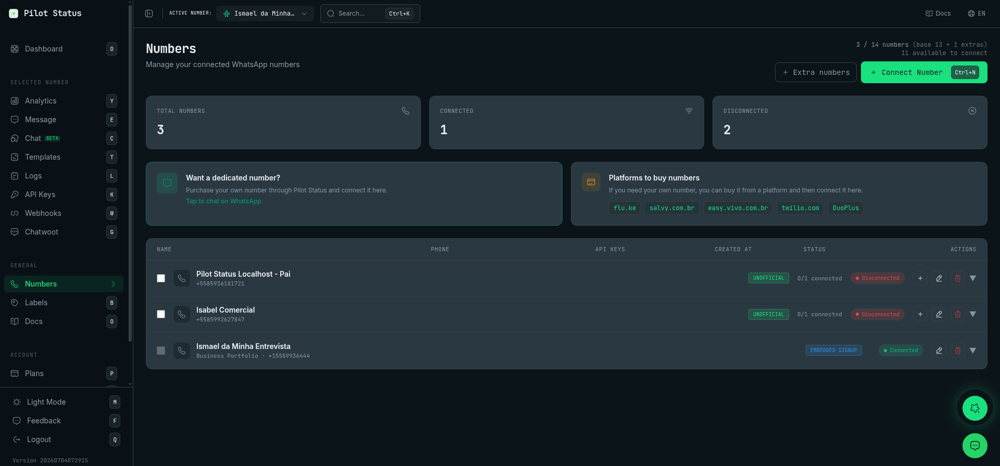
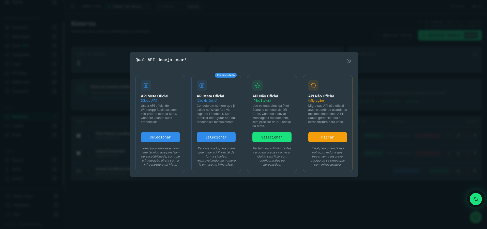
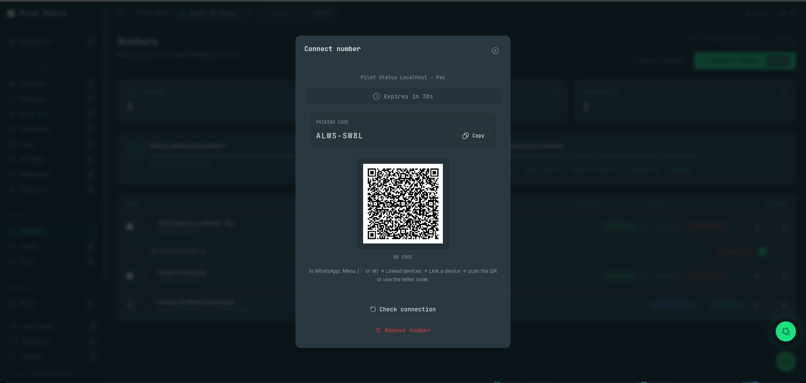
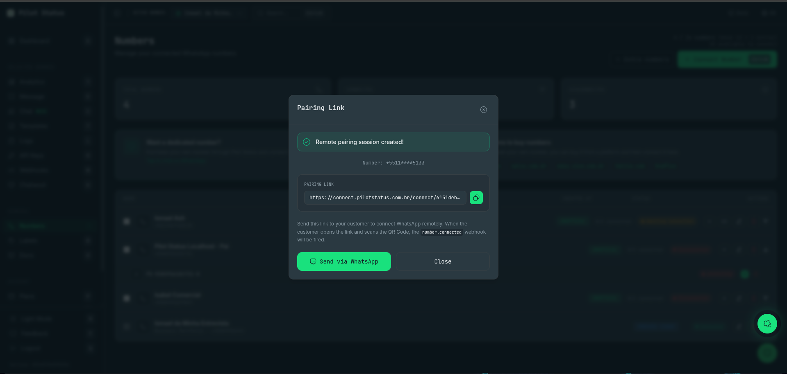

**Numbers** is where every WhatsApp number of the workspace lives: you connect new ones, watch their health, copy the IDs and webhook values Meta asks for, and remove them. It is reached from the sidebar item **Numbers** (shortcut `n`), at the path `/numbers`.

<Frame caption="The Numbers screen — one row per number, with status, API keys and actions.">
  
</Frame>

## Who can do what

Every role can **open** the screen and see the numbers (`numbers:read` is granted to everyone, Analyst included). What a role can **change** is narrower — buttons a role cannot use are not shown at all.

| Action | Owner | Admin | Agent | Analyst |
|---|:-:|:-:|:-:|:-:|
| See numbers, status, Meta details, groups and newsletter IDs | ✓ | ✓ | ✓ | ✓ |
| **Connect Number**, **Add connection**, **Reconnect**, **Reconnect with Meta**, new pairing link, **I already connected, sync**, **Sync history**, **Resume sending** | ✓ | ✓ | | |
| **Edit name**, **Refresh** (Meta data), **Register on the Cloud API** | ✓ | ✓ | | |
| **Enable calling** | ✓ | ✓ | | |
| **Delete number** / **Remove connection**, see **Recently deleted** and **Restore** | ✓ | ✓ | | |
| **Delete permanently** (purge) | ✓ | | | |
| Copy the Meta **Verify Token** from the number's card | ✓ | | | |
| **Extra numbers**, **Add extra number**, **Pay now** | ✓ | | | |

An Agent or Analyst limited to specific numbers sees only those numbers — see [Members](/dashboard/members).

## What you see

**Header.** The title **Numbers** — *"Manage your connected WhatsApp numbers"* — and a usage line that depends on the plan:

- fixed plans: `used / limit numbers`, with `(base N + M extras)` when you have extra numbers, and how many are **available to connect**;
- **On Demand**: also the price per number/month;
- **Pay As You Go**: `N billable number(s)` and the price per number/month. This is a **billing** count — every number on the account, connected or not (unfinished pairings excluded).

**Summary cards.** **Total Numbers**, **Connected** and **Disconnected**. Blocked numbers and unfinished pairings count in neither of the last two: they are named under the total instead (for example *2 blocked · 1 awaiting connection*).

**Phone lines card.** For Owners and Admins, a shortcut to [Phone lines](/dashboard/phone-lines).

**Number list.** The header reads **Name · Phone · Created at**, **Status** and **Actions**. Each row shows the number's name and phone (numbers connected with Facebook show *Business Portfolio · &lt;phone&gt;*) followed by **Created at** and the date the number was added, a connection-type tag — **EMBEDDED SIGNUP**, **CLOUD API**, **MIGRATION** or **UNOFFICIAL** —, for unofficial numbers how many of its connections are up (*1/2 connected*), the badges below, the status pill and the action icons (**Add connection**, **Generate new link**, **Edit name**, **Delete number**, depending on the number and your role). Clicking a row expands it. With no number yet, the list reads *No connected number*.

### Status badges on a row

| Badge | Meaning |
|---|---|
| **Connected** / **Disconnected** | Connection state. |
| **Awaiting connection** | A pairing (QR, remote link or Meta signup) that was never completed. Tooltip: *"Connection not completed yet: it is not billed and is removed automatically after 24h. Generate a new link to try again."* |
| **Blocked** / **Send blocked** | Meta restricted or banned the number, or every connection dropped; the send queue is paused. |
| **Shadowban** | Web sending is blocked and the queue is **paused**. The number still works from the phone app. Lower volume, wait a few hours, then **Resume sending**. |
| **Degraded** | Sending works but with problems. |
| **Not registered on the Cloud API** | Meta numbers whose registration failed — use **Register on the Cloud API** in the expanded row. |
| **Receiving stalled** | The number still sends, but inbound messages are held upstream and should arrive in a batch. |
| **Connection lost** | Pilot Status lost access to the number on Meta (app removed from the Business Manager or WABA deleted). If access was removed, click **Reconnect with Meta** — the same number comes back with the same API keys and webhooks. |
| **Payment pending** / **Beyond the plan** | Sending is blocked because the extra-number charge failed, or the number is beyond the Free plan's single number. The expanded row shows the date it will be disconnected and the **Pay now** / **Add extra number** button (Owner only). |
| **Meta payment pending** | *Meta has blocked the templates of this WhatsApp Business account because of a payment problem. Sending through Pilot Status has not been paused.* |
| **History not imported** | WhatsApp sent the chat history while history import was off (it was discarded), or Meta refused to send it. Meta sends history only once. |

When Meta reports a policy violation, the expanded row shows **Reason given by Meta** with the violation, restrictions and the date.

### The expanded row

**Unofficial numbers** list each **connection** (instance) with its state and, when connected, two buttons:

- **Groups** — opens **WhatsApp groups**: every group with its **ID** and a **Copy group ID** button, filterable by name. This is how you get the `groupId` for [sending to groups](/api/groups).
- **Newsletters** — opens **WhatsApp newsletters**: channels and their IDs (**Copy newsletter ID**). *"Cached list (up to 1h)."* See [Channels (newsletters)](/api/newsletters).

…plus **Reconnect** (new QR) and **Delete** (remove that connection).

When an unofficial number cannot send, a red strip in the expanded row explains why — a shadowban, every connection down (*"Reconnect the number and click Resume sending — the waiting messages go out right after."*) or another block — with the **Resume sending** button. This strip and the button exist only for unofficial numbers.

**Meta numbers** show:

- a **Webhook Configured** / **Webhook Pending** badge, the webhook **URL:** with a copy button, and **Verify Token:** — the **Owner** gets a copy button; everyone else reads *"Only the workspace owner can view it"*. This block appears for numbers connected **by credentials** (Cloud API), because those are the ones where you paste the webhook into your own Meta app.
- **Phone Number**, **Phone ID**, **WABA ID** and **Business Account ID**, each with a copy button.
- **Sync history** (Coexistence numbers only) — *"Imports this number's earlier messages."*
- a WhatsApp-style preview of the business profile.
- **Meta details** — a snapshot read from Meta (fetched automatically when you expand a row that has none yet; **Updated:** shows when it was taken). It holds:
  - badges for **Quality** (green, yellow or red), **Tier** — the number's own messaging limit, `—` when Meta gives the number none — plus a **Portfolio** tier when the Business Portfolio's limit differs (*"Business Portfolio messaging limit, not this number's. Meta requires the NUMBER's own limit to be 2K/24h before calling can be enabled."*), **Calling** (**Enabled**/**Disabled**), throughput, the Meta status (`CONNECTED`…), platform and account mode;
  - **Number:** verification status, **Name:** — the display-name status at Meta — and **New name:** when a name change is under review. Only `APPROVED` is green; `AVAILABLE_WITHOUT_REVIEW`, `PENDING_REVIEW` and `PENDING` are amber (the name is not approved yet). **Official** and **PIN** badges appear when they apply;
  - **Onboarded at**, **Business profile** (About, Description, Email, Address, Vertical, Websites) and **WhatsApp Business Account (WABA)** (Name, Currency, Timezone, Country, Account review, Business verification, Ownership, Template namespace, Owner business);
  - a red **Unable to send** or amber **Degraded sending** strip with the reason, or **Not registered on the Cloud API**, when that is the number's health;
  - *"Some data could not be loaded (token missing permission or expired)."* when part of the snapshot failed.

  Buttons: **Refresh** (Owner and Admin) reloads the snapshot; **Enable calling** (Owner and Admin) appears while calling is not enabled; **Register on the Cloud API** (Owner and Admin) appears only when the number needs it — its registration failed, Meta shows it as not verified, or Meta reports it disconnected.

<Note>
  **Coexistence numbers cannot enable calling or be registered on the Cloud API** — Meta refuses it while the number still lives in the WhatsApp Business app. Messaging keeps working. The panel says so in the row, in amber: *"This number is in coexistence with the WhatsApp Business app (confirmed by Meta)…"*, or *"This number is likely in coexistence…"* when Meta has not confirmed it.
</Note>

## Connecting a number

Click **Connect Number** (shortcut `N`). The first dialog, **Which API do you want to use?**, offers four cards — one may carry a **Recommended** tag:

<Frame caption="Which API do you want to use? — the four connection cards.">
  
</Frame>

| Card | What it does |
|---|---|
| **Official Meta API** (Cloud API) | Your own Meta app, connected with credentials. |
| **Official Meta API** (Coexistence) | Connect a number already on WhatsApp via Facebook login — no app or credentials. |
| **Unofficial API** (Pilot Status) | Pilot Status endpoints, connected by QR code. |
| **Unofficial API** (Migration) — button **Migrate** | Move an instance from another provider and keep your code. |

If your plan has no free slot, **Number limit reached** opens instead: it shows how many numbers you use and offers **Upgrade** (to [Plans](/dashboard/plans), for roles that can see billing) and **Buy extra number** / **Add extra number** (Owner).

On **Pay As You Go**, every connect form shows the estimated monthly cost and *"This number will be charged (Pay As You Go) after connecting"*, prorated to the rest of the cycle.

### Unofficial API — QR code or remote link

1. **Pairing mode**: **Direct (QR Code)** — *"Scan the QR Code on your phone to connect"* — or **Remote (Link)** — *"Generate a link to send to your customer to connect remotely"*.
2. **Connect number** form: **Name** (e.g. *Main Support*), **Number**, and the checkbox **Bring this device's previous conversations** — *"Imports up to 30 days of conversation at the moment the number connects. On by default. ⚠️ The choice is now: WhatsApp hands that history over once, right after the connection, and there is no way to ask for it again."* Then **Generate QR Code**.
3. **Direct**: the QR dialog shows the **QR code**, a countdown (*"Expires in N s"*) and the letter **Pairing code** with **Copy**. In WhatsApp: *Menu → Linked devices → Link a device*, then scan or type the code. Buttons: **Generate new QR Code**, **Try fetching QR again**, **Check connection**, **Remove number**.

<Frame caption="Connect number — QR code and letter pairing code.">
  
</Frame>

4. **Remote**: the **Pairing Link** dialog — *"Remote pairing session created!"* — shows the masked number and the link with **Copy link** and **Send via WhatsApp**. When your customer opens it and scans the QR code, the `number.connected` webhook fires. What the customer sees is described in [Connect page](/dashboard/connect-page).

<Frame caption="The Pairing Link dialog for remote pairing.">
  
</Frame>

An unfinished remote pairing stays **Awaiting connection** (not billed, removed after 24h); the row's link button (**Generate new link**) issues a fresh one.

### Official Meta API (Cloud API) — by credentials

1. **How do you want to connect?** — **Connect now** (*"Set up this number right now"*) or **Remote (Link)** (send your customer a link). The link opens the credentials form of the [Connect page](/dashboard/connect-page), which adds a checkbox to route the WABA's webhooks to Pilot Status automatically.
2. **Connect now** opens the form with **Name**, **Phone Number ID**, **WABA ID**, **System Token**, **App Secret** and **App ID** (all required; the phone number itself is read from Meta with the Phone Number ID and the System Token — if that fails: *"Could not resolve the number from the Phone Number ID. Check the ID and System Token."*). Click **Connect Meta**. This dashboard form has no routing checkbox: you always configure the webhook yourself.
3. **Meta Number Created!** — *"Configure the webhook in Meta Business Dashboard:"* — shows two values with copy buttons:
   - **Callback URL** — the URL to paste in your Meta app;
   - **Verify Token** — the token Meta sends back to verify that URL.

   The dialog then lists the steps: 1. *Open the Meta App Dashboard* · 2. *WhatsApp → Configuration → Webhook* · 3. *Paste the Callback URL and Verify token above and click “Verify and save”* · 4. *Subscribe to the fields:* `messages`, `message_template_status_update`. Click **Done**.

<Warning>
  The **Verify Token** is not lost when you close this dialog: the **Owner** copies it again from the number's expanded row (**Verify Token:** → copy). Admins, Agents and Analysts see *"Only the workspace owner can view it"*. You never need support for it. Over the API it is returned only once, in `webhook.verifyToken` of [`POST /v1/numbers/meta`](/api/numbers/create).
</Warning>

### Official Meta API (Coexistence) — Connect with Facebook

Choose **Connect now** or **Remote (Link)**. **Connect now** shows **Connect with Facebook**: Meta's Embedded Signup opens in a Facebook window, you pick or create the WABA and the number, and the number appears connected (*"Number connected!"*). No credentials and no webhook to paste — Pilot Status subscribes the webhook for you.

If the Facebook window closed before the dashboard noticed, the row stays **Awaiting connection** with the button **I already connected, sync** — *"If you already finished connecting in the Facebook window, sync to activate the number here."*

### Migration from another provider

**Migrate instance** — *"Enter the instance name and token you used in your previous provider."* Fields: **Source provider** (**Evolution GO** or **Evolution V2**), **Name**, the phone number, **Old instance name**, **Instance ID (UUID)** and **Old instance token**. Click **Migrate and connect**; a QR code follows. The dialog reminds you: *"After creation, point your base URL to `https://pilotstatus.com.br/api/layer/<provider>/` and your code will keep working."* — see the [API Layer](/api/layer/overview).

## Other actions on a row

- **Add connection** (unofficial) — a second device/connection for the same number; same QR dialog.
- **Edit name** — dialog **Edit number name** with **Name**. For migrated numbers it also shows **Instance Name**, **Instance ID (UUID)** and **Instance Token** (the old provider's values used by the API Layer).
- **Reconnect** — new QR for an unofficial connection; **Reconnect with Meta** for a Meta number that lost access.
- **Resume sending** (unofficial numbers) — after a disconnection or shadowban paused the queue; the waiting messages go out right after. Toast: *"Sending resumed. Start slowly and watch for failures."*
- **Two-step verification PIN** — opens when **Register on the Cloud API** fails because the number already has a PIN you set. Field **6-digit PIN** (*"not the code received by SMS"*), button **Register with this PIN**. Several wrong PINs make Meta block attempts for a while. Don't know it? Turn off two-step verification in WhatsApp Manager and register again. The PIN is sent once and not stored.

## Extra numbers (Owner)

- **Extra numbers** (fixed paid plans) — a stepper for recurring extra numbers: *"Increasing charges a prorated amount immediately; reducing is not refunded."* Shows the **Total limit**; **Save**.
- **Add extra number** (Free and On Demand) — a **Quantity** stepper, then the price per number, **Charged now (prorated)**, **Then, monthly**, and **How to charge**: **Credits (wallet)** (with balance; a saved card covers the rest) or **Card**; without either you are sent to checkout. **Confirm purchase**. If you already have paid empty slots, it warns that the purchase opens another slot.
- **Pay now** — on a number with **Payment pending**: charges the wallet or saved card right away and releases sending.

Pay As You Go has no extra-number purchase: each connection pays its own prorated charge.

## Deleting, restoring and purging

### Delete number

The trash icon on a row (Owner and Admin) opens **Delete Number** — *"Are you sure you want to delete the number &lt;name&gt; (&lt;phone&gt;)"* — or, for a Meta number, **Remove Meta Number**. In both you must **type the line's phone number** (*"Type this line's phone number to confirm."*); the button (**Delete** / **Confirm Removal**) stays disabled until the digits match, and the server checks the typed number again.

When you have paid extra numbers (fixed plans and On Demand), the dialog adds: *"This does not reduce your paid capacity: the slot stays free to reconnect another number this cycle. To lower capacity, use the General tab in Plans — the new value only applies next cycle."*

What confirming does, for every kind of number:

- every connection of the number is logged out and removed right away (an unofficial device is unlinked from the phone);
- the number leaves the list and the billable count, its API keys stop working on the next request, and an unpaid extra-number charge on it is dropped;
- `number.removed` is sent to the webhooks subscribed to that number;
- the number goes to **Recently deleted**, with its history, templates, webhooks and API keys kept for 30 days.

#### Remove Meta Number

The Meta dialog says what the removal really does: *"The number goes to Recently deleted and can be restored for 30 days. Nothing changes at Meta now: the number stays registered on WhatsApp Business. Only on permanent deletion (manual, or automatic after the 30 days), and only for numbers connected through Facebook, is the app's access revoked, the WABA webhook subscription cancelled and the number deregistered. Confirm removal of &lt;name&gt; (&lt;phone&gt;)"*.

In detail: while the number sits in **Recently deleted**, nothing is changed at Meta, which is what lets **Restore** bring it back. The Meta steps run only when the number is deleted for good — **Delete permanently**, or automatically after the 30 days — and only for a number connected **with Facebook** (Embedded Signup): Pilot Status deregisters the number from the Cloud API and, when no other live number uses the same WABA, also unsubscribes the WABA from its webhooks and revokes the app's access. These calls are best-effort. For a number connected **with your own credentials** (Cloud API), nothing is changed at Meta at any point: the webhook and the registration stay in your Meta app until you remove them there.

On a narrow (phone-width) screen, the row's trash icon is shown for every number — Meta numbers and numbers with more than one connection included — and opens the same dialog.

### Recently deleted

Owner and Admin see the **Recently deleted** block at the bottom of the screen — *"Recoverable for 30 days. After that the deletion is permanent — and the number becomes connectable by any account."* Each entry shows the days left (*purge imminent* on the last day) and:

- **Restore** — asks first. **Restore number?** shows the number, says it comes back **DISCONNECTED** and what restoring may cost: at the number limit, *"Your account is at its number limit (N of N). If this number had been connected before, restoring it is charged now as an extra number — from credits first, then the card"* (with the per-number monthly price on On Demand and Pay As You Go); with room, that it takes one of the free slots with no extra charge; if the plan could not be loaded, that it **may** be charged. **Restore** confirms, **Cancel** does nothing. Restoring brings the number back (with its history, templates, webhooks and API keys) **disconnected**: you reconnect it from scratch (new QR or Meta re-provisioning), and `number.restored` is sent. If the workspace is already at its number limit, restoring a number that had connected before **buys an extra number** for it, charged to the wallet or saved card. Refusals: *"The 30-day window has expired: this number can no longer be restored."*, *"This number has already been reconnected elsewhere and cannot be restored."*, *"Restoring this number goes past your plan's limit, and the extra number could not be charged. Add credits or a card and try again."* and *"The extra number's payment did not go through, and the number was NOT restored. Check your statement before trying again."*
- **Delete permanently** (Owner) — dialog **Delete permanently**: *"There is no undo. Confirm the permanent deletion of &lt;number&gt;"*. It first counts what will go — *"This deletes the number and its whole history forever: N conversations and N messages."* — then, under **Also deleted:**, send log entries, call records, message templates, webhooks set up only for this number, API keys of this number, the Chatwoot integration, and *"the number registration on the official Meta API"* (listed only when the Meta deregistration will actually run). It suggests the alternatives (**Restore**, or simply leave it to be deleted automatically). If the count fails, it says to assume everything will be deleted. You type the number to confirm.

### Remove connection

**Remove connection** (the trash icon on one connection of an unofficial number) — *"This logs the device out and deletes this connection of &lt;connection&gt;"* — with the note *"Unlike deleting the number: the connection does NOT go to the trash and cannot be restored. The number keeps existing and can be connected again from scratch."* Confirmed by typing the connection's phone number.

## Do it via API / MCP

| Dashboard action | API | MCP tool |
|---|---|---|
| List / see a number (status, Meta details, `?refresh=1` = Refresh Meta data) | [`GET /v1/numbers`, `GET /v1/numbers/{id}`](/api/numbers/list) | `numbers_list`, `numbers_get` |
| Connection status | [`GET /v1/numbers/{id}/status`](/api/numbers/status) | `numbers_status` |
| Connect unofficial (QR) | [`POST /v1/numbers`](/api/numbers/create) | `numbers_create` |
| New QR / reconnect | [`GET /v1/numbers/{id}/connect`](/api/numbers/create) | `numbers_connect` |
| Remote pairing link (unofficial or Meta) | [`POST /v1/numbers/remote-pairing`](/api/numbers/remote-pairing) | `numbers_remote_pairing` |
| Meta by credentials (returns Callback URL + Verify Token once) | [`POST /v1/numbers/meta`](/api/numbers/create) | — |
| Connect with Facebook (Embedded Signup) | through a remote pairing link with `metaFlow` | `numbers_remote_pairing` |
| Migration | [API Layer](/api/layer/overview) (dashboard creates the instance) | dashboard only |
| Number settings (history, retention, read receipts) | [`PATCH /v1/numbers/{id}`](/api/numbers/settings) | `numbers_settings_update` |
| Logout without deleting | [`POST /v1/numbers/{id}/logout`](/api/numbers/logout) | — |
| Delete / Restore / Delete permanently | [`DELETE /v1/numbers/{id}`, `POST …/restore`, `DELETE …/purge`](/api/numbers/create) | `numbers_delete`, `numbers_restore`, `numbers_purge` |
| Pay now | [`POST /v1/numbers/{id}/pay`](/api/numbers/pay) | `numbers_pay` |
| Extra numbers | [`/v1/subscription/extra-numbers`](/api/extra-numbers) | `subscription_extra_numbers_get`, `subscription_extra_numbers_add`, `subscription_extra_numbers_remove` |
| Enable calling | [`PUT /v1/calls/settings`](/api/calls/endpoints) | `call_enable`, `call_settings_update` |
| Groups list | [`GET /v1/groups`](/api/groups) | `groups_list` |
| Newsletters list | [`GET /v1/newsletters`](/api/newsletters) | `newsletters_list` |
| Edit name, Sync history, Resume sending, Register on the Cloud API (PIN), copy Verify Token later | — | dashboard only |

Lifecycle events (`number.connected`, `number.removed`, `number.restored`…) are described in [Webhook events](/api/webhooks/events).
