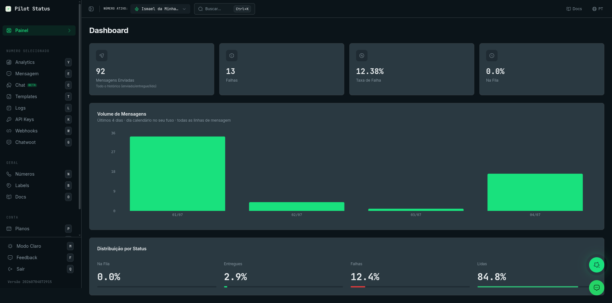
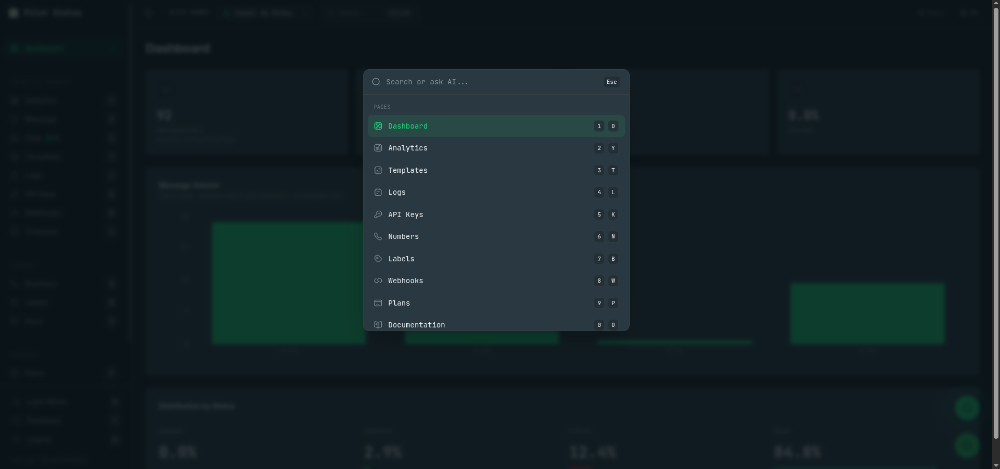

The Pilot Status dashboard is the web app at `https://pilotstatus.com.br/dashboard`. Everything you can do with a WhatsApp number — connect it, send and receive messages, chat live, build templates and Flows, read logs, configure webhooks, and manage keys, members and billing — has a screen in it. This page describes the **home screen** (`/dashboard`) and links to one page per screen.

<Tip>
  Looking for a credential or a value? Webhook signing secrets, API keys, Flow endpoint keys and similar values are shown in the dashboard, on the screen that creates them — not by support. Use the [screen index](#screen-index) below to find the right page.
</Tip>

<Frame caption="The Pilot Status dashboard home — KPIs, message volume, and status distribution.">
  
</Frame>

## How the dashboard is organized

The left sidebar groups screens in this order:

| Group | Screens (sidebar label → path) |
| --- | --- |
| *(top)* | **Dashboard** → `/dashboard` |
| **Selected Number** — act on the number chosen in the header's number selector | **Analytics** → `/analytics`, **Ads** → `/ads`, **Message** → `/messages`, **Chat** → `/chat`, **Flows** → `/flows`, **Templates** → `/templates`, **Logs** → `/logs`, **API Keys** → `/api-keys`, **Webhooks** → `/webhooks`, **Chatwoot** → `/chatwoot` |
| **Workspace** | **Numbers** → `/numbers`, **Phone lines** → `/linhas`, **Labels** → `/labels`, **API Keys** → `/workspace-api-keys`, **Docs** (opens this site) |
| **Account** | **Plans** → `/plans`, **Profile** → `/profile` |

<Note>
  The sidebar has **two entries labeled API Keys**. The one under **Selected Number** (`/api-keys`) holds the number-scoped `ps_` key of the selected number. The one under **Workspace** (`/workspace-api-keys`) holds the workspace keys (the primary key and named keys). Your personal account keys (`ps_account_`) live under **Profile**. See [API Authentication](/api/authentication).
</Note>

The sidebar only shows screens your [role](/concepts/roles-and-permissions) can open. **Flows** is shown only when the selected number is an official (Meta Cloud API) number. **Ads**, **Chat**, **Flows** and **Phone lines** carry a **beta** badge.

### Keyboard shortcuts

Outside a text field, press a single letter to jump to a screen: **D** Dashboard, **Y** Analytics, **S** Ads, **E** Message, **C** Chat, **H** Flows, **T** Templates, **L** Logs, **K** API Keys (number), **W** Webhooks, **G** Chatwoot, **N** Numbers, **I** Phone lines, **B** Labels, **V** API Keys (workspace), **O** Docs, **P** Plans, **U** Profile. **M** toggles light/dark mode, **F** opens feedback and **Q** logs out.

### Command palette

<Frame caption="Ctrl+K opens the command palette — jump to any page by number/letter shortcut or ask the AI.">
  
</Frame>

Press **Ctrl+K** (**⌘K** on macOS) to open the palette (**Search or ask AI...**). Type to filter pages and actions, press **1**–**9** or **0** to pick a result, or — when nothing matches — press **Enter** or click **Ask AI** to get an answer from the documentation. **Copy AI answer** copies the reply.

## The home screen (`/dashboard`)

Click **Dashboard** in the sidebar (or press **D**). It is the screen you land on after logging in — new accounts included: there is no setup wizard you are sent to first. You connect your first number from [Numbers](/dashboard/numbers) whenever you want.

When the workspace has no number yet (or no number is selected in the header), a **No connected numbers** banner appears at the top — *"Connect a WhatsApp number to start sending messages."* For **Owner** and **Admin** it carries an **Add Number** button that opens the connect wizard on [Numbers](/dashboard/numbers); Agents and Analysts see the banner without the button.

Unlike the screens under **Selected Number**, the home screen aggregates **every number in the workspace** (or, for a member restricted to some numbers, only the numbers they were granted). It refreshes on its own and when you return to the tab; values can be up to about a minute old.

### KPI cards

| Card | What it counts |
| --- | --- |
| **Messages Sent** | All-time outbound messages whose status is sent, delivered or read (*All history (sent/delivered/read)*). |
| **Messages Received** | All-time inbound messages, from every provider (*All history (all webhooks)*). |
| **Failures** | All-time outbound messages with status failed. |
| **Failure Rate** | Failures ÷ (sent + failures), with two decimals. |
| **Queued** | The **percentage** of all outbound messages still queued — not a count. |

### Message Volume

A chart of messages per day for the **Last 4 days · calendar day in your timezone · all message rows**. Days are computed in your browser's timezone.

### Distribution by Status

Four percentages of all outbound messages, each with a bar: **Queued**, **Delivered** (sent + delivered together), **Failures** and **Read**.

### Top Numbers

The 5 numbers with the highest all-time volume (**By sent + received volume**), each with its name (or phone number), the ↑ outbound count (every outbound message of the number, whatever its status — failed and queued included) and the ↓ received count. The block is hidden when there is no traffic yet.

### Who can see it

Every role — **Owner**, **Admin**, **Agent** and **Analyst** — can open the home screen (permission `analytics:read`).

### Do it via API / MCP

The home screen's all-time, whole-workspace totals are **dashboard only**. For per-number KPIs and a daily series over 7, 30 or 90 days, use [`GET /v1/analytics/dashboard`](/api/analytics) (MCP tool `analytics_dashboard`), which returns the data behind the [Analytics](/dashboard/logs-analytics) screen for the API key's number.

## Screen index

<CardGroup cols={2}>
  <Card title="Numbers" icon="phone" href="/dashboard/numbers">
    Connect, reconnect, configure and delete WhatsApp numbers; connection status and the connect wizard.
  </Card>
  <Card title="Live Chat" icon="message" href="/dashboard/live-chat">
    WhatsApp inbox: conversations, replies, media, calls, forwarding, contact and group info.
  </Card>
  <Card title="Send messages" icon="paper-plane" href="/dashboard/send-messages">
    The **Message** screen: send an approved template to a list of recipients from a label or a spreadsheet, now or scheduled.
  </Card>
  <Card title="Templates" icon="rectangle-list" href="/dashboard/templates">
    Create, edit, test and submit templates to Meta; sync, insights and the API request sample.
  </Card>
  <Card title="Flows" icon="diagram-project" href="/dashboard/flows">
    WhatsApp Flows: create, publish, preview, traces and the endpoint keys and signing secret.
  </Card>
  <Card title="Logs & Analytics" icon="chart-bar" href="/dashboard/logs-analytics">
    Message history, details, resend, cancel scheduled sends, and per-number analytics.
  </Card>
  <Card title="Labels" icon="tag" href="/dashboard/labels">
    Contacts and labels used for segmentation and bulk sends.
  </Card>
  <Card title="Webhooks" icon="link" href="/dashboard/webhooks">
    Webhook endpoints, events, and the signing secret shown after you create a webhook.
  </Card>
  <Card title="API keys" icon="key" href="/dashboard/api-keys">
    Number keys and workspace keys: view, copy, regenerate.
  </Card>
  <Card title="Chatwoot" icon="headset" href="/dashboard/chatwoot">
    Connect a number to a Chatwoot inbox.
  </Card>
  <Card title="Ads" icon="bullhorn" href="/dashboard/ads">
    Click-to-WhatsApp ads performance.
  </Card>
  <Card title="Connect page" icon="qrcode" href="/dashboard/connect-page">
    The page you share so someone else can connect a number.
  </Card>
  <Card title="Phone lines" icon="phone-volume" href="/dashboard/phone-lines">
    Buy and manage virtual phone lines.
  </Card>
  <Card title="Plans" icon="credit-card" href="/dashboard/plans">
    Subscription, billing and payment method.
  </Card>
  <Card title="Profile" icon="user" href="/dashboard/profile">
    Your profile, account API keys and preferences.
  </Card>
  <Card title="Account access" icon="lock" href="/dashboard/account-access">
    Login, sessions and access to your account.
  </Card>
  <Card title="Members" icon="users" href="/dashboard/members">
    Invite members, assign roles and restrict them to numbers.
  </Card>
</CardGroup>
