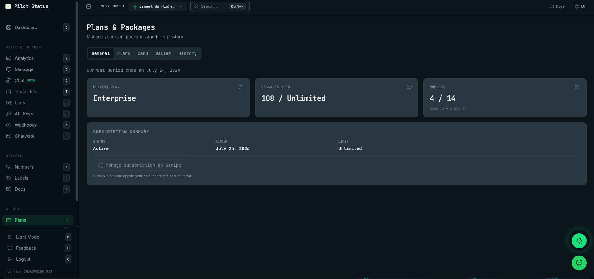
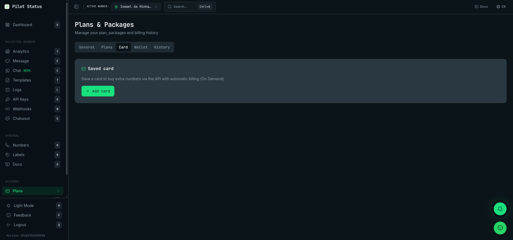
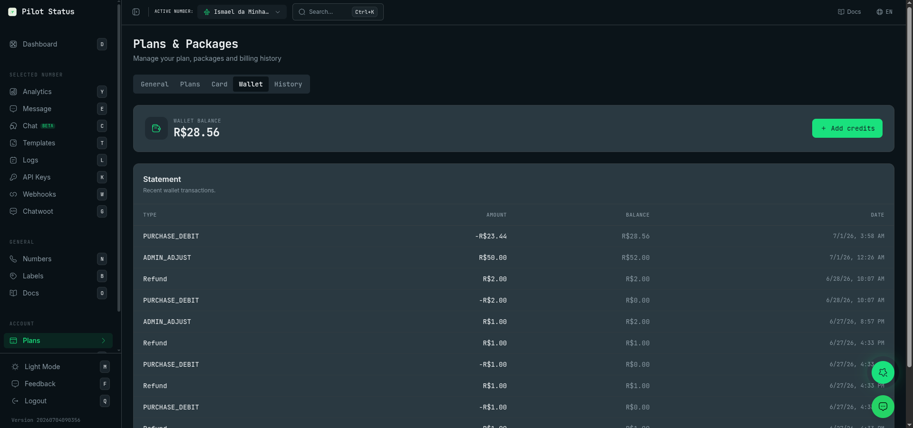

**Plans & Packages** is where a workspace sees and pays for what it uses: the plan, the extra numbers, the prepaid wallet, the saved card, the receipts and the full trail of billing events. Prices and what each plan includes are on [Plans](/plans); this page describes the screen.

## How to get there

- Sidebar: **Plans** (keyboard shortcut: `p`), or **Plans** in the command palette (`Ctrl+K` / `⌘K`).
- Path: `/plans`. Each tab has its own link with `?tab=`: `/plans?tab=general`, `plans`, `card`, `wallet`, `finance`, `history`. A billing notice e-mail can open this screen directly.
- The screen title is **Plans & Packages**, with the subtitle **Manage your plan, packages and billing history**.

## Who sees what

The screen is for **Owner** and **Admin**. Agent and Analyst do not see it: there is no **Plans** item in their sidebar or command palette, and opening `/plans` by link shows **Your role does not include this area** instead.

| Tab | Owner | Admin |
| --- | --- | --- |
| **General** | Everything, including **Cancel Plan** / **Reactivate Plan** | Read only (see the note below) |
| **Plans** | Yes | Hidden |
| **Card** | Yes | Hidden |
| **Wallet** | Balance, statement and **Add credits** | Balance and statement; no **Add credits** |
| **Finance** | Everything; edits **Billing details** | Reads everything; **Billing details** show the CPF/CNPJ and street address masked, with **Only the account owner can change these details.** |
| **History** | Yes | Yes |

Moving money — buying or changing a plan, paying, saving or removing a card, topping up the wallet, cancelling, changing paid capacity, editing billing details — is **Owner only**. A hidden tab stays hidden even when opened by link (`/plans?tab=card` falls back to **General**).

<Note>
  On **General**, an Admin can still see **Manage subscription on Stripe**, **Pay invoice** (in the suspension and overdue notices), **Schedule reduction** and **Cancel reduction**, but those actions are Owner-only on the server and are refused for an Admin. **Manage subscription on Stripe** and **Pay invoice** show the server's refusal (in Portuguese: *Seu papel no workspace não permite esta ação (billing:manage).*); the two reduction buttons show **Failed to schedule the reduction.** and **Failed to cancel the scheduled reduction.** The **Add credits** button of the insufficient-funds notice also shows for an Admin, but it leads to the **Wallet** tab, where an Admin has no **Add credits**. Ask the Owner to do these.
</Note>

<Frame caption="Plans & Packages — the General tab.">
  
</Frame>

## General

### Notices at the top

- **Billing suspended** — sending is paused. The text says why and since when:
  - the subscription charge was declined → **Pay invoice** (opens the Stripe portal);
  - insufficient funds → **Add credits** (goes to the **Wallet** tab) and, when there is no saved card yet, **Add card** — saving a card also settles the open cycle;
  - resuming depends on support → no button, only **Support needed**, and the text asks you to mention the cycle ID it shows.
- **Payment overdue** — the last subscription charge was declined but sending has not stopped yet. It says the date by which to pay the open invoice, with **Pay invoice**.
- **Current period ends on …** — the end of the current billing period.

API sends while billing is suspended return `422 BILLING_SUSPENDED` — see [Plans → Billing modes](/plans#billing-modes).

### Cards

- **Current Plan** — **Free**, **Basic**, **Premium** or **Enterprise**; other plans show their code, such as `ON_DEMAND`, `PAY_AS_YOU_GO` or `CUSTOM`.
- **Messages Used** — messages used / the plan's limit, or **Limit exceeded**.
- **Usage** — Free plan only: the percentage of the message cap, with a bar.
- **Numbers** — numbers connected / numbers allowed, with **base … + … extras** when you have extra numbers. On Pay As You Go: **… billable number(s)**.

### Billing cycle

Paid plans only. Two columns:

- **Current cycle** — start → end dates, **Capacity: … number(s)** (or the billable numbers on Pay As You Go) and, on On Demand, **Current cycle amount**.
- **Next cycle** — dates, **Capacity kept: …** or **Capacity drops from … to … number(s)** and, on On Demand and Pay As You Go, **Next cycle amount**.

Changing paid capacity (any plan with paid extra numbers, except Pay As You Go):

- **Reduce to** [number] **paid no.** → **Schedule reduction**. The new capacity only takes effect, and is only billed, from the next cycle; you keep the current one until then. You cannot go below the numbers you have connected (**You have more connected numbers than that target. Disconnect numbers before reducing.**).
- With a reduction scheduled, **Cancel reduction** keeps the current capacity for the next cycle.
- The tab reminds you: **Your paid capacity is a 30-day entitlement: deleting a number does not reduce it.** On Pay As You Go it says instead: **On Pay As You Go the renewal bills every number that has been connected and has not been deleted, even if it is disconnected now. To pay less, delete the number: disconnecting is not enough.**

Buying extra numbers is not done here: it happens on the **Numbers** screen (the buy dialog) or through the API. See [Extra numbers & On Demand](/api/extra-numbers).

### Subscription Summary

**Status** (**Active**, **Payment overdue** or **Cancelled**), **Renews** (date) and **Limit** (messages).

- **Manage subscription on Stripe** — shown when the plan is paid by card through Stripe, with *View invoices and update your card in Stripe's secure portal.* It takes you to Stripe's secure portal (in the same tab), where you see the Stripe invoices and update the card used by the subscription. Owner only (see the note above).
- **Cancel Plan** (Owner, and only for a plan paid by card through Stripe; a plan paid by Pix or from the wallet has no **Cancel Plan**) — opens the **Cancel Plan** dialog: **Your plan will remain active until the end of the billing period. It will then be migrated to FREE.** and **You can reactivate at any time before the period ends.** Buttons: **Confirm Cancellation** and **Back**. After cancelling, the tab shows **Cancelled — valid until …** and **Reactivate Plan**.

## Plans

Owner only. A **Monthly** / **Annual** switch (annual shows **-20%**), the line **Numbers: … / …**, and one card per plan — **Free**, **Basic**, **Premium** (marked **Popular**) and **Enterprise** — with the price, how many numbers, how many messages and the features. Prices: [Plans](/plans#plan-comparison).

The button on each card depends on your situation:

| Button | When | What happens |
| --- | --- | --- |
| **Current plan** | It is your plan | Nothing (disabled). If your payment is overdue, it reads **Payment overdue** and opens the Stripe portal. |
| **Free plan** | The Free card, when you are on another plan | Nothing (disabled). To go back to Free, use **Cancel Plan** on **General**. |
| **Credit card** / **PIX** | You have no card subscription yet | **Credit card** opens Stripe Checkout. **PIX** opens the **PIX Payment** dialog (only shown when the dashboard is in Portuguese). |
| **Upgrade** / **Downgrade** | You already pay a plan by card (not On Demand: an On Demand subscription sees **Credit card** / **PIX**) | Opens the **Upgrade plan** or **Downgrade plan** dialog. |

- **Upgrade plan** — **The prorated difference is charged now to your card on file and the new plan takes effect immediately.** → **Confirm** / **Back**.
- **Downgrade plan** — **The change takes effect at the end of the current period (…); you keep your current plan until then. No refund.** It also warns: **If you have more connected numbers than the chosen plan allows, disconnect them before continuing.** → **Confirm** / **Back**. The confirmation says **Downgrade scheduled for …**.

### PIX Payment dialog

Shows what you are paying for, the amount, **Expires at** (date and time), the **QR code** and **Copy PIX code** (the Pix copy-and-paste code). After paying in your bank app, click **Check payment**: **Payment confirmed!** or **Payment is still pending.** **Close** dismisses it.

<Warning>
  The Pix code and QR code live only in this dialog. Once you close it, they are not shown again: start the payment again from the plan card to get a new code. A Pix that is not paid by **Expires at** stops working.
</Warning>

A plan paid by Pix renews from the wallet each cycle — see [Billing modes](/plans#billing-modes).

**Need more numbers?** at the bottom has **Talk to our team** (WhatsApp), for more than 13 numbers or a custom plan.

## Card

Owner only. **Saved card** — *Save a card to buy extra numbers via the API with automatic billing (On Demand).* The same card also pays automatic charges when the wallet does not cover them.

- With a card: the **brand** and **•••• last 4 digits**, and **Remove card**. Removal happens at once, with no confirmation dialog. It is refused while the card is needed: **Cancel On Demand before removing the card.** or **Disable auto-recharge before removing the card.**
- Without a card: **Add card** opens a Stripe page to save one; you come back to `/plans` when done.
- **Using the card of workspace … as a backup** — the workspace has no card of its own, but charges fall back to another workspace's card (a reseller's [shared card](/reseller-billing#shared-card)). It shows that card's brand and last 4 digits, read only. **A card of your own takes precedence over the backup card.**

The full card number is never shown anywhere in Pilot Status; Stripe holds it.

<Frame caption="The Card tab with a saved card.">
  
</Frame>

## Wallet

The prepaid wallet: **Wallet balance** (in the wallet's currency) and the **Statement** — **Recent wallet transactions.**, with **Type** (**Top-up**, **Debit**, **Credit**, **Refund**, **Adjustment**, **Purchase** and **Monthly fee** — purchases and monthly fees come from plans, extra numbers and phone lines), **Amount**, **Balance** and **Date**. The **All**, **WhatsApp** and **Phone lines** buttons filter by product.

**Add credits** (Owner) opens the **Add credits** dialog:

1. **Amount** (in the wallet currency).
2. **Payment method** — **PIX** (BRL wallets only; otherwise **Pix is available only for BRL wallets.**) or **Card**. With a saved card, choose **Use card •••• 1234** (charged at once, no extra page: **Credits added.**) or **Other card** (opens Stripe Checkout).
3. **Continue**.

With Pix, the dialog shows the QR code and **Copy Pix code**, and **After payment, the balance is credited automatically.** — **Done** closes it. As with the plan Pix, the code is not shown again after you close the dialog; start a new top-up if you need one.

<Frame caption="The Wallet tab — balance, Add credits and the statement.">
  
</Frame>

## Finance

**What the account spent, what the Phone Lines will charge next, who the receipts are issued to, and the documents of every paid charge.** Four sections:

- **Consolidated spend** — everything charged, per product and per month (in the account time zone): **Plan subscription**, **Monthly fee from the wallet (plan and extra numbers)**, **Extra numbers**, **Phone lines**, **Message packages**. **Period**: **2 months**, **6 months** or **12 months**; the two latest months are cards (**Current month**, **Previous month**) and **Earlier months** is a table. It also shows **Wallet** (**Top-ups**, **Spent on products**, **Refunded to the wallet**), not added to the total, and **Returned to you** (**Refunds (card or Pix)**, **Chargebacks lost at the bank**). Meta message costs are not here: Meta bills them directly (**See Meta prices**).
- **Phone line charges** — wallet balance, coverage of the next renewals and the charge history of the lines. Described in [Phone lines in the dashboard](/dashboard/phone-lines#lines-under-plans).
- **Billing details** — who the receipts and payment proofs are issued to: **Country** (**Brazil** or **Another country** with **Country code (2 letters)**), **Document type**, **CPF or CNPJ**, **Full name or company name**, **Billing e-mail**, **Postal code (CEP)** (in Brazil the address is looked up from the CEP), **Street address**, **Number**, **Address line 2 (optional)**, **District (optional)**, **City**, **State**. When no billing details are saved yet, the Owner sees the form directly and, if there is one, **Use the Phone Lines verification details** fills it from the line holder verification. Once saved, **Edit** → **Save details** (Owner). Saving also updates the name, e-mail, address and CPF/CNPJ on the Stripe customer, so upcoming card invoices carry them. **Updated on …** shows the last change.
- **Receipts and invoices** — one row per paid charge, with **Load more**. **Payment proof** downloads an HTML file you can open and print or save as PDF; it works for any payment method and is not a tax invoice (nota fiscal). **Stripe invoice/receipt** opens Stripe's document; the button only shows when a card was involved and Stripe has a document (if Stripe has none after all: **This charge has no Stripe document. Use the payment proof.**).

<Note>
  For an Admin, the CPF/CNPJ and street address in **Billing details** — and in the payment proofs that Admin downloads — are masked. Only the Owner sees them in full.
</Note>

## History

**Billing Events** — the timeline of everything that happened to the account's billing, newest first, with **Load more**. Each event shows its name, amount, payment method and date. Examples: **Checkout started**, **Checkout completed**, **Checkout canceled**, **Subscription activated**, **Subscription renewed**, **Subscription canceled**, **Plan change proration paid**, **Extra numbers purchased**, **Extra numbers removed**, **Number reduction scheduled**, **Number reduction canceled**, **Credits added**, **Top-up not completed**, **Card saved**, **Card removed**, **Backup card linked**, **Backup card unlinked**, **Monthly charge paid**, **Monthly charge outstanding**, **Account suspended for non-payment**, **Account reactivated**, **Price updated**, **Payment disputed at the bank**, **Refunded at the PSP**, plus others such as the end of a subscription, custom plans, packages and auto-recharge, and the phone line events (**Line purchased**, **Line monthly fee paid**, **Line charge failed**, **Line suspended for non-payment**, **Line reactivated**, **Line canceled** and more). More in [Plans → Billing history](/plans#billing-history).

## Values that are shown only once

- The **Pix copy-and-paste code and QR code** (plan payment and wallet top-up) are shown only in their dialog. Closing it loses them; start a new payment for a new code. Through the API, `POST /v1/billing/checkout` returns the code in its response and `GET /v1/billing/topups/{id}` tells you if it was paid.

Nothing else on this screen is a secret: the card shows only brand and last 4 digits, and invoices stay available in **Receipts and invoices** and in the Stripe portal.

## Do it via API / MCP

| Screen action | `/v1` endpoint | MCP tool |
| --- | --- | --- |
| Wallet top-up (Pix or card) | [`POST /v1/billing/checkout`](/api/wallet-and-card) with `purpose: "wallet_topup"` | `billing_checkout` |
| Follow a top-up | [`GET /v1/billing/topups/{id}`](/api/wallet-and-card#follow-a-top-up) | `billing_topups_get` |
| Save a card | `POST /v1/billing/checkout` with `purpose: "add_card"`, or [Stripe Elements](/api/wallet-and-card#card-on-your-own-page-stripe-elements) via `/v1/billing/card/setup-intent` | `billing_checkout` |
| Preview / buy extra numbers | [`GET` / `POST /v1/subscription/extra-numbers`](/api/extra-numbers) | `subscription_extra_numbers_get`, `subscription_extra_numbers_add` |
| Schedule a capacity reduction | `DELETE /v1/subscription/extra-numbers` | `subscription_extra_numbers_remove` |
| Cancel the scheduled reduction | `DELETE /v1/subscription/extra-numbers/schedule` | `subscription_extra_numbers_cancel_scheduled` |
| Current plan and members | [`GET /v1/workspace`](/api/workspace) | `workspace_get` |
| Meta message prices | [`GET /v1/meta/pricing`](/api/pricing) | `meta_pricing_get` |
| Shared (backup) card of a reseller's workspace | [`PUT` / `DELETE /v1/workspaces/{id}/shared-card`](/api/workspaces) (reseller key) | `workspaces_shared_card_link`, `workspaces_shared_card_unlink` |

**Dashboard only** (no `/v1` endpoint or MCP tool): buying a plan by card or Pix, upgrade, downgrade, cancel and reactivate the plan, the Stripe portal, removing the saved card, the wallet balance and statement, **Finance** (spend, billing details, receipts and payment proofs) and **History**.

Money-moving endpoints need an **Owner** credential (account key or OAuth/MCP token); see [Wallet and card via API](/api/wallet-and-card#credentials-and-permissions).
