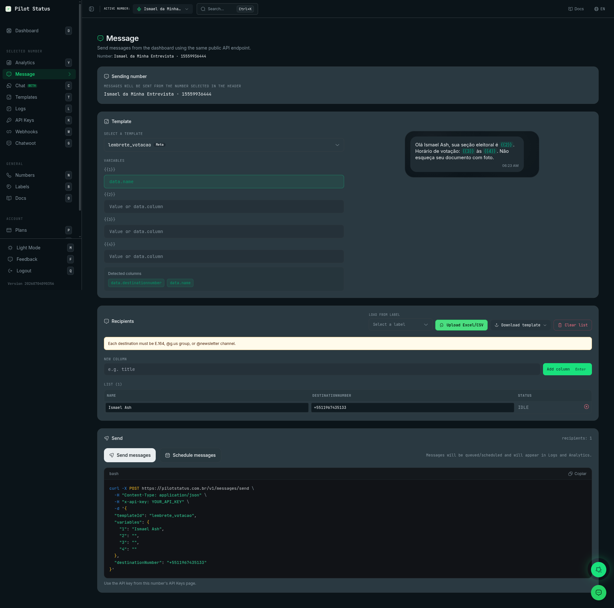

The **Message** screen (`/messages`) sends an approved template from the dashboard, to one person or to a whole list. Each recipient becomes one call to the same public endpoint your code uses, [`POST /v1/messages/send`](/api/messages/send), so a send from here behaves exactly like an API send: it goes through the queue and shows up in [Logs and Analytics](/dashboard/logs-analytics).

<Frame caption="The Message page — template picker and preview, variables mapped to spreadsheet columns, a recipients list with Excel/CSV upload, Send and Schedule actions, and the auto-generated curl of the exact API call.">
  
</Frame>

## How to reach it

In the sidebar, click **Message**, in the **Selected Number** group (keyboard shortcut: `E`). The page title is **Message**, with the subtitle **Send messages from the dashboard using the same public API endpoint.** and the **Number:** you are sending from.

## Who can use it

**Owner**, **Admin** and **Agent** can open the screen and send (permissions `messages:bulk_send` and `messages:send`). **Analyst** does not see it. A member restricted to some numbers can only send from those numbers. See [Roles and permissions](/concepts/roles-and-permissions).

There is no plan gate on the screen itself. Every recipient is one message and counts toward your plan's message quota; a message over the quota fails with `PLAN_LIMIT_REACHED` (see [Log error codes](/api/messages/log-error-codes)).

## What you see

The screen has five blocks, top to bottom.

### Sending number

Messages go out from the number selected in the header (**Messages will be sent from the number selected in the header**). To send from another number, change it in the header's number selector. With no number selected, the block says **Select a number in the header**.

<Note>
  You cannot send from the Pilot Status test number. If it is the selected number, sending is blocked with **Test number: select one of your numbers to send messages.**
</Note>

### Template

Pick the template in **Select a template** (searchable). The screen sends **templates only** — there is no free-text or standalone media send here; for those, use [Live Chat](/dashboard/live-chat) or the API.

- On an **official (Meta Cloud API)** number, the list shows only that number's templates **approved by Meta**. A template not yet approved fails with **Template not yet approved by Meta.**
- On other numbers, the list shows all your templates.

Templates are created and edited on the **Templates** screen. See [Templates](/concepts/templates).

### Variables

If the template has variables, each one gets a field (**Value or data.column**). You can type:

- a fixed value, the same for every recipient; or
- `data.<column>`, to take the value from that column of the recipient list (for example `data.link`).

When a column has the same name as a variable, the field is filled with `data.<column>` automatically. **Detected columns** lists every column of the list as a `data.` chip — click one to copy it. A template with no variables says **This template has no variables.**

For **Marketing** templates created in Pilot Status, the switch **Rewrite with AI (anti-spam)** appears: after the template is rendered, AI varies the final text while keeping a similar length and tone, so bulk sends look less repetitive. It is off by default and resets when you change the template. It does not appear for Marketing templates that came from Meta.

**Message preview** shows the rendered message — header, media, body, footer, buttons and lists — with the variables filled from the **first** recipient of the list.

### Recipients

Build the list in any combination of these ways. Adding never creates duplicates: a destination already on the list is skipped.

- **Load from label** — pick a label (each shows its contact count) to add all its contacts. Labels are managed on the [Labels](/dashboard/labels) screen.
- **Upload Excel/CSV** — a `.xlsx`, `.xls` or `.csv` file with a `name` column and a destination column. The destination column can be named `destinationNumber`, `number`, `numero`, `telefone` or `phone`. Every other column becomes a `data.` column for the variables.
- **Download template** — downloads a spreadsheet model (**Excel (.xlsx)** or **CSV (.csv)**) with the columns `name`, `destinationNumber` and one column per template variable, prefilled with your own name and phone and the Pilot Status number.
- **New column** / **Add column** (or `Enter`) — adds an empty column to every row, to fill in by hand. Each extra column has **Remove column**.
- **Clear list** — empties the list.

When you open the screen, the list starts with one row: your own profile phone, so a first send goes to you.

The **List** table, with the row count, shows **Name**, **destinationNumber**, each extra column, and **Status**. Every cell is editable and every row can be removed. A destination can be:

- a phone number in E.164 format (`+5511999999999`);
- a WhatsApp group (ending in `@g.us`);
- a WhatsApp channel (ending in `@newsletter`).

An invalid destination turns its row red with the hint **E.164 / @g.us / @newsletter**, and a repeated one is marked **Duplicate**. While any of them remains, sending is blocked.

### Send

The block shows how many **recipients** are on the list.

- **Send messages** — sends now.
- **Schedule messages** — opens a picker with a date, **Hour** and **Minute** (your browser's timezone), then **Schedule**. **Clear** empties the date.

<Warning>
  There is no confirmation dialog: clicking **Send messages** or **Schedule** starts the send right away, to every row on the list. Check the list and the preview first.
</Warning>

The browser sends three recipients at a time and updates each row's **Status**: `SENDING`, then `QUEUED` (accepted, with its message ID) or `FAILED` with the error under it. Keep the tab open until every row has left `SENDING`. At the end, a message says how many were queued or scheduled and how many failed.

`QUEUED` means the message entered the queue, not that it was delivered. Delivery, read and failure show up in [Logs](/dashboard/logs-analytics), where you can also cancel a scheduled send or resend a failed one. On web-connected numbers, cold sends (24h window closed) are spaced out by the anti-block engine, so a large list takes time to go out.

### The curl of the same call

Below the send block, a **curl** shows the exact `POST /v1/messages/send` request for the **first** recipient, with the selected template, the resolved variables and, if set, the schedule. Copy it to reproduce the send from your code. Replace `YOUR_API_KEY` with the key from this number's **API Keys** page (**Use the API key from this number's API Keys page.**).

## Do it via API / MCP

| Dashboard action | API (`/v1`) | MCP tool |
| --- | --- | --- |
| Send a template to one recipient | [`POST /v1/messages/send`](/api/messages/send) with `templateId`, `variables` and one destination (`destinationNumber`, `groupId` or `newsletterId`) | `messages_send` |
| Send to a list | One `POST /v1/messages/send` per recipient — there is no bulk endpoint | `messages_send`, once per recipient |
| **Schedule messages** | The `deliverAt` field (and optionally `deliverUntil`) | `messages_send` with `deliverAt` |
| **Rewrite with AI (anti-spam)** | `marketingOptions.aiRewriteEnabled: true` | `messages_send` with `marketingOptions` |
| Tag the recipients with labels | The `labels` field — see [Labels](/api/labels) | `messages_send` with `labels` |
| Load recipients from a label | — | Dashboard only |

Use a number-scoped API key — see [API Authentication](/api/authentication). The step-by-step guide is [Send messages](/guides/send-messages).
