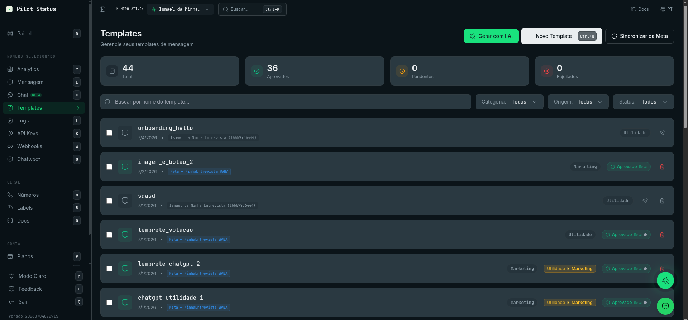
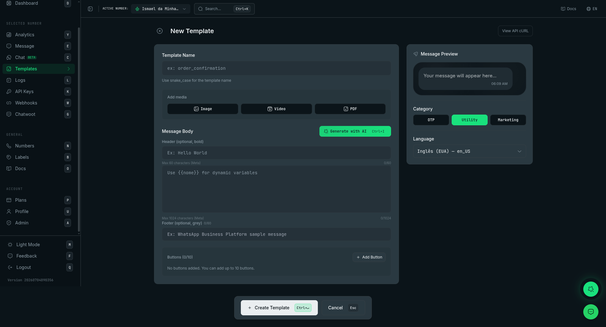

Templates are the reusable messages you send with `templateId`. This page describes what the dashboard screens show and do. For the rules of the template itself — categories, variables, Meta approval, structure — see [Templates](/concepts/templates) and the [Templates API](/api/templates).

<Frame caption="The Templates list — status cards, filters, and one row per template.">
  
</Frame>

## How to reach it

| Screen | Route | How you get there |
| --- | --- | --- |
| Template list | `/templates` | **Templates** in the sidebar (keyboard shortcut: `t`), or search "Templates" in the command palette |
| New template | `/templates/new` | **New Template** on the list, `Ctrl+Shift+1` (`⌘+Shift+1` on Mac), or "Create Template" in the command palette |
| Edit template | `/templates/:id/edit` | Click a row in the list |

The list shows the templates of the number selected in the dashboard header. When the selected number is the Pilot Status test number, the list shows every template in the workspace instead — but that number is for testing only: deleting, syncing, submitting to Meta and saving are blocked, with the message _"Test number: select one of your numbers to manage templates."_ Pick one of your own numbers in the header to manage templates.

## Who can do what

| Action | Owner | Admin | Agent | Analyst |
| --- | --- | --- | --- | --- |
| See the list, filters, status cards | ✓ | ✓ | ✓ | ✓ |
| Open **Template insights** | ✓ | ✓ | ✓ | ✓ |
| Copy a template name | ✓ | ✓ | ✓ | ✓ |
| Create, edit (open the editor), **Generate with AI** | ✓ | ✓ | — | — |
| **Sync from Meta**, **Submit to Meta**, test send, delete, bulk actions | ✓ | ✓ | — | — |

Agents and Analysts read the list (permission `templates:read`). Everything that writes — including the test send, which is a real message — needs `templates:manage`, which Owner and Admin have. For Agents and Analysts the rows are not clickable and the write buttons and checkboxes are not shown.

There is no plan gate on these screens.

## Template list (`/templates`)

### Header buttons

- **Generate with AI** — opens the **Generate Template with AI** modal (see [AI generation](#ai-generation)). Shown only when AI is available on the platform.
- **New Template** — opens `/templates/new`.
- **Sync from Meta** — shown when the workspace has at least one official (Meta) number. See [Sync from Meta](#sync-from-meta).

### Status cards

Four cards: **Total**, **Approved**, **Pending**, **Rejected**. They count the templates currently loaded with the active filters — they are not workspace-wide totals. **Rejected** counts both rejected and disabled templates. Clicking a card sets the **Status** filter (**Total** clears it).

### Filters

- **Search by template name...** — filters by name as you type.
- **Category:** **All**, **OTP**, **Marketing**, **Utility**. Hovering an option shows what the category is for, examples, and the rule that applies on the Pilot Status number.
- **Source:** **All**, **Pilot Status** (templates that are not on Meta: drafts never submitted, and templates of non-Meta numbers), **Meta** (templates on your WhatsApp Business Account — imported by **Sync from Meta** or submitted from Pilot Status; a template moves here as soon as Meta accepts the submission).
- **Status:** **All**, **Approved**, **Pending**, **Rejected**, **Disabled**, **Paused** (Meta review status).

The list shows 20 templates at a time; **Load more** shows the next 20. It refreshes when you come back to the tab. An empty result shows _"No templates found"_.

### What each row shows

- The template **name** (monospace) and a copy icon that copies the name to the clipboard.
- The last update date.
- A **Meta** badge (with the WABA name, `Meta — <WABA name>`) when the template is on Meta, or the number the template belongs to.
- The **category**. When Meta changed the category after review, a badge shows the old category struck through and the new one (tooltip: _"Category changed by Meta"_).
- The **Meta status** badge — **Approved**, **Pending**, **Rejected**, **Disabled** or **Paused** — with a colored dot for Meta's quality rating (green, yellow, red) when Meta reports one.
- For a rejected template, **Reason:** followed by Meta's rejection reason.

### Row actions

Hover a row to see its action icons. Which ones appear depends on the template and your role:

| Icon (tooltip) | When it appears | What it does |
| --- | --- | --- |
| Chart (**Template insights**) | The template is on Meta, and its WABA is not a WhatsApp Business App / coexistence account | Opens the [Template insights](#template-insights) modal |
| Flask (**Test template**) | The template is not on Meta yet, the Pilot Status test number is connected, Owner/Admin | Opens the [Send Test](#send-test) modal |
| Send (**Submit for Meta approval** / **Re-submit for Meta approval**) | The template is not on Meta yet, the workspace has a Meta number, Owner/Admin | Opens the [Submit to Meta](#submit-to-meta) modal |
| Trash | The template was never on Meta, Owner/Admin | Deletes the template ([Delete Template](#delete)) |
| Red trash (**Delete template from Meta**) | The template is on Meta, Owner/Admin | Deletes it on Meta and in Pilot Status ([Delete Template from Meta](#delete)) |

Clicking anywhere else on the row opens the editor (Owner/Admin).

Once Meta accepts a submission the template counts as a Meta template: the send and flask icons disappear from its row, and further changes go through **Save** in the editor (see [Edit and resubmit](#edit-and-resubmit)).

### Bulk actions

Owner and Admin see a checkbox on each row. Selecting at least one shows a bar with:

- **Delete selected** — asks for confirmation in the **Delete Templates** modal, then deletes each one. Templates that are on Meta are deleted on Meta too.
- **Submit selected to Meta** — opens the [Submit to Meta](#submit-to-meta) confirmation and submits each selected template to the Meta number selected in the header. Templates already on Meta are skipped.
- **Deselect all**.

## Sync from Meta

**Sync from Meta** imports the templates that exist on your WhatsApp Business Accounts into Pilot Status, for **every** Meta number of the workspace (not only the one in the header). New templates are created and existing ones are updated. The result appears as a toast — _"Synced from Meta: 2 new, 3 updated"_ — or _"No new templates found on Meta."_

If Meta cannot be reached for an account, you see: _"Could not access the WhatsApp Business Account (WABA) on Meta. It may have been removed/deleted, or the System Token lacks permission. Reconnect the number on Meta."_

## Delete

There are two delete paths, and which one a row offers depends on whether the template is on Meta.

- **Delete Template** (plain trash icon) — for a template that was never submitted to Meta. The modal asks _"Are you sure you want to delete the template"_ with the name. On success: _"Template deleted!"_
- **Delete Template from Meta** (red trash icon) — for a template on Meta. The modal says _"Are you sure you want to delete this template from Meta? This action cannot be undone."_ It deletes the template on Meta **and** in Pilot Status. On success: _"Template deleted from Meta!"_

<Warning>
  Deleting a template on Meta cannot be undone.
</Warning>

### When Meta refuses the deletion

If Meta refuses (for example, the token lacks permission on the WABA), nothing is deleted and the **Meta refused the deletion** modal opens. It shows Meta's reason and the template name, and explains that you can remove only Pilot Status' copy — the template **stays** on Meta and may reappear on the next sync. **Remove local copy only** does that, and the toast confirms: _"Removed from Pilot Status only. The template STAYS on Meta and may reappear on the next sync."_ This option only appears after a refusal; it is never the default.

If Meta says the template does not exist there, you see _"This template was not found on Meta. Try deleting it locally only."_

## Template insights

The **Template insights** modal shows Meta's analytics for a template that is on Meta:

- The template name, its Meta status and its quality rating (**GREEN**, **YELLOW**, **RED**).
- A period selector: **7 days**, **30 days** (default), **90 days**.
- Four numbers: **Sent**, **Delivered**, **Read**, **Read rate** (— when nothing was delivered).
- **Sent per day** — a bar per day.
- **Button clicks** — each button with its click count, or _"No clicks recorded in this period."_

If Meta refuses (for example, the account is a WhatsApp Business App / coexistence account, where Meta offers no insights), the modal shows the reason and a **Try again** button; in the coexistence case the chart icon disappears from that account's templates. Insights are read-only — every role can open them.

## Editor (`/templates/new` and `/templates/:id/edit`)

<Frame caption="The template editor — form on the left, live preview and category/language on the right.">
  
</Frame>

The editor has the form on the left and a sidebar on the right. The page title is **New Template** or **Edit Template**. When editing, the title area also shows the template name, its status badge and, for a rejected template, **Reason:** with Meta's reason and _"See WhatsApp Manager for more details."_ The **View API cURL** button sits at the top right.

### Form

- **Template Name** (create only) — converted to snake_case as you type. If the name already exists you see _"A template with this name already exists."_ The name cannot be changed after creation.
- **Add media** — header media: **Image**, **Video** or **PDF**. Pick **Use URL** to paste a direct `http(s)` link, or **Upload** to send a file (**Choose image**, **Choose MP4 video**, **Choose PDF**). Limits: PNG, JPEG, WebP or GIF up to 5 MB; MP4 up to 16 MB; PDF up to 10 MB. After an upload you see **Media on server** and _"Remember to click 'Save' to persist this media in the template."_ — the upload is only kept once you save. Media is unavailable while there is a text header, a list or a carousel. **Remove media** clears it.
- **Message Body** — three fields, with `{{variable}}` highlighted:
  - **Header (optional, bold)** — max 60 characters, at most 1 variable, no emojis, line breaks or formatting. Unavailable while there is header media, a list or a carousel.
  - The body — max 1024 characters (counter shown).
  - **Footer (optional, grey)** — max 60 characters.
- **Detected variables** — every `{{variable}}` found, as chips.
- **Variable examples** — one sample value per variable, sent to Meta for approval. **Generate examples with AI** fills them (when AI is available).
- **Buttons** — the list of buttons (up to 10) with **Add Button**, which opens the [buttons modal](#buttons-modal). Click a button to edit it; the trash icon removes it.
- **Carousel** — **Add carousel** turns the template into a carousel of 2 to 10 cards, each with an image, a short text and up to 2 buttons. It is exclusive: with a carousel there is no header and no button section, and **Add carousel** disappears when the template already has buttons, a list or an order card.

On an official (Meta) number with category **OTP**, the form switches to Meta's fixed authentication layout: you see the fixed text, a **Copy code** button, a **Security recommendation** switch (adds the "do not share it" line) and **Code expiration (min)** (optional, 1 to 90). Body, header, footer and buttons are not editable there.

### Sidebar

- **Message Preview** — a live WhatsApp-style preview of the message as you type, with the variable examples applied, media, buttons, list, order card or carousel. When the template contains a link, a note recommends shortening it with ShareContent.
- **Category** — **OTP**, **Utility** or **Marketing**, with a tooltip on each. Set at creation; when editing it is read-only (_"Category cannot be changed after creation."_). On an approved template: _"Approved template — changes require new Meta approval."_; on a pending one: _"Pending template — changes may affect approval."_
- **Language** — searchable list of Meta languages. Also fixed after creation.

### Bottom bar

- **Create Template** (create) or **Save** (edit). Disabled while the Pilot Status test number is selected (_"Test number: select one of your numbers to save or publish templates."_).
- **Submit to Meta** (edit only) — shown for templates that are not on Meta yet, when the workspace has a Meta number. It saves first (or, with no changes, goes straight on), then opens the [Submit to Meta](#submit-to-meta) confirmation.
- **Send Test** — shown when the Pilot Status test number is connected. Opens [Send Test](#send-test).
- **Cancel** (`Esc`).

### Edit and resubmit

What **Save** does depends on whether the template is already on Meta. Name, category and language never change after creation, whatever the state.

- **Not on Meta yet** (a draft, or a template of a non-Meta number) — **Save** only stores the change in Pilot Status. Send it for review with **Submit to Meta**.
- **On Meta** (submitted from Pilot Status or imported by **Sync from Meta**) — **Save** sends the edited version to Meta as an edit of the same template. Pilot Status only writes the new version after Meta accepts it; the status then goes back to **Pending** until Meta reviews it again. If Meta refuses, nothing changes — neither in Pilot Status nor on Meta.

This is how a **rejected** template is fixed: open it from the list, read **Reason:** next to the status, correct the content and click **Save**. There is no separate resubmit button for a template already on Meta — the save is the resubmission.

Meta only accepts edits of templates in certain states. An **approved** template is refused, and you see _"Meta does not allow editing this template in its current state (only rejected templates can be edited). Create a new template with the change, or send the document at send time."_ The approved version stays as it was, in Pilot Status and on Meta; create a new template with the change. For **Paused** and **Disabled** templates Meta decides the same way; when it refuses for a reason Pilot Status does not translate, you see _"Failed to save template"_ and nothing changes.

If nothing changed, you see _"No changes detected in the template."_ After a successful save you go back to the list.

### Templates with a Flow button

A template whose stored version has a **Flow** button — whether you added it with the [Flow picker](#flow-picker) or it came from Meta — is read-only in the editor, and so is one with a catalog or WhatsApp Pay button created in Meta's console. You can open it and even open the button, but **Save** is refused with _"This template has a button Pilot Status does not support yet (FLOW). Saving here would delete it on Meta. Edit it in Meta's console."_ — saving would otherwise recreate the template on Meta without that button. The same message appears for **Submit to Meta** in the editor's bottom bar, because it saves first.

- To submit a draft that has a Flow button, use the send icon on its row in the list (or **Submit selected to Meta**), which submits without saving.
- To change the template's text or its Flow, create a new template. Over the API, `PUT /v1/templates/{id}` accepts an edit only if the Flow button stays bound to the same Flow.

## Buttons modal

**Add Button** opens the **Add Button** modal (**Edit Button** when you click an existing one): _"Choose the type of button to add."_

| Option | What it adds |
| --- | --- |
| **Reply Button** | A quick reply with predefined text |
| **Action Button** | **Action Type**: **Open Website (URL)**, **Call (Phone)** or **Copy**; plus **Button Text**. A URL may end in one variable after a fixed base |
| **List Button** | An interactive list: up to 10 sections and 10 options in total, each option with title, optional description and optional ID (returned in the reply). A list is exclusive — no other button or order card |
| **Payment Button** | **Payment format**: **Pix** (a button that copies the Pix copy-and-paste code, or a `{{variable}}`) or **Order card** (items, quantities, prices, order number and **Payment method**: **Pix**, **Boleto**, **Payment link**, **Card**) |
| **Flow** | A button that opens a WhatsApp Flow in the conversation |

Options the current combination does not allow are disabled with the reason (button limit reached, list exclusivity).

### Flow picker

The **Flow** option is always visible. It is disabled with _"Meta Cloud API numbers only."_ on a non-Meta number, and with _"This template already has a Flow — Meta allows one per template."_ when there is one already. The step asks for:

- **Button label** (up to 25 characters).
- **Flow** — a list of every Flow on the number's WhatsApp Business Account, each with its state (**Select a Flow**). If you pick one that is not published you see that the template can be approved, but the button only opens once the Flow is published. With no Flows: _"No Flows on this account. Create one in Meta's manager and sync before binding."_ If the list fails to load, the message says so — it does not mean there are none.
- **Action** — **Open a screen** (with **First screen**) or **Exchange data with the endpoint**.

Pick the Flow before saving the template: once the template is created, its Flow button can no longer be changed from the editor (see [above](#templates-with-a-flow-button)). See [The Flows screen](/dashboard/flows) and the [Flows API](/api/flows) for creating and publishing Flows.

## AI generation

**Generate with AI** (on the list, and next to **Message Body** in the new-template editor; shortcut `Ctrl+I` / `⌘+I`) opens **Generate Template with AI**: _"Describe your template's goal. The AI will create the name, message text, and even suggest buttons if necessary."_ Type the briefing and click **Generate**. From the list, it opens `/templates/new` and starts generating right away.

While it runs you see _"AI is working..."_ — it fills the category, name, body, header, footer, buttons, language and variable examples. If a generated field exceeds Meta's limit, the AI is asked to shorten it automatically, and a toast tells you which fields were shortened (_"Shortened to fit Meta's limit: …"_). If a field still does not fit, a warning tells you its length and the maximum so you can trim it before saving — text is never cut silently.

AI generation is only on new templates; when editing, only **Generate examples with AI** is offered. AI entry points are hidden when AI is not available on the platform.

## Send Test

The **Send Test** modal sends a real message so you can see the template on WhatsApp. It needs the Pilot Status test number to be connected (otherwise: _"The default Pilot Status number is disconnected. Connect the instance to send a test."_).

- _"The message will be sent to the number configured in your profile."_
- **Fill in the variables:** one field per variable. _"Empty fields are sent as an empty string ("") to the API."_
- **Send Test** sends it. From the editor you can test a template that is not saved yet.

After sending, the modal follows the message: **Test queued** → **Test sent** → **Test delivered** → **Test read**, or **Test failed** with the reason. It also shows **Equivalent request (cURL):** — the `POST /v1/messages/send` call that sends this template, with a **Copy** button. **Send another test** resets the form.

A test with video or PDF media cannot have buttons (_"Remove all buttons before sending a test with video or PDF."_), and you must wait for any media upload to finish.

## View API cURL

**View API cURL** in the editor opens **Send this template via the API**: a ready-to-copy `curl` for `POST /v1/messages/send` with:

- `templateId` set to the template **name**,
- a sample `destinationNumber` (`+5511999999999`),
- one `<variable>` placeholder per variable,
- `media` and `mediaType` when the template has a media header.

The key in the command is the placeholder `ps_sua_chave_aqui` — the modal never shows your real API key. Replace it with the number's key from the **API Keys** page, and replace the placeholders and `destinationNumber` with real values. On a new template with no name yet, it warns: _"Save the template first to get its final ID (templateId)."_

## Submit to Meta

Submitting sends a template created in Pilot Status to Meta for review. It always goes to the **Meta number selected in the header** — if the header has a non-Meta number you see _"Select a Meta number in the header."_

The **Submit to Meta** modal asks _"Submit the template to &lt;number name&gt; (&lt;number&gt;)?"_ with the template name, and **Submit** / **Cancel**.

You get there from:

- the send icon on a row (**Submit for Meta approval**, or **Re-submit for Meta approval** if it was submitted before),
- **Submit selected to Meta** in the bulk bar,
- **Submit to Meta** in the editor's bottom bar (saves first),
- right after **Create Template** on a Meta number: a prompt **Template created!** / **Submit to Meta?** with **Yes** (opens the confirmation) and **Later** (keeps it as a draft and returns to the list).

Templates with a **List Button** cannot be submitted to Meta: on an official number they go out as an interactive message, only inside the 24-hour customer service window. Templates already on Meta do not show this action — to resubmit a rejected one, edit it and **Save** (see [Edit and resubmit](#edit-and-resubmit)).

After submission the template is on Meta and its status is **Pending** until Meta reviews it; Meta may also change its category (shown on the row as _"Category changed by Meta"_). Use **Sync from Meta** or reopen the list to see the result. See [Templates](/concepts/templates) and the submit and rejection errors in the [Templates API](/api/templates).

## Values on these screens

Nothing on these screens is shown only once, and no secret is shown: the cURL commands use a placeholder API key. Everything else — the template name, status, rejection reason, quality, insights — can be read again at any time on the list, in the editor, or through the API.

## Do it via API / MCP

| Dashboard action | REST (`/v1`) | MCP tool |
| --- | --- | --- |
| List templates | `GET /v1/templates` | `templates_list` |
| Open one template | `GET /v1/templates/{id}` | `templates_get` |
| Create a template | `POST /v1/templates` — on a Meta number it is submitted to Meta on creation | `templates_create` |
| Edit (Save) | `PUT /v1/templates/{id}` — re-submits on Meta numbers | `templates_update` |
| Delete / Delete from Meta | `DELETE /v1/templates/{id}` | `templates_delete` |
| Remove local copy only (after a Meta refusal) | `DELETE /v1/templates/{id}?force_local=true` | `templates_delete` with `force_local_delete: true` |
| Template insights | `GET /v1/templates/{id}/insights` (`days`: 7, 30 or 90) | `templates_insights` |
| Send the template (what the cURL shows) | `POST /v1/messages/send` | `messages_send` |
| List Flows for the Flow picker | `GET /v1/flows` | `flows_list` |

Dashboard only: **Sync from Meta**, submitting an existing draft to Meta separately, **Send Test**, **Generate with AI** / **Generate examples with AI**, media **Upload** (the API takes media headers by URL), and the bulk actions.

The API needs a number-scoped API key. See [Templates API](/api/templates), [Send a message](/api/messages/send) and [MCP server](/integrations/mcp-server).
