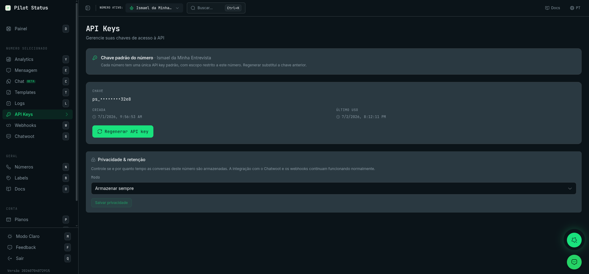

# Claves de API: listar, regenerar, rotar

Cada solicitud a la API de Pilot Status requiere una clave de API en uno de estos encabezados:

- `x-api-key`: la clave en bruto (`ps_...`)
- `x-api-key-id`: el ID de la clave de API (el backend la resuelve internamente)

Todas las claves usan el prefijo `ps_`. Las claves creadas a partir del 2026-10-28 también llevan su tipo: `ps_number_`, `ps_workspace_` o `ps_account_`. Esta página cubre las claves de número; para las claves de workspace (principal y con nombre) y las claves de cuenta, consulta [Tipos de clave](/es/concepts/key-types) y [Crear workspaces](/es/api/workspaces#claves-de-workspace).

<Frame caption="La página API Keys: cada número tiene una clave predeterminada (mostrada enmascarada) con una acción Regenerate, además de privacidad y retención por número.">
  
</Frame>

## Alcances de las claves

| Alcance | Vinculada a | Dónde encontrarla |
| --- | --- | --- |
| **Limitada a un número** (predeterminada) | Un número de WhatsApp: todos los endpoints de acción/datos de ese número (envío, estado, grupos, plantillas, multimedia, llamadas…) | Panel → página **API Keys** (una clave predeterminada por número; **Regenerate**) |
| **Limitada al tenant** (clave de workspace) | El tenant (sin número): gestión a nivel de cuenta: `/v1/numbers/*`, `/v1/remote-pairing/*`, `/v1/api-keys`, `/v1/branding`, `/v1/webhooks/*`, `/v1/subscription/*`, `/v1/billing/*`. También actúa sobre cualquier número con `x-whatsapp-number-id`. | Panel → **Workspace keys** (`/workspace-api-keys`) |
| **Clave de cuenta** | Tú, el usuario: cualquier workspace del que seas miembro, elegido con `x-workspace-id`, con tu rol en él | Panel → **Profile** → pestaña **API** |

**No hay subclaves** (ni padre/hijo). Las claves de número se **regeneran**, no se crean: cada número de WhatsApp tiene una clave predeterminada limitada al número. Un workspace tiene una clave de workspace **principal** y puede agregar claves **con nombre** (consulta [Claves de workspace](/es/concepts/key-types#claves-de-workspace)).

Una clave limitada al tenant en un endpoint de acción por número recibe **403 `TENANT_SCOPE_NOT_ALLOWED`**; una clave limitada a un número en un endpoint exclusivo del tenant recibe **403 `NUMBER_SCOPE_NOT_ALLOWED`**. Una clave limitada a un número que intenta crear un número (`POST /v1/numbers`, `/v1/numbers/meta`, `/v1/numbers/remote-pairing`) recibe **403 `NUMBER_KEY_CANNOT_CREATE_NUMBER`**: usa una clave de workspace o una clave de cuenta.


## GET /v1/api-keys: listar claves (solo limitadas al tenant)

Una clave limitada a un número recibe **403 `NUMBER_SCOPE_NOT_ALLOWED`**. Con una clave de cuenta (`x-workspace-id`), requiere el rol **Owner**, ya que devuelve claves en texto plano; regenerar la clave de un número (`POST`) requiere **Owner o Admin**. Con un token OAuth/MCP, ambos requieren el rol **Owner**, verificado en cada llamada, y cada una queda registrada en el log de auditoría ([detalles](/es/integrations/mcp-server#secretos-y-api-keys-por-oauth)); cualquier otro rol recibe **403 `OAUTH_SECRET_REQUIRES_OWNER`**. Si ese registro de auditoría no se puede escribir, no se revela ni se rota nada y la respuesta es **500 `OAUTH_SECRET_AUDIT_UNAVAILABLE`**: vuelve a intentarlo. Un token OAuth autorizado solo para números específicos recibe **403 `NUMBER_SCOPE_NOT_ALLOWED`**. Las claves de workspace no se listan aquí. Devuelve un **arreglo plano y ligero, un elemento por número**, con `numberId`, `number`, `displayName`, `keyId`, `keyLast4`, además del valor real utilizable (`key`, `revealable: true`). Las claves heredadas vuelven con `key: null` y `revealable: false`: regenera ese número para obtener un valor utilizable.

<Note>
  **Una entrada por número: la clave creada más recientemente.** Un número puede tener más de una clave, y el listado ahora las colapsa en la más nueva en lugar de devolver una fila por clave. Las claves más antiguas **no** se revocan: siguen autenticando, solo dejan de listarse. Las claves sin número asociado se siguen listando individualmente.
</Note>

```bash
curl "https://pilotstatus.com.br/v1/api-keys" \
  -H "x-api-key: ps_your_tenant_scoped_key"
```

```json
[
  { "numberId": "wn_1", "number": "5511999999999", "displayName": "Suporte", "keyId": "k_aaa", "keyLast4": "wxyz", "key": "ps_4f1c...real...wxyz", "revealable": true },
  { "numberId": "wn_2", "number": "5511888888888", "displayName": "Vendas",  "keyId": "k_bbb", "keyLast4": "abcd", "key": null, "revealable": false }
]
```

## POST /v1/api-keys: regenerar la clave de un número (solo limitadas al tenant)

Envía el número destino en `whatsappNumberId`: su clave predeterminada anterior se **rota/invalida** y la nueva `key` en bruto se devuelve **una sola vez**. No existe "crear otra clave": cada número tiene exactamente una clave predeterminada. Número desconocido → **404 `NUMBER_NOT_FOUND`**. Un `whatsappNumberId` ausente o vacío → **400** `{ "error": "Validation error", "details": … }`. Acepta el id del número o su instance id de `GET /v1/numbers`. La respuesta es `200`. Un cuerpo que no es JSON válido → **400 `INVALID_BODY`**, y no se rota ninguna clave ([Cuerpo JSON mal formado](/es/api/overview#cuerpo-json-mal-formado)).

```bash
curl -X POST "https://pilotstatus.com.br/v1/api-keys" \
  -H "Content-Type: application/json" \
  -H "x-api-key: ps_your_tenant_scoped_key" \
  -d '{ "whatsappNumberId": "wn_1" }'
```

```json
{
  "numberId": "wn_1",
  "keyId": "k_new",
  "keyPrefix": "ps_number_",
  "keyLast4": "wxyz",
  "key": "ps_number_...newreal...",
  "createdAt": "2026-06-28T15:00:00.000Z"
}
```

<Warning>
  La regeneración **rota** la única clave predeterminada del número elegido: la clave anterior deja de funcionar de inmediato. Si el número está conectado a una bandeja nativa de Chatwoot y la nueva clave no se puede enviar a ella, las claves anteriores se dejan válidas a propósito para que la bandeja no se rompa: así es como un número termina teniendo más de una clave funcional. La clave completa en bruto se muestra solo una vez en la respuesta: guárdala ahora.
</Warning>

## POST /v1/api-keys/regenerate: rotar la propia clave de quien llama

Rota la clave del **propio alcance de la clave que llama** (funciona para ambos alcances): la clave actual se invalida y la nueva clave en bruto se devuelve **una sola vez** en la respuesta, con estado `201`.

- **Con una clave de número**, rota la clave predeterminada de ese número.

- **Con una clave de workspace** (principal o con nombre), rota la clave **principal** del workspace. Las claves con nombre no se tocan: una clave con nombre que la llama sigue funcionando.
- **Con una clave de cuenta y `x-workspace-id`**, rota la clave principal de ese workspace. Requiere el rol **Owner**.
- **Con un token OAuth/MCP** autorizado para todo el workspace, también rota la clave principal, solo mientras el usuario sea **Owner**, verificado en cada llamada y registrado en el log de auditoría (`403 OAUTH_SECRET_REQUIRES_OWNER` en caso contrario; `500 OAUTH_SECRET_AUDIT_UNAVAILABLE` si el registro no se puede escribir, y no se rota nada).
- **Un token autorizado para números específicos, o una clave de cuenta de un miembro restringido a algunos números**, recibe **403 `NUMBERS_GRANT_NOT_ALLOWED`**.

```bash
curl -X POST "https://pilotstatus.com.br/v1/api-keys/regenerate" \
  -H "x-api-key: ps_current_key"
```

```json Response (201)
{
  "id": "k_new",
  "name": "Tenant API Key",
  "key": "ps_workspace_...newreal...",
  "keyPrefix": "ps_workspace_",
  "keyLast4": "wxyz",
  "scope": "tenant",
  "whatsappNumberId": null,
  "createdAt": "2026-06-28T15:00:00.000Z"
}
```

Con una clave de número, `name` es `"Default API Key"`, `keyPrefix` es `"ps_number_"`, `scope` es `"number"` y `whatsappNumberId` indica el número.

## Privacidad y retención de datos

La página **API Keys** también aloja el panel de **Privacidad y retención** por número (el mismo control aparece en la página **Numbers**). Determina si se almacenan, y por cuánto tiempo, las conversaciones y el contenido de los mensajes de este número. Nunca afecta la entrega: **la integración con Chatwoot y los webhooks siguen funcionando en todos los modos** (se ejecutan antes del almacenamiento).

| Modo | Qué hace |
| --- | --- |
| **Almacenar indefinidamente** (`STORE_INDEFINITE`, predeterminado) | Conserva para siempre todos los mensajes entrantes y salientes y las conversaciones. |
| **Almacenar por X días** (`STORE_X_DAYS`) | Conserva solo los últimos _N_ días (`piiRetentionDays`, un entero entre **1 y 3650**). Un proceso diario elimina definitivamente los registros de chat anteriores a la ventana y redacta la PII de las entradas más antiguas del log. |
| **No almacenar / solo retransmitir** (`RELAY_ONLY`) | Nunca persiste el chat. Los mensajes se siguen retransmitiendo (los webhooks se disparan y Chatwoot replica), pero `/chat` y `/logs` quedan vacíos para este número y la multimedia entrante no se vuelve a alojar. |

La política vive en el número y se cambia en el panel, en la página API Keys (panel de Privacidad y retención) o en la configuración del número en Numbers. Para el comportamiento completo (cómo afecta cada modo al panel y a los endpoints de lectura `/v1`, y cómo se ven las lecturas redactadas), consulta [Retención de datos y modos de PII](/es/trust/data-retention).

## Buenas prácticas de seguridad

- Usa las claves de API solo en el **backend** (nunca en el navegador).
- Guarda las claves en variables de entorno o en un gestor de secretos.
- Trata como sensibles las respuestas que contienen claves en bruto (no las registres en logs).
