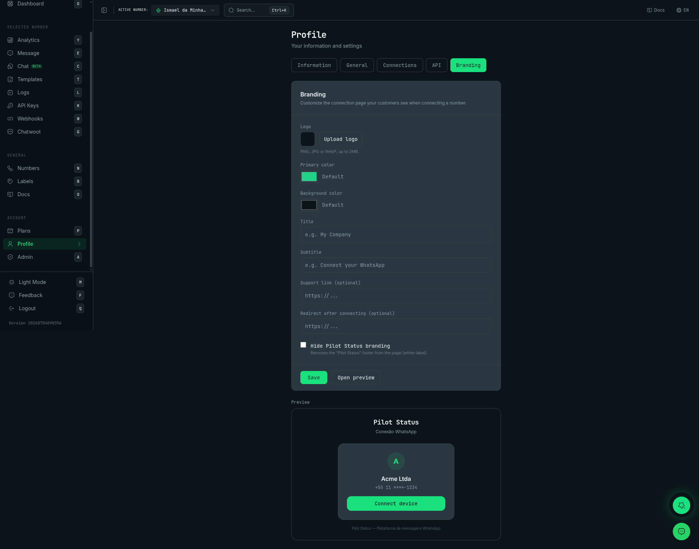

# Marca de la página de conexión (marca blanca)

La **página pública de conexión** (`/connect/{token}`), donde tu cliente final escanea el código QR o ejecuta el Embedded Signup de Meta para conectar un número de WhatsApp (consulta [Emparejamiento remoto](/es/api/numbers/remote-pairing)), se puede **personalizar por tenant**. Tus clientes ven **tu** marca en lugar de "Pilot Status".

<Frame caption="Perfil → Marca: logo, colores, título, enlace de soporte, opción de marca blanca y vista previa en vivo de la página de conexión del cliente.">
  
</Frame>

## Qué puedes personalizar

| Campo | Tipo | Notas |
| --- | --- | --- |
| `logoUrl` | URL https | Se muestra en el encabezado en lugar del nombre de la empresa. |
| `primaryColor` | hex `#RRGGBB` | Botones, acentos, resaltados. |
| `backgroundColor` | hex `#RRGGBB` | Fondo de la página/tarjeta. |
| `companyName` | string (≤ 60) | Título del encabezado (reemplaza "Pilot Status"). |
| `subtitle` | string (≤ 120) | Subtítulo del encabezado (reemplaza "Conexão WhatsApp"). |
| `supportUrl` | URL https | Muestra un enlace "Need help?" (¿Necesitas ayuda?). |
| `defaultRedirectUrl` | URL https | A dónde enviar al usuario tras una conexión exitosa. |
| `hidePilotStatusBranding` | boolean | **Marca blanca**: oculta el pie "Pilot Status". |

Los colores se guardan en hex y se convierten automáticamente al tema de la página.

## Cuatro formas de configurarlo

Orden de precedencia (de mayor a menor):

```text
URL query param  >  per-link override  >  tenant branding (dashboard/API)  >  Pilot Status default
```

### 1) Panel (recomendado)

**Perfil → Marca**: sube un logo, elige colores, define el título/subtítulo/enlace de soporte, activa la marca blanca y mira una **vista previa en vivo**. Esta marca se aplica a **todos** los enlaces de conexión del tenant.

### 2) API pública: GET / PUT /v1/branding

<Note>
  Requiere una credencial **a nivel de tenant**: una key de workspace, o una key de cuenta / token OAuth cuyo usuario sea **Admin u Owner** (`403 PERMISSION_DENIED` por debajo de eso). Las keys asociadas a un número reciben `403` (`NUMBER_SCOPE_NOT_ALLOWED`). Tanto `GET` como `PUT` requieren el mismo permiso.
</Note>

<CodeGroup>

```bash Leer
curl "https://pilotstatus.com.br/v1/branding" \
  -H "x-api-key: ps_your_tenant_scoped_key"
```

```bash Actualizar
curl -X PUT "https://pilotstatus.com.br/v1/branding" \
  -H "Content-Type: application/json" \
  -H "x-api-key: ps_your_tenant_scoped_key" \
  -d '{ "companyName": "Acme", "primaryColor": "#1fd286", "hidePilotStatusBranding": true }'
```

</CodeGroup>

Respuesta (ambos):

```json
HTTP 200
{ "branding": { "companyName": "Acme", "primaryColor": "#1fd286", "hidePilotStatusBranding": true, "logoUrl": null, "backgroundColor": null, "subtitle": null, "supportUrl": null, "defaultRedirectUrl": null } }
```

Todos los campos del `PUT` son opcionales: envía `null` para borrar un campo y omite una key para dejarla sin cambios. Los colores deben ser `#RRGGBB` y las URL deben ser `https://` (como máximo 2048 caracteres); de lo contrario, `400` `{ "error": "Validation error", "details": … }`. Cualquier otra key se rechaza con `400 UNKNOWN_FIELDS` (`unknownFields` las enumera) y no se guarda nada. Eso incluye `button`: el estilo del botón **no se guarda** a nivel de workspace, solo se aplica por enlace (en el `branding` de un enlace de emparejamiento). Hasta el 2026-11-09, las keys desconocidas, `button` entre ellas, se descartaban con un `200`. Un workspace que nunca guardó su marca lee todos los campos como `null` y `hidePilotStatusBranding: false`. Un cuerpo que no es JSON válido devuelve `400 INVALID_BODY` y no se cambia nada: ya no se interpreta como una actualización vacía. Consulta [Cuerpo JSON mal formado](/es/api/overview#cuerpo-json-mal-formado).

**Carga del logo** (sesión del panel): `POST /api/branding/logo` acepta un `file` multipart (PNG / JPG / WebP, ≤ 2 MB) y devuelve `{ url, key, mimeType, fileName, sizeBytes }`. Usa la `url` devuelta como `logoUrl` en `PUT /v1/branding`.

### 3) Override por enlace

Al crear un enlace de emparejamiento, pasa un objeto `branding` para sobrescribir la marca **solo en ese enlace** (se guarda como snapshot en el token y tiene prioridad sobre la marca guardada del tenant):

```bash
curl -X POST "https://pilotstatus.com.br/v1/numbers/remote-pairing" \
  -H "Content-Type: application/json" \
  -H "x-api-key: ps_your_token_here" \
  -d '{
    "name": "Customer João",
    "number": "+5511999999999",
    "branding": { "companyName": "Customer João Co.", "primaryColor": "#2563eb" }
  }'
```

### 4) Parámetros de URL (solo cosméticos)

Agrega parámetros permitidos y sanitizados a un enlace de conexión para ajustar la apariencia al vuelo. Son **solo cosméticos**: nunca cambian qué tenant/número se empareja:

```text
/connect/{token}?primary=%231fd286&title=Acme&hideBranding=1
```

Admitidos: `logo` (https), `primary` (hex), `bg` (hex), `title`, `subtitle`, `support` (https), `hideBranding` (`1`/`true`).

## Endpoint público de marca

La página de conexión lee su marca desde:

- `GET /v1/remote-pairing/{token}` → incluye un objeto `branding` resuelto, **o**
- `GET /v1/connect/{token}/branding` → `{ branding }` (usado por el flujo de Embedded Signup de Meta; no requiere API key; siempre `200`, con los valores predeterminados de Pilot Status para un token desconocido). El `branding` resuelto tiene `logoUrl`, `primaryColor`, `primaryColorHsl`, `backgroundColor`, `backgroundColorHsl`, `companyName`, `subtitle`, `supportUrl`, `hidePilotStatusBranding` y, para un override por enlace, `button`.

## Notas

- La marca es **por tenant**; una sola marca guardada se aplica a todos los enlaces de conexión, con overrides opcionales por enlace y por parámetro de URL encima.
- `hidePilotStatusBranding: true` elimina la atribución a Pilot Status (marca blanca). Úsalo para presentar el flujo de conexión completamente bajo tu propia marca.
- Los overrides por parámetro de URL se limitan intencionalmente a la apariencia; el token sigue controlando el emparejamiento real.
