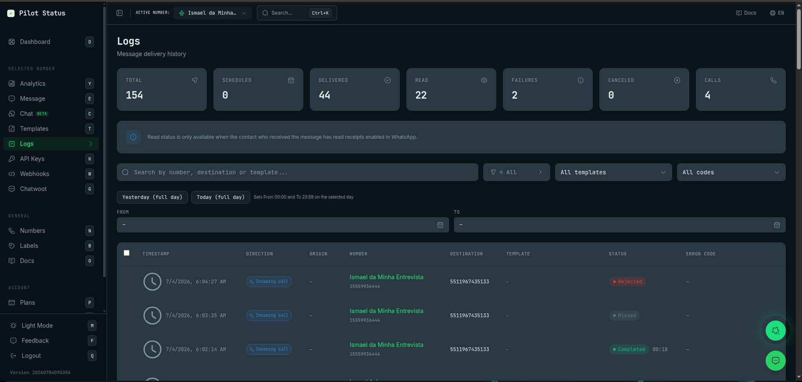

Las llamadas de WhatsApp Business te permiten hacer y recibir **llamadas de voz** con tus clientes por WhatsApp, mediante la API `/v1/calls*`.

## Proveedores compatibles

Las llamadas funcionan en **dos** tipos de proveedor, y se comportan de forma distinta en cada uno:

| Proveedor | Qué es | Modelo de medios |
| --- | --- | --- |
| **META** (Meta Cloud API) | Número oficial de WhatsApp Business | **Solo señalización**: Pilot Status retransmite el SDP (RFC 8866); el audio fluye **navegador ↔ WhatsApp** directamente por WebRTC |
| **API no oficial** (conexión por código QR) | Un número conectado escaneando un código QR | **Medios del lado del servidor**: sin SDP; el audio corre en el servidor. Inicias/contestas/rechazas/cuelgas por la API y envías audio o abres un stream en tiempo real mediante endpoints dedicados |

<Warning>
  Cualquier otro tipo de número devuelve `400 FEATURE_NOT_SUPPORTED`. El mensaje de error: _"Calling is only supported on Meta Cloud API numbers and unofficial API (QR code connection) numbers"_ En la API no oficial, las llamadas solo existen en la **conexión por código QR actual**; los números que siguen en la conexión por QR anterior devuelven `400 FEATURE_NOT_SUPPORTED` (reconecta el número para tener llamadas). Un número no oficial que no está conectado devuelve `409 WHATSAPP_INSTANCE_NOT_CONNECTED`.

  **Los números en coexistencia no pueden llamar.** Meta solo habilita llamadas en números conectados directamente a la Cloud API. Un número que sigue en la app WhatsApp Business (coexistencia) devuelve `400 CALLS_NOT_AVAILABLE_COEXISTENCE` al iniciar, aceptar, pre-aceptar y en los endpoints de permisos, antes de que cualquier solicitud llegue a Meta. Listar, rechazar y terminar llamadas existentes sigue funcionando. El campo `coexistence` de `GET /v1/numbers/{id}` indica qué números están afectados.
</Warning>

<Note>
  **Habilitar las llamadas en un número oficial (Meta Cloud) tiene dos requisitos previos del lado de Meta:** (1) un nivel de mensajería `TIER_2K` (2,000 msgs/24h) o superior, que es la barrera de Meta para la Calling API (intentarlo por debajo devuelve el error de Meta `138015`); **y** (2) la WABA debe tener **suscrito el campo de webhook `calls`** (o SIP configurado); de lo contrario, Meta devuelve `138018` (_"technical pre-requisites not met"_). Pilot Status activa las llamadas **automáticamente** cuando conectas el número y vuelve a intentarlo a medida que sube el nivel de mensajería, así que un número nuevo en un nivel bajo (por ejemplo, `TIER_250`) simplemente todavía no puede recibir llamadas. El nivel que cuenta es el **propio** `messaging_limit_tier` del número, no el límite del Business Portfolio (`whatsapp_business_manager_messaging_limit`), que es un número distinto, normalmente más alto, y no habilita las llamadas. También puedes activarlo manualmente con el botón **Enable calling** en los detalles de Meta del número en la página **Numbers**: devuelve `ENABLED`, `PENDING_TIER` (el nivel sigue por debajo de 2K) o `PENDING_WEBHOOK` (suscribe el campo de webhook `calls` en la WABA o configura SIP y vuelve a intentarlo). Los números no oficiales (web) no tienen esa barrera.
</Note>

<Warning>
  **Un número en coexistencia con la app WhatsApp Business no puede usar llamadas en absoluto.** Cuando un número sigue funcionando en la app WhatsApp Business del teléfono y solo está _conectado_ a la Cloud API, Meta nunca lo registra como un número completo de Cloud API: `POST /{phone-number-id}/register` se rechaza con _"Register endpoint is not available for SMB businesses"_, y toda escritura en la configuración de llamadas responde con el error de Meta **`141000`**: _"The phone number is not a valid Cloud API number"_. La mensajería sigue funcionando con normalidad; solo se bloquean las llamadas, y ningún aumento de nivel ni suscripción de webhook cambia eso. Señales reveladoras en los detalles de Meta del número: `code_verification_status: NOT_VERIFIED`, `name_status: NON_EXISTS` y ningún PIN habilitado. La única salida es migrar el número de la app WhatsApp Business a la Cloud API (luego hay que registrarlo y llegar a `TIER_2K`), lo que también lo quita de la app en el teléfono.
</Warning>

## Tipos de llamada

| Tipo | Quién la inicia | Facturación |
| --- | --- | --- |
| **BIC**: llamada iniciada por la empresa (Business-Initiated Call) | Tú llamas al cliente | En META, la factura **Meta directamente en tu WABA** (por minuto, pulsos de 6 segundos, solo cuando se contesta). En números de la API no oficial no hay cargo por minuto de Meta. |
| **UIC**: llamada iniciada por el usuario (User-Initiated Call) | El cliente te llama | Gratis |

Pilot Status **no cobra** nada por las llamadas.

### Precios de Meta para llamadas iniciadas por la empresa (números oficiales)

En números de Meta Cloud API, los minutos de BIC los factura **Meta directamente en tu WABA** ([precios oficiales](https://developers.facebook.com/documentation/business-messaging/whatsapp/calling/pricing)):

- **Las llamadas iniciadas por el usuario son gratis**: siempre, en ambos proveedores.
- La duración de las BIC se mide en **pulsos de 6 segundos**; cualquier pulso parcial cuenta como un pulso completo (una llamada de 56 segundos = 9.33 → **10 pulsos**).
- La tarifa por pulso depende del **país de destino** y de tu **nivel de volumen mensual** (la misma estructura de acumulación por niveles que la mensajería de WhatsApp). Cuando una llamada cruza el límite de un nivel, **toda la llamada se cobra a la tarifa más barata (de mayor volumen)**.
- Se **requiere un método de pago válido en la WABA** para hacer llamadas; sin él, las llamadas fallan con el error de Meta `131044`.
- Los **mensajes de solicitud de permiso de llamada** se facturan como mensajes normales, no como minutos de llamada.
- Las tarifas se publican por moneda en las tablas de tarifas de Meta (tabla de tarifas en BRL vigente desde el 1 de julio de 2026).

## Compatibilidad de funciones por proveedor

| Función | Endpoint | META | API no oficial (QR) |
| --- | --- | :-: | :-: |
| Hacer una llamada (BIC) | `POST /v1/calls` | ✅ oferta SDP **obligatoria** | ✅ **sin SDP** |
| Listar llamadas | `GET /v1/calls` | ✅ | ✅ |
| Obtener una llamada | `GET /v1/calls/{callId}` | ✅ | ✅ |
| Aceptar (UIC) | `POST /v1/calls/{callId}/accept` | ✅ respuesta SDP **obligatoria** | ✅ **sin SDP** |
| Pre-aceptar | `POST /v1/calls/{callId}/pre-accept` | ✅ | ❌ |
| Rechazar | `POST /v1/calls/{callId}/reject` | ✅ | ✅ |
| Terminar / colgar | `POST /v1/calls/{callId}/terminate` | ✅ | ✅ |
| Reproducir un archivo de audio en la llamada | `POST /v1/calls/{callId}/play` | ❌ | ✅ **solo no oficial** |
| Sesión de medios en tiempo real (PCM16 WS) | `POST /v1/calls/{callId}/realtime-session` | ❌ | ✅ **solo no oficial** |
| Obtener / actualizar la configuración de llamadas | `GET`·`PUT /v1/calls/settings` | ✅ | ❌ |
| Obtener permisos de llamada | `GET /v1/calls/permissions` | ✅ | ❌ |
| Solicitar permiso de llamada | `POST /v1/calls/permissions/request` | ✅ | ❌ |

Una función que un proveedor no admite devuelve `400 FEATURE_NOT_SUPPORTED`.

## Cómo maneja los medios cada proveedor

### META: solo señalización

Pilot Status retransmite el SDP; el audio fluye **navegador ↔ WhatsApp** directamente. Tu cliente WebRTC produce la oferta/respuesta SDP. No hay nada del lado del servidor en lo que reproducir, así que `play` y `realtime-session` no aplican. La página **/chat** del dashboard incluye un **softphone** integrado (disponible en ambos tipos de número).

### API no oficial (conexión por código QR): medios del lado del servidor (sin SDP)

`POST /v1/calls` y `/accept` **no reciben `sdp`**: la llamada se conecta y el audio se procesa en el servidor. Iniciar, contestar, rechazar y colgar usan los mismos endpoints que META (`POST /v1/calls`, `/accept`, `/reject`, `/terminate`). Luego controlas el audio con los dos endpoints exclusivos de la API no oficial:

- `POST /v1/calls/{callId}/play`: el backend descarga tu archivo de audio (la URL se valida del lado del servidor) y lo reproduce en la llamada; pasa `hangupAfterPlay: true` para terminar la llamada automáticamente cuando termine la reproducción (los bots de notificación no necesitan un temporizador del lado del cliente).
- `POST /v1/calls/{callId}/realtime-session`: abre una sesión **WebSocket PCM16** full-duplex; el body `{ "mode": "talk" | "listen" }` es obligatorio (`talk` envía y recibe audio, `listen` solo recibe). El `wsUrl` devuelto está en un host de medios público dedicado y su token es de un solo uso con un TTL corto (~2 min); conéctate a él directamente (no pasa por el proxy de la API).

Los números de la API no oficial no necesitan concesión de **permiso** para BIC, no tienen **configuración** de llamadas ni **pre-accept** (conceptos de Meta): esos endpoints devuelven `400 FEATURE_NOT_SUPPORTED`.

## Capa de migración / compatibilidad

Si ya tienes código escrito contra la API nativa de llamadas de la conexión por código QR, la capa de compatibilidad hace de proxy de sus endpoints `/call/*` (start, answer, reject, hangup, list, get, media/play, media/realtime/session): apunta tu URL base a `/api/layer/evolution-go/` y tu código de llamadas existente sigue funcionando. Al WebSocket en tiempo real (`/call/media/realtime/ws/*`) se accede **directamente** en un host de medios público dedicado (la capa HTTP no hace upgrade de WebSockets); las rutas de frontend/manager no pasan por el proxy.

## Sigue el progreso de las llamadas con webhooks

Suscríbete a `call.ringing`, `call.connected`, `call.ended` (incluye `duration` en segundos cuando se contesta), `call.missed` y `call.permission_updated`. `call.ringing`, `call.connected`, `call.ended` y `call.missed` se disparan tanto para números META como de la API no oficial; `call.permission_updated` es **solo META** (la API no oficial no tiene modelo de permisos).

<Frame caption="Llamadas en la página Logs: cada llamada aparece con su dirección, su estado (Completed con duración, Missed, Rejected) y su propio contador CALLS.">
  
</Frame>

## Próximos pasos

<CardGroup cols={2}>
  <Card title="Referencia de la API de llamadas" icon="phone" href="/es/api/calls/endpoints">
    Todos los endpoints, parámetros y comportamiento por proveedor.
  </Card>

  <Card title="Guía de llamadas de voz" icon="book-open" href="/es/guides/voice-calls">
    Paso a paso: hacer una llamada, contestar, permisos, softphone.
  </Card>
</CardGroup>
