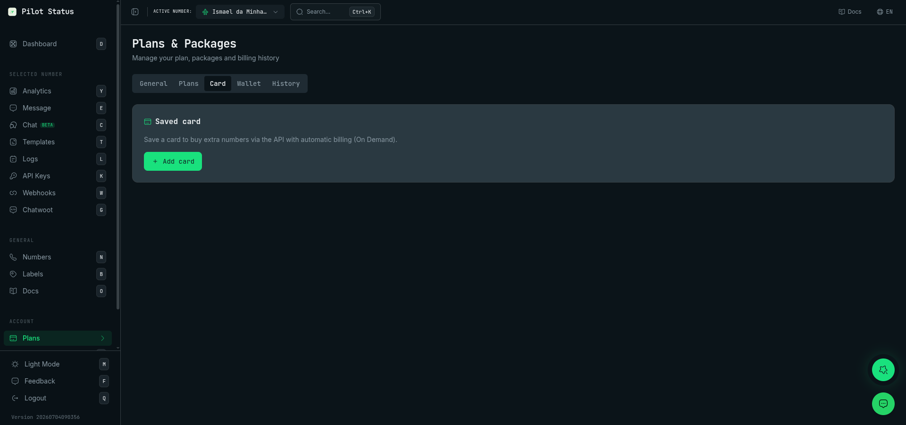

# Números extra y On Demand

Compra un número de WhatsApp extra por la API pública con una clave **con alcance de tenant**. Los precios siguen el modelo **On Demand**: pagas un **precio mensual por número conectado** (definido por tenant por el equipo de Pilot Status) y obtienes **mensajes ilimitados** en todos los números.

<Frame caption="La pestaña Card en Plans: guarda una tarjeta una vez y los números extra comprados por la API se facturan automáticamente (On Demand).">
  
</Frame>

La facturación funciona con una **billetera prepaga**: primero los créditos, y la tarjeta guardada para lo que los créditos no cubran. Los créditos se pueden recargar en el panel o por la API, con tarjeta o Pix (workspaces en BRL). Consulta [Billetera y tarjeta por API](/es/api/wallet-and-card).

<Note>
  Las claves con alcance de número reciben **403**: usa una [clave de workspace](/es/api/key-types#claves-de-workspace) (**Workspace keys** en el panel) o una clave de cuenta con `x-workspace-id`.
</Note>

**Rol**, con una clave de cuenta o un token OAuth/MCP: la vista previa (`GET`) requiere **Owner o Admin**; comprar, programar una reducción y cancelarla (`POST`, `DELETE`, `DELETE …/schedule`) son acciones de **Owner**. Un rol inferior recibe **403 `PERMISSION_DENIED`**. Una clave de workspace no tiene usuario, así que no se aplica ningún rol.

## Se cobra al conectar por primera vez

Un **número extra** es un número de WhatsApp que supera la capacidad que tu workspace pagó: la asignación del plan, más los números extra que compraste, más los que se te otorgaron. Se cobra cuando el número **se conecta por primera vez**, en todos los planes y sin importar cómo se conectó: el panel, la API, el servidor MCP, un enlace de vinculación remota o el Embedded Signup de Meta.

- **Crear un número no cobra nada.** Tampoco generar un enlace de vinculación.
- **Un número que nunca se conectó no cuenta** para tu capacidad ni para tu factura mensual. Solo pagas por los números que realmente se vincularon.
- **En un plan pago el cargo es automático.** Es la misma compra que `POST /v1/subscription/extra-numbers` para un número: prorrateado por los días que quedan en el ciclo, primero los créditos de la billetera y el resto en la tarjeta guardada. El plan Free nunca compra por sí solo; consulta [Plan Free](#plan-free).
- **Comprar por adelantado sigue funcionando.** Un número que se conecta dentro de la capacidad que ya pagaste no se cobra de nuevo.
- **Para un número no oficial**, la primera conexión es la primera vez que se completa su código QR o código de vinculación. **Para un número oficial (Meta Cloud API)** es cuando el número se activa, por ejemplo cuando termina el Embedded Signup.

<Note>
  **Queda un rechazo en la creación.** En un plan pago, cuando el siguiente número sería un número extra y el workspace no tiene ni saldo en la billetera para cubrirlo ni una tarjeta guardada, crear el número (o su enlace de vinculación) sigue respondiendo **`402`** con `INSUFFICIENT_FUNDS` o `PLAN_NUMBER_LIMIT_REACHED`. En el plan Free, un número que supera la asignación del plan se rechaza con `402 PLAN_NUMBER_LIMIT_REACHED` sin importar el saldo. El cuerpo no cambia: consulta [errores de capacidad](/es/api/numbers/create#errores-de-capacidad-y-cómo-resolverlos).
</Note>

### Plan Free

**El plan Free nunca compra un número extra por sí solo.** Comprar un número extra en Free convierte la cuenta a On Demand y transforma el número que ya tenías en uno pago. Eso solo ocurre mediante la compra explícita, que pide confirmación: el diálogo de compra en el panel, o `POST /v1/subscription/extra-numbers` con `confirm: true`. Un workspace Free nunca se convierte ni se cobra por conectar un número.

- **Crear un número que supera la asignación del plan se rechaza** con `402 PLAN_NUMBER_LIMIT_REACHED`, incluso cuando el workspace tiene saldo en la billetera o una tarjeta guardada. En los planes pagos, los fondos permiten la creación y el extra se cobra en la primera conexión.
- **Vincular un número que nunca se conectó también se rechaza** cuando la asignación del plan ya está llena. `GET /v1/numbers/{id}/connect`, el paso de conexión de un enlace de vinculación remota y `POST /v1/numbers/remote-pairing` para un teléfono que ya existe responden `402 PLAN_NUMBER_LIMIT_REACHED`. Volver a vincular un número que ya se había conectado nunca se rechaza.
- **Si un segundo número se conecta de todos modos** (dos vinculaciones iniciadas en paralelo), no se cobra nada y el plan no cambia. El número sigue conectado con el envío bloqueado (`409 NUMBER_BLOCKED`, `reason: "extra_charge_unpaid"`), y `POST /v1/numbers/{id}/pay` responde `402 PLAN_NUMBER_LIMIT_REACHED` para él. Una recarga o una tarjeta guardada no levanta este bloqueo.

Para usar el segundo número, compra el número extra tú mismo o sube de plan. Un número que estaba bloqueado se libera entonces en un máximo de 15 minutos, o de inmediato si llamas a `POST /v1/numbers/{id}/pay`, que responde `not_required`.

### Cuando el cargo es rechazado

Si la tarjeta es rechazada o no hay fondos, el número **sigue conectado**, pero **el envío desde él queda bloqueado** hasta que se pague el cargo:

- `POST /v1/messages/send` responde **`409 NUMBER_BLOCKED`** con `reason: "extra_charge_unpaid"`.
- Un mensaje que ya estaba en cola falla y muestra `NUMBER_BLOCKED` en los [logs](/es/api/messages/log-error-codes).
- `GET /v1/numbers` y `GET /v1/numbers/{id}` muestran [`extraChargeUnpaidSince`](/es/api/numbers/list#cargo-de-número-extra-sin-pagar) en el número.

```json
{
  "error": "This number's extra-number charge is unpaid. Pay it to resume sending from this number. | A cobrança do número extra deste número está pendente. Pague para voltar a enviar por ele.",
  "code": "NUMBER_BLOCKED",
  "reason": "extra_charge_unpaid",
  "observedAt": "2026-10-10T12:00:00.000Z"
}
```

Solo ese número queda bloqueado. Tus otros números siguen enviando, y el número bloqueado sigue recibiendo.

<Note>
  **Un cargo que no se pudo concluir no es un rechazo.** Cuando no se puede contactar al procesador de pagos, no se bloquea nada: el número sigue enviando y el cargo se reintenta automáticamente cada 15 minutos.
</Note>

### Qué levanta el bloqueo

| Lo que haces | Lo que pasa |
| --- | --- |
| Recargas la billetera | El cargo se reintenta automáticamente. |
| Guardas una tarjeta | El cargo se reintenta automáticamente. |
| Haces clic en **Pay now** en la página **Numbers** del panel | El cargo se reintenta en el momento. Solo el dueño del workspace. |
| Llamas a [`POST /v1/numbers/{id}/pay`](/es/api/numbers/pay) | El cargo se reintenta en el momento. |

Si la renovación de tu propio plan está vencida, una recarga o una tarjeta guardada paga primero la renovación.

En el plan Free no se aplica ninguna de las cuatro: consulta [Plan Free](#plan-free).

El bloqueo también se levanta solo, en un máximo de 15 minutos, cuando tu capacidad llega a cubrir el número, por ejemplo después de comprar un número extra con `POST /v1/subscription/extra-numbers`.

### Tras 7 días sin pagar

- **Un número conectado por código QR** que sigue sin pagarse durante **7 días** se desconecta: su dispositivo se cierra y el número deja de contar para tu capacidad. Se envía un recordatorio 2 días antes, y `extraChargeDisconnectAt` en el número te indica cuándo. Conectarlo de nuevo es una nueva primera conexión, que se cobra otra vez.
- **Un número de Meta Cloud API nunca se desconecta.** Sigue bloqueado para enviar hasta que se pague.

## GET /v1/subscription/extra-numbers: vista previa (dry-run)

```bash
curl "https://pilotstatus.com.br/v1/subscription/extra-numbers?quantity=1" \
  -H "x-api-key: ps_your_tenant_scoped_key"
```

Devuelve el costo y si la compra convierte el plan. `quantity` es `1` por defecto; se redondea hacia abajo a un entero, y un valor que no sea un número positivo se trata como `1` (la vista previa nunca responde `400`). `proratedTotal` es lo que se te cobra **ahora**; `monthlyTotalBRL` es lo que se repite en cada ciclo después:

```json
{
  "plan": "FREE",
  "requiresConversion": true,
  "explanation": { "pt": "…", "en": "…" },
  "currentNumbers": 1,
  "requested": 1,
  "billedQuantity": 2,
  "currency": "BRL",
  "unitPriceMonthly": 29.9,
  "proratedUnitPrice": 14.95,
  "proratedTotal": 29.9,
  "remainingDays": 15,
  "totalDaysInCycle": 30,
  "walletBalance": 0,
  "hasSavedCard": false,
  "fundingSource": "none",
  "canFund": false,
  "unitPriceBRL": 29.9,
  "monthlyTotalBRL": 59.8
}
```

<Note>
  **Solo pagas por los días que quedan en el ciclo.** El primer cargo es prorrateado: `proratedUnitPrice = unitPriceMonthly × (remainingDays / totalDaysInCycle)`. En el ejemplo anterior queda la mitad del ciclo, así que 2 números × R\$14,95 = **R\$29,90 ahora**, y **R\$59,80/mes** a partir del siguiente ciclo.
</Note>

`fundingSource` te indica cómo se cubrirá el cargo: `credits` (la billetera cubre todo `proratedTotal`), `credits+card` (una parte con créditos y el resto en la tarjeta guardada), `card` o `none`. `none` significa que la billetera no cubre `proratedTotal` **y** no hay tarjeta guardada (`hasSavedCard: false`): `canFund` es `false`, y el `POST` responde **`402 INSUFFICIENT_FUNDS`** sin cobrar nada. **No** devuelve un enlace de checkout: recarga la billetera o guarda una tarjeta primero (`POST /v1/billing/checkout`, más abajo).

## POST /v1/subscription/extra-numbers: comprar

```bash
curl -X POST "https://pilotstatus.com.br/v1/subscription/extra-numbers" \
  -H "Content-Type: application/json" \
  -H "x-api-key: ps_your_tenant_scoped_key" \
  -d '{ "quantity": 1, "confirm": true }'
```

Comportamiento:

- **Conversión de Free a On Demand.** Si estás en el plan **Free**, comprar un número extra te pasa a On Demand: tu número actual (antes gratuito, limitado a 200 mensajes) se convierte en un número **pago e ilimitado** **y** el número nuevo también se factura. Así que comprar 1 extra estando en Free te factura **2** números. Como esto cambia lo que pagas, el `POST` devuelve **409 `CONFIRMATION_REQUIRED`** (con la vista previa) a menos que envíes `confirm: true`.
- **Un cuerpo mal formado se rechaza, no se completa con valores por defecto.** Un cuerpo que no es JSON válido (por ejemplo un `{"quantity": 3` truncado) devuelve **`400 INVALID_BODY`** antes de cualquier vista previa, cargo o cambio de plan: no se factura nada. Solo un cuerpo **vacío** (sin ningún byte) significa `quantity = 1`. Consulta [Cuerpo JSON mal formado](/es/api/overview#cuerpo-json-mal-formado).
- **`quantity` debe ser un entero ≥ 1.** Cualquier otra cosa (`0`, `1.5`, `"2"`) devuelve `400` con `{ "error": "quantity deve ser um inteiro >= 1" }`, un mensaje solo en portugués y **sin `code`**. No se cobra nada.
- **La capacidad sin usar se rechaza.** Si el workspace ya tiene al menos `quantity` espacios (pagos o incluidos en el plan) sin número conectado, la compra devuelve **409 `UNUSED_CAPACITY_AVAILABLE`** (`{ unusedSlots, freePlanSlots, requested, maxNumbers, currentNumberCount }`) y no se cobra nada. Conecta un número en el espacio que ya tienes: la capacidad pagada se factura cada mes, la use un número o no.
- **Ya en On Demand / pago.** La compra aumenta tu cantidad de números; los mensajes siguen ilimitados.
- **Pago.** El costo prorrateado se cobra **en el momento**: primero de tu **billetera prepaga** y luego el resto de tu tarjeta guardada (**Plans → Cartão** en el panel, o `POST /v1/billing/checkout` con `add_card`). Una compra exitosa responde `{ "success": true, "charged": true, … }`: `creditsUsed` y `cardCharged` muestran cómo se dividió el cargo, y `paidExtraNumbers` ya incluye el nuevo espacio, así que puedes crear el número con `POST /v1/numbers` de inmediato. **Esta ruta nunca devuelve un enlace de checkout** (no hay `checkoutUrl`, y `charged` nunca es `false`): sin créditos suficientes ni tarjeta guardada devuelve **`402 INSUFFICIENT_FUNDS`**, no se cobra nada y los créditos que hubiera empezado a usar se devuelven. Recarga o guarda una tarjeta y vuelve a intentarlo.
- **La recurrencia mensual sale de la billetera**, no de una suscripción separada. En cada ciclo, `paidExtraNumbers × precio unitario` se debita de tus créditos y, si no alcanza, de tu tarjeta guardada. Recarga la billetera en el panel o por la API, con tarjeta o Pix ([Billetera y tarjeta por API](/es/api/wallet-and-card)), así puedes usar On Demand con créditos Pix sin guardar nunca una tarjeta.

<Note>
  Mantén disponibles créditos o una tarjeta guardada. Si el cargo de un ciclo no se puede cubrir, tienes **2 días** para agregar créditos o actualizar la tarjeta antes de que todos tus números dejen de **enviar** (la recepción sigue funcionando). Agregar fondos reactiva de inmediato.
</Note>

<Note>
  Para reducir tu capacidad pagada, consulta la sección de reducción programada más abajo.
</Note>

### Idempotency-Key

Envía un encabezado `Idempotency-Key` en `POST /v1/subscription/extra-numbers` para que un reintento tras un timeout no compre dos veces. **Sin él, cada `POST` es una compra nueva.**

- **Misma clave, mismo cuerpo, dentro de 24 horas:** recibes de vuelta el resultado **original**: el mismo cuerpo, sin segundo cargo y sin segundo espacio.
- **Misma clave, `quantity` diferente:** una compra diferente. El cuerpo forma parte de la clave.
- **Misma clave en un reintento cuyo monto prorrateado cambió** (el monto varía con el tiempo que queda en el ciclo): **409 `IDEMPOTENCY_KEY_REUSED`**. Es posible que el cargo original se haya realizado: revisa tus compras antes de reintentar, y usa una clave nueva solo si realmente quieres otro número.
- **Misma clave mientras la primera solicitud sigue en curso:** **409 `IDEMPOTENCY_KEY_IN_USE`**. Espera unos segundos y repite con la **misma** clave.
- Hasta 255 caracteres, sin caracteres de control; de lo contrario **400 `IDEMPOTENCY_KEY_INVALID`**. Un valor vacío cuenta como ausente.
- Después de 24 horas, la misma clave es una compra **nueva**.

<Warning>
  **Dos solicitudes enviadas al mismo tiempo con la misma clave no las deduplicamos nosotros.** Ambas pueden debitar la billetera; solo la parte de la tarjeta se consolida en un único pago. Envía una solicitud y reintenta solo después de que haya fallado o agotado el tiempo.
</Warning>

## Cuando el pago no se concreta

`POST /v1/subscription/extra-numbers` distingue **tres** fallos, y no comparten solución. Decide según `code`, nunca según el estado HTTP: dos de los tres son `402`.

| Estado | `code` | Qué pasó | Qué hacer |
| --- | --- | --- | --- |
| `402` | `INSUFFICIENT_FUNDS` | La billetera no pudo cubrir el cargo **y** no hay una tarjeta guardada utilizable. Es el único caso que realmente tiene que ver con tu saldo. | Recarga la billetera (`POST /v1/billing/checkout`, `wallet_topup` con `method` `card` o `pix`) o guarda una tarjeta. Luego reintenta. |
| `402` | `PAYMENT_FAILED` | Se intentó el cargo y no se completó. O el emisor rechazó la tarjeta, o el intento falló por un motivo que no podemos atribuir a tu saldo. | Corrige o reemplaza la tarjeta y reintenta. Agregar créditos también puede resolverlo, ya que los créditos se usan antes que la tarjeta. |
| `502` | `PAYMENT_PROVIDER_ERROR` | No pudimos obtener respuesta del procesador de pagos. | **Revisa tu estado de cuenta antes de reintentar**; consulta la nota más abajo. |

Todos estos cuerpos incluyen `proratedTotal` y `currency`, así que puedes mostrar el monto que se intentó cobrar. `INSUFFICIENT_FUNDS` también incluye `walletReason`, que en esta ruta siempre es `NO_CARD`.

Este es el cuerpo de `INSUFFICIENT_FUNDS` cuando los créditos no cubren el cargo y no hay tarjeta guardada (`error` es un mensaje legible para personas, en portugués; decide según `code`):

```json
{
  "error": "Saldo insuficiente na carteira e cartão indisponível para cobrar o número extra. Adicione créditos ou um cartão.",
  "code": "INSUFFICIENT_FUNDS",
  "proratedTotal": 29.9,
  "currency": "BRL",
  "walletReason": "NO_CARD"
}
```

<Note>
  **En los tres casos el número extra _no_ se agregó.** Tu `paidExtraNumbers` no cambia y no se desbloqueó ningún espacio: toda escritura ocurre después de un cargo exitoso.
</Note>

<Warning>
  **`502 PAYMENT_PROVIDER_ERROR` no significa "no se cobró nada".** Significa que la solicitud al procesador falló _o_ que su respuesta se perdió: es posible que el cargo se haya completado del lado del procesador sin que recibiéramos respuesta. El conteo no cambió, así que un reintento a ciegas puede cobrar dos veces. Revisa primero tu estado de cuenta.
</Warning>

### El campo `declineCode`

`PAYMENT_FAILED` **a veces** incluye `declineCode`. Cuando está presente, es el código de rechazo propio de la red de la tarjeta, textual (`insufficient_funds`, `expired_card`, `card_not_supported`, …), seguro para mostrar al titular de la tarjeta o para tomar decisiones.

⚠️ **Su ausencia no te dice nada.** Un `PAYMENT_FAILED` sin `declineCode` es un pago que no se concretó por un motivo que no pudimos atribuir a la tarjeta: un límite de tasa en la solicitud, una clave de integración vencida, una intención de pago que quedó en un estado no exitoso. No inventamos un código para llenar el campo. Por lo tanto:

- Toma `code: "PAYMENT_FAILED"` como la decisión. Siempre está presente y siempre significa lo mismo.
- Usa `declineCode` solo para _afinar el mensaje_ cuando esté presente.
- Nunca interpretes "sin `declineCode`" como "no fue un rechazo", y nunca como "la tarjeta está bien".

<Note>
  `declineCode` nunca aparece en `INSUFFICIENT_FUNDS` ni en `PAYMENT_PROVIDER_ERROR`. Ninguno de los dos es un rechazo de tarjeta.
</Note>

## La capacidad pagada es un derecho de 30 días

Cuando compras números extra, esa **capacidad es tuya durante todo el ciclo de 30 días**. Dos consecuencias:

- **Eliminar un número _no_ reduce tu capacidad pagada.** `DELETE /v1/numbers/<id>` libera el espacio para que puedas reconectar otro número en el mismo ciclo; tu cantidad pagada y tu factura siguen iguales hasta que termine el ciclo.
- **Reducir la capacidad es una acción explícita y programada.** Tú decides bajar la cantidad de espacios pagados; el cambio entra en vigor en el **siguiente** ciclo, cuando la facturación baja al nuevo monto. No se reembolsa nada del ciclo en curso.

## Pay As You Go funciona de otra manera

En **Pay As You Go** no hay capacidad que recomprar ni que programar a la baja: pagas por los números que tienes:

- **Un número se cobra cuando se conecta por primera vez**, prorrateado por los días que quedan en el ciclo: la misma regla que en todos los planes, [descrita arriba](#se-cobra-al-conectar-por-primera-vez). Para un número no oficial es la primera conexión; para un número oficial (Meta) es cuando termina el Embedded Signup.
- **El espacio que pagaste dura todo el ciclo.** Eliminar un número y conectar otro en su lugar **no** cobra de nuevo.
- **El siguiente ciclo factura cada número que se conectó y no fue eliminado**, incluidos los desconectados el día de la renovación, menos los números que se te otorgaron, al precio por número. Desconectar no detiene el cobro; eliminar sí. La única excepción es la [desconexión automática tras 7 días sin pagar](#tras-7-días-sin-pagar): borra la primera conexión del número, así que deja de facturarse hasta que se conecte de nuevo. Nada se acumula del ciclo anterior, así que no hay nada que programar a la baja; consulta el `409 NOT_APPLICABLE_FOR_PLAN` en el endpoint de abajo.
- **Una vinculación que nunca terminaste no es un número y no se factura.** La fila "esperando conexión" que aparece mientras tu usuario final está dentro del diálogo de Facebook queda excluida de la facturación y de tu capacidad, y se elimina automáticamente 24 h después de crearse.

## DELETE /v1/subscription/extra-numbers: programar una reducción

Programa una reducción de `quantity` espacio(s) pagado(s) para el **siguiente** ciclo:

```bash
curl -X DELETE "https://pilotstatus.com.br/v1/subscription/extra-numbers" \
  -H "Content-Type: application/json" \
  -H "x-api-key: ps_your_tenant_scoped_key" \
  -d '{ "quantity": 1 }'
```

Comportamiento:

- **Programada, no inmediata.** Este ciclo mantiene la capacidad actual (sin reembolso); la reducción se aplica en el siguiente cambio de ciclo, cuando los meses futuros se facturan por menos.
- **Las llamadas repetidas se acumulan.** Cada llamada resta `quantity` del objetivo ya programado (o de la cantidad pagada actual cuando no hay nada programado), nunca por debajo de `0`. Dos llamadas con `quantity: 1` programan una reducción de 2. Si el resultado no queda por debajo de la cantidad pagada actual (por ejemplo, si no hay nada pago), la llamada cancela en cambio cualquier programación pendiente. Cancélala con `DELETE …/schedule` (abajo).
- **No puede bajar de los números conectados.** Si el objetivo dejara tu límite por debajo de los números que aún tienes conectados, devuelve **409 `NUMBER_LIMIT_EXCEEDED`** (`{ currentNumberCount, maxNumbers }`): elimina un número primero.
- **No disponible en Pay As You Go.** Devuelve **409 `NOT_APPLICABLE_FOR_PLAN`**. No hay capacidad pagada que devolver: Pay As You Go factura los números que tienes, y el siguiente ciclo ya cobra solo los números que se conectaron y no fueron eliminados. Para pagar menos, elimina el número; no hace falta programar nada.
- **`quantity`** es `1` por defecto y debe ser un entero ≥ 1 (de lo contrario `400`, con el mismo cuerpo que en `POST`). El objetivo se limita para que nunca bajes de `0` extras pagados. Las claves con alcance de número reciben **403**.
- **Sin suscripción.** Un workspace sin suscripción recibe **404 `NO_SUBSCRIPTION`**.
- **Cuerpo mal formado.** Un cuerpo que no es JSON válido devuelve **`400 INVALID_BODY`** y no se programa nada. Un cuerpo vacío sigue significando `quantity = 1`.

Respuesta: `paidExtraNumbers` y `maxNumbers` se mantienen en los valores actuales (de este ciclo); `scheduledPaidExtraNumbers` es el objetivo que entra en vigor en `scheduledReductionEffectiveAt`, el final del ciclo actual. No se cobra ni se reembolsa nada, así que los campos de dinero son `0`:

```json
{
  "success": true,
  "charged": true,
  "plan": "ON_DEMAND",
  "paidExtraNumbers": 5,
  "proratedTotal": 0,
  "currency": "BRL",
  "creditsUsed": 0,
  "cardCharged": 0,
  "grantedExtraNumbers": 0,
  "baseMaxNumbers": 1,
  "maxNumbers": 6,
  "currentNumberCount": 4,
  "scheduledPaidExtraNumbers": 4,
  "scheduledReductionEffectiveAt": "2026-12-01T00:00:00.000Z",
  "monthlyTotalBRL": 0
}
```

## DELETE /v1/subscription/extra-numbers/schedule: cancelar la reducción programada

Cancela una reducción pendiente para que el siguiente ciclo mantenga tu capacidad pagada actual. No hace nada si no hay nada programado.

```bash
curl -X DELETE "https://pilotstatus.com.br/v1/subscription/extra-numbers/schedule" \
  -H "x-api-key: ps_your_tenant_scoped_key"
```

No lleva cuerpo. La respuesta tiene la misma forma que la de la reducción, con `scheduledPaidExtraNumbers` y `scheduledReductionEffectiveAt` de vuelta en `null`. Un workspace sin suscripción recibe **404 `NO_SUBSCRIPTION`**.

```json
{
  "success": true,
  "charged": true,
  "plan": "ON_DEMAND",
  "paidExtraNumbers": 5,
  "proratedTotal": 0,
  "currency": "BRL",
  "creditsUsed": 0,
  "cardCharged": 0,
  "grantedExtraNumbers": 0,
  "baseMaxNumbers": 1,
  "maxNumbers": 6,
  "currentNumberCount": 4,
  "scheduledPaidExtraNumbers": null,
  "scheduledReductionEffectiveAt": null,
  "monthlyTotalBRL": 0
}
```

## POST /v1/billing/checkout: recargar la billetera / agregar una tarjeta

Recarga la billetera (página de tarjeta alojada o Pix) o abre una página alojada para guardar una tarjeta. La referencia completa (Pix, estado de la recarga y un formulario de tarjeta en tu propia página con Stripe Elements) está en [Billetera y tarjeta por API](/es/api/wallet-and-card).

```bash
curl -X POST "https://pilotstatus.com.br/v1/billing/checkout" \
  -H "Content-Type: application/json" \
  -H "x-api-key: ps_your_tenant_scoped_key" \
  -d '{ "purpose": "wallet_topup", "amount": 50 }'
```

- `purpose: "wallet_topup"`: recarga la billetera prepaga. `method: "card"` (por defecto) devuelve una página alojada de Stripe; `method: "pix"` (solo workspaces en BRL) devuelve en cambio un código Pix copia y pega y un código QR; consulta [Recargar con Pix](/es/api/wallet-and-card#recargar-con-pix). **Requiere `amount`**: un número positivo, en la moneda de tu cuenta (`BRL` o `USD` de la billetera; no se puede elegir por solicitud). Si falta, es cero, negativo o no numérico, devuelve `400` `{ "error": "amount must be a positive number. | amount deve ser um número positivo.", "code": "INVALID_AMOUNT" }`. Desde el 2026-10-29, todos los rechazos de este endpoint son bilingües (`English | Português`); los códigos no cambiaron.
- `purpose: "add_card"`: guarda una tarjeta en el workspace, en cualquier plan. Respalda a la billetera en todos los cargos: números extra, renovaciones de plan (incluido Pay As You Go) y líneas telefónicas.
- Un cuerpo que no es JSON válido devuelve `400` [`INVALID_BODY`](/es/api/overview#cuerpo-json-mal-formado). Un cuerpo vacío, o uno sin un `purpose` conocido, devuelve `400 INVALID_PURPOSE`.

Con `method: "card"` y con `add_card`, la respuesta contiene una `url` para abrir en el navegador. Para `wallet_topup` también incluye `method`, `orderId`, `amount` y `currency`; sigue el pedido con [`GET /v1/billing/topups/{orderId}`](/es/api/wallet-and-card#seguir-una-recarga):

```json
{
  "url": "https://checkout.stripe.com/c/pay/cs_test_…",
  "purpose": "wallet_topup",
  "method": "card",
  "orderId": "…",
  "amount": 50,
  "currency": "BRL"
}
```
