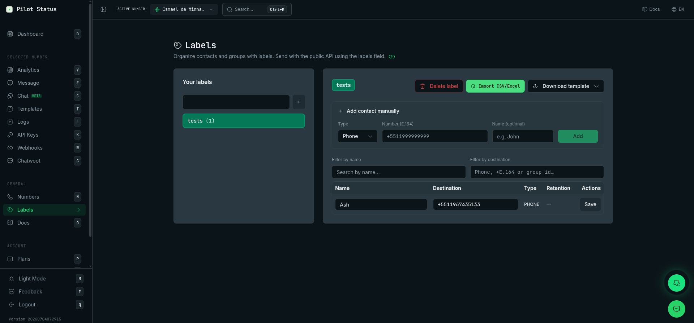

## Qué son las etiquetas

Las etiquetas marcan destinos (teléfono E.164 o grupo de WhatsApp `...@g.us`) con alcance de **tenant**. Adminístralas en **Config → Labels** (`/labels`): crea etiquetas, importa CSV/Excel, edita nombre/destino, copia un contacto de una etiqueta a otra.

<Frame caption="La página Labels: organiza contactos y grupos en etiquetas, importa desde CSV/Excel y luego pasa las etiquetas en POST /v1/messages/send.">
  
</Frame>

## API pública: enviar mensaje

En `POST /v1/messages/send`, opcionalmente envía:

```json
"labels": ["vip", "customers"]
```

- Funciona con `destinationNumber`, `groupId` o `newsletterId`.
- Hasta **50** nombres de etiqueta por envío, cada uno de 1 a 200 caracteres; una lista más larga se rechaza con `400 Validation error`.
- **No** existe un endpoint `/v1/labels`: las etiquetas se crean y vinculan solo mediante `labels` en el envío. El listado, el cambio de nombre y la importación se hacen en el dashboard.
- El procesamiento de etiquetas es **asíncrono**: hace upsert de las etiquetas por nombre y asocia el destino.
- La plataforma puede intentar completar el **nombre visible** del contacto con datos de WhatsApp de la instancia conectada cuando todavía está vacío.

### Ejemplo

<CodeGroup>

```bash cURL
curl -X POST "https://pilotstatus.com.br/v1/messages/send" \
  -H "Content-Type: application/json" \
  -H "x-api-key: ps_your_key_here" \
  -d '{
    "destinationNumber": "+5511999999999",
    "templateId": "order_update",
    "labels": ["vip", "customers"]
  }'
```

```json Response (202)
{
  "id": "cmm04obm46zz0qv4ycjp8x6r2",
  "correlationId": "b3f1c2a4-9e7d-4c5a-8f21-0a1b2c3d4e5f",
  "status": "QUEUED",
  "createdAt": "2026-07-04T12:00:00.000Z",
  "origin": "My WhatsApp",
  "sourceNumber": "5511888888888"
}
```

</CodeGroup>

## Retención (PII)

La retención se rige por el **modo PII del número**, que se cambia en el dashboard en la página API Keys (panel Privacy & retention) o en la configuración del número en Numbers:

- **`STORE_INDEFINITE`** (predeterminado): las conversaciones y los mensajes se almacenan indefinidamente.
- **`STORE_X_DAYS`**: solo se conservan los últimos N días de registros de chat; los registros más antiguos se eliminan a diario.
- **`RELAY_ONLY`**: las conversaciones no se persisten. Las etiquetas igual se crean cuando pasas `labels` en la API de envío, pero no se almacena contenido de conversaciones.

Para el comportamiento completo de cada modo, consulta [Retención de datos y modos PII](/es/trust/data-retention).

## Importación desde la UI

- Columnas de teléfono: las mismas que en Messages (`number`, `destinationnumber`, `phone`, etc.).
- Columna opcional de grupo: `groupId`, `group`; si termina en `@g.us`, la fila se trata como **GROUP**.
- Si el mismo destino ya existe en la etiqueta con un **nombre vacío** y la importación trae un nombre, el **nombre se actualiza**.

## Copiar contacto

Usa **Copy to…** (Copiar a…) para duplicar el vínculo en otra etiqueta (sin duplicados por destino; completa el nombre en el destino cuando está vacío).
