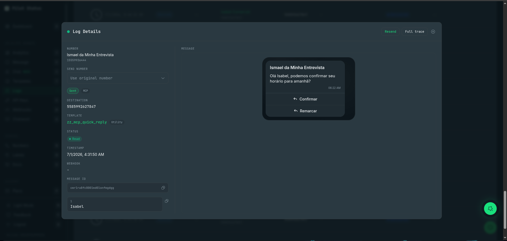

# Estado del mensaje

```text
GET https://pilotstatus.com.br/v1/messages/{messageId}
```

Después de enviar un mensaje y recibir un `id` (por ejemplo, `msg_abc`) de [`POST /v1/messages/send`](/es/api/messages/send), consulta su estado actual.

Para listar y filtrar muchos mensajes (enviados y recibidos), consulta [`GET /v1/messages`](/es/api/messages/list).

<Frame caption="Log Details en el dashboard: el mensaje renderizado, el template, el estado en vivo (Read) y el mismo messageId que consultas vía API.">
  
</Frame>

<Note>
  `{messageId}` acepta el `id` interno del mensaje devuelto por el endpoint de envío, el `correlationId` o el ID de mensaje de WhatsApp del proveedor (wamid).
</Note>

<Note>
  **En un número oficial (Meta)** este `id` también vuelve dentro del estado nativo de Meta, como [`statuses[].biz_opaque_callback_data`](/es/api/webhooks/events#vincular-un-estado-con-tu-envío-biz_opaque_callback_data), así que puedes asociar el estado con tu envío sin llamar a este endpoint.
</Note>

## Autenticación

Una key **con alcance de número** en `x-api-key` (o `x-api-key-id`), o una key de toda la cuenta que indique el número en el header [`x-whatsapp-number-id`](/es/api/authentication); sin él, `403 TENANT_SCOPE_NOT_ALLOWED`. Los **tokens OAuth / MCP y las keys de cuenta** (`ps_account_`) también necesitan `logs:read:content` (roles `AGENT`, `ADMIN`, `OWNER`); el rol `ANALYST` recibe `403 PERMISSION_DENIED`.

En un número no oficial, un mensaje que sigue en `QUEUED` o `SENT` y que ya tiene un id del proveedor se vuelve a verificar con el proveedor en esta llamada, así que la respuesta puede ser más reciente que el último webhook.

## Ejemplo

<CodeGroup>

```bash x-api-key
curl "https://pilotstatus.com.br/v1/messages/msg_abc" \
  -H "x-api-key: ps_your_key_here"
```

```bash x-api-key-id
curl "https://pilotstatus.com.br/v1/messages/msg_abc" \
  -H "x-api-key-id: ck_xxx"
```

</CodeGroup>

## Respuesta (200)

```json
{
  "id": "msg_abc",
  "status": "SENT",
  "correlationId": "corr_123",
  "destinationNumber": "+5511999999999",
  "template": "welcome_message",
  "createdAt": "2026-02-24T15:00:00.000Z",
  "sentAt": "2026-02-24T15:00:05.000Z",
  "deliveredAt": "2026-02-24T15:00:07.000Z",
  "readAt": null,
  "externalMessageId": "wamid.HBgLNTUxMTk5OTk5OTk5",
  "errorCode": null,
  "errorMessage": null,
  "origin": "API",
  "metaPricing": {
    "conversationId": "…",
    "originType": "referral_conversion",
    "category": "referral_conversion",
    "type": "free_entry_point"
  }
}
```

### Un envío fallido en un número oficial

Un mensaje de formato libre enviado a un número oficial (Meta) después de que se cerró la ventana de servicio de 24 horas. Meta acepta la solicitud y la marca como fallida después, así que el mensaje tiene un wamid y un `sentAt`. No hay key `template` porque el envío no usó template.

```json
{
  "id": "msg_def",
  "status": "FAILED",
  "correlationId": "corr_456",
  "destinationNumber": "+5511988887777",
  "createdAt": "2026-02-24T16:00:00.000Z",
  "sentAt": "2026-02-24T16:00:01.000Z",
  "deliveredAt": null,
  "readAt": null,
  "externalMessageId": "wamid.HBgLNTUxMTk4ODg4Nzc3Nw",
  "errorCode": "META_OUTSIDE_24H_WINDOW",
  "errorMessage": "Re-engagement message: Message failed to send because more than 24 hours have passed since the customer last replied to this number.",
  "origin": "API",
  "metaPricing": null
}
```

<ResponseField name="errorCode" type="string | null">
  Motivo legible por máquina de un fallo, de un conjunto listado en [Log Error Codes](/es/api/messages/log-error-codes). Es el mismo valor que [`GET /v1/messages`](/es/api/messages/list) devuelve para el mismo mensaje. `null` cuando no hay error, y siempre `null` en `DELIVERED`, `READ`, `PLAYED` y `CANCELED`.

  **Toma decisiones según `errorCode`, nunca según `errorMessage`.** `errorMessage` es texto para personas y su redacción no es un contrato. El conjunto de códigos crece, así que trata un código que no reconozcas como "requiere revisión" y no como un error.

  Si el webhook de un envío nunca llegó, consulta este endpoint por `id`, `correlationId` o wamid y clasifica el resultado por `errorCode`.
</ResponseField>

<ResponseField name="externalMessageId" type="string | null">
  El id del mensaje en el proveedor; en un número oficial, el wamid de Meta. `null` hasta que el proveedor acepta el mensaje, así que sigue en `null` en un mensaje que aún está `QUEUED` o que fue rechazado antes de salir.
</ResponseField>

<ResponseField name="template" type="string">
  Nombre del template con el que se envió el mensaje. **La key se omite, no es `null`**, cuando el envío no usó template.
</ResponseField>

<ResponseField name="origin" type="string | null">
  Por qué canal salió el mensaje: `API`, `MCP`, `CHATWOOT`, `CHAT`, `DASHBOARD`, `SYSTEM` o `null`. Tres tipos de mensaje saliente aparecen solo en [`GET /v1/messages`](/es/api/messages/list) y no tienen detalle aquí (`404`), porque Pilot Status no los envió: `APP` (la app WhatsApp Business en el teléfono, u otra herramienta en la misma WABA), `LAYER` (un cliente de la [capa de Meta](/es/api/layer/meta)) y las respuestas `CHATWOOT` enviadas desde una bandeja nativa de WhatsApp Cloud. Una respuesta `CHATWOOT` desde una bandeja espejo de API sí tiene detalle aquí.

  ⚠️ **`null` no significa "entrante".** Para eso, lee `direction` en [`GET /v1/messages`](/es/api/messages/list). Un `null` en una fila `OUT` es un saliente sin clasificar: contarlo como entrante subestima tus propios envíos en un reporte de facturación.
</ResponseField>

<ResponseField name="metaPricing" type="object | null">
  **El veredicto de la propia Meta sobre cómo se facturó este mensaje**: `conversationId`, `originType`, `category` y `type`. `null` hasta que Meta lo informa.

  `type` separa `regular` (facturado) de `free_entry_point` (ventana abierta por un clic en un anuncio) y `free_customer_service` (dentro de la franquicia de servicio).
</ResponseField>

<Note>
  **No deduzcas la categoría a partir del template que enviaste.** Meta recategoriza templates (`template_category_update`), y el mismo envío queda como `free_entry_point` o `free_customer_service` según cómo se abrió la ventana. Usa `metaPricing`, arriba.

  La misma información llega en tiempo real a tu webhook, como `pricing.category` / `pricing.type` dentro de `value.statuses[]` del [envelope nativo](/es/api/webhooks/events#statuses-aquí-está-la-categoría-facturada). `externalMessageId` (el wamid) es el campo que une ambos.
</Note>

<Warning>
  **Los mensajes enviados desde la app del teléfono no traen bloque de facturación.** Los que llegan vía `smb_message_echoes` reciben estados de entregado y leído normalmente, pero `metaPricing` sigue en `null` y `pricing` nunca llega al webhook; medido en producción, sin excepción en la muestra.

  Para un reporte de facturación, **cuéntalos por separado** en lugar de buscar un campo que no llega.
</Warning>

## Estados

| Status | Significado |
| --- | --- |
| `QUEUED` | En cola / esperando procesamiento |
| `SENT` | Enviado al proveedor/WhatsApp |
| `DELIVERED` | Entregado al dispositivo |
| `READ` | Marcado como leído |
| `PLAYED` | Nota de voz escuchada por el destinatario (números oficiales) |
| `FAILED` | Fallido: decide según `errorCode` ([Log Error Codes](/es/api/messages/log-error-codes)); `errorMessage` tiene el motivo legible para personas |
| `CANCELED` | Envío programado cancelado vía [`DELETE /v1/messages/cancel`](/es/api/messages/cancel) |

<Note>
  **Confirmaciones de lectura:** el estado `READ` y `readAt` solo están disponibles cuando el **contacto que recibió el mensaje** tiene las **confirmaciones de lectura** activadas en WhatsApp (_Ajustes \> Privacidad \> Confirmaciones de lectura_). Si no, el ciclo de vida puede detenerse en `DELIVERED`. Lo mismo aplica a Logs y al webhook `message.read`.
</Note>

<Note>
  **`PLAYED` es un valor nuevo.** Se devuelve en números oficiales (Meta Cloud API) para
  notas de voz (`mediaType: "voice"`) cuando el destinatario las escucha, y está
  **por encima** de `READ`: un mensaje que llega a `PLAYED` no vuelve a `READ`. Si tu
  integración decide según `status` con un `switch` exhaustivo o una lista fija, agrega
  `PLAYED` antes de que empiece a aparecer: el código que trata un estado desconocido como error
  verá uno. En números oficiales, `mediaType: "audio"` llega como archivo de audio, no como
  nota de voz, y no llega a `PLAYED`. En números no oficiales, una nota de voz que fue
  escuchada aparece como `READ`.
</Note>

## Errores comunes

- `401`: credencial ausente o inválida (`{"error": "Invalid API key"}`).
- `403 TENANT_SCOPE_NOT_ALLOWED`: una key de toda la cuenta sin `x-whatsapp-number-id`.
- `403 PERMISSION_DENIED`: token OAuth/MCP o key de cuenta cuyo rol no tiene `logs:read:content`.
- `404`: `{"error": "Message not found"}` (sin `code`): no hay mensaje con ese identificador dentro del número de la key, incluidas las filas salientes que no tienen solicitud de envío (`APP`, `LAYER`, `CHATWOOT` de bandeja nativa) y todos los mensajes recibidos, que solo lista [`GET /v1/messages`](/es/api/messages/list).

Pruébalo en el Playground: [Obtener mensaje](/es/playground/messages/get-message).
