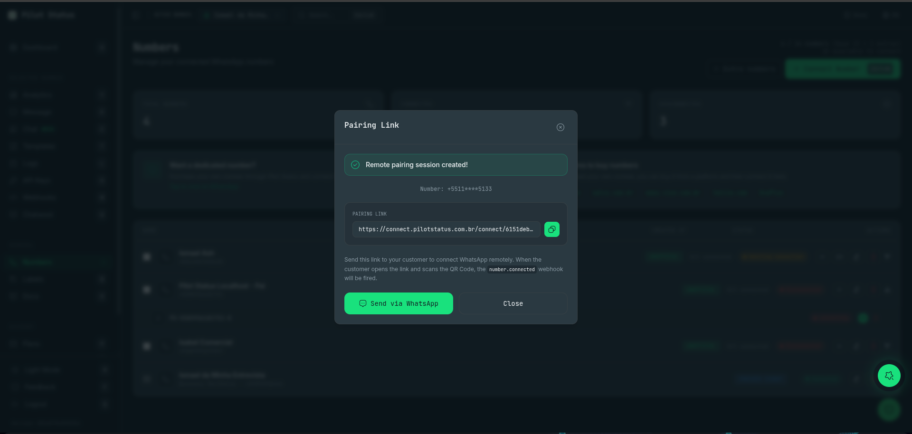

# Vinculación remota: enlace de vinculación alojado

Para plataformas SaaS que gestionan números para clientes finales, Remote Pairing te permite generar un **enlace de vinculación** en lugar de mostrar tú mismo el código QR. Tu cliente abre el enlace, escanea el QR (o ejecuta Meta Embedded Signup) y el número se conecta a tu cuenta.

<Frame caption="Una sesión de vinculación remota: envía el enlace alojado a tu cliente; cuando escanee el QR, se dispara el webhook number.connected.">
  
</Frame>

## POST /v1/numbers/remote-pairing

El mismo cuerpo que `POST /v1/numbers`, más opciones específicas de vinculación:

```bash
curl -X POST "https://pilotstatus.com.br/v1/numbers/remote-pairing" \
  -H "Content-Type: application/json" \
  -H "x-api-key: ps_your_token_here" \
  -d '{
    "name": "Customer João",
    "number": "+5511999999999"
  }'
```

Respuesta `201`:

```json
{
  "provider": "PILOT_STATUS",
  "instance": { "id": "wa_abc", "instanceName": "PS-5511999999999-0", "number": "5511999999999", "displayName": "Customer João", "state": "CLOSE" },
  "remotePairingUrl": "https://pilotstatus.com.br/connect/abc123-def456-...",
  "maskedNumber": "+5511****9999",
  "linkedApiKeyId": null
}
```

Diferencias con `POST /v1/numbers`:

- La instancia se crea en estado `CLOSE` (desconectada): **no se devuelve código QR**.
- `remotePairingUrl` es el enlace público para el cliente final. El endpoint solo devuelve el enlace: **tú se lo entregas a tu cliente** (tu propia interfaz, correo, chat, donde sea que esté).
- Cuando el cliente final abre la URL y se conecta, el webhook `number.connected` se dispara normalmente.

### `linkToApiKey`: retirado

**Se acepta pero no hace nada.** Enviarlo no es un error, y no se toca ninguna clave de API: `linkedApiKeyId` en la respuesta es **siempre `null`**. Antes reasignaba una clave con alcance de número al número que acababas de vincular, quitándole en silencio el alcance del número al que estaba asociada.

## `warnings` en el `201`

Una vinculación exitosa puede volver con un array `warnings` de strings. Solo está presente cuando hay algo que informar.

Para `provider=PILOT_STATUS`, `externalRef` y `redirectUrl` se aceptan pero **no se pueden respetar**: viajan en la sesión firmada de Meta, y el enlace de vinculación por QR no lleva sesión. Cada uno que envíes se informa en `warnings`, y la vinculación igual tiene éxito. **No** es un `400`:

```json
{
  "provider": "PILOT_STATUS",
  "remotePairingUrl": "https://pilotstatus.com.br/connect/abc123-def456-...",
  "warnings": ["redirectUrl is only supported for provider=META and was ignored"]
}
```

Antes se descartaban en silencio. Si necesitas alguno de ellos, usa `provider=META`: la rama de Meta es la que los transmite a través de la sesión firmada.

## Historial: decídelo en esta llamada

Quien abre el enlace se conecta en el momento, y el proveedor entrega el historial del dispositivo justo después, **una sola vez**. No hay un momento intermedio para un `PATCH`, así que esta ruta acepta el bloque `settings` de la [configuración del número](/es/api/numbers/settings), para **ambos** proveedores:

```bash
curl -X POST "https://pilotstatus.com.br/v1/numbers/remote-pairing" \
  -H "Content-Type: application/json" \
  -H "x-api-key: ps_your_token_here" \
  -d '{ "provider": "META", "settings": { "historyImportEnabled": false } }'
```

Respuesta `201` para `META`:

```json
{
  "provider": "META",
  "numberId": "num_01HZX...",
  "remotePairingUrl": "https://connect.pilotstatus.com.br/connect/eyJhbGciOi...",
  "expiresAt": "2026-09-16T14:06:38.000Z",
  "settings": {
    "historyImportEnabled": false,
    "webhookHistoricalMessages": false,
    "ignoreNewsletters": false,
    "markReadOnSend": true,
    "alwaysOnline": null,
    "rejectCall": null,
    "msgRejectCall": null,
    "readMessages": null,
    "ignoreGroups": null,
    "ignoreStatus": null,
    "appliesTo": { "history": "all", "advanced": "none", "sending": "meta" }
  }
}
```

- `settings.historyImportEnabled` es `true` por defecto. Omite el bloque para conservar el historial del dispositivo; envía `false` para descartarlo.
- `numberId` es el marcador de posición en el que cae la conexión. Úsalo para seguir la conexión (`GET /v1/numbers/{id}/status`) o para hacerle `PATCH` antes de que la persona termine.
- Un bloque inválido responde `400 INVALID_SETTINGS` y no se crea nada.
- Para `PILOT_STATUS`, el bloque se aplica solo cuando esta llamada crea el número.

<Warning>
  **Cambió el 2026-09-16.** Antes de eso, `provider=META` ignoraba `settings` sin decir nada y el `201` no traía `numberId`: la única forma de definir el historial en un enlace de Meta era un `PATCH` sobre el marcador de posición, con el id tomado de dentro del token del enlace. Lee `numberId` del cuerpo: el token es un formato interno y puede cambiar.
</Warning>

## Marca por enlace (marca blanca)

El cuerpo también acepta un objeto `branding` opcional para sobrescribir el logo, los colores y el título de la página de conexión **solo para este enlace** (se guarda como instantánea en el token). Sobrescribe la marca guardada del tenant. Consulta [Marca de la página de conexión](/es/api/branding).

## Números de Meta: `metaFlow`

Para números de **Meta Cloud API oficial**, el enlace de vinculación puede ejecutar flujos de Meta en lugar de la vinculación por QR:

- `metaFlow: "embedded"`: la página alojada ejecuta **Meta Embedded Signup**. Quien abre el enlace se autentica con Facebook dentro del propio diálogo de Meta y elige ahí el business portfolio y el número de teléfono.
- `metaFlow: "credentials"`: la página alojada recoge las credenciales de una WABA existente. También muestra una casilla **route inbound webhooks to Pilot Status** (enrutar webhooks entrantes a Pilot Status), activada por defecto, que suscribe automáticamente esa WABA al callback de Pilot, así que no hace falta configurar webhooks manualmente; consulta [entrega de webhooks](/es/api/numbers/create).

### Quien se autentica decide quién es dueño de la WABA

La página alojada ejecuta el **mismo** componente de Embedded Signup que ejecuta el panel, con la misma app y la misma configuración. Nada en el token de vinculación fija un business portfolio.

**Así que la WABA queda en el portfolio de quien inicie sesión en Facebook en ese diálogo**: el cliente final si abre el enlace, o *tú* si un operador de tu equipo lo abre y selecciona tu propio portfolio. Si tu modelo es "la WABA es nuestra y le pagamos a Meta", haz que tu operador ejecute el enlace; si es "el cliente es dueño de su WABA", envía el enlace al cliente. La llamada a la API es idéntica en ambos casos.

<Note>
  Aquí Embedded Signup está configurado con `featureType: "whatsapp_business_app_onboarding"`, el onboarding de **coexistence** de Meta. El diálogo muestra el QR que el dueño del número escanea con la app WhatsApp Business en su teléfono, así que el teléfono tiene que estar disponible en ese momento, sin importar quién conduzca el diálogo.
</Note>

<Warning>
  **El selector de portfolio no aparece para el perfil de Facebook dueño de la app de desarrollador.** Es una regla de Meta, no un bug: un portfolio dueño de la app queda excluido de su propio Embedded Signup, y Meta oculta un selector vacío. Cualquier otro perfil (incluido el tuyo como cliente de esta plataforma) lo ve. Si estás haciendo pruebas, usa un perfil de Facebook **sin ningún rol** en la app.
</Warning>

### `POST /v1/numbers/meta`: la alternativa BYO-WABA

Si ya tienes `metaPhoneId` + `metaWabaId` + un token de system user del lado del servidor, [`POST /v1/numbers/meta`](/es/api/numbers/create) adjunta el número sin enlace y sin interacción del cliente final.

Es **agnóstico respecto a coexistence**: adjunta por igual un número en coexistence y un número puro de Cloud API. Lo que **no** hace es nada de lo que Embedded Signup hace por ti:

| | Embedded Signup (`remote-pairing`, `metaFlow: "embedded"`) | `POST /v1/numbers/meta` |
| --- | --- | --- |
| Crea la WABA / ejecuta el QR de coexistence | **Sí**, dentro del diálogo de Meta | **No.** La WABA y el número de teléfono ya deben existir |
| Solicita la sincronización del historial del dispositivo | **Sí** | **No** |
| Registra `metaIsCoexistence` | **Sí**, a partir de la respuesta de Meta a esa solicitud | **No**: queda en `null` |
| `coexistence.evidence` justo después | `history_sync`, mejorado a `meta_is_on_biz_app` en el primer `?refresh=1` | `UNKNOWN` hasta el primer `?refresh=1` |

<Warning>
  **BYO-WABA no puede realizar por sí solo la vinculación de coexistence.** Convertir un teléfono activo en la app WhatsApp Business en un número de Cloud API ocurre dentro del diálogo de Embedded Signup de Meta: no hay API para eso, ni nuestra ni de Meta. `POST /v1/numbers/meta` es la forma de *registrar* un número que esa vinculación ya produjo, no la forma de vincular uno.

  Además, nunca le pide a Meta el historial del dispositivo, así que no se importa nada para ese número. Si necesitas el historial, vincula mediante Embedded Signup.
</Warning>

## Vigencia del enlace: dos TTL diferentes

Los dos proveedores emiten dos credenciales diferentes, y **no** vencen con el mismo reloj.

| Proveedor | Credencial | Vigencia |
| --- | --- | --- |
| `META` | Sesión firmada de Embedded Signup, devuelta como `expiresAt` en el `201` | **30 minutos** |
| `PILOT_STATUS` | Token de vinculación por QR en la fila del número | **24 horas**, o hasta que el número se conecte (un solo uso) |

Lee `expiresAt` del `201` en lugar de fijar cualquiera de los dos valores en el código. Para un enlace `META`, el número también aparece de inmediato como un marcador de posición cuyo `GET /v1/numbers/{id}/status` responde `PENDING` y luego `EXPIRED`: esa es la señal para mostrarle a tu cliente un mensaje de "el enlace venció" y emitir uno nuevo.

## El origen de la página de conexión (`postMessage`)

Cuando incrustas la página de conexión en tu propio sitio, esta se comunica con la página anfitriona mediante `postMessage` (`connect:paired`, `connect:error`, `connect:expired`). **Ambos proveedores usan el mismo host** (viene de una configuración de toda la plataforma, no del proveedor) y, en producción, ese host es:

```
https://connect.pilotstatus.com.br
```

Restringe tu listener a él y rechaza cualquier otro origen.

<Note>
  **Mejor que fijarlo en el código:** derívalo del enlace que la API te acaba de entregar, `new URL(response.remotePairingUrl).origin`. El host es una configuración de despliegue; un receptor fijado a un literal se rompe en silencio si alguna vez cambia, mientras que uno derivado de `remotePairingUrl` no puede desviarse.
</Note>

## Errores

| Estado | Cuerpo | Significado |
| --- | --- | --- |
| `400` | `{ "error": "The request body is not valid JSON \| O corpo da requisição não é um JSON válido", "code": "INVALID_BODY" }` | El cuerpo no es un JSON válido; no se crea ningún enlace. Consulta [Cuerpo JSON malformado](/es/api/overview#cuerpo-json-mal-formado). |
| `400` | `{ "error": "Validation error", "details": … }` | Cuerpo inválido. Para `provider=PILOT_STATUS`, `name` y `number` son obligatorios. |
| `402` | `{ "error": "PLAN_NUMBER_LIMIT_REACHED", "code": "PLAN_NUMBER_LIMIT_REACHED", … }` | La cuota de números propia del plan está completa. **En el plan Free** el dinero no lo resuelve (libera un espacio, compra tú un número extra o sube de plan) y también es la respuesta cuando el teléfono ya existe en tu workspace pero nunca se conectó. **En un plan pago** solo se responde cuando nunca se compró un número extra y el siguiente no se puede pagar: los créditos o una tarjeta guardada sí lo resuelven. |
| `402` | `{ "error": "INSUFFICIENT_FUNDS", "code": "INSUFFICIENT_FUNDS", … }` | Solo planes pagos. El siguiente número es un **extra pago** y no hay saldo en la billetera ni tarjeta guardada. |
| `403` | `{ "error": "A number key cannot create WhatsApp numbers: use a workspace API key or an account API key (ps_account_…) to connect a new number \| Uma chave de número não pode criar números de WhatsApp: use uma API key de workspace ou uma API key de conta (ps_account_…) para conectar um novo número", "code": "NUMBER_KEY_CANNOT_CREATE_NUMBER" }` | Una clave de número (`ps_number_`, o una clave `ps_` heredada con alcance de número) no puede vincular números nuevos. Usa una clave de workspace (también cuando está acotada con `x-whatsapp-number-id`) o una clave de cuenta. No se emite ningún enlace. |
| `403` | `{ "error": "…", "code": "NUMBERS_GRANT_NOT_ALLOWED" }` | Una conexión OAuth por número no puede vincular números nuevos. |
| `403` | `{ "error": "…", "code": "PERMISSION_DENIED" }` | Token OAuth / MCP o clave de cuenta (`ps_account_`) de un usuario por debajo de Admin: vincular un número necesita `numbers:connect`. Las claves de workspace y de número no están sujetas a esta verificación. |

Ambos `402` incluyen los números detrás del rechazo (`plan`, `maxNumbers`, `currentNumberCount`, `extras`, `proratedTotal`, `walletBalance` y `currency`) junto con `error` y `code`. El rechazo del plan Free para un teléfono que ya existe incluye solo `plan`, `maxNumbers` y `currentNumberCount`. Decide según el **code**: los dos comparten estado pero no solución. Consulta [errores de capacidad](/es/api/numbers/create#errores-de-capacidad-y-cómo-resolverlos).

<Note>
  **Corregido:** `INSUFFICIENT_FUNDS` en esta ruta ahora responde **`402`**, el mismo estado que `POST /v1/numbers`. Antes volvía como `500`.
</Note>

<Note>
  **Cambiado.** Un plan cuya cuota simplemente estaba completa también respondía aquí `INSUFFICIENT_FUNDS`, y el cuerpo no traía nada más que el código repetido en ambos campos. Ahora responde `PLAN_NUMBER_LIMIT_REACHED`, con las cifras de capacidad adjuntas.
</Note>

## Endpoints públicos de token (sin autenticación)

La página de vinculación usa estos endpoints basados en token; también puedes llamarlos para construir tu propia interfaz de conexión:

| Método | Endpoint | Devuelve |
| --- | --- | --- |
| `GET` | `/v1/remote-pairing/{token}` | `{ valid, name, maskedNumber, state, branding }` |
| `POST` | `/v1/remote-pairing/{token}/connect` | `{ qrcodeBase64, pairingCode }`, o `402 PLAN_NUMBER_LIMIT_REACHED` en un plan Free completo (consulta las notas) |
| `GET` | `/v1/remote-pairing/{token}/status` | `{ state, isFullyConnected }` |
| `GET` | `/v1/connect/{token}/branding` | `{ branding }` (también lo usa el flujo de Meta Embedded Signup) |

Notas:

- **Plan Free:** cuando el workspace que emitió el enlace está en Free, su cuota ya está completa y este número nunca se conectó, `POST /v1/remote-pairing/{token}/connect` responde `402` con `{ "error": "PLAN_NUMBER_LIMIT_REACHED", "code": "PLAN_NUMBER_LIMIT_REACHED", "message": "…", "plan": "FREE", "maxNumbers": 1, "currentNumberCount": 1 }`, y no se genera ningún código QR. `message` es una frase bilingüe, `English | Português`. La persona que tiene el enlace no puede resolverlo: el workspace tiene que comprar un número extra o subir de plan. Consulta [Plan Free](/es/api/extra-numbers#plan-free).
- Este es el token **`PILOT_STATUS` (QR)**: vence después de **24 horas** o tras una **conexión exitosa** (un solo uso). Un enlace `META` de Embedded Signup es una credencial diferente con un TTL de **30 minutos**; consulta [Vigencia del enlace](#vigencia-del-enlace-dos-ttl-diferentes).
- `POST .../connect` solo funciona cuando el estado no es `OPEN` (de lo contrario, `409` `{ "error": "Instance already connected", "state": "OPEN" }`). Cuando el proveedor no devuelve ni código QR ni código de vinculación, responde `502` con `code: "EMPTY_CONNECT_BUNDLE"`.
- Un token desconocido o vencido responde `404`: `GET /v1/remote-pairing/{token}` con `{ "valid": false, "reason": "not_found" | "expired" }`, `POST .../connect` con `{ "error": "Invalid or expired token" }`, `GET .../status` con `{ "error": "Token not found or expired" }`.
- Se aplican el mismo estado de conexión que se muestra en el panel y los webhooks (`number.created`, `number.connected`).
