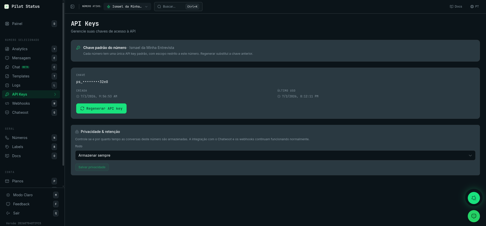

# Descripción general de la API de Pilot Status

Pilot Status es una plataforma para enviar mensajes de WhatsApp (transaccionales y de marketing/masivos) con control de plantillas, versionado y visibilidad operativa mediante el panel, la API y los webhooks.

## URL base

```text
https://pilotstatus.com.br/v1
```

## Autenticación

Cada solicitud requiere una clave de API enviada en el encabezado `x-api-key` (o `x-api-key-id` con el ID de la clave). Las claves usan el prefijo `ps_`. Los conectores MCP y las apps OAuth, en cambio, se autentican con un token de acceso OAuth en `Authorization: Bearer`. Consulta [Tipos de clave](/es/api/key-types#qué-puede-llamar-cada-credencial).

<Warning>
  Nunca envíes una clave `ps_` como `Authorization: Bearer`: un valor Bearer se interpreta como un token de acceso OAuth, así que una clave enviada ahí se rechaza con `401` (`Invalid or expired access token`). `Authorization: Bearer` es solo para los tokens de acceso OAuth que Pilot Status emite a conectores MCP y apps OAuth. Cuando `x-api-key` o `x-api-key-id` está presente, el encabezado Bearer se ignora.
</Warning>

```bash
curl "https://pilotstatus.com.br/v1/messages/msg_abc" \
  -H "x-api-key: ps_your_key_here"
```

<Frame caption="Obtén (o regenera) tu clave en la página API Keys del panel: una clave predeterminada por número.">
  
</Frame>

### Alcances de las claves

| Alcance | Vinculada a | Puede llamar |
| --- | --- | --- |
| **Por número** (predeterminada) | Un número de WhatsApp | Todos los endpoints de acción/datos de ese número: `POST /v1/messages/send`, estado del mensaje, cancelación, grupos, canales, plantillas, analíticas, medios |
| **Por tenant** (clave de workspace) | El tenant (sin número) | Gestión a nivel de tenant: `/v1/numbers/*`, `/v1/remote-pairing/*`, `/v1/api-keys`, `/v1/branding`, `/v1/webhooks/*`, `/v1/subscription/extra-numbers`, `/v1/billing/*` y `/v1/embed/sessions` (superficie de conexión) |
| **Clave de cuenta** (`ps_account_`) | Tú, el usuario | `/v1/workspaces*` (crear workspaces y sus claves), y todo lo que una clave de workspace puede hacer en cualquier workspace al que pertenezcas, elegido con `x-workspace-id`, con tu rol en él |

Consulta [Autenticación de la API](/es/api/authentication) y [Tipos de clave](/es/api/key-types) para más detalles.

## Conceptos clave

- **Plantilla**: un modelo de mensaje versionado, referenciado por `templateId` en los envíos por API. Para números de **Meta**, las plantillas se envían a Meta para aprobación; para números **no oficiales (Pilot Status web)**, se crean localmente sin paso de aprobación.
- **Mensaje**: un intento de envío creado por `POST /v1/messages/send`.
- **Webhooks**: eventos de entrega (sent/delivered/read/failed) y mensajes entrantes (reply/received/group).
- **Confirmaciones de lectura**: el estado `READ`, `readAt` y el webhook `message.read` solo ocurren cuando el contacto destinatario tiene activadas las confirmaciones de lectura de WhatsApp.

## Flujo típico de integración

<Steps>
  <Step title="Crea plantillas">
    Crea plantillas en el panel (`/templates`).
  </Step>
  <Step title="Conecta WhatsApp">
    Configura tu número/instancia de WhatsApp en el panel (`/profile` y `/numbers`).
  </Step>
  <Step title="Crea una clave de API">
    Crea una clave de API en la página `/api-keys`.
  </Step>
  <Step title="Envía mensajes">
    Envía mensajes con [`POST /v1/messages/send`](/es/api/messages/send).
  </Step>
  <Step title="Sigue la entrega">
    Consulta el estado con [`GET /v1/messages/{messageId}`](/es/api/messages/status) y/o consume eventos mediante webhooks.
  </Step>
</Steps>

## Errores HTTP comunes

| Estado | Significado |
| --- | --- |
| `400` | Payload inválido (por ejemplo, teléfono que no está en E.164, campos obligatorios ausentes) |
| `401` | Credencial ausente o inválida (`x-api-key`, `x-api-key-id` u OAuth `Authorization: Bearer`). El cuerpo trae solo `error` (por ejemplo, `Invalid API key`) y ningún `code` |
| `403` | Clave válida, pero operación bloqueada (por ejemplo, alcance de clave incorrecto) |
| `404` | Recurso no encontrado dentro del alcance de la clave, o `ROUTE_NOT_FOUND`: el endpoint no existe ([abajo](#endpoint-desconocido)) |
| `429` | Límite de tasa excedido, en los endpoints que documentan un límite |

## Cuerpo JSON mal formado

Un cuerpo de solicitud que **no es JSON válido** (truncado, como `{"quantity": 3`, con una coma final, codificado como formulario) se rechaza antes de que se ejecute nada:

```json
{
  "error": "The request body is not valid JSON | O corpo da requisição não é um JSON válido",
  "code": "INVALID_BODY"
}
```

- **Estado `400`, código `INVALID_BODY`.** Es un error permanente del cliente: corrige el payload, no lo reintentes tal cual. No se envía, cobra, crea ni cambia nada. En `POST /v1/messages/send` el rechazo no reserva la `Idempotency-Key`, así que el reintento corregido puede reutilizarla.
- **Un cuerpo vacío no está mal formado.** En las rutas cuyo cuerpo es opcional, no enviar cuerpo mantiene el valor predeterminado documentado de la ruta: por ejemplo, `POST /v1/subscription/extra-numbers` sin cuerpo sigue comprando `quantity = 1`. Las rutas que requieren un cuerpo (`messages/send`, `templates`, `messages/cancel`, `messages/read`, `messages/typing`, `webhooks`) responden el mismo `400 INVALID_BODY` a un cuerpo vacío.
- **JSON válido que no es un objeto** (`null`, un arreglo, una cadena) no está cubierto por esta verificación: cada ruta lo responde con su propia validación. En `POST /v1/webhooks` y `PATCH /v1/webhooks/{id}` es `400 INVALID_BODY` con `"The request body must be a JSON object | O corpo da requisição deve ser um objeto JSON"`.
- La autenticación y los permisos se verifican primero: una clave incorrecta sigue respondiendo `401`/`403`, no `400`.

Ramifica según `code`, no según el mensaje. Antes de esta verificación, un cuerpo mal formado respondía `500` en algunas rutas y se leía silenciosamente como `{}` en otras.

## Endpoint desconocido

Una ruta bajo `/v1` que no coincide con ningún endpoint responde `404` con JSON, con cualquier método y sin necesidad de autenticación:

```json
{
  "error": "Not found",
  "code": "ROUTE_NOT_FOUND",
  "message": "No such endpoint: POST /v1/..."
}
```

`message` indica el método y la ruta que se llamaron. Si recibes `ROUTE_NOT_FOUND`, compara la URL con esta referencia antes que nada. Una ruta existente llamada con un método que no admite responde `405` con un cuerpo vacío.

## Advertencias (WhatsApp / antispam)

<Warning>
  Los envíos de alto volumen y no solicitados pueden activar los mecanismos antispam de WhatsApp (límites de tasa, bloqueos y baneos). Tú eres responsable del opt-in/consentimiento y del cumplimiento de las leyes aplicables y de las políticas de WhatsApp.
</Warning>
