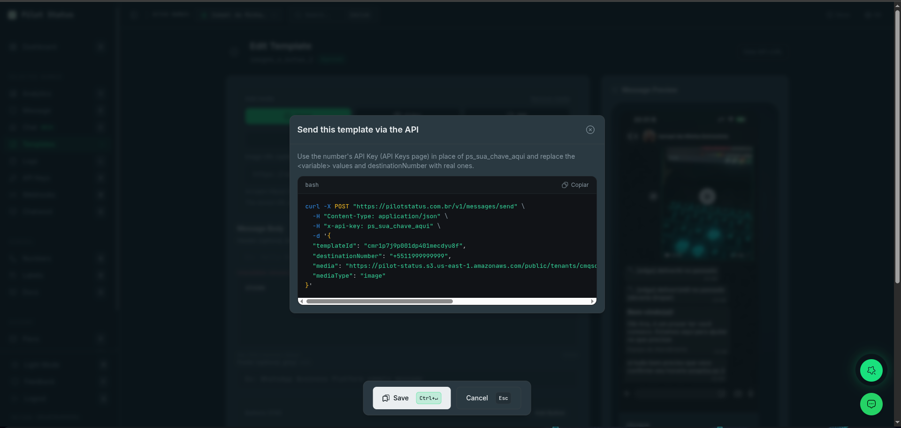

Las plantillas definen contenido de mensajes reutilizable. Créalas y adminístralas en el dashboard (`/templates`) **o** mediante la API REST pública (`/v1/templates`) y el servidor MCP (`templates_create` / `templates_update` / `templates_delete`). Al enviar, haz referencia a la plantilla por `templateId` y pasa un objeto `variables` con las claves correspondientes.

<Frame caption="Cada plantilla tiene una llamada a la API lista: el modal Send via API del editor genera el curl exacto con el templateId.">
  
</Frame>

<Note>
  URL base: `https://pilotstatus.com.br/v1`. Todos los endpoints de `/v1/templates` actúan sobre **un número de WhatsApp**, tomado de la credencial; consulta [Autenticación y permisos](#autenticación-y-permisos).
</Note>

## Autenticación y permisos

Todos los endpoints `/v1/templates*` actúan sobre un solo número de WhatsApp, y ese número siempre proviene de la credencial, nunca del body de la solicitud:

- **Clave de número** (`ps_number_`, en `x-api-key`, o `x-api-key-id`): su propio número.
- **Clave de workspace** (`ps_workspace_`), **clave de cuenta** (`ps_account_` con `x-workspace-id`) o **token OAuth/MCP**: indica el número en el encabezado `x-whatsapp-number-id` (su id o el id de instancia de `GET /v1/numbers`). Sin el encabezado, la llamada recibe `403 TENANT_SCOPE_NOT_ALLOWED`.

Las claves de número y de workspace no llevan usuario, así que no se les aplica ninguna verificación de rol. Las claves de cuenta y los tokens OAuth actúan con el **rol actual** del usuario en el workspace:

| Endpoints | Permiso | Roles |
| --- | --- | --- |
| `GET /v1/templates`, `GET /v1/templates/{id}`, `GET /v1/templates/{id}/insights` | `templates:read` | `OWNER`, `ADMIN`, `AGENT`, `ANALYST` |
| `POST /v1/templates`, `PUT /v1/templates/{id}`, `DELETE /v1/templates/{id}`, `POST /v1/templates/{id}/submit`, `POST /v1/templates/sync` | `templates:manage` | `OWNER`, `ADMIN` |

- Un rol sin el permiso recibe `403 PERMISSION_DENIED`.
- Un token OAuth al que solo se le concedieron algunos números recibe `403 NUMBER_NOT_IN_GRANT`, o `404 TEMPLATE_NOT_FOUND`, para una plantilla fuera de esos números.
- `{id}` en todas las rutas es el **id** de la plantilla (el `id` que devuelve `GET /v1/templates`). El nombre de la plantilla no se busca: un nombre en su lugar recibe `404 TEMPLATE_NOT_FOUND`.

## Categoría

Se define al crearla; **no se puede cambiar después**.

- **MARKETING**: mensajes promocionales (más sensibles a las políticas de WhatsApp).
- **UTILITY**: mensajes transaccionales (actualizaciones de cuenta, alertas, recordatorios).
- **OTP**: mensajes de código de un solo uso o de verificación.

## Estructura de la plantilla

Solo el **body** es obligatorio.

| Componente | Obligatorio | Qué es |
| --- | --- | --- |
| **Header** (encabezado) | opcional | Texto o un elemento multimedia (imagen, video, PDF). |
| **Body** (cuerpo) | **obligatorio** | Texto principal con marcadores `{{variable}}`. |
| **Footer** (pie) | opcional | Línea estática corta debajo del cuerpo. |
| **Buttons** (botones) | opcional | Hasta 10 botones interactivos. |

### Header

| Tipo | Valor | Notas |
| --- | --- | --- |
| `NONE` | — | Predeterminado. |
| `TEXT` | `text` | Hasta **60** caracteres, **0 o 1** variable. Sin saltos de línea, emojis ni formato. |
| `IMAGE` | `url` o `base64` | JPG/PNG. |
| `VIDEO` | `url` o `base64` | MP4. |
| `DOCUMENT` | `url` o `base64` | PDF. Define el nombre de archivo que ve el destinatario al enviar con `mediaFilename`; consulta [Nombrar el documento de una plantilla](/es/guides/media-messages#nombrar-el-documento-de-una-plantilla). |

- **API REST**: pasa `header.url` (URL http(s) pública) o `header.base64` (data URI); el base64 se vuelve a alojar del lado del servidor automáticamente.
- **MCP**: **solo** `header.url`; base64 no es compatible por MCP.

<Note>
  **No** existe un encabezado `LOCATION`.
</Note>

### Body

- Hasta **1024** caracteres.
- Variables escritas como `{{nome}}` (estilo con nombre).
- El body **no debe empezar ni terminar con una variable**.
- Se permiten emojis y múltiples variables.

### Footer

Texto estático de hasta **60** caracteres. **Sin variables.**

### Buttons

Hasta **10** botones en total; se pueden combinar botones de respuesta rápida y de CTA.

| Tipo | Campos | Límite |
| --- | --- | --- |
| `QUICK_REPLY` | `text` | hasta 10 |
| `URL` | `text`, `url` (estática o dinámica) | hasta 2 |
| `PHONE_NUMBER` | `text`, `phone_number` (E.164) | hasta 1 |
| `COPY_CODE` | `example` (código para copiar; solo una muestra en números oficiales) | hasta 1 |
| `PAYMENT_REQUEST` | `text`, `paymentType`, `example` (código PIX) | hasta 1 |

- **Botón de URL dinámica**: la URL **termina con una variable** (por ejemplo, `https://loja.com/promo/{{link}}`), una variable como máximo, nunca en el dominio. El valor de muestra va en `examples`. Al enviar, se completa por su nombre (`variables.link`). Una plantilla creada en la consola de Meta con un marcador numerado (`https://ctlnk.io/{{1}}`) se completa en cambio con `button_<N>`; consulta [Marcadores de botón en plantillas creadas en Meta](#marcadores-de-botón-en-plantillas-creadas-en-meta).
- **Copiar código**: el valor va en el botón como `example` (array, por ejemplo `["PROMO10"]`), solo alfanumérico, hasta **15** caracteres. No sirve para claves PIX ni correos; para PIX, usa el botón `PAYMENT_REQUEST` de abajo. En un **número oficial**, este `example` es solo una muestra: el código que copia el cliente va en `variables` como `button_<N>` en cada envío; consulta [Botones de copiar código en números oficiales](#botones-de-copiar-código-en-números-oficiales).

### Botón de pago PIX (`PAYMENT_REQUEST`)

Botón de pago de WhatsApp Pay Brasil: el cliente lo toca y copia el código PIX. Esta es la forma correcta de enviar el PIX copia y pega: `COPY_CODE` tiene un tope de 15 caracteres alfanuméricos, mientras que un BR Code real tiene entre 100 y 400 caracteres con puntuación.

El código es un valor **por envío**: pon una variable en el `example` del botón y pasa el código real en `variables` al enviar, como cualquier otra variable.

```json
{ "type": "PAYMENT_REQUEST", "text": "Copy Pix code",
  "paymentType": "pix_dynamic_code", "example": ["{{codigo_pix}}"] }
```

<Note>
  Este botón requiere que Meta haya habilitado los **pagos** en tu WhatsApp Business Account. La habilitación es gradual y por cuenta; en palabras de Meta: _"this feature is rolling out and might not be available yet for your WhatsApp Business account"_. En una cuenta sin ella, Meta rechaza la plantilla con `100` / subcódigo `2388128` (_"Button at index 0 has unexpected type (PAYMENT\_REQUEST)"_). No hay ningún campo de API para verificarlo: la única forma de saberlo es intentar crear una.
</Note>

<Warning>
  La variable del código PIX es **obligatoria** al enviar. Si falta, el envío se rechaza en lugar de entregarse: sin el parámetro, Meta usaría el código de **muestra** guardado en la plantilla, y el cliente pagaría a la cuenta equivocada.
</Warning>

`ORDER_DETAILS` (la tarjeta de pedido detallada) se puede construir, previsualizar y guardar; consulta [Tarjeta de pedido detallada](/es/concepts/templates#tarjeta-de-pedido-detallada-orderdetails).

- Los botones **sí** se permiten junto con un encabezado de video o documento (PDF).

## Variables y ejemplos (obligatorios)

Al crear o actualizar por REST o MCP, **debes** incluir un objeto `examples` que asigne a **cada** variable usada (body \+ texto del encabezado \+ URL dinámica) un valor de muestra real. El valor de copiar código es la única excepción (vive en el botón).

```json
400 { "code": "TEMPLATE_EXAMPLES_REQUIRED", "details": { "missing": ["desconto"] } }
```

Después de guardar, `GET /v1/templates/{id}` devuelve todas las claves detectadas en el array `variables` de nivel superior (un `string[]`); proporciónalas todas en `variables` al enviar. No hay ningún objeto `latestVersion` en la respuesta de la API pública.

### Marcadores de botón en plantillas creadas en Meta

Una plantilla creada en el WhatsApp Manager de Meta y sincronizada en Pilot Status (`source: "META"`) con marcadores posicionales numera por separado la variable de un botón de URL dinámica: en `https://ctlnk.io/{{1}}`, ese `{{1}}` **no** es el `{{1}}` del body. Envía su valor como `variables["button_<N>"]`, donde `N` es la posición del botón en la lista de botones de la plantilla, **empezando en 1**: todos los botones cuentan, incluidos los estáticos. Pasa solo la parte variable (el sufijo de la URL), no la URL completa:

```json
"variables": { "1": "Maria", "2": "R$ 10,00", "3": "21/09/2026", "button_1": "Gggkf" }
```

- `GET /v1/templates` y `GET /v1/templates/{id}` listan la clave en `variables`: `["1", "2", "3", "button_1"]` para la plantilla de arriba.
- Un envío sin ella, o con un valor vacío, se rechaza con `400 MISSING_TEMPLATE_VARIABLES` (o `INVALID_TEMPLATE_VARIABLE_VALUE`) indicando la clave, en lugar de aceptarse y fallar después con el error de Meta `131008`.
- Los marcadores con nombre no cambian: un botón creado en Pilot Status como `https://loja.com/promo/{{link}}` se completa con `variables.link`.
- La misma clave `button_<N>` lleva el código de un botón de copiar código en un número oficial; consulta más abajo.

### Botones de copiar código en números oficiales

Para Meta, el código escrito en un botón `COPY_CODE` al crearlo es solo un **ejemplo**; el código que copia el cliente es un **parámetro obligatorio de cada envío**. Así que, en una plantilla aprobada por Meta (`source: "META"`: todas las plantillas de un número oficial, creadas en la consola de Meta o en Pilot Status), un botón de copiar código cuyo valor **no** tiene `{{variable}}` (un ejemplo fijo como `PROMO10`) toma su código como `variables["button_<N>"]`, con la misma regla: `N` es la posición del botón en la lista de botones de la plantilla, **empezando en 1**, y todos los botones cuentan. Para los botones `[QUICK_REPLY, COPY_CODE]` con el ejemplo `PROMO10`:

```json
"variables": { "button_2": "BLACKFRIDAY" }
```

- `GET /v1/templates` y `GET /v1/templates/{id}` listan la clave en `variables`: `button_4` para la plantilla `promo_cupom` de [Crear mediante la API REST](#crear-mediante-la-api-rest).
- Un envío sin ella, o con un valor vacío, se rechaza con `400 MISSING_TEMPLATE_VARIABLES` (o `INVALID_TEMPLATE_VARIABLE_VALUE`) indicando la clave. El `example` mantiene su límite de creación (15 caracteres alfanuméricos); para el código enviado, el límite de Meta es de 20 caracteres.
- Un botón de copiar código cuyo ejemplo es una variable con nombre (`["{{cupom}}"]`) se sigue completando con `variables.cupom`. El botón de código de una plantilla de autenticación (OTP) sigue tomando el código del body.
- Números no oficiales (web/QR): allí el código para copiar también se genera por envío; escríbelo en el botón como `{{variable}}` (por ejemplo, `["{{cupom}}"]`) y complétalo en `variables`.

## Límites de caracteres

| Componente | Límite | Reglas |
| --- | --- | --- |
| Header (texto) | 60 | Sin saltos de línea, emojis ni formato; como máximo 1 variable. |
| Body | 1024 | No puede empezar ni terminar con una variable. |
| Footer | 60 | Sin variables. |
| Etiqueta del botón | 25 | — |
| Valor de copiar código | 15 | Solo alfanumérico. |
| Código PIX (`PAYMENT_REQUEST`) | 2000 | Se permite puntuación; un BR Code real tiene entre 100 y 400. |

## Crear mediante la API REST

<CodeGroup>

```bash curl
curl -X POST https://pilotstatus.com.br/v1/templates \
  -H "Content-Type: application/json" \
  -H "x-api-key: ps_your_token_here" \
  -d '{
  "name": "promo_cupom",
  "category": "MARKETING",
  "language": "pt_BR",
  "body": {
    "header": { "type": "IMAGE", "url": "https://cdn.exemplo.com/banner.png" },
    "body":   { "text": "Oi {{nome}}! Use e ganhe {{desconto}} de desconto." },
    "footer": { "text": "Promoção por tempo limitado" },
    "buttons": [
      { "type": "QUICK_REPLY",  "text": "Quero!" },
      { "type": "URL",          "text": "Comprar", "url": "https://loja.com/promo/{{link}}" },
      { "type": "PHONE_NUMBER", "text": "Falar",   "phone_number": "+5511999998888" },
      { "type": "COPY_CODE",    "example": ["PROMO10"] }
    ]
  },
  "examples": { "nome": "Maria", "desconto": "10%", "link": "abc123" }
}'
```

```json Response 201
{ "id": "tmpl_123", "name": "promo_cupom", "category": "MARKETING", "metaStatus": "PENDING" }
```

</CodeGroup>

- `body` puede ser un **objeto** (recomendado), un **string JSON** o **texto plano** (plantillas solo con body).
- Edita con `PUT /v1/templates/{id}` (misma forma; consulta [Editar](#editar)); elimina con `DELETE /v1/templates/{id}`: para una plantilla de Meta, esto también le pide a Meta que la elimine, y la respuesta depende de lo que conteste Meta (consulta [Eliminar](#eliminar)).
- `GET /v1/templates` devuelve un array simple (sin paginación) con todas las plantillas que puede usar el número de la clave; `GET /v1/templates/{id}` devuelve una. Cada ítem tiene `id`, `name`, `category`, `body` (la plantilla guardada como un **string** JSON), `variables` (todas las claves que hay que proporcionar al enviar), `source` (`META` | `PILOT_STATUS`), `metaStatus` (el estado de Meta tal como lo informa Meta, por ejemplo `APPROVED`, `PENDING`, `REJECTED`, `PAUSED`, `DISABLED`, o `null`), `metaLanguage` y `sendable`: en un número de Meta solo se pueden enviar las plantillas `META` con `metaStatus: "APPROVED"`; en un número que no es de Meta, solo las plantillas `PILOT_STATUS`.

### Campos de creación

| Campo | Tipo | Notas |
| --- | --- | --- |
| `name` | string, **obligatorio** | Se normaliza antes de validar: en minúsculas, sin acentos, y cualquier secuencia de otros caracteres se convierte en `_`. Luego debe coincidir con `[a-z0-9_]`, hasta 100 caracteres. Único por número (por WABA en un número de Meta). |
| `category` | `MARKETING` \| `UTILITY` \| `OTP` | Predeterminado `UTILITY`. |
| `language` | string | Código de idioma de Meta. Predeterminado `pt_BR`. |
| `body` | object \| string, **obligatorio** | Consulta arriba. |
| `examples` | object | Un valor de muestra por variable; consulta **Variables y ejemplos** arriba. |
| `variables`, `whatsappNumberId`, `metaWabaId` | — | Se aceptan y se **ignoran**: las variables se derivan de `body` y el número proviene de la clave. |

Cualquier otro campo de nivel superior se rechaza; consulta `TEMPLATE_UNKNOWN_FIELDS` más abajo. El encabezado, el pie, los botones y el carrusel van **dentro** de `body`.

### Errores de creación

| HTTP | `code` | Cuándo |
| --- | --- | --- |
| `400` | `INVALID_BODY` | El body de la solicitud no es JSON válido. |
| `400` | `TEMPLATE_UNKNOWN_FIELDS` | Un campo de nivel superior fuera de la lista anterior (normalmente `buttons`, `header` o `footer` junto a `body` en lugar de dentro de él). No se crea nada. `error` está en portugués, `errorEn` en inglés, y `details.unknownFields` lista los campos. |
| `400` | — | `{ "error": "Validation error", "details": { ... } }`: un campo no pasó la validación (nombre, categoría, idioma, límites del body); `details` tiene los mensajes por campo. |
| `400` | `TEMPLATE_EXAMPLES_REQUIRED` | Una variable no tiene valor de muestra en `examples`; `details.missing` las lista. |
| `400` | `TEMPLATE_WEB_BUTTON_NOT_SUPPORTED` | El número de la clave, que no es de Meta, no puede enviar uno de los botones. `error` en portugués, `errorEn` en inglés. |
| `400` | `META_TEMPLATE_SUBMIT_FAILED` | Meta rechazó la plantilla; `error` tiene el motivo. No se guarda nada. |
| `404` | — | El número de la clave ya no existe (solo `error`). |
| `409` | — | Ya existe una plantilla con ese nombre para este número. Solo `error`, en portugués. |
| `422` | `TEMPLATE_MEDIA_UPLOAD_FAILED` | La multimedia de `header.base64` no se pudo decodificar ni volver a alojar. |

## Editar

`PUT /v1/templates/{id}` reemplaza el contenido de la plantilla. Solo se aplican `body` (obligatorio, mismas formas que en la creación) y `examples`; `name`, `category`, `language`, `variables`, `whatsappNumberId` y `metaWabaId` se aceptan y se **ignoran**: el nombre, la categoría y el idioma de una plantilla no se pueden cambiar. Cualquier otro campo de nivel superior recibe `400 TEMPLATE_UNKNOWN_FIELDS`, como en la creación. En un número de Meta, la nueva versión se vuelve a enviar a Meta para aprobación y vuelve con `metaStatus: "PENDING"`.

```json Response 200
{
  "id": "tpl_01HZX...",
  "name": "promo_cupom",
  "category": "MARKETING",
  "body": "{\"body\":{\"text\":\"Oi {{nome}}!\"}}",
  "variables": ["nome"],
  "metaStatus": "PENDING"
}
```

`metaStatus` se omite cuando la plantilla no tiene ninguno (una plantilla de un número que no es de Meta). Otros errores: `404 TEMPLATE_NOT_FOUND`, `400 INVALID_BODY`, `400` `Validation error`, `400 TEMPLATE_EXAMPLES_REQUIRED`, `400 TEMPLATE_WEB_BUTTON_NOT_SUPPORTED` (también para un botón `FLOW`, que este endpoint no puede crear), `400 TEMPLATE_LIST_NOT_SUPPORTED_BY_META` (un botón de lista en una plantilla que ya está en Meta; la mitad en inglés está en `errorEN`), `422 TEMPLATE_MEDIA_UPLOAD_FAILED`, y `400` solo con `error` cuando Meta rechaza el reenvío por otro motivo.

Meta decide si una plantilla se puede editar. Su regla publicada es que una plantilla aprobada se puede editar como máximo una vez cada 24 horas y 10 veces cada 30 días, pero en la práctica Meta puede rechazarlo de todos modos. Cuando Meta lo rechaza por el estado actual de la plantilla (código Graph `100`, subcódigo `2388003`: "Message templates can only be edited if they have been rejected."), la API devuelve `409`:

```json Response 409
{
  "error": "Meta does not allow editing this template in its current state (only rejected templates can be edited). Create a new template with the change, or send the document at send time. | A Meta não permite editar este template no estado atual (só templates rejeitados podem ser editados). Crie um novo template com a alteração ou envie o documento no momento do envio.",
  "code": "TEMPLATE_NOT_EDITABLE",
  "meta_user_message": "Message templates can only be edited if they have been rejected."
}
```

- `code` es `TEMPLATE_NOT_EDITABLE`. `error` es una frase bilingüe `English | Português`. `meta_user_message` es el texto propio de Meta, o `null`.
- **Cuando Meta rechaza una edición, por cualquier motivo, nada cambia en Pilot Status:** la plantilla guardada conserva su body y su `metaStatus` anteriores, así que sigue coincidiendo con lo que tiene Meta. Antes, el body nuevo se guardaba como `PENDING` aunque Meta lo hubiera rechazado.
- **Qué hacer:** crea una plantilla nueva con el cambio (`POST /v1/templates`, con un nombre nuevo). Si lo que querías cambiar es el documento del encabezado, conserva la plantilla y envía el documento como parámetro en tiempo de ejecución al enviar: el `media` por envío de `POST /v1/messages/send` ([Multimedia con plantillas](/es/guides/media-messages#multimedia-con-plantillas)).
- La herramienta MCP `templates_update` pasa por esta misma ruta y devuelve el mismo `409`.

## Enviar a Meta

`POST /v1/templates/{id}/submit` envía una plantilla a Meta para aprobación: el **Submit to Meta** del dashboard. Úsalo para una plantilla que nunca se envió a Meta (`source: "PILOT_STATUS"`), por ejemplo una creada antes de que el número tuviera una WhatsApp Business Account, o para volver a enviar una rechazada.

```bash curl
curl -X POST "https://pilotstatus.com.br/v1/templates/tpl_01HZX.../submit" \
  -H "x-api-key: ps_your_token_here"
```

```json Response 200
{
  "id": "tpl_01HZX...",
  "name": "order_update",
  "source": "META",
  "metaStatus": "PENDING",
  "metaLanguage": "pt_BR",
  "sendable": false,
  "metaTemplateId": "1234567890123456"
}
```

- **El número proviene de la clave.** Debe ser un número de Meta Cloud API con una WhatsApp Business Account; cualquier otro número recibe `422 TEMPLATE_REQUIRES_META_NUMBER`. El body está vacío: cualquier campo, incluido `whatsappNumberId`, recibe `400 UNKNOWN_FIELDS`.
- **La plantilla debe ser accesible mediante el número de la clave**, como en `GET /v1/templates/{id}`; de lo contrario, `404 TEMPLATE_NOT_FOUND`.
- **Meta revisa de forma asíncrona.** La respuesta normalmente dice `PENDING`; lee el resultado más tarde con `GET /v1/templates/{id}`, o actualiza todo el catálogo con [`POST /v1/templates/sync`](#sincronizar-desde-meta).
- **Los errores** son bilingües (`English | Português`) con un `code`: las verificaciones de [Verificado antes de enviar a Meta](#verificado-antes-de-enviar-a-meta) (`400`, por ejemplo `TEMPLATE_URL_BLOCKED`, `TEMPLATE_BUTTON_INVALID`), `400 META_API_ERROR` cuando Meta rechaza el envío (con el código de Meta en `meta_code`), `409 TEMPLATE_NOT_EDITABLE` cuando Meta ya no acepta cambios en la plantilla en su estado actual, `409 TEMPLATE_ALREADY_SUBMITTED`, y `400 INVALID_BODY` cuando el body no es un objeto JSON.
- Permiso `templates:manage`, el mismo que en el dashboard. Herramienta MCP: `templates_submit`.

## Sincronizar desde Meta

`POST /v1/templates/sync` trae desde Meta todas las plantillas de la WhatsApp Business Account de la clave: el **Sync from Meta** del dashboard. Las plantillas que Pilot Status todavía no tiene se crean; las demás reciben el estado, la categoría y el contenido actuales de Meta (por ejemplo, una plantilla `PENDING` que Meta aprobó desde entonces).

```bash curl
curl -X POST "https://pilotstatus.com.br/v1/templates/sync" \
  -H "x-api-key: ps_your_token_here"
```

```json Response 200
{ "created": 2, "updated": 5 }
```

- La misma regla de número que en el envío: un número de Meta Cloud API con una WhatsApp Business Account (de lo contrario, `422 TEMPLATE_REQUIRES_META_NUMBER`), body vacío (`400 UNKNOWN_FIELDS`).
- **Una sincronización por número a la vez**, compartida con el dashboard. Mientras una está en curso, otra llamada recibe `429 TEMPLATE_SYNC_IN_PROGRESS` con `Retry-After: 120` (el bloqueo dura como máximo 120 segundos y se libera en cuanto termina la sincronización en curso). Espera en lugar de reintentar en bucle.
- Los errores de Meta se mapean como en el envío (`400 META_API_ERROR` con `meta_code`, `422 TEMPLATE_REQUIRES_META_NUMBER`).
- Permiso `templates:manage`. Herramienta MCP: `templates_sync`.

## Eliminar

`DELETE /v1/templates/{id}` **ya no siempre devuelve éxito.** Para una plantilla de Meta, la eliminación se reenvía a Meta, y el resultado depende de lo que haga Meta:

| Resultado | HTTP | Body | Fila local |
| --- | --- | --- | --- |
| Eliminada en ambos lados | `200` | `{ "deleted": true, "id": "tmpl_123" }` | eliminada |
| Meta **rechazó** la eliminación | `409` | `META_TEMPLATE_DELETE_REFUSED`, consulta abajo | **se conserva** |
| La plantilla realmente no existe en Meta (404 real) | `200` | `{ "deleted": true, "id": "tmpl_123" }` | eliminada |

- Un `200 { "deleted": true, "id" }` es la única respuesta que significa que la plantilla realmente desapareció: eliminada en Meta **y** localmente.
- Un `409` significa que **no se eliminó nada**: Meta rechazó la eliminación (por ejemplo, el token del sistema no tiene permiso en la WABA), o ningún número de tu workspace en esa WABA tiene un token de Meta, así que no se le pudo preguntar a Meta. La plantilla sigue existiendo en Meta y su nombre **sigue reservado**. La fila local se conserva. Corrige el permiso subyacente y vuelve a intentarlo.
- Una plantilla sin WhatsApp Business Account (una plantilla de un número que no es de Meta) solo se elimina localmente.

```json Response 409
{
  "error": "Template \"promo\" was NOT deleted: Meta refused the deletion. Reason: … It still exists on your WABA, consuming quota and keeping the name reserved (re-creating a template with the same name will fail). Fix the token's permission on that WABA and try again, or delete the template in Meta Business Manager.",
  "errorPT": "O template \"promo\" NÃO foi excluído: a Meta recusou a exclusão. Motivo: … ",
  "code": "META_TEMPLATE_DELETE_REFUSED",
  "template_name": "promo",
  "can_force_local_delete": true
}
```

- A diferencia de los demás errores de esta página, `error` está solo en inglés y el texto en portugués está en `errorPT`.
- **`?force_local=true`** es la salida deliberada para una fila que no puedes eliminar en Meta (normalmente una WABA sin ningún número conectado): cuando Meta rechaza, o no se le puede preguntar, la fila local se elimina de todos modos y recibes `200 { "deleted": true, "id" }`. La plantilla **sigue en Meta**, y la siguiente [sincronización](#sincronizar-desde-meta) de un número en esa WABA la trae de vuelta. Úsalo solo después de un `409`.
- Si Meta informa que la plantilla no existe (un 404 real / "template does not exist"), la fila local obsoleta se elimina y aun así recibes `200 { "deleted": true, "id" }`.

### Previsualizar una eliminación (`dry_run`)

`DELETE /v1/templates/{id}?dry_run=true` **no elimina nada** y te dice qué haría la eliminación. Mismo permiso y alcance que la eliminación en sí.

```json Response 200
{
  "dry_run": true,
  "action": "DELETE_ON_META_AND_LOCAL",
  "template": { "id": "tpl_01HZX...", "name": "promo", "category": "MARKETING", "source": "META", "meta_status": "APPROVED", "meta_language": "pt_BR", "meta_template_id": "1234567890123456" },
  "waba": { "id": "1581714517011340", "name": "Acme" },
  "via_number": { "id": "wn_01HZX...", "number": "+5511999990000", "display_name": "Acme" },
  "warnings": [
    "Irreversible: the template is deleted on Meta and in Pilot Status. Meta does not let the same name be reused for about 30 days.",
    "Meta deletes by name: every language version of \"promo\" on this WABA is deleted on Meta, not only this one."
  ]
}
```

- Funciona para todas las plantillas, en cualquier tipo de número. `action` es `DELETE_ON_META_AND_LOCAL` para una plantilla vinculada a una WhatsApp Business Account, o `DELETE_LOCAL_ONLY` para una que no lo está (una plantilla de un número que no es de Meta; `waba` y `via_number` son entonces `null`, y `warnings` solo dice que la eliminación es irreversible).
- Solo el valor exacto `true` previsualiza; cualquier otro valor de `dry_run` realiza la eliminación real.
- **Meta elimina por nombre**: se eliminan todas las versiones de idioma de ese nombre en la WABA, no solo la que indicaste.
- `via_number` es el número cuyo token de Meta realiza la eliminación. `null` en una plantilla de Meta significa que ningún número de tu workspace en esa WABA tiene un token: la eliminación se rechazaría con `409 META_TEMPLATE_DELETE_REFUSED`, y `warnings` recibe una tercera línea que lo indica.
- `warnings` está en inglés.
- La herramienta MCP `templates_delete` siempre muestra primero esta vista previa y pide confirmación; consulta [Servidor MCP](/es/integrations/mcp-server#confirmación-para-herramientas-destructivas).

## Insights

`GET /v1/templates/{id}/insights` devuelve las cifras de Meta para una plantilla: cuántos mensajes se enviaron, entregaron y leyeron, la tasa de lectura, los clics en botones y una serie día por día. `{id}` es el id de la plantilla, como en `GET /v1/templates/{id}`.

```bash curl
curl "https://pilotstatus.com.br/v1/templates/tpl_01HZX.../insights?days=7" \
  -H "x-api-key: ps_your_token_here"
```

```json Response 200
{
  "templateId": "tpl_01HZX...",
  "template": { "name": "boas_vindas", "status": "APPROVED", "category": "UTILITY", "language": "pt_BR", "qualityScore": "GREEN" },
  "days": 7,
  "totals": { "sent": 1240, "delivered": 1198, "read": 873 },
  "readRate": 0.7287,
  "clicks": [
    { "type": "quick_reply_button", "buttonContent": "Quero saber mais", "count": 112 },
    { "type": "url_button", "buttonContent": "https://exemplo.com.br/oferta", "count": 64 }
  ],
  "daily": [
    { "date": "2026-10-22", "sent": 180, "delivered": 175, "read": 130 },
    { "date": "2026-10-28", "sent": 175, "delivered": 167, "read": 120 }
  ]
}
```

- **`days`** es opcional: `7`, `30` o `90`, predeterminado `30`. Cualquier otro valor devuelve `400 INVALID_DAYS`.
- **`readRate`** es `read / delivered`, de 0 a 1. Es `null` cuando no se entregó nada en la ventana.
- **`daily`** tiene una entrada por día (UTC), de la más antigua a la más reciente. **`clicks`** tiene una entrada por botón, con el tipo de botón de Meta y su texto.
- **Los datos provienen de las analíticas de plantillas de Meta:** granularidad diaria, solo los últimos 90 días, y los días más recientes todavía pueden estar completándose: las cifras de ayer y hoy pueden crecer en una llamada posterior.
- **La primera llamada** para una WhatsApp Business Account puede activar los insights de plantillas para esa cuenta en Meta. No necesitas hacer nada en Meta Business Manager.
- **Acceso:** el mismo que `GET /v1/templates/{id}`: permiso `templates:read`, y una clave con alcance de número solo ve las plantillas de sus números.
- **SDKs e integraciones:** `client.templates.insights(id, { days })` (Node), `client.templates.insights(id, days=30)` (Python), la herramienta MCP `templates_insights` y el nodo de n8n **Template → Get Insights**.

| HTTP | `code` | Cuándo |
| --- | --- | --- |
| `400` | `INVALID_DAYS` | `days` no es `7`, `30` ni `90` |
| `404` | `TEMPLATE_NOT_FOUND` | La plantilla no existe en el alcance de la clave |
| `409` | `TEMPLATE_NOT_ON_META` | La plantilla nunca se envió a Meta (una plantilla solo de Pilot Status) |
| `409` | `NO_META_NUMBER_FOR_WABA` | Ningún número de Meta conectado pertenece a la WhatsApp Business Account de la plantilla |
| `422` | `TEMPLATE_INSIGHTS_UNAVAILABLE_SMB` | El número está en la app WhatsApp Business (coexistencia); Meta no proporciona insights de plantillas para estas cuentas |
| `422` | `META_REJECTED` | Meta rechazó la solicitud; la mitad en inglés de `error` lleva el mensaje propio de Meta |
| `503` | `META_UNAVAILABLE` | Meta no está disponible temporalmente; vuelve a intentarlo más tarde |
| `500` | `INTERNAL_ERROR` | Error inesperado del servidor |

Los errores usan la forma estándar `{ "error": "<English> | <Português>", "code": "..." }`, por ejemplo `{ "error": "days must be one of 7, 30 or 90. | days deve ser 7, 30 ou 90.", "code": "INVALID_DAYS" }`.

Si Meta y la copia local no informan ningún estado ni idioma para la plantilla, `template.status` es `"UNKNOWN"` y `template.language` es `""`.

## Plantillas de carrusel

Una **plantilla de carrusel** es una plantilla aprobada cuyo `body` lleva un bloque `carousel`: una franja desplazable horizontalmente de **2–10** tarjetas multimedia, cada una con su propia imagen, línea de texto y botones. Las plantillas de carrusel son **exclusivas de Meta** y siempre de categoría **MARKETING**: en un número de Meta, la creación se envía a Meta como un componente `CAROUSEL`.

A diferencia del [carrusel de sesión](/es/api/messages/send) (interactivo, **solo respuesta rápida**: un botón de URL allí devuelve `400`), una tarjeta de carrusel de **plantilla** puede combinar botones `QUICK_REPLY` **y** `URL` en la misma tarjeta.

### El bloque `carousel`

Está dentro de `body`, junto a `body.text`: el mensaje que se muestra **encima** de las tarjetas (el body del carrusel).

| Campo | Qué es |
| --- | --- |
| `cardTemplate` | El **esqueleto** compartido al que debe ajustarse cada tarjeta: una decisión `hasBody` y una lista `buttons` (tipos \+ orden). |
| `cardTemplate.hasBody` | `true`/`false`: si cada tarjeta lleva una línea de texto. El body es **todo o nada** entre las tarjetas. |
| `cardTemplate.buttons` | Los **tipos y el orden** de botones que repite cada tarjeta, por ejemplo `[{ "type": "QUICK_REPLY" }, { "type": "URL" }]`. |
| `cards` | 2–10 tarjetas. Cada tarjeta solo completa su propio `media`, el texto de su `body` y los **valores** de los botones (`text`, `payload`, `url`). |

### Topes (validados al **crear y actualizar**)

Los mismos topes y reglas de multimedia aplican a `POST` (crear) **y** `PUT` (actualizar): la validación ya no se omite.

| Regla | Límite |
| --- | --- |
| Tarjetas | 2–10 |
| Botones por tarjeta | ≤ 2 |
| Body de la tarjeta | ≤ 160 caracteres |
| Body del mensaje (`body.text`, encima de las tarjetas) | ≤ 1024 caracteres |
| Etiqueta del botón (`text`) | ≤ 20 caracteres |
| Payload / id del botón | ≤ 256 caracteres |
| Body | todo o nada: todas las tarjetas tienen body, o ninguna |
| Botones | cada tarjeta repite exactamente los tipos **y** el orden de `cardTemplate.buttons` |

**Multimedia de las tarjetas**: cada `card.media.url` debe ser una URL **https** pública que termine en `.png`, `.jpg`, `.jpeg` o `.webp`, **sin query string**. Meta acepta una imagen inaccesible con `200` y luego no entrega nada, así que la URL se descarga y se rechaza antes del envío con un error tipado que indica la tarjeta problemática.

<Note>
  **No** se permite un `header` de nivel superior con `carousel` (la multimedia vive en cada tarjeta), y los botones de las tarjetas reemplazan los `buttons` de nivel superior.
</Note>

### Crear una plantilla de carrusel

<CodeGroup>

```bash curl
curl -X POST https://pilotstatus.com.br/v1/templates \
  -H "Content-Type: application/json" \
  -H "x-api-key: ps_your_token_here" \
  -d '{
  "name": "lancamentos_carrossel",
  "category": "MARKETING",
  "language": "pt_BR",
  "body": {
    "body": { "text": "Confira nossos lançamentos da semana!" },
    "carousel": {
      "cardTemplate": {
        "hasBody": true,
        "buttons": [{ "type": "QUICK_REPLY" }, { "type": "URL" }]
      },
      "cards": [
        {
          "media": { "format": "IMAGE", "url": "https://cdn.exemplo.com/tenis.png" },
          "body": "Runner sneakers — $59",
          "buttons": [
            { "type": "QUICK_REPLY", "text": "I want it", "payload": "SKU-1" },
            { "type": "URL",         "text": "See product", "url": "https://loja.com/p/tenis" }
          ]
        },
        {
          "media": { "format": "IMAGE", "url": "https://cdn.exemplo.com/jaqueta.png" },
          "body": "Wind jacket — $89",
          "buttons": [
            { "type": "QUICK_REPLY", "text": "I want it", "payload": "SKU-2" },
            { "type": "URL",         "text": "See product", "url": "https://loja.com/p/jaqueta" }
          ]
        }
      ]
    }
  }
}'
```

```json Response 201
{ "id": "tmpl_car_1", "name": "lancamentos_carrossel", "category": "MARKETING", "metaStatus": "PENDING" }
```

</CodeGroup>

Aquí, cada tarjeta repite el par `QUICK_REPLY` \+ `URL` declarado en `cardTemplate.buttons`, en ese orden. Una tarjeta que omite un botón, los reordena o cambia un tipo se rechaza antes del envío.

## Aprobación

- **Números de Meta:** las plantillas se envían a Meta para revisión ("Submit to Meta" en `/templates`, o al guardar). Las categorías, el idioma y el estado siguen las reglas de Meta.
- **Números no oficiales (Pilot Status web):** las plantillas se crean localmente y se pueden usar de inmediato, sin paso de aprobación.

## No compatible

`LOCATION` (encabezado o botón), `CATALOG`/`MPM`, `LIMITED_TIME_OFFER`, **autofill/one-tap/zero-tap** de OTP y botones `VOICE_CALL`. (El `carousel` de sesión, el tipo que no es de plantilla, se trata en la referencia [Enviar mensaje](/es/api/messages/send)).

Los botones `FLOW` **sí** son compatibles en números de Meta; consulta [Enviar un Flow](/es/concepts/flows#enviar-un-flow). `ORDER_DETAILS` (la tarjeta de pedido detallada) se puede construir, previsualizar y guardar; consulta [Tarjeta de pedido detallada](/es/concepts/templates#tarjeta-de-pedido-detallada-orderdetails) para ver el comportamiento según el tipo de número.

El `parameter_format` `NAMED` **sí** es compatible: una plantilla creada en la consola de Meta con variables con nombre (`{{customer_name}}`) se importa con las variables correctas y se envía con `parameter_name` en cada parámetro.

## Errores de envío y rechazo

Los botones de enlace/URL aceptan una sola variable, que debe estar al **final** de la URL y nunca en el dominio; los botones de llamada necesitan el código de país (por ejemplo, `+55`).

### Verificado antes de enviar a Meta

| Causa | Solución | Código de Meta |
| --- | --- | --- |
| El body empieza o termina con una variable | Agrega texto literal en los extremos | `2388299` |
| Combinación de botones por encima de los límites | ≤10 en total, ≤10 de respuesta rápida, ≤2 de URL, ≤1 de llamada, ≤1 de copiar código | `100` |
| Botón de llamada sin código de país | Usa E.164 (`+55 21 99999-8888`) | `192` |
| Botón de enlace con un dominio de ejemplo (example.com…) | Usa la URL real de tu negocio | `368/1346003` |
| Variable en el dominio de la URL | Variable solo al final de la ruta | `100` |
| Más de una variable en la URL / no al final | Una variable, al final | `100` |
| Copiar código con símbolos/espacios o \>15 caracteres | Alfanumérico ≤15 | `100` |
| El footer contiene una variable | Elimínala | `2388073` |
| Encabezado de texto con emoji/salto de línea/formato/2\+ variables | Texto plano, ≤1 variable | `2388047` |
| Campo por encima del límite de caracteres | Header 60, body 1024, footer 60, botón 25 | `2388040` |

### Validación del lado de la API

| Causa | Solución | Código de Meta |
| --- | --- | --- |
| Demasiadas variables frente al texto fijo | Agrega texto o reduce las variables | `2388293` |
| El body de `POST /v1/templates` o `PUT /v1/templates/{id}` no es JSON válido, incluido el vacío | Envía un objeto JSON válido; se responde `400 INVALID_BODY` antes de guardar nada ([Body JSON mal formado](/es/api/overview#cuerpo-json-mal-formado)) | — |

### Meta rechazó el envío

| Causa | Solución | Código de Meta |
| --- | --- | --- |
| Encabezado multimedia, pero al número le falta el Meta App ID | Configura el App ID en los ajustes del número | — |
| Parámetro inválido (se muestra el motivo de Meta) | Revisa el campo indicado | `100` |
| Contenido marcado como abusivo (normalmente el dominio de la URL del botón) | Revisa los enlaces de los botones | `368/1346003` |
| El nombre visible todavía no está aprobado | Espera la aprobación de Meta | `131037` |
| Falta un parámetro obligatorio (por ejemplo, una variable de botón sin completar) | Proporciona todas las variables de la plantilla; para un marcador de botón numerado en una plantilla creada en la consola de Meta, como `button_<N>` | `131008` |
| El botón de pago no está habilitado para esta WABA | Espera a que Meta habilite los pagos | `100/subcode 2388128` |
| Edición rechazada: Meta solo permite editar plantillas rechazadas (`409 TEMPLATE_NOT_EDITABLE`) | Crea una plantilla nueva, o envía el documento al enviar; consulta [Editar](#editar) | `100/subcode 2388003` |
| Enlace/variable inválido en el botón de URL | Revisa el enlace y `{{…}}` | `100` |
| Falló la subida de multimedia a Meta | Archivo del encabezado accesible \+ formato válido | — |
| Archivo del encabezado demasiado grande / no compatible | Imagen ≤5MB JPEG/PNG, video ≤16MB MP4, PDF ≤10MB | `131002/131003` |
| Número bloqueado temporalmente (política) | Resuélvelo con Meta | `368` |
| Al token le faltan permisos de WhatsApp | Reconecta el número concediendo los permisos | `10/200/3` |
| Token inválido/vencido | Actualiza el System Token | `190` |
| WABA inaccesible/eliminada | Reconecta el número en Meta | `100/subcode 33` |

### Rechazada después de la revisión

| Motivo | Código de Meta |
| --- | --- |
| Contenido amenazante, abusivo o que viola las políticas | `ABUSIVE_CONTENT` |
| La categoría no coincide con el contenido | `INCORRECT_CATEGORY` |
| Formato: variables incorrectas o adyacentes, faltan ejemplos | `INVALID_FORMAT` |
| Plantilla Utility con contenido promocional | — |
| Parece una estafa (genérica, urgencia falsa) | `SCAM` |
| Idioma seleccionado ≠ texto escrito | — |

### Bloqueos al enviar (incluso aprobada)

| Causa | Código de Meta |
| --- | --- |
| Verificación del negocio no completada | `141010` |
| Sin método de pago / factura pendiente en la WABA | `131042 / 141006` |
| Plantilla deshabilitada permanentemente tras pausas repetidas | `132016` |
| Plantilla todavía no aprobada | — (Pilot Status la rechaza antes de llamar a Meta: `META_TEMPLATE_NOT_APPROVED`) |
| Cantidad de variables ≠ plantilla aprobada | `132000` |
| Plantilla pausada por caída de calidad | `132015` |

## Error común al enviar

`404`: plantilla sin versión aprobada (no existe para la clave, o la plantilla de Meta todavía no tiene una versión aprobada).
