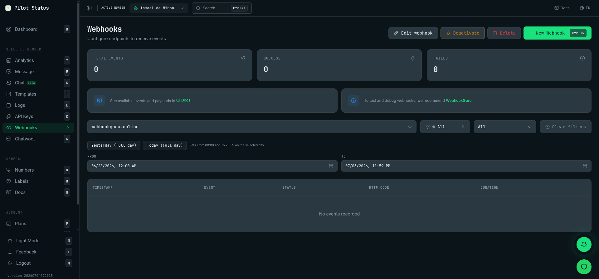

# Configurar webhooks

Administra todo el ciclo de vida de los webhooks a través de la API pública, o usa la página **Webhooks** del panel (`/webhooks`). Un webhook se configura **por número**; una vez configurado, los eventos se entregan automáticamente (no se requiere vincular una clave de API).

<Frame caption="La página Webhooks: crea, edita, desactiva o elimina un webhook e inspecciona sus eventos de entrega.">
  
</Frame>

Para los payloads y la lista completa de eventos, consulta la [referencia de eventos](/es/api/webhooks/events).

## Endpoints

| Método | Endpoint | Descripción |
| --- | --- | --- |
| `GET` | `/v1/webhooks` | Lista los webhooks visibles para el alcance de la clave. |
| `POST` | `/v1/webhooks` | Crea un webhook suscrito a **un** número. Devuelve el `secret` de firma, **solo esta vez**. |
| `GET` | `/v1/webhooks/{id}` | Obtiene un webhook. |
| `PATCH` | `/v1/webhooks/{id}` | Actualiza `name`, `url`, `active`, `events`. |
| `DELETE` | `/v1/webhooks/{id}` | Elimina el webhook de forma permanente. |
| `GET` | `/v1/webhooks/{id}/logs` | Intentos de entrega recientes (`limit` 1–50, filtro `event`; `event=*` = cualquier evento). |
| `POST` | `/v1/webhooks/{id}/rotate-secret` | Genera un nuevo secreto de firma y lo devuelve, una vez. El anterior deja de verificar de inmediato. |
| `POST` | `/v1/webhooks/{id}/reactivate` | Reanuda la entrega a un destino que fue [pausado automáticamente](#pausa-automática-y-reactivate). |

Todos se pueden probar en el **Playground → [Webhooks](/es/playground/webhooks/list-webhooks)**.

<Note>
  **Quién puede llamarlos.** Una clave clásica `ps_` (de workspace o de número) está limitada solo por su alcance. Con una [clave de cuenta](/es/concepts/key-types#claves-de-cuenta) (más `x-workspace-id`) o un token OAuth/MCP, el usuario detrás debe ser **Owner o Admin** (`webhooks:read` para las lecturas, `webhooks:manage` para el resto); de lo contrario, **403 `PERMISSION_DENIED`**.
</Note>

## Alcance por número

Un webhook pertenece a un único número de WhatsApp.

- Con una clave **con alcance de número**, el número viene de la propia clave; un `whatsappNumberId` en el cuerpo debe coincidir con él (si no, **400 `NUMBER_MISMATCH`**).
- Con una clave **con alcance de tenant**, pasa el número de destino en el campo `whatsappNumberId` del cuerpo o en el encabezado `x-whatsapp-number-id`; omitir ambos devuelve **400 `NUMBER_REQUIRED`**; un número fuera de tu tenant devuelve **404 `NUMBER_NOT_FOUND`**.
- `GET /v1/webhooks` lista solo los webhooks visibles para el alcance de la clave (una clave con alcance de número ve solo los webhooks de su propio número). Un webhook fuera del alcance de la clave devuelve **404 `WEBHOOK_NOT_FOUND`**.
- Un token OAuth/MCP con permiso solo sobre algunos números debe enviar `x-whatsapp-number-id` en cada uno de estos endpoints; de lo contrario, **400 `NUMBER_REQUIRED`**.

## El objeto webhook

`GET /v1/webhooks` devuelve un arreglo de estos, y `GET /v1/webhooks/{id}` uno de ellos:

```json
{
  "id": "wh_01HZX...",
  "tenantId": "tenant_01HZX...",
  "name": "n8n",
  "url": "https://hooks.acme.com/whatsapp",
  "environment": "LIVE",
  "deliveryTimeoutMs": null,
  "active": true,
  "events": ["message.received", "message.delivered"],
  "createdAt": "2026-06-01T11:59:00.000Z",
  "updatedAt": "2026-06-01T12:00:00.000Z",
  "hasSecret": true,
  "lastTriggered": "2026-06-28T09:59:00.000Z",
  "whatsappInstanceIds": [],
  "whatsappNumberIds": ["num_01HZX..."],
  "circuitOpen": false,
  "circuitOpenedAt": null,
  "circuitSuccessPct": null,
  "heldCount": 0,
  "droppedCount": 0
}
```

| Campo | Descripción |
| --- | --- |
| `name` | Nombre visible, hasta 100 caracteres. Vacío o ausente → el hostname de la URL. |
| `url` | `http` o `https`. |
| `active` | `false` = desactivado por ti: no se entrega nada. |
| `events` | Las suscripciones. Vacío = no se entrega nada (consulta [Filtrado de eventos](#filtrado-de-eventos)). |
| `deliveryTimeoutMs` | Plazo de entrega por webhook en ms, o `null` para el valor por defecto de 10 segundos. Solo lo configura el equipo de Pilot Status (consulta abajo). |
| `hasSecret` | Si las entregas están firmadas. El secreto en sí nunca se devuelve en una lectura. |
| `lastTriggered` | Cuándo ocurrió el último intento de entrega, o `null`. |
| `whatsappNumberIds` | El número al que está suscrito el webhook. |
| `circuitOpen`, `circuitOpenedAt`, `circuitSuccessPct`, `heldCount`, `droppedCount` | El estado de la [pausa automática](#pausa-automática-y-reactivate). |

`POST` responde la fila almacenada (de `id` a `updatedAt`) más `hasSecret` y `secret`; `PATCH` responde solo la fila almacenada: sin `hasSecret`, sin estado de pausa, sin ids de número. Vuelve a leerlos con `GET`.

<Note>
  **`deliveryTimeoutMs` está reservado al equipo de Pilot Status.** Enviar el campo en `POST` o `PATCH` (incluso como `null`) con cualquier otra credencial devuelve **403 `DELIVERY_TIMEOUT_STAFF_ONLY`** (`"deliveryTimeoutMs can only be set by Pilot Status platform staff; remove the field from the request. | deliveryTimeoutMs só pode ser definido pela equipe da Pilot Status; remova o campo do pedido."`), y no se crea ni se cambia nada. Las claves clásicas `ps_` nunca son del equipo. Si tu endpoint necesita más de 10 segundos, pide a soporte.
</Note>

## Ejemplos

<CodeGroup>

```bash Create
curl -X POST "https://pilotstatus.com.br/v1/webhooks" \
  -H "x-api-key: ps_your_token_here" \
  -H "Content-Type: application/json" \
  -d '{ "url": "https://example.com/hooks/in", "name": "My hook", "events": ["message.received", "message.sent"] }'
```

```bash Pause (keep it, stop delivering)
curl -X PATCH "https://pilotstatus.com.br/v1/webhooks/wh_abc" \
  -H "x-api-key: ps_your_token_here" \
  -H "Content-Type: application/json" \
  -d '{ "active": false }'
```

```bash Delete
curl -X DELETE "https://pilotstatus.com.br/v1/webhooks/wh_abc" \
  -H "x-api-key: ps_your_token_here"
```

```bash Delivery logs
curl "https://pilotstatus.com.br/v1/webhooks/wh_abc/logs?limit=20&event=message.received" \
  -H "x-api-key: ps_your_token_here"
```

</CodeGroup>

## Leer los registros de entrega

`GET /v1/webhooks/{id}/logs` devuelve los intentos recientes, los más nuevos primero. Dos campos juntos
te dicen *dónde* murió un intento:

| `status` | `statusCode` | `response` |
| --- | --- | --- |
| `SUCCESS` | el estado HTTP (2xx) | el cuerpo de tu endpoint, truncado a 1000 caracteres |
| `FAILED` | el estado HTTP | el cuerpo de tu endpoint: respondió, pero no con un 2xx |
| `FAILED` | `null` | la solicitud nunca se completó; `response` contiene la cadena de motivos |

Un `statusCode` `null` es el caso que vale la pena leer con atención: nada llegó a tu servidor, así que
no existe ningún estado. `response` trae entonces la cadena de causas, de la más externa a la más interna, unidas por `<-`
y etiquetadas con el código de error del sistema:

```
fetch failed <- getaddrinfo EAI_AGAIN hooks.example.com [EAI_AGAIN]
fetch failed <- connect ECONNREFUSED 203.0.113.10:443 [ECONNREFUSED]
The operation was aborted due to timeout
```

Los códigos que aparecen con más frecuencia:

| Código | Qué significa |
| --- | --- |
| `EAI_AGAIN`, `ENOTFOUND` | tu hostname no se resolvió |
| `ECONNREFUSED` | el host respondió pero nada escucha en ese puerto |
| `ECONNRESET` | la conexión se cerró a mitad de la solicitud |
| `CERT_HAS_EXPIRED`, `DEPTH_ZERO_SELF_SIGNED_CERT` | se rechazó el TLS |
| *(sin código, "aborted due to timeout")* | tu endpoint no respondió a tiempo |

<Note>
  Trata `response` como una **cadena de diagnóstico, no como un contrato**. La redacción viene del
  runtime y puede cambiar entre versiones; decide según `status` y `statusCode`, y lee
  `response` cuando necesites saber el porqué.
</Note>

Cada evento tiene **3 intentos en total**: el primero de inmediato, y luego reintentos unos 5 y 10
segundos después. Tu endpoint tiene **10 segundos** para responder con un `2xx`; cualquier otra cosa cuenta como
un intento fallido. Así que una sola fila `FAILED` no significa que el evento se perdió: busca un `SUCCESS`
posterior en el mismo evento.

`limit` va de 1 a 50 (por defecto 50): un valor mayor se limita a 50, y un valor que no es
un número positivo vuelve a 50. Cada fila también lleva `whatsappNumberId`, `messageId` y
`correlationId` cuando el evento los tenía.

## Filtrado de eventos

<Warning>
  Una lista `events` **vacía (u omitida) no despacha NADA**: no existe un "suscribirse a todo" implícito. Usa `"*"` para suscribirte a todos los eventos.
</Warning>

- **`"*"` cubre todos los eventos excepto `lead.received`.** Ese es opt-in: se entrega solo cuando se lista por nombre, por ejemplo `["*", "lead.received"]`. Consulta [`lead.received`](/es/api/webhooks/events#payload-lead).

- En `PATCH`, **`events` reemplaza toda la lista de suscripciones** (no se combina).
- Los eventos que el proveedor del número no puede emitir se descartan en silencio.

## Reglas y errores

| Regla | Error |
| --- | --- |
| Crear sin un número (clave con alcance de tenant, sin `whatsappNumberId` / encabezado) | **400 `NUMBER_REQUIRED`** |
| `whatsappNumberId` distinto del número de una clave con alcance de número | **400 `NUMBER_MISMATCH`** |
| `whatsappNumberId` en `PATCH` (el número no se puede cambiar después de la creación: elimina y vuelve a crear) | **400 `NUMBER_RESCOPE_NOT_SUPPORTED`** |
| Cuerpo de `POST` / `PATCH` que no es JSON válido, incluido el vacío; no se crea ni se cambia nada | **400 `INVALID_BODY`**: `"The request body is not valid JSON \| O corpo da requisição não é um JSON válido"` |
| Cuerpo de `POST` / `PATCH` que es JSON válido pero no un objeto (`null`, una cadena, un número) | **400 `INVALID_BODY`**: `"The request body must be a JSON object \| O corpo da requisição deve ser um objeto JSON"` |
| Un campo de tipo incorrecto, un arreglo como cuerpo, una `url` que no es una URL, un `name` de más de 100 caracteres | **400** `{ "error": "Validation error", "details": { … } }`: sin `code`; `details.fieldErrors` indica el campo |
| `url` con un esquema distinto de `http`/`https`, `localhost`, una IP de loopback o privada, o un host sin punto | **400 `INVALID_WEBHOOK_URL`**: `"URL de webhook recusada: <reason>"` |
| `deliveryTimeoutMs` enviado por alguien que no es del equipo de Pilot Status | **403 `DELIVERY_TIMEOUT_STAFF_ONLY`** |
| Clave de cuenta o usuario OAuth/MCP que no es Owner ni Admin | **403 `PERMISSION_DENIED`** |
| Número fuera de tu tenant | **404 `NUMBER_NOT_FOUND`** |
| Webhook no visible para el alcance de la clave | **404 `WEBHOOK_NOT_FOUND`** |
| La misma `url` ya existe en este número (`POST`, o un `PATCH` que cambia la URL) | **409 `WEBHOOK_DUPLICATE`** |
| El workspace ya tiene 50 webhooks (`POST`) | **409 `WEBHOOK_LIMIT_REACHED`** |

Los campos desconocidos del cuerpo se ignoran, no se rechazan. Los mensajes de `INVALID_WEBHOOK_URL`, `WEBHOOK_DUPLICATE` y `WEBHOOK_LIMIT_REACHED` están solo en portugués: decide según `code`.

<Note>
  **El `secret` de firma se devuelve solo al nacer**: en el `201` de `POST /v1/webhooks` y en la respuesta de `POST /v1/webhooks/{id}/rotate-secret`. Ninguna otra respuesta lo devuelve: `GET` y la lista traen `hasSecret` en su lugar, y `PATCH` ninguno de los dos. ¿Lo perdiste? [Rótalo](#rotar-o-generar-uno-para-un-webhook-antiguo). Con un token OAuth/MCP, los mismos roles obtienen el secreto (`webhooks:manage`, Admin u Owner), y cada creación y rotación queda registrada en el registro de auditoría ([detalles](/es/integrations/mcp-server#secretos-y-api-keys-por-oauth)).

  Si ese registro de auditoría no se puede escribir: en la **creación**, el webhook se crea igual, pero `secret` vuelve como `null` junto con `"secretWithheld": true`, `secretWithheldReason` y `"secretWithheldCode": "OAUTH_SECRET_AUDIT_UNAVAILABLE"` (llama a `rotate-secret` para obtener uno); una **rotación** se rechaza con **500 `OAUTH_SECRET_AUDIT_UNAVAILABLE`** y el secreto anterior sigue siendo válido.
</Note>

## Cuántos webhooks por número

**Un número puede tener más de un webhook.** El alcance es de muchos a muchos: cada webhook activo suscrito al número recibe los eventos a los que se suscribió, y un segundo webhook **no** reemplaza al primero. Úsalo para separar responsabilidades: un endpoint para conversaciones, otro para salud y monitoreo.

El único rechazo es un **duplicado exacto**: la misma `url` en el mismo número, **409 `WEBHOOK_DUPLICATE`**. No hay ninguna razón legítima para tener dos, y la integración que creaba en lugar de actualizar solía acumular filas en silencio; ahora recibe un conflicto. También se aplica un tope de **50** webhooks por workspace (**409 `WEBHOOK_LIMIT_REACHED`**), deliberadamente holgado, ya que un tenant con muchos números puede querer uno por número.

```bash Two endpoints on the same number
# 1) conversaciones → tu bandeja de entrada / helpdesk
curl -X POST "https://pilotstatus.com.br/v1/webhooks" \
  -H "x-api-key: ps_your_token_here" -H "Content-Type: application/json" \
  -d '{ "url": "https://example.com/hooks/inbox", "name": "Inbox", "events": ["messages", "smb_message_echoes"] }'

# 2) todo → tu endpoint de monitoreo (esta es la ÚNICA forma de obtener la
#    familia de salud del número; consulta la referencia de eventos)
curl -X POST "https://pilotstatus.com.br/v1/webhooks" \
  -H "x-api-key: ps_your_token_here" -H "Content-Type: application/json" \
  -d '{ "url": "https://example.com/hooks/monitor", "name": "Monitor", "events": ["*"] }'
```

## Verificar la firma

**Todo webhook creado a partir del 2026-09-15 está firmado desde su nacimiento.** La creación genera un secreto y lo devuelve en claro en ese `201`, la única respuesta en la vida de un secreto que lo trae. Nada lo vuelve a leer.

<Warning>
  **Los webhooks creados antes de esa fecha no tienen secreto, y así se quedan.** Sus entregas siguen saliendo sin firmar. Es deliberado: activar la verificación de firma debajo de una integración en funcionamiento es una caída en sí misma. `POST /v1/webhooks/{id}/rotate-secret` es la forma de activarla para uno de ellos, y la única forma de recuperar un secreto perdido, ya que ninguna lectura lo devuelve.

  Lee `hasSecret` en cualquier webhook para distinguir ambos casos antes de decidir si tu receptor puede rechazar entregas sin firmar.
</Warning>

## Rotar, o generar uno para un webhook antiguo

```bash
curl -X POST "https://pilotstatus.com.br/v1/webhooks/wh_abc/rotate-secret" \
  -H "x-api-key: ps_your_token_here"
# → { "id": "wh_abc", "hasSecret": true, "secret": "…" }   ← en claro, una vez
```

<Warning>
  **La rotación es inmediata y no tiene ventana de superposición.** El secreto anterior deja de verificar en el momento en que la llamada responde; las entregas ya en curso firman con el valor que cargó su despacho. Acepta cualquiera de los dos secretos de tu lado durante un minuto, o rota mientras el número está tranquilo.
</Warning>

Cuando hay un secreto configurado, el encabezado `x-pilot-status-signature` lleva el **HMAC-SHA256 del cuerpo crudo de la solicitud** codificado en hex, con el secreto como clave. Calcula el HMAC sobre los bytes crudos exactamente como se recibieron (antes de cualquier análisis JSON) y compara en tiempo constante.

**Con el SDK de Python** (`pilot-status` 1.16.0 o posterior), `verify_webhook_signature(raw_body, signature_header, secret)` lo hace por ti. Pasa el cuerpo exactamente como llegó por la red (Flask `request.get_data()`, FastAPI `await request.body()`), nunca el JSON analizado y vuelto a serializar, cuyos bytes difieren. Compara en tiempo constante y devuelve `False`, sin lanzar nunca una excepción, ante un encabezado ausente o malformado, un secreto vacío o un cuerpo alterado:

```bash
pip install "pilot-status>=1.16.0"
```

<CodeGroup>

```python Flask
import os

from flask import Flask, abort, request
from pilot_status import WEBHOOK_SIGNATURE_HEADER, verify_webhook_signature

app = Flask(__name__)
SECRET = os.environ["PILOT_STATUS_WEBHOOK_SECRET"]  # el secreto devuelto una vez al crear o rotar

@app.post("/hooks/pilot-status")
def pilot_status_hook():
    raw = request.get_data()  # los bytes crudos que se firmaron, no json.dumps(request.json)
    if not verify_webhook_signature(raw, request.headers.get(WEBHOOK_SIGNATURE_HEADER), SECRET):
        abort(401)
    # ... analiza json.loads(raw) y procésalo
    return "", 200
```

```python FastAPI
import os

from fastapi import FastAPI, HTTPException, Request
from pilot_status import WEBHOOK_SIGNATURE_HEADER, verify_webhook_signature

app = FastAPI()
SECRET = os.environ["PILOT_STATUS_WEBHOOK_SECRET"]  # el secreto devuelto una vez al crear o rotar

@app.post("/hooks/pilot-status")
async def pilot_status_hook(request: Request):
    raw = await request.body()  # los bytes crudos que se firmaron
    if not verify_webhook_signature(raw, request.headers.get(WEBHOOK_SIGNATURE_HEADER), SECRET):
        raise HTTPException(status_code=401)
    # ... analiza json.loads(raw) y procésalo
    return {}
```

</CodeGroup>

**Sin el SDK**, calcúlalo tú mismo:

<CodeGroup>

```javascript Node
const crypto = require("node:crypto");
const expected = crypto.createHmac("sha256", process.env.WEBHOOK_SECRET).update(rawBody).digest("hex");
const ok = crypto.timingSafeEqual(Buffer.from(expected), Buffer.from(req.headers["x-pilot-status-signature"] ?? ""));
```

```python Python
import hashlib
import hmac

# raw_body: el cuerpo de la solicitud exactamente como se recibió (bytes).
def is_valid_signature(raw_body: bytes, signature_header: str | None, secret: str) -> bool:
    expected = hmac.new(secret.encode(), raw_body, hashlib.sha256).hexdigest()
    return hmac.compare_digest(expected.encode(), (signature_header or "").encode())
```

</CodeGroup>

## Eliminar reintentos duplicados: `Idempotency-Key`

Cuando está presente, `Idempotency-Key` es **estable por evento**: un reintento, una repetición por backoff y una repetición por failover del mismo evento llevan el mismo valor, así que es la clave correcta para eliminar duplicados. El mismo valor también se agrega al cuerpo JSON entregado como un campo `idempotencyKey` de nivel superior, así que puedes leerlo de cualquiera de los dos lugares.

<Warning>
  **El encabezado no está en todas las entregas.** Se deriva de un id de mensaje encontrado en el payload (`messageId` / `internalMessageId`, en el nivel superior o dentro de `data`). Un payload sin ese id **no recibe ni encabezado ni campo en el cuerpo**; eso incluye:

  - todo **sobre nativo de la Meta Cloud API** (`messages`, `smb_message_echoes`, `message_echoes`, los campos de plantillas y de cuenta …), cuyo nivel superior es `{ object, entry }`,
  - los eventos de ciclo de vida `number.*` y de salud del número: elimina duplicados por su [`id`](/es/api/webhooks/events#payload-number) de nivel superior, el mismo en cada reintento y repetición,
  - `lead.received`: elimina duplicados por `data.leadgenId`.

  Así que el tráfico de conversación de un número de Meta **no** está cubierto por este encabezado hoy. Elimina esos duplicados por los propios ids de Meta, y lee la advertencia sobre el wamid en la [referencia de eventos](/es/api/webhooks/events#eventos-de-meta-cloud-api-sobre-nativo) antes de usar solo el wamid como clave.
</Warning>

## Pausa automática y `reactivate`

Cuando un destino sigue fallando (una tasa de éxito **igual o inferior al 20 % en sus últimas 50 entregas**, después de al menos 20), Pilot Status **pausa la entrega hacia él** (`circuitOpen: true`). Esto no es `active: false`: tú no apagaste nada, y se alerta al Owner de la cuenta.

Mientras está pausado:

- los eventos nuevos se **retienen** (`heldCount`) durante hasta **48 horas**, como máximo **20.000** por webhook; más allá de eso se pierden y se cuentan en `droppedCount`;
- **una entrega cada 5 minutos** pasa como sonda. Cuando tiene éxito, la pausa termina sola y los eventos retenidos vuelven a salir durante la hora siguiente.

Para terminarla de inmediato, arregla tu endpoint y llama a:

```bash
curl -X POST "https://pilotstatus.com.br/v1/webhooks/wh_abc/reactivate" \
  -H "x-api-key: ps_your_token_here"
```

```json
{
  "ok": true,
  "released": 12,
  "stillHeld": 0,
  "circuitOpen": false,
  "circuitOpenedAt": null,
  "circuitSuccessPct": null,
  "heldCount": 0,
  "droppedCount": 0
}
```

Libera hasta 1.000 eventos retenidos, espaciados 200 ms entre sí (`released`); el resto (`stillHeld`) sale en el ciclo horario. Es idempotente (en un webhook que ya está entregando responde `200` con `released: 0`) y no activa un webhook que desactivaste con `active: false`. Sin cuerpo; permiso `webhooks:manage`.

## Panel

Todo lo anterior también está disponible en el panel en **`/webhooks`**: crea y edita webhooks por número, elige eventos, pausa y reanuda, e inspecciona los registros de entrega. La interfaz New/Edit Webhook incluye el aviso de que `message.read` solo se dispara cuando el destinatario tiene activadas las confirmaciones de lectura de WhatsApp.

### Secreto de firma en el panel

- **Al crear.** Justo después de que **New Webhook** guarda, una ventana **Signing secret** muestra el secreto en claro, con un botón **Copy** y el aviso *"Shown once. Store it now — no read returns it again."* (Se muestra una vez. Guárdalo ahora: ninguna lectura lo vuelve a devolver.) Cópialo antes de hacer clic en **Got it**: cerrar la ventana es la última vez que el panel lo muestra.
- **Después.** La ventana **Edit Webhook** muestra el estado del webhook: **Deliveries signed**, o **Unsigned** para un webhook creado antes de que existiera la firma.
- **Rotar (o activar la firma).** En **Edit Webhook**, haz clic en **Generate a new secret** y confirma. El nuevo secreto aparece una vez, en la misma ventana **Signing secret**. Igual que con la API, el secreto anterior deja de verificar **de inmediato**: no hay ventana de superposición, así que actualiza tu receptor enseguida o acepta ambos durante un minuto.

Este es el mismo secreto que devuelve la API, y esos dos momentos son los únicos lugares donde se muestra. No necesitas pedírselo a soporte: rotar es la forma de recuperar uno perdido.
