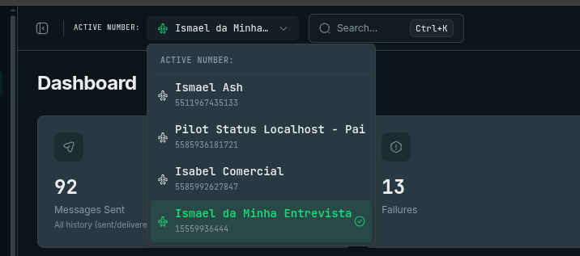

En Pilot Status, cada número de teléfono conectado a WhatsApp se representa como un **número**: la unidad central alrededor de la cual se organiza todo tu proyecto. Ya sea que conectes una sola línea de negocio o gestiones cientos de cuentas de clientes, los números son la forma de identificar, configurar y referirte a las conexiones de WhatsApp en tus llamadas a la API, webhooks y dashboard.

<Frame caption="El selector de número activo en el encabezado: cada página por número (Chat, Templates, Logs, API Keys…) sigue el número seleccionado aquí.">
  
</Frame>

## ¿Qué es un número?

Un número representa un número de teléfono conectado a WhatsApp dentro de tu proyecto de Pilot Status. Cuando conectas un número de teléfono (ya sea escaneando un código QR (API no oficial) o vinculando tus credenciales de WABA (API oficial)), Pilot Status crea un objeto número y le asigna un identificador único.

Cada número está totalmente aislado de los demás números de tu proyecto:

- **Historial de mensajes separado**: las conversaciones y los logs de un número nunca se mezclan con los de otro.
- **Webhooks independientes**: configuras las URLs de webhook por número, así que cada línea puede enviar eventos a un endpoint distinto.
- **Logs dedicados**: el estado de conexión, los errores y la actividad se registran de forma individual.
- **Su propia API key**: cada número tiene una key `ps_` con alcance de número; las solicitudes hechas con esa key actúan sobre ese número.

## Proyectos con varios números

Tu plan de Pilot Status define la cantidad máxima de números de WhatsApp que puedes conectar al mismo tiempo. Dentro de ese límite, puedes conectar todos los números que necesites y gestionarlos desde un solo dashboard y una sola API.

Tener varios números en un mismo proyecto es útil en distintos escenarios:

<CardGroup cols={3}>
  <Card title="Distribución de carga" icon="arrow-right-arrow-left">
    Reparte grandes volúmenes de mensajes entre varios números para mantenerte dentro de los límites de tasa de WhatsApp y conservar un alto rendimiento.
  </Card>

  <Card title="Líneas de marca separadas" icon="tag">
    Mantén marcas o líneas de producto distintas en sus propios números, cada uno con su propio historial de mensajes e identidad.
  </Card>

  <Card title="Enrutamiento por departamento" icon="sitemap">
    Da a tus equipos de ventas, soporte y operaciones números individuales para que las conversaciones se mantengan organizadas y con responsables claros.
  </Card>
</CardGroup>

## SaaS multi-tenant

Si estás construyendo un producto SaaS sobre Pilot Status, el modelo multi-tenant permite que cada uno de tus clientes conecte su propio número de WhatsApp dentro de tu único proyecto de Pilot Status. No necesitas crear una cuenta de Pilot Status por cliente: gestionas toda la flota desde un solo lugar.

Desde tu dashboard y la API, ves todos los números conectados de todos tus clientes. Puedes revisar el historial de mensajes, configurar webhooks y disparar envíos para cualquier número de cliente. Los datos de cada cliente permanecen aislados de los de los demás.

Para enviar un mensaje en nombre de un cliente específico, usa la **API key con alcance de número** de ese número en el header `x-api-key`: la propia key selecciona qué conexión de WhatsApp envía:

```bash
curl -X POST "https://pilotstatus.com.br/v1/messages/send" \
  -H "x-api-key: ps_customer_number_key" \
  -H "Content-Type: application/json" \
  -d '{ "text": "Hello from your app!", "destinationNumber": "+5511999999999" }'
```

Pilot Status enruta el mensaje por la conexión de WhatsApp correcta automáticamente. Tus clientes nunca interactúan con Pilot Status directamente: solo ven tu producto.

## Identificadores de número

Cada número tiene un ID único (por ejemplo, `cmm0abc123`) que aparece en los payloads de webhook (`numberId`) y en los endpoints de gestión. Hay dos formas de encontrar el ID de un número:

<Tabs>
  <Tab title="Dashboard">
    Ve a **Dashboard → Numbers**. El ID de cada número conectado aparece en el panel de detalles del número. Puedes copiarlo directamente desde la interfaz.
  </Tab>
  <Tab title="API">
    Envía una solicitud `GET` al endpoint de números con tu key **con alcance de tenant** para obtener todos los números conectados de tu proyecto, incluidos sus IDs, estado y tipo de conexión.

    ```bash
    curl "https://pilotstatus.com.br/v1/numbers" \
      -H "x-api-key: ps_your_tenant_key"
    ```

    La respuesta devuelve un arreglo de objetos número, cada uno con el campo `id` que usas en las llamadas de gestión y para correlacionar webhooks.
  </Tab>
</Tabs>

<Info>
  Cada plan incluye una cantidad fija de números conectados, y puedes comprar números adicionales como un complemento recurrente. Si tu proyecto requiere un límite mayor, contacta a Pilot Status para hablar de un plan personalizado.
</Info>
