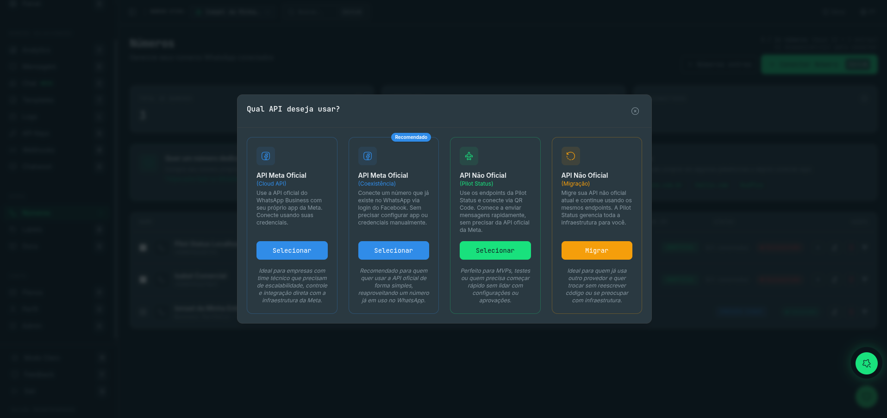

Pilot Status admite dos formas distintas de conectar un número de WhatsApp: la **API oficial** (impulsada por la Cloud API de Meta o el modo Coexistence) y la **API no oficial** (impulsada por el protocolo de WhatsApp Web). Eliges un modo de conexión por número, así que puedes usar ambos tipos dentro del mismo proyecto según tus necesidades.

<Frame caption="Los cuatro modos de conexión en el dashboard: dos oficiales (Cloud API, Coexistence) y dos no oficiales (código QR, migración).">
  
</Frame>

## Comparación lado a lado

<CardGroup cols={2}>
  <Card title="API oficial" icon="shield-check">
    - **Configuración**: conéctate mediante una cuenta de Meta Business y las credenciales de la WABA
    - **Requiere cuenta de Meta**: Sí
    - **Plantillas**: deben estar aprobadas previamente por Meta (OTP, Utility, Marketing)
    - **Grupos / Newsletters**: No compatibles
    - **Proxy**: No aplica, el tráfico pasa por la infraestructura de Meta
    - **Tarifas de Meta por mensaje**: Sí, Meta las cobra por mensaje según la categoría y no están incluidas en tu plan de Pilot Status
    - **Ideal para**: industrias reguladas, campañas de alto volumen, implementaciones de nivel productivo
  </Card>

  <Card title="API no oficial" icon="bolt">
    - **Configuración**: conéctate escaneando un código QR, sin necesidad de cuenta de Meta
    - **Requiere cuenta de Meta**: No
    - **Plantillas**: no requieren aprobación, envía cualquier mensaje libremente
    - **Grupos / Newsletters**: Compatibles
    - **Proxy**: incluido y totalmente administrado por Pilot Status
    - **Tarifas de Meta por mensaje**: Ninguna
    - **Ideal para**: prototipos, herramientas internas, chatbots de IA, onboarding de SaaS
  </Card>
</CardGroup>

## API oficial

La API oficial se integra directamente con la infraestructura de Meta y te da un canal conforme a las normas y listo para producción para la mensajería de WhatsApp. Hay dos variantes disponibles en Pilot Status:

**Cloud API** es la solución de mensajería alojada de Meta. Conectas tu WhatsApp Business Account (WABA), envías tu número remitente para verificación y empiezas a enviar. Todo el tráfico de mensajes pasa por los servidores de Meta, lo que significa que la entrega es muy confiable y tu integración cumple totalmente con las normas de WhatsApp.

**El modo Coexistence** es una variante especial de la API oficial que permite que tu app WhatsApp Business siga funcionando en tu teléfono al mismo tiempo que la integración por API. Tu equipo puede seguir usando la app con normalidad mientras tu backend envía y recibe mensajes de forma programática mediante Pilot Status, sin tener que elegir entre uno u otro.

<Tip>
  El modo Coexistence es ideal si quieres seguir usando la app WhatsApp Business en tu teléfono y, al mismo tiempo, integrarte por API.
</Tip>

Como la API oficial pasa por Meta, Meta cobra sus propias tarifas por los mensajes que envías. Desde el 1 de julio de 2025, Meta cobra por mensaje, no por conversación: la tarifa depende de la categoría del mensaje (marketing, utility, authentication) y del país del destinatario. Meta factura estos cargos directamente y no forman parte de tu suscripción a Pilot Status. Consulta los [precios de WhatsApp de Meta](https://developers.facebook.com/docs/whatsapp/pricing) para conocer las reglas y tarifas vigentes.

## API no oficial

La API no oficial usa el protocolo de WhatsApp Web para enviar y recibir mensajes sin necesidad de una cuenta de Meta Business. Conectas un número simplemente escaneando un código QR en el dashboard de Pilot Status, igual que vincularías WhatsApp Web en un navegador.

Una vez conectado, Pilot Status administra todo en segundo plano: un proxy dedicado y totalmente administrado mantiene tu sesión estable y se encarga de los detalles de conexión de bajo nivel. Nunca aprovisionas ni mantienes ninguna infraestructura por tu cuenta.

La API no oficial habilita capacidades que la API oficial no admite, como enviar mensajes a **grupos**, administrar **canales de newsletter** y enviar mensajes interactivos enriquecidos sin aprobación previa de plantillas. Las variables y el contenido dinámico funcionan exactamente igual que en la API oficial.

<Note>
  La API no oficial usa el protocolo de WhatsApp Web. Aunque se usa ampliamente, Meta no la admite oficialmente.
</Note>

## Cómo elegir el modo adecuado

Usa la guía siguiente para elegir el tipo de conexión que se ajusta a tu caso de uso.

<Accordion title="Envío de mensajes regulados (banca, salud, finanzas)">
  Elige la **API oficial**. Las industrias reguladas requieren un canal de mensajería conforme a las normas y auditable. La API oficial está aprobada por WhatsApp y te da la trazabilidad y la confiabilidad que exigen estos entornos.
</Accordion>

<Accordion title="Marketing de alto volumen con plantillas aprobadas">
  Elige la **API oficial**. La categoría de plantillas Marketing de Meta está diseñada para campañas promocionales a gran escala. La aprobación garantiza que tus mensajes se entreguen de forma confiable y que tu cuenta mantenga una buena reputación.
</Accordion>

<Accordion title="Prototipos rápidos o herramientas internas">
  Elige la **API no oficial**. Puedes estar funcionando en segundos: sin cuenta de Meta, sin envío de plantillas, sin esperar aprobación. Es el camino más rápido de cero a una integración de WhatsApp funcionando.
</Accordion>

<Accordion title="Agentes de IA y chatbots">
  Cualquiera de los dos modos funciona bien. Si necesitas salir en vivo rápido o quieres evitar el proceso de aprobación de Meta, la API no oficial es más fácil para empezar. Si tu chatbot maneja datos sensibles o necesita operar a escala empresarial, la API oficial te da una base más duradera.
</Accordion>

<Accordion title="Productos SaaS con números propiedad del cliente">
  Ambos modos son compatibles. La API no oficial suele ser más fácil para el onboarding de clientes: tus usuarios simplemente escanean un código QR en lugar de configurar una cuenta de Meta Business. Siempre puedes migrar números individuales a la API oficial más adelante, a medida que crezcan las necesidades de tus clientes.
</Accordion>
