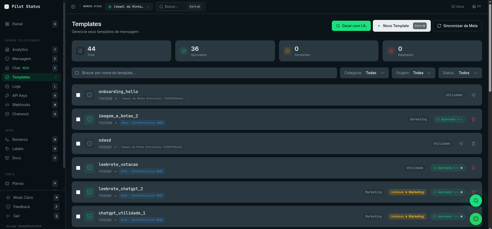
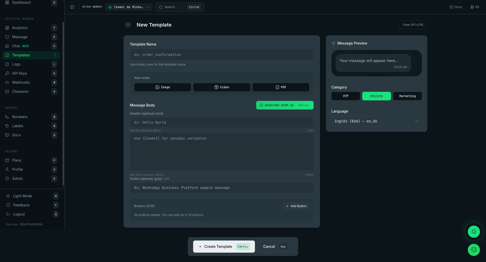

Las plantillas definen contenido de mensaje reutilizable. Créalas y gestiónalas en el panel (`/templates`), mediante la API REST (`/v1/templates`) o a través del servidor MCP (`templates_create` / `templates_update` / `templates_delete`). Al enviar, referencia la plantilla por `templateId` en `POST /v1/messages/send` y pasa un objeto `variables` con las claves correspondientes.

<Frame caption="La página Templates: genera con IA, envía a Meta y ve el estado de aprobación y la categoría de cada plantilla.">
  
</Frame>

## Categorías

La categoría se define al crear la plantilla y **no se puede cambiar después**:

- **MARKETING**: mensajes promocionales (los más sensibles a las políticas de WhatsApp).
- **UTILITY**: mensajes transaccionales (actualizaciones de cuenta, alertas, recordatorios).
- **OTP**: mensajes de código de un solo uso o de verificación.

## Aprobación de Meta vs. plantillas locales

- **Números oficiales (Meta):** cuando guardas una plantilla con un número de Meta seleccionado, el panel te pregunta si quieres **enviarla a revisión de Meta** ahora o guardarla como borrador y enviarla después. Una vez enviada, la categoría, el idioma y el estado de aprobación siguen las reglas de Meta. Una plantilla solo puede enviarse en un número de Meta cuando tiene una versión **aprobada**.
- **Números no oficiales (Pilot Status web):** las plantillas se crean localmente y se pueden **usar de inmediato**: no hay paso de aprobación.

Las plantillas devueltas por `GET /v1/templates` incluyen un campo `source` (de dónde vino la plantilla), un campo `metaStatus` (estado de revisión de Meta, por ejemplo `PENDING`, `APPROVED`, `REJECTED`) y un indicador `sendable` que dice si se puede usar para envíos en este momento.

## Estructura de la plantilla

<Frame caption="El editor de plantillas: nombre, multimedia, cuerpo con {{variables}}, botones, categoría (OTP/Utility/Marketing), idioma y generación con IA.">
  
</Frame>

Solo el **body** es obligatorio.

| Componente | Obligatorio | Qué es |
| --- | --- | --- |
| **Header** | opcional | Texto (≤60 caracteres, ≤1 variable) o un elemento multimedia (`IMAGE` JPG/PNG, `VIDEO` MP4, `DOCUMENT` PDF). |
| **Body** | **obligatorio** | Texto principal (≤1024 caracteres) con marcadores `{{variable}}`. |
| **Footer** | opcional | Texto estático ≤60 caracteres, sin variables. |
| **Buttons** | opcional | Hasta 10 botones: `QUICK_REPLY` (≤10), `URL` (≤2), `PHONE_NUMBER` (≤1, E.164 con código de país), `COPY_CODE` (≤1, alfanumérico ≤15 caracteres), `PAYMENT_REQUEST` (≤1, PIX). |

Valores del header multimedia: por REST pasa `header.url` (URL pública http(s)) **o** `header.base64` (data URI, que se vuelve a alojar automáticamente en el servidor). Por MCP solo se acepta `header.url`.

<Note>
  No existe un header `LOCATION`. Tampoco se admiten: `CATALOG`/`MPM`, `LIMITED_TIME_OFFER`, autocompletado/one-tap/zero-tap de OTP ni botones `VOICE_CALL`.

  **Las plantillas carrusel se admiten** en números de Meta: categoría `MARKETING`, de 2 a 10 tarjetas multimedia; consulta [Plantillas carrusel](/es/api/templates#plantillas-de-carrusel).

  **Los botones `FLOW` se admiten** en números de Meta: abren un [Flow](/es/concepts/flows) dentro del chat. El botón se vincula por `flow_id`, `flow_name` o `flow_json` en línea. `ORDER_DETAILS` (la tarjeta de pedido detallada) se puede **construir, previsualizar y guardar**; su envío a Meta se intenta en la versión actual de la Graph API y, cuando la cuenta todavía no es elegible para WhatsApp Pay, el rechazo vuelve como un error de elegibilidad claro en lugar de un 400 críptico de Meta.

  En **números no oficiales (web)** las plantillas admiten hasta **3 botones** en total, y la vista previa del editor muestra exactamente cómo se entrega el mensaje para el número seleccionado, incluida la sustitución en vivo de `{{variable}}` con tus valores de ejemplo.

  El `parameter_format` `NAMED` **sí** se admite: una plantilla creada en la consola de Meta con variables con nombre (`{{customer_name}}`) se importa con las variables correctas y se envía con `parameter_name` en cada parámetro.
</Note>

### Botón de pago PIX (`PAYMENT_REQUEST`)

Entrega un código PIX copia y pega (BR Code). Esta es la forma correcta de enviar PIX: `COPY_CODE` se limita a 15 caracteres alfanuméricos, mientras que un BR Code real tiene entre 100 y 400 caracteres con puntuación. El botón funciona en **ambos** tipos de número, con una presentación distinta:

- **Números de Meta (oficiales):** la tarjeta de pago de WhatsApp Pay (fila "Pagar com" + ícono del medio de pago), cuando la cuenta tiene los pagos habilitados (consulta la nota de abajo).
- **Números no oficiales (web):** se entrega como un **botón de copiar "Copiar código Pix"** con el BR Code completo (sin límite de longitud; validado en dispositivos reales). Se combina normalmente con los demás botones de la plantilla, y la vista previa del editor muestra exactamente esta forma.

El código es un valor **por envío**: pon una variable en el `example` del botón y pasa el código real en `variables` al momento del envío, como cualquier otra variable.

```json
{ "type": "PAYMENT_REQUEST", "text": "Copy Pix code",
  "paymentType": "pix_dynamic_code", "example": ["{{codigo_pix}}"] }
```

<Note>
  Este botón requiere que Meta haya habilitado los **pagos** en tu cuenta de WhatsApp Business. La habilitación es gradual y por cuenta; en palabras de Meta: _"this feature is rolling out and might not be available yet for your WhatsApp Business account"_ (esta función se está implementando y puede que aún no esté disponible para tu cuenta de WhatsApp Business). En una cuenta sin ella, Meta rechaza la plantilla con `100` / subcódigo `2388128` (_"Button at index 0 has unexpected type (PAYMENT_REQUEST)"_). No hay un campo de API para verificarlo: la única forma de saberlo es intentar crear una.
</Note>

<Warning>
  La variable del código PIX es **obligatoria** al momento del envío. Si falta, el envío se rechaza en lugar de entregarse: sin el parámetro, Meta usaría el código de **muestra** guardado en la plantilla, y el cliente le pagaría a la cuenta equivocada.
</Warning>

### Tarjeta de pedido detallada (`orderDetails`)

Una plantilla puede llevar una tarjeta de pedido detallada (`PEDIDO #reference`, ítems con cantidad, una fila de pago "Pagar com" y el total), guardada como un bloque `orderDetails` (`order` con ítems/subtotal/impuestos en unidades menores enteras, más `paymentSettings` con el medio de pago). Comportamiento según el tipo de número:

- **Meta (oficial):** la tarjeta se construye, se previsualiza y se guarda; su envío a Meta se intenta en la versión actual de la Graph API y devuelve un error de elegibilidad claro cuando la cuenta no tiene WhatsApp Pay.
- **No oficial EVO_V2:** la tarjeta **se puede entregar hoy** (`review_and_pay`). Cuando la plantilla también lleva texto en el body, botones o un header multimedia, se entregan primero como un mensaje normal y la tarjeta de pedido llega como un segundo mensaje; si la tarjeta falla después de entregado el primer mensaje, el envío se marca como fallido (sin reintento, para no duplicar el texto).
- **No oficial EVO_GO:** no hay tarjeta detallada; cuando el pedido lleva un medio de pago PIX, se degrada a un botón de copiar "Copiar código Pix" agregado a los demás botones de la plantilla.

**Variables en la tarjeta de pedido:** los campos de texto (nombre del ítem, referencia, moneda) aceptan `{{variables}}` como cualquier otro campo. Los campos numéricos (precio del ítem, cantidad, subtotal, impuestos, total) también aceptan un **único token `{{variable}}`**: el ejemplo debe ser un entero no negativo (unidades menores, es decir, centavos), el valor real se sustituye al momento del envío, y un envío con un valor numérico corrupto se rechaza en lugar de entregarse con un monto incorrecto.

## Reglas de las variables

- Escribe las variables como `{{name}}` en el body, el header de texto y los botones de URL dinámica (por ejemplo, `https://shop.com/promo/{{link}}`: una variable, al **final** de la URL, nunca en el dominio).
- El body **no debe empezar ni terminar con una variable**: incluye siempre texto literal en ambos extremos.
- Al crear o actualizar mediante la API o MCP, es **obligatorio** un objeto `examples` que asigne a **cada** variable un valor de muestra real. Si faltan muestras, se devuelve `400 TEMPLATE_EXAMPLES_REQUIRED` con las claves faltantes en `details.missing`.
- El valor del código para copiar es la única excepción: va en el botón como `example` (por ejemplo, `["PROMO10"]`), no en el `examples` de nivel superior. En un **número oficial** ese `example` es solo una muestra: el código que copia el cliente va en `variables` como `button_<N>` en cada envío (ver abajo).
- **Al enviar**, cada marcador (incluidas las claves usadas solo en botones) debe proporcionarse en `variables`, y cada valor debe ser una **cadena no vacía**.
- **Marcadores numerados en botones (plantillas creadas en la consola de Meta).** Una plantilla creada en el WhatsApp Manager de Meta y sincronizada con Pilot Status (`source: "META"`) con marcadores posicionales numera por separado la variable de un botón de URL dinámica: en `https://ctlnk.io/{{1}}`, ese `{{1}}` **no** es el `{{1}}` del body. Proporciónalo como `variables["button_<N>"]`, donde `N` es la posición del botón en la lista de botones de la plantilla, **empezando en 1**: cuentan todos los botones, incluidos los estáticos. Pasa solo la parte variable (el sufijo de la URL), no la URL completa. Un envío sin él, o con un valor vacío, se rechaza con `400 MISSING_TEMPLATE_VARIABLES` (o `INVALID_TEMPLATE_VARIABLE_VALUE`) indicando la clave.

Para una plantilla con marcadores en el body `{{1}}`, `{{2}}`, `{{3}}` y un único botón de URL `https://ctlnk.io/{{1}}`:

```json
"variables": { "1": "Maria", "2": "R$ 10,00", "3": "21/09/2026", "button_1": "Gggkf" }
```

Los marcadores con nombre no cambian: un botón creado en Pilot Status como `https://shop.com/promo/{{link}}` se completa con `variables.link`.

**Botones de copiar código en números oficiales.** Para Meta, el código escrito en un botón de copiar código al crearlo es solo un **ejemplo**; el código que copia el cliente es un parámetro obligatorio de **cada envío**. Por eso, en una plantilla aprobada por Meta (`source: "META"`: todas las plantillas de un número oficial, ya sea creadas en la consola de Meta o en Pilot Status), un botón de copiar código cuyo valor **no** tiene `{{variable}}` (un ejemplo fijo como `PROMO10`) recibe su código como `variables["button_<N>"]`, con la misma regla de `N`. Para los botones `[QUICK_REPLY, COPY_CODE]` con el ejemplo `PROMO10`:

```json
"variables": { "button_2": "BLACKFRIDAY" }
```

Un envío sin él, o con un valor vacío, se rechaza con `400 MISSING_TEMPLATE_VARIABLES` (o `INVALID_TEMPLATE_VARIABLE_VALUE`) indicando la clave. Un botón de copiar código cuyo ejemplo es una variable con nombre (`["{{coupon}}"]`) se sigue completando con `variables.coupon`, y el botón de código de una plantilla de autenticación (OTP) sigue tomando el código del body. En números no oficiales (web/QR) el código también es por envío: escríbelo en el botón como una `{{variable}}` y complétalo en `variables`.

## Formato de texto

Los marcadores de formato de WhatsApp funcionan en el body: `*negrita*`, `_cursiva_`, `~tachado~`, `monospace`. El **header de texto no permite** marcadores de formato, emojis ni saltos de línea.

## API de plantillas

<CodeGroup>

```bash Create
curl -X POST "https://pilotstatus.com.br/v1/templates" \
  -H "x-api-key: ps_your_key_here" \
  -H "Content-Type: application/json" \
  -d '{
    "name": "promo_coupon",
    "category": "MARKETING",
    "language": "pt_BR",
    "body": {
      "header": { "type": "IMAGE", "url": "https://cdn.example.com/banner.png" },
      "body":   { "text": "Hi {{name}}! Use it and get {{discount}} off." },
      "footer": { "text": "Limited-time offer" },
      "buttons": [
        { "type": "QUICK_REPLY",  "text": "I want it!" },
        { "type": "URL",          "text": "Buy", "url": "https://shop.com/promo/{{link}}" },
        { "type": "COPY_CODE",    "example": ["PROMO10"] }
      ]
    },
    "examples": { "name": "Maria", "discount": "10%", "link": "abc123" }
  }'
```

```bash Update
curl -X PUT "https://pilotstatus.com.br/v1/templates/tmpl_123" \
  -H "x-api-key: ps_your_key_here" \
  -H "Content-Type: application/json" \
  -d '{ "body": { "body": { "text": "Hi {{name}}! New copy here." } }, "examples": { "name": "Maria" } }'
```

```bash Delete
curl -X DELETE "https://pilotstatus.com.br/v1/templates/tmpl_123" \
  -H "x-api-key: ps_your_key_here"
```

</CodeGroup>

Una creación exitosa devuelve `201`:

```json
{ "id": "tmpl_123", "name": "promo_coupon", "category": "MARKETING", "metaStatus": "PENDING" }
```

Después de guardar, `GET /v1/templates/{id}` devuelve todas las claves de variables detectadas en el arreglo plano `variables` de nivel superior. Para una plantilla creada en la consola de Meta con un marcador numerado en un botón, el arreglo también lista la clave `button_<N>` del botón (por ejemplo, `["1", "2", "3", "button_1"]`), y en un número oficial lista la clave de un botón de copiar código sin `{{variable}}` (`button_3` para el `promo_coupon` de arriba): proporciona en el envío cada clave que liste.

## Errores comunes de envío a revisión y de envío

| Situación | Solución | Código de Meta |
| --- | --- | --- |
| El body empieza/termina con una variable | Agrega texto literal en ambos extremos | `2388299` |
| Botón de URL con un dominio de ejemplo (example.com, yourdomain.com…) | Usa el dominio real de tu negocio | `368/1346003` |
| Teléfono del botón de llamada sin código de país | Usa E.164, por ejemplo `+5521999998888` | `192` |
| Demasiadas variables en relación con el texto fijo | Agrega texto o elimina variables | `2388293` |
| Envío de una plantilla aún no aprobada por Meta | Espera la aprobación | — (Pilot Status la rechaza antes de llamar a Meta: `META_TEMPLATE_NOT_APPROVED`) |
| Las variables enviadas no coinciden con la plantilla aprobada | Envía cada clave esperada | `132000` |
| Plantilla pausada por Meta por caída de calidad | Mejora el contenido, reduce las denuncias | `132015` |
| Falta un parámetro obligatorio (por ejemplo, una variable de botón sin completar) | Proporciona cada variable de la plantilla; para un marcador numerado en un botón de una plantilla creada en la consola de Meta, como `button_<N>` | `131008` |
| El nombre visible aún no está aprobado | Espera la aprobación de Meta | `131037` |
| Botón de pago no habilitado para esta WABA | Espera a que Meta habilite los pagos | `100/subcode 2388128` |
| Editar una plantilla que Meta no te deja editar en su estado actual: solo se pueden editar las plantillas rechazadas (`409 TEMPLATE_NOT_EDITABLE`; la plantilla guardada no cambia) | Crea una plantilla nueva con el cambio, o envía el documento al momento del envío ([Editar](/es/api/templates#editar)) | `100/subcode 2388003` |

Un `404` al enviar significa que la plantilla no existe para la clave o (en un número de Meta) que todavía no tiene una versión aprobada.

## Relacionado

- [Enviar mensajes](/es/guides/send-messages)
- [Mensajes multimedia](/es/guides/media-messages)
