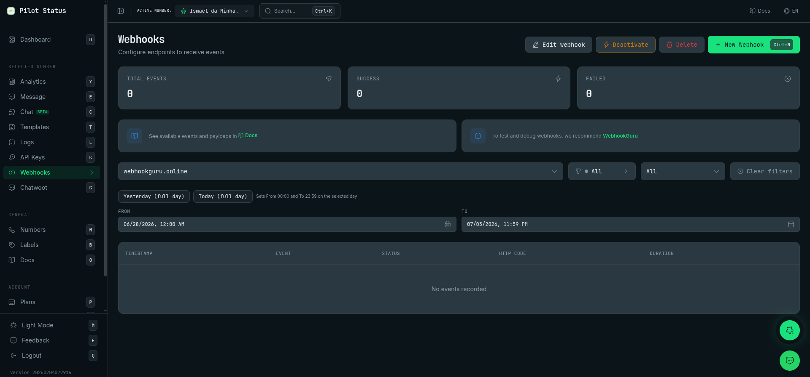

Los webhooks entregan eventos en tiempo real a tu URL como solicitudes `POST` en JSON. Configuras los webhooks por número en la página **Webhooks** del dashboard o mediante `POST /v1/webhooks`. Consulta la [guía Recibir mensajes](/es/guides/receive-messages) para la configuración y la [referencia de eventos](/es/api/webhooks/events) para los esquemas completos de payload.

<Frame caption="La página Webhooks: crea endpoints, elige eventos (o suscríbete a todos con *) e inspecciona los registros de entrega.">
  
</Frame>

## Resumen de eventos

| Grupo | Eventos |
| --- | --- |
| Estado de salida | `message.sent`, `message.delivered`, `message.read`, `message.failed` |
| Entrantes | `message.received`, `message.reply`, `message.group`, `message.newsletter`, `message.stories` |
| Ciclo de vida del número | `number.created`, `number.connected`, `number.disconnected`, `number.removed`, `number.restored` |
| Salud y recuperación del número | `number.health_blocked`, `number.health_degraded`, `number.health_shadowban`, `number.recovered` |
| Llamadas de voz | `call.ringing`, `call.connected`, `call.ended`, `call.missed` |
| Llamadas de voz (solo Meta Cloud API) | `call.permission_updated`, `calls` (sobre crudo de Meta) |
| Archivar chat y bloquear contacto | `chat.archived`, `chat.unarchived` (solo QR Code), `contact.blocked`, `contact.unblocked` |

Un webhook solo se dispara para los eventos de su lista `events`. Una **lista vacía no despacha nada**; usa `"*"` para suscribirte a todos los eventos. Los eventos de salud del número y `number.recovered` se pueden suscribir por nombre desde el 2026-09-15, y también llegan a las suscripciones `"*"`.

## Esquema del payload (v3)

Todo evento `message.*` / `number.*` llega así:

```json
{
  "event": "message.sent",
  "data": { }
}
```

Todos los campos de `data` están en **camelCase**. Los números de teléfono siempre están en **E.164 con `+`** (sin sufijo de dispositivo, sin `@s.whatsapp.net`/`@lid`). Las marcas de tiempo están en **ISO 8601** en un único campo `createdAt`. Los eventos `call.*` normalizados son planos (sin el envoltorio `data`).

<Warning>
  **Cambio incompatible: `data.numberId` siempre es el ID del número.** En todo evento `number.*`, `data.numberId` ahora es el ID del **número** de WhatsApp. `number.created`, `number.connected` y `number.removed` antes llevaban el ID interno de la **instancia**, mientras que los eventos de salud ya llevaban el ID del número. **Si tu consumidor relacionaba los eventos de ciclo de vida por ID de instancia, dejará de coincidir: usa el ID del número como clave.** Es el mismo `id` que devuelve `GET /v1/numbers`.
</Warning>

## Correlación con la respuesta 202

`POST /v1/messages/send` responde `HTTP 202` con `id` y `correlationId`. Úsalos para vincular los webhooks con tu envío:

| Campo del `202` | Equivalente en el webhook |
| --- | --- |
| `id` | `id` en `message.sent` / `delivered` / `read` / `failed` (mismo valor) |
| `correlationId` | Se repite en los eventos de estado de salida y en `message.reply` / `message.received` cuando hay correlación |
| _(no está en el 202)_ | `messageId` de WhatsApp: aparece por primera vez en `message.sent` |

En `message.reply`, `quotedMessageId` es igual al `messageId` de tu `message.sent` original, y `contentReplied` lleva el texto citado.

<Note>
  El evento `message.read` (y el estado **Read** en los registros) solo ocurre cuando el destinatario tiene activadas las **confirmaciones de lectura de WhatsApp**. De lo contrario, el ciclo de vida termina en `message.delivered`.
</Note>

## Notas de entrega

- `number.disconnected` se emite desde la transición de salud del número, que controla la ventana anti-oscilación y la deduplicación de una alerta por transición: un evento por caída confirmada, no uno por cada parpadeo del socket. Se dispara para números **web nativos (no oficiales)**, que antes no producían ningún evento suscribible cuando se caían. Los números de **Meta Cloud API** solo lo emiten cuando Pilot Status pierde el acceso a ellos en Meta (app eliminada de la WABA o WABA desvinculada), de inmediato cuando Meta lo notifica; fuera de eso, señalan los problemas mediante los eventos de salud del número.
- Con la retención de datos desactivada ([modos de PII](/es/trust/data-retention)), los campos condicionales como `content` pueden venir vacíos; los IDs y las marcas de tiempo siempre existen.
- Los eventos que el proveedor del número no puede emitir se descartan en silencio de la suscripción.

## Relacionado

- [Guía Recibir mensajes](/es/guides/receive-messages)
- [Referencia de eventos de webhook](/es/api/webhooks/events)
- [Configurar webhooks](/es/api/webhooks/configure)
