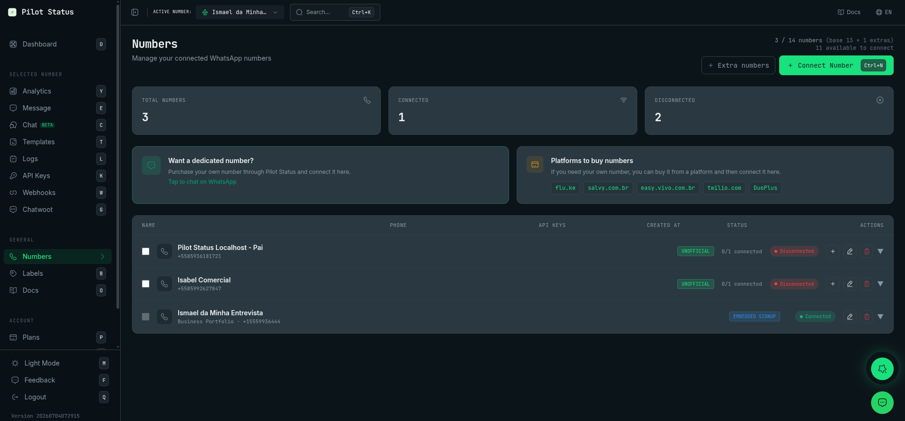
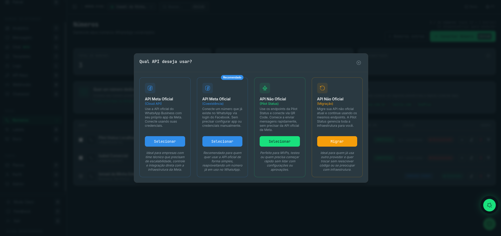
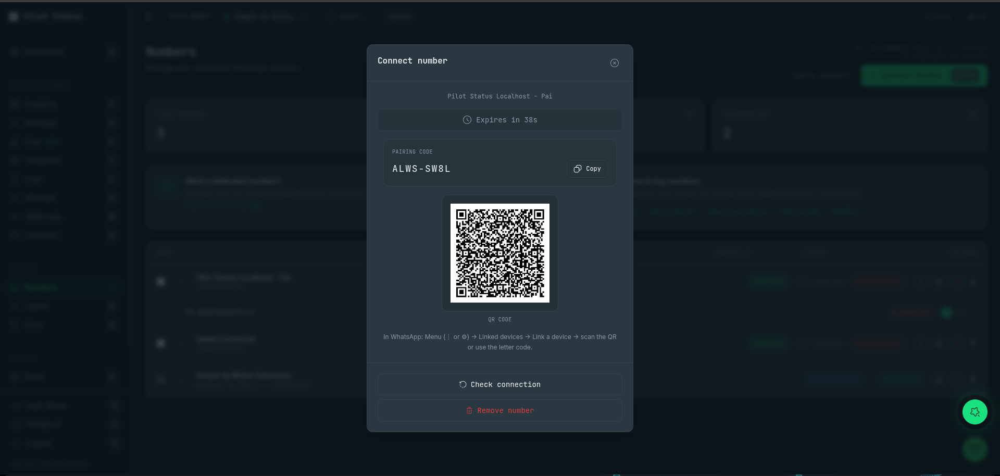

Pilot Status admite dos formas de conectar un número de WhatsApp a tu proyecto: una conexión no oficial basada en código QR que se configura en segundos, y una conexión oficial de Meta que usa la Cloud API o el modo Coexistence para cumplir por completo con las políticas y obtener mayor rendimiento. Puedes combinar ambos tipos en el mismo proyecto.

<Frame caption="La página Numbers: números conectados con insignias de proveedor (Unofficial / Embedded Signup) y el botón Connect Number.">
  
</Frame>

<Frame caption="Conectar un número: elige entre Meta Cloud API, Meta Coexistence, la API no oficial de Pilot Status (código QR) o la migración desde otro proveedor.">
  
</Frame>

<Tabs>
  <Tab title="No oficial (código QR)">
    El método de conexión no oficial autentica tu número de WhatsApp vinculándolo como un dispositivo, el mismo flujo que WhatsApp Web. Pilot Status gestiona el proxy administrado automáticamente, así que no hay nada adicional que configurar.

    <Steps>
      <Step title="Abre la sección Numbers">
        En tu panel de Pilot Status, ve a **Dashboard → Numbers** y haz clic en **Connect Number**.
      </Step>
      <Step title="Selecciona la tarjeta Unofficial API">
        En la pantalla de tipo de conexión, elige la tarjeta **Unofficial API** (Pilot Status / QR Code).
      </Step>
      <Step title="Escanea el código QR">
        Abre WhatsApp en tu teléfono y toca **Dispositivos vinculados → Vincular un dispositivo**. Apunta la cámara al código QR que aparece en el panel.

        <Frame caption="El modal Connect number: escanea el código QR o escribe el código de vinculación de letras en WhatsApp (Dispositivos vinculados); los códigos expiran y se regeneran automáticamente.">
          
        </Frame>
      </Step>
      <Step title="Confirma la conexión">
        Cuando WhatsApp reconoce el código, el estado de tu número cambia a **Connected** en el panel. Ya puedes empezar a enviar y recibir mensajes por la API.
      </Step>
    </Steps>

    <Note>
      Las conexiones no oficiales incluyen un proxy administrado: no necesitas VPS ni configuración adicional. Pilot Status mantiene la conexión y la redirige automáticamente si tu IP cambia.
    </Note>
  </Tab>
  <Tab title="Oficial (Meta)">
    La conexión oficial usa la WhatsApp Business API de Meta. Elige **Cloud API** para una integración totalmente alojada por Meta, o el **modo Coexistence** para usar la API junto a tu app WhatsApp Business existente sin interrumpirla.

    <Steps>
      <Step title="Abre la sección Numbers">
        En tu panel de Pilot Status, ve a **Dashboard → Numbers** y haz clic en **Connect Number**.
      </Step>
      <Step title="Selecciona la tarjeta Official Meta API">
        En la pantalla de tipo de conexión, elige la tarjeta **Official Meta API** (Cloud API o Coexistence, que aparecen como tarjetas separadas).
      </Step>
      <Step title="Coexistence: conecta con Facebook">
        En la tarjeta **Official Meta API (Coexistence)**, haz clic en **Connect with Facebook** y sigue el aviso de Meta para otorgar a Pilot Status los permisos de WhatsApp Business. Debes ser administrador de la cuenta de Meta Business. Meta configura el webhook por ti, así que no hay nada más que preparar.
      </Step>
      <Step title="Cloud API: ingresa las credenciales de tu app de Meta">
        En la tarjeta **Official Meta API (Cloud API)** (tu propia app de Meta), completa los cinco campos, todos obligatorios: **Phone Number ID**, **WABA ID**, **System Token** (el token de acceso del usuario de sistema de tu app de Meta), **App Secret** y **App ID**. Luego haz clic en **Connect Meta**. Pilot Status lee el número de teléfono desde Meta usando el Phone Number ID y el token.
      </Step>
      <Step title="Cloud API: copia la Callback URL y el Verify Token">
        Justo después de crear el número, la ventana **Meta Number Created!** muestra una **Callback URL** y un **Verify Token**, cada uno con un botón para copiar. En tu app de Meta, abre **WhatsApp → Configuration → Webhook**, pega ambos, verifica y suscríbete a los campos `messages` y `message_template_status_update`. Hasta que Meta verifique el webhook, la tarjeta del número muestra **Webhook Pending**; después, **Webhook Configured**.
      </Step>
      <Step title="Confirma la conexión">
        Cuando la conexión se completa, el estado de tu número cambia a **Connected**. Los mensajes de plantilla, los webhooks de la Cloud API y el envío de alto volumen están disponibles de inmediato.
      </Step>
    </Steps>

    <Note>
      El modo Coexistence te permite usar la API oficial de Meta y mantener activa tu app WhatsApp Business existente en el mismo número. Tu equipo puede seguir usando la app para conversaciones manuales mientras tus automatizaciones e integraciones funcionan a través de la API.
    </Note>

    <Tip>
      **¿Necesitas el Verify Token de nuevo más tarde?** Para un número conectado por **Official Meta API (Cloud API)** con credenciales, expande la tarjeta del número en la página **Numbers**: su bloque de webhook (**Webhook Pending** o **Webhook Configured**) muestra la **URL** (con botón para copiar) y el **Verify Token**, enmascarado, con un botón para copiar. Solo el **dueño del workspace** puede copiar el token; los demás roles ven *"Only the workspace owner can view it"* (solo el dueño del workspace puede verlo). Los números conectados con Facebook (Coexistence / Embedded Signup) no tienen ese bloque, porque Meta configura su webhook por sí misma.
    </Tip>
  </Tab>
</Tabs>

## Configuración de varios números

Todos los planes de Pilot Status admiten varios números en un mismo proyecto. Agrega números hasta el límite de tu plan: desde 1 número en el nivel gratuito hasta 13 números en el plan Enterprise. Cada número tiene su propio ID, alcance de API y registro de mensajes.

Para productos SaaS y aplicaciones multi-tenant, cada uno de tus clientes puede conectar su propio número de WhatsApp dentro de tu proyecto. Así el tráfico de mensajes queda totalmente aislado por tenant, mientras administras todos los números desde un solo panel y una sola integración de API. Pilot Status factura a nivel de proyecto, así que no necesitas una cuenta separada por cliente.

## Reconectar un número

Las conexiones no oficiales se caen de vez en cuando, por ejemplo si el teléfono vinculado está sin conexión durante mucho tiempo o si WhatsApp revoca la sesión. Las conexiones oficiales suelen ser más estables, pero las interrupciones de red también pueden causar una desconexión temporal.

Para reconectar un número, abre **Dashboard → Numbers**, busca el número con estado **Disconnected** y haz clic en **Reconnect**. En los números no oficiales, escanearás un nuevo código QR. En los números oficiales, Pilot Status intentará restablecer la sesión automáticamente con tus credenciales guardadas.

<Warning>
  Los Términos de Servicio de WhatsApp prohíben enviar spam. Obtén siempre el consentimiento explícito del usuario antes de enviar mensajes a cualquier contacto. Las infracciones pueden hacer que Meta bloquee tu número.
</Warning>
