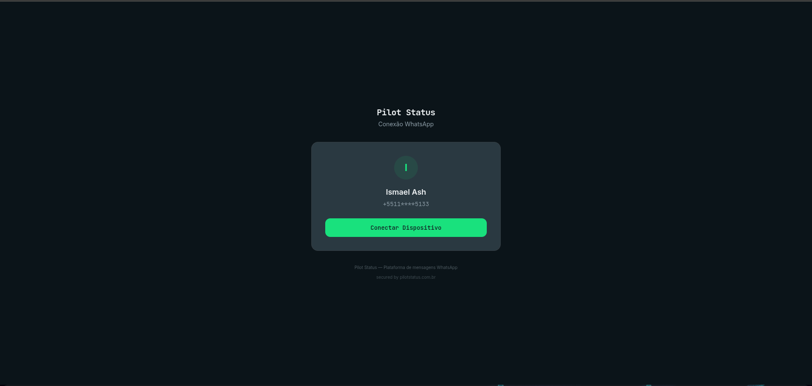

La página de conexión es la página pública en `https://connect.pilotstatus.com.br/connect/<token>`. Se la envías a un cliente para que **él** pueda conectar su número de WhatsApp a **tu** workspace, sin una cuenta en tu dashboard y sin que tú veas nunca su teléfono.

No es una pantalla del dashboard. Se abre sin login, y el token en la URL es la única credencial. Esta página describe lo que ve la persona del otro lado. Para **incrustarla** en tu propia app (iframe, eventos `postMessage`, modo botón, estilo del botón), lee [Incrustar la página de conexión](/es/integrations/embed-connect).

<Frame caption="La página de conexión alojada, con el logo, los colores y el título del tenant.">
  
</Frame>

## De dónde sale el enlace

Tú creas el enlace. Hay dos formas:

- **En el dashboard**: el flujo de conexión de la pantalla **Numbers** puede generar un enlace de emparejamiento remoto en lugar de mostrarte el código QR a ti. Consulta [Números](/es/dashboard/numbers).
- **Por la API o MCP**: [`POST /v1/numbers/remote-pairing`](/es/api/numbers/remote-pairing), o la herramienta MCP `numbers_remote_pairing`. La respuesta trae `remotePairingUrl`.

El enlace decide qué flujo ve el cliente:

| Enlace | Flujo en la página | Vigencia |
| --- | --- | --- |
| Número web de Pilot Status (QR, el predeterminado) | Código QR más código de emparejamiento | **24 horas**, un solo uso |
| Meta, `metaFlow: "embedded"` | Botón de Embedded Signup de Facebook | **30 minutos** |
| Meta, `metaFlow: "credentials"` | Formulario para las credenciales de la Cloud API | **30 minutos** |

## Qué ve el cliente

La página está **solo en portugués**. Las etiquetas de abajo se citan tal como aparecen.

### Encabezado y pie de página

Arriba está tu logo, o el nombre de tu empresa si no hay logo, con un subtítulo. Ambos vienen de tu branding. La pestaña del navegador muestra el nombre de tu empresa, o *Conectar WhatsApp*.

Abajo:

- *Pilot Status — Plataforma de mensagens WhatsApp*, salvo que tu branding oculte Pilot Status.
- Un enlace **Precisa de ajuda?**, si tu branding tiene una URL de soporte.
- Un pequeño enlace **secured by pilotstatus.com.br**. Siempre aparece y no se puede quitar en la página completa.

### Emparejamiento por QR (número web de Pilot Status)

1. La tarjeta muestra el nombre del número, su inicial y el número enmascarado (por ejemplo `+5511****9999`), más un botón **Conectar Dispositivo** (*Preparando...* mientras carga).
2. Después del clic, la página muestra **Escaneie o QR Code** con:
   - un **Código de pareamento** que se copia al hacer clic (**Copiar código**),
   - el código QR,
   - la cuenta regresiva **Expira em Ns**. Cada QR dura 40 segundos y la página obtiene uno nuevo por sí sola.
3. Las instrucciones dicen: abre WhatsApp en el teléfono, ve a **Menu > Dispositivos conectados > Conectar um dispositivo**, y escanea el código QR o escribe el código de emparejamiento.
4. Una vez que el teléfono se vincula, la página muestra **Conectado com sucesso!**: *O número WhatsApp foi conectado. Você pode fechar esta página.*

Si el workspace no puede aceptar otro número (por ejemplo, alcanzó el límite de su plan), el cliente lee un mensaje neutro: *Este número não pode ser conectado agora. Fale com quem enviou este link.* Los detalles del plan nunca aparecen en esta página. Una falla temporal dice *Erro ao gerar QR Code. Tente novamente.* y ofrece **Tentar novamente**.

### Número oficial, Embedded Signup

1. La tarjeta muestra **Conectar WhatsApp Business**: *iniciarás sesión en Facebook y elegirás el número de tu cuenta oficial de WhatsApp (Meta Cloud API). Aquí no se necesitan credenciales.*
2. El botón dice **Continuar com o Facebook** por defecto. El estilo del botón de tu enlace puede cambiar la etiqueta. Abre el diálogo de Meta, donde el cliente elige o crea la cuenta comercial y el número.
3. En un teléfono, un aviso sugiere abrir el enlace en una computadora, porque la conexión con Meta puede no completarse en móvil. Este aviso se omite cuando el enlace usa el flujo de redirección, que está pensado para móvil.
4. Si el cliente vuelve a la página después de terminar en Facebook pero la página nunca recibió el resultado, ofrece **Concluiu no Facebook? Finalizar conexão**. Eso abre un campo de teléfono (*Informe o número que você conectou no WhatsApp Business*) y un botón **Finalizar conexão**. Después, la página dice que la solicitud fue recibida: el número aparece en el dashboard en poco tiempo si Meta lo conectó; de lo contrario, el equipo de Pilot Status se pone en contacto.
5. Si todo sale bien: **Conectado com sucesso!**

### Número oficial, formulario de credenciales

**Conectar WhatsApp Business** pide las credenciales de la cuenta oficial, que se encuentran en Meta Business / WhatsApp Manager. Todos los campos son obligatorios:

| Campo | Placeholder de ejemplo |
| --- | --- |
| **Nome** | *Ex.: Atendimento principal* |
| **Número** | `+55 11 99999-9999` |
| **Phone Number ID** | `123456789012345` |
| **WABA ID** | `098765432109876` |
| **System Token** | `EAA...` (campo oculto) |
| **App Secret** | `abcdef123456...` (campo oculto) |
| **App ID** | `1234567890` |

Debajo de los campos hay una casilla, activada por defecto: **Receber as mensagens automaticamente na Pilot Status (recomendado).** (*Configuramos o webhook desta conta (WABA) para você — sem passos manuais.*). Con ella activada, Pilot Status suscribe la cuenta (WABA) en Meta con su propia URL de callback y el verify token del número, para que los mensajes entrantes lleguen a Pilot Status sin pasos manuales. Debajo de la etiqueta, en letra más pequeña: *Atenção: redireciona os webhooks de **toda a WABA**. Se este número já envia eventos para outra integração, ela deixa de recebê-los. Desmarque para configurar o webhook manualmente depois.*

<Warning>
  El enrutamiento se aplica a **toda la WABA**, no solo a este número: si un número de esa cuenta ya envía eventos a otra integración, esa integración deja de recibirlos. Cuando el cliente **desmarca** la casilla, la página muestra de inmediato una advertencia: *Você vai precisar colar a URL de callback e o Verify token nas configurações de webhook do seu app na Meta. Até fazer isso, nenhuma mensagem recebida chega à Pilot Status.*
</Warning>

El cliente envía con **Conectar** (*Conectando...* mientras se ejecuta). Si Meta o Pilot Status rechazan las credenciales, el error aparece debajo del botón. La página nunca vuelve a mostrar el System Token ni el App Secret.

#### Cuando todavía hay que configurar el webhook

La pantalla de éxito depende de si la WABA realmente quedó enrutada a Pilot Status:

- **Enrutada** (casilla marcada y Meta aceptó la suscripción): el habitual **Conectado com sucesso!**.
- **No enrutada** (la casilla estaba desmarcada, o estaba marcada pero la suscripción en Meta falló): la página muestra **Falta um passo: configure o webhook na Meta**: *O número foi conectado, mas as mensagens recebidas só chegam à Pilot Status depois que você configurar o webhook no seu app da Meta.* Cuando se solicitó el enrutamiento y falló, el texto empieza con *Não conseguimos configurar o webhook automaticamente para você.* Luego:
  - **URL de Callback** y **Verify Token**, cada uno con un botón **Copiar**;
  - los pasos: 1. *Acesse o Meta App Dashboard* · 2. *WhatsApp → Configuração → Webhook* · 3. *Cole a URL de callback e o Verify token acima e clique em “Verificar e salvar”* · 4. *Assine os campos:* `messages`, `message_template_status_update`;
  - un aviso: *Copie o Verify token agora: ele não será mostrado de novo nesta página. Depois, o dono do workspace pode copiá-lo no card do número, na tela Números do painel.*

El número conectado dispara `number.connected` en ambos casos, y su payload indica si el webhook quedó enrutado (nunca trae el verify token). Después, el **Owner** del workspace puede volver a copiar el verify token desde la fila del número en la pantalla [Números](/es/dashboard/numbers).

### Después de conectar, vencimiento, errores

- **Redirección**: si el enlace se creó con un `redirectUrl` y la página no está incrustada, el navegador va ahí unos 2,5 segundos después de **Conectado com sucesso!**. Cuando la configuración manual del webhook está en pantalla no hay redirección automática (el verify token solo se muestra ahí), y el cliente sale con un botón **Continuar** una vez que lo copió. Las páginas incrustadas, en cambio, envían `connect:paired` a la app anfitriona.
- **Enlace vencido o usado**: **Link expirado**: *Este link de pareamento expirou ou já foi utilizado. Solicite um novo link ao seu fornecedor.* El cliente no puede renovarlo. Tú creas un enlace nuevo.
- **Errores de red**: mensajes como *Erro de conexão. Verifique sua internet.* Los errores que se pueden reintentar muestran **Tentar novamente**.

## Branding

La apariencia viene, en orden de precedencia, de:

1. Parámetros cosméticos de la URL. Solo se aplican una vez que el token es válido.
2. El `branding` propio del enlace.
3. El branding de tu workspace ([`/v1/branding`](/es/api/branding)).
4. Los valores predeterminados de Pilot Status.

La tabla completa está en [White-label / branding](/es/integrations/embed-connect).

## Quién puede crear el enlace

Crear un enlace de emparejamiento equivale a conectar un número, así que requiere el permiso `numbers:connect`. **Owner** y **Admin** lo tienen; Agent y Analyst no. El mismo permiso se aplica por la API y MCP. La persona que abre el enlace no necesita cuenta ni rol.

## Hacerlo por API / MCP

| Paso | API pública | Herramienta MCP |
| --- | --- | --- |
| Crear el enlace | [`POST /v1/numbers/remote-pairing`](/es/api/numbers/remote-pairing) | `numbers_remote_pairing` |
| Seguir la conexión del número | [`GET /v1/numbers/{id}/status`](/es/api/numbers/status) | `numbers_status` |
| Recibir aviso cuando se conecta | [Webhooks](/es/dashboard/webhooks), o `connect:paired` cuando está incrustada | — |
| Lo que el cliente hace en la página | Solo en la página. Los endpoints de token que llama son públicos y están atados al enlace. | — |

## Relacionado

- [Incrustar la página de conexión](/es/integrations/embed-connect): iframe, modo botón, eventos `postMessage`, estilo del botón.
- [Embedded Signup en tu app](/es/guides/embedded-signup).
- [API de emparejamiento remoto](/es/api/numbers/remote-pairing).
- [Números](/es/dashboard/numbers).
