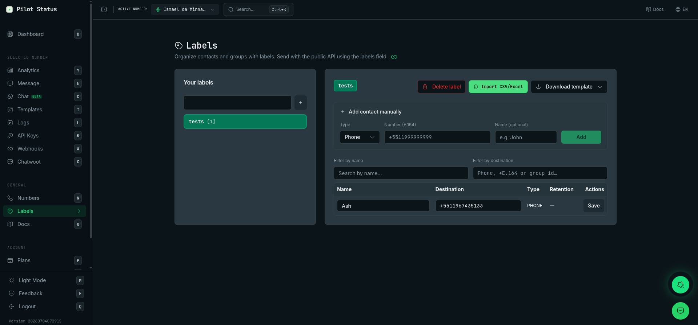

La pantalla **Labels** (`/labels`) organiza tus contactos y grupos de WhatsApp en listas con nombre, como `vip` o `customers`. Usas una etiqueta para cargar destinatarios en un envío masivo en la pantalla [Message](/es/dashboard/send-messages), y tu integración puede etiquetar contactos automáticamente pasando `labels` en [`POST /v1/messages/send`](/es/api/messages/send).

Las etiquetas pertenecen al **workspace**, no a un número: todos los números del workspace ven las mismas etiquetas.

<Frame caption="La página Labels: organiza contactos y grupos en etiquetas, importa desde CSV/Excel y luego pasa las etiquetas en POST /v1/messages/send.">
  
</Frame>

## Cómo llegar

En la barra lateral, haz clic en **Labels**, en el grupo **Workspace** (atajo de teclado: `B`). El título de la página es **Labels**, con el subtítulo **Organize contacts and groups with labels. Send with the public API using the labels field.** El ícono de enlace a su lado abre este sitio de documentación.

## Quién puede hacer qué

| Acción | Owner | Admin | Agent | Analyst |
| --- | --- | --- | --- | --- |
| Abrir **Labels**, ver etiquetas y contactos | Sí | Sí | Sí | No |
| Crear una etiqueta, agregar, importar, editar y copiar contactos | Sí | Sí | Sí | No |
| **Delete label** (Eliminar etiqueta) | Sí | Sí | No | No |
| Ver el aviso **Data retention (PII)** | Sí | Sí | No | No |

Los permisos detrás: `contacts:read` abre la pantalla, `contacts:manage` crea etiquetas y modifica contactos, y `contacts:delete` elimina una etiqueta (quita todos los vínculos de contactos de la etiqueta). El aviso de retención depende de leer las claves de API (`apikeys:read`), que solo tienen Owner y Admin. Consulta [Roles y permisos](/es/concepts/roles-and-permissions).

No hay restricción por plan en esta pantalla.

## Qué ves

### Aviso Data retention (PII)

Cuando al menos una de tus claves de API tiene una retención de 0 días, aparece arriba un aviso titulado **Data retention (PII)**: **Some API key has retention 0: numbers may be erased automatically per retention policy. Contacts from the public API show the key retention.** Consulta [Retención de datos y modos PII](/es/trust/data-retention).

### Your labels

La tarjeta de la izquierda, **Your labels** (Tus etiquetas), lista cada etiqueta con su cantidad de contactos, por ejemplo `vip (12)`. Haz clic en una etiqueta para seleccionarla; la primera etiqueta queda seleccionada al abrir la página. Cada etiqueta recibe un color automáticamente, calculado a partir de su nombre; no hay color para elegir. Las etiquetas se listan en orden alfabético.

Para crear una etiqueta, escribe su nombre en el campo de la parte superior de la tarjeta y presiona `Enter` o haz clic en **+**. Los nombres son snake_case: letras minúsculas, números y `_` (el campo convierte lo que escribes). Crear una etiqueta cuyo nombre ya existe selecciona la existente en lugar de hacer una copia. La pantalla muestra **Label created**.

### La etiqueta seleccionada

La tarjeta de la derecha muestra el nombre de la etiqueta seleccionada y sus acciones. Sin etiqueta, dice **Create or select a label.**

- **Delete label**: solo Owner y Admin. Abre el diálogo **Delete label?**: **This cannot be undone. All contacts linked to this label will be removed.**, con la cantidad de contactos, y **Cancel** o **Delete**. Los contactos se desvinculan solo de esta etiqueta; los mismos destinos permanecen en otras etiquetas.
- **Import CSV/Excel**: agrega los contactos de un archivo `.xlsx`, `.xls` o `.csv` a la etiqueta seleccionada. Consulta [Importar contactos](#importar-contactos).
- **Download template**: descarga un modelo de importación (**Excel (.xlsx)** o **CSV (.csv)**) con las columnas `name`, `destinationNumber` y `groupId` y dos filas de ejemplo.

### Agregar contacto manualmente

En **Add contact manually**:

1. Elige el **Type**: **Phone** o **Group**.
2. Escribe el **Number (E.164)**, como `+5511999999999`, o el **Group id**, que debe terminar en `@g.us`.
3. Opcionalmente escribe el **Name (optional)**.
4. Haz clic en **Add**.

Un número inválido muestra **Invalid number (use E.164, e.g. +5511999999999)**; un id de grupo sin `@g.us` muestra **Group id must end with @g.us**. Si todo sale bien, la pantalla muestra **Contact added**. Si dejas el nombre vacío en un contacto telefónico, Pilot Status intenta completarlo con el nombre que el número usa en WhatsApp, cuando hay uno disponible.

### Lista de contactos

Los contactos de la etiqueta seleccionada. Acota la lista con **Filter by name** y **Filter by destination** (un teléfono en cualquier formato, E.164 o un id de grupo); **Clear filters** restablece ambos. Una etiqueta vacía dice **No contacts yet. Use the form above, import CSV/Excel, or send messages with labels via the API.**

| Columna | Qué muestra |
| --- | --- |
| **Name** | El nombre del contacto, editable. |
| **Destination** | El teléfono (E.164) o el id de grupo, editable. |
| **Type** | `PHONE` o `GROUP`. |
| **Retention** | Solo para contactos agregados por la API: la retención de la clave de API que los agregó, como `30d`, o **0 days (PII off)** en ámbar. Los contactos agregados en el dashboard muestran `—`. |
| **Actions** | **Save** y **Copy to…** |

La columna **Retention** es la forma de saber qué contactos vinieron de la API: son los que tienen un valor ahí. La clave de API en sí nunca se muestra.

### Editar un contacto

Cambia el nombre o el destino en la fila y luego haz clic en **Save** en esa fila. Las filas editadas se vuelven ámbar con **Unsaved**, y un banner te lo recuerda: **There are unsaved changes. Click Save on each row to persist.** Cambiar un destino por uno que la etiqueta ya tiene falla con **Destination already exists in this label**. Un teléfono necesita al menos 8 dígitos, o recibes **Invalid number**. Un nuevo id de grupo que no termina en `@g.us` no se aplica: después de **Save** (la pantalla muestra **Saved**), la fila conserva su id de grupo anterior.

### Copiar un contacto a otra etiqueta

En **Copy to…**, busca y elige otra etiqueta. El contacto queda vinculado también a esa etiqueta (**Contact copied**). Si el destino ya está ahí, no se duplica; un nombre vacío en el destino se completa. Un contacto copiado que vino de la API conserva su **Retention** en la nueva etiqueta.

<Note>
  La pantalla no tiene un botón para quitar un solo contacto de una etiqueta, ni exportación. Para quitar un contacto, elimina y vuelve a crear la etiqueta, o importa la lista que quieres en una etiqueta nueva.
</Note>

## Importar contactos

Selecciona una etiqueta, haz clic en **Import CSV/Excel** y elige el archivo. La importación:

- lee el teléfono de una columna llamada `destinationNumber`, `number`, `numero`, `telefone` o `phone`, y el nombre de `name`;
- trata una fila como **grupo** cuando la columna `groupId` (o `group_id`, `group`, `grupo`) termina en `@g.us`;
- omite las filas cuyo teléfono no es un número E.164 válido;
- actualiza el nombre de un destino que ya está en la etiqueta cuando la etiqueta lo tiene con un nombre vacío;
- para una fila de teléfono sin nombre, intenta completar el nombre con el que el número usa en WhatsApp.

Si ninguna fila es válida, la pantalla muestra **No valid contacts in file**. De lo contrario muestra **Import finished** y recarga la lista; si la carga falla, muestra **Import failed**.

## Valores en esta pantalla

Nada aquí se muestra una sola vez. Las etiquetas y los contactos permanecen hasta que los eliminas, salvo que la [retención](/es/trust/data-retention) de la clave de API que agregó un contacto lo borre.

## Hacerlo por API / MCP

| Acción en el dashboard | API (`/v1`) | Herramienta MCP |
| --- | --- | --- |
| Etiquetar un destino al enviar (crea la etiqueta si hace falta) | El campo `labels` de [`POST /v1/messages/send`](/es/api/messages/send); consulta [Etiquetas](/es/api/labels) | `messages_send` con `labels` |
| Enviar a todos los de una etiqueta | Carga la etiqueta en la pantalla [Message](/es/dashboard/send-messages) | Solo dashboard |
| Listar etiquetas y contactos, crear una etiqueta, agregar, importar, editar, copiar contactos, eliminar una etiqueta | — | Solo dashboard |
