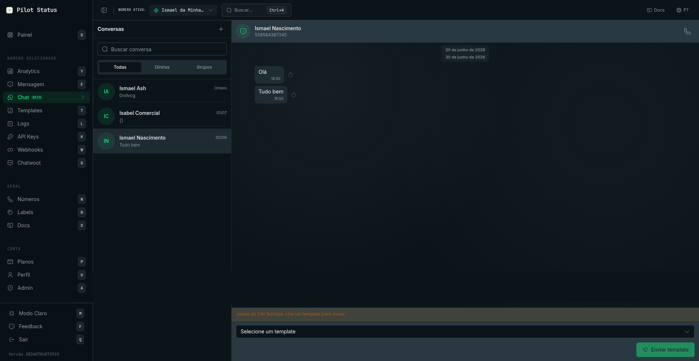
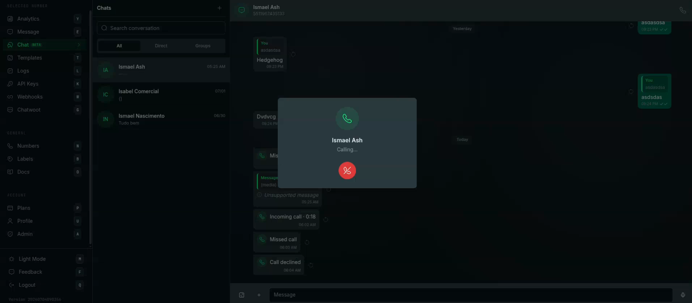

La pantalla **Chat** es una bandeja de entrada de WhatsApp dentro del panel. Lees y respondes las conversaciones de un número de WhatsApp a la vez (chats directos, grupos y canales) desde cualquier navegador, mientras tu integración por API sigue funcionando en el mismo número.

<Frame caption="La bandeja de Chat: lista de conversaciones, hilo de mensajes y un compositor de plantillas que aparece cuando la ventana de 24 horas está cerrada.">
  
</Frame>

## Cómo llegar

Barra lateral → **Chat** (marcado como beta), o ve directo a `/chat` (atajo de teclado **C**). Una conversación tiene su propia URL, `/chat/<conversationId>`: abrirla (o recargarla) abre esa conversación directamente, incluso cuando no está en la primera página de la lista.

La pantalla siempre trabaja sobre el **Active number** elegido en el encabezado del panel. Cambia el número en el encabezado para ver la bandeja de otro número; cada número tiene sus propias conversaciones, y la conversación abierta se cierra al cambiar.

- **Sin número conectado:** la pantalla queda bloqueada con **"Connect a number to continue"** y un botón **Add Number**.
- **Sin número seleccionado:** ves **"Select a number"**: _"Pick a WhatsApp number to view and reply to conversations."_
- **Número de prueba compartido seleccionado** (el número **Test**): puedes navegar, pero cada envío, llamada y reenvío se rechaza con _"Test number: select one of your numbers to send in chat."_

La misma pantalla también se puede incrustar en tu propio producto; consulta [Incrustar el chat](/es/integrations/embed-chat).

<Note>
  Chat es una función de los planes pagos: la página [Planes](/es/plans) la indica como no incluida en **Free**.
</Note>

## Quién puede usarla

| Rol | Qué obtiene |
| --- | --- |
| **Owner**, **Admin** | Todo lo de esta pantalla. |
| **Agent** | Todo lo de esta pantalla, pero solo en los números a los que su administrador le dio acceso (consulta [Miembros](/es/dashboard/members)). |
| **Analyst** | **Sin acceso.** Los Analysts no tienen el permiso de chat: leer conversaciones de clientes es justamente lo que este rol busca dejar fuera de su alcance. La opción **Chat** no les aparece. |

Leer conversaciones requiere el permiso de chat; enviar, reaccionar, reenviar, fijar, destacar, eliminar, reintentar y organizar chats (archivar, fijar, vaciar, eliminar) requieren el permiso de envío; iniciar un chat nuevo requiere el permiso de contactos; las llamadas requieren el permiso de llamadas. Owner, Admin y Agent tienen los cuatro.

## Las funciones que ves dependen del número

La pantalla oculta lo que la conexión del número no puede hacer:

| | Número oficial (Meta Cloud API) | Número no oficial (conexión por código QR actual) | Número no oficial (conexión por código QR anterior) |
| --- | --- | --- | --- |
| Texto, multimedia, notas de voz, plantillas, mensajes de lista, stickers | Sí | Sí | Sí |
| Filtros **Groups** y **Newsletter** | No | Sí | Sí |
| Presencia de escribiendo / grabando visible para el contacto | No | Sí | Sí |
| **Call** (softphone) | Sí | Sí | No |
| Ventana de 24 horas para mensajes libres | **Sí** | No | No |

## La lista de conversaciones (panel izquierdo)

El encabezado dice **Chats**, con un botón **New chat** (**+**).

- **Search conversation**: filtra la lista por nombre o número.
- **Chips de filtro**: **All**, **Unread**, **Favorites**, **Direct**, **Groups**, **Newsletter**. Cada chip excepto **All** muestra cuántas conversaciones no leídas contiene. **Groups** y **Newsletter** solo aparecen en números no oficiales. Los chips que no caben van bajo **More filters**.
- **Archived**: una fila en la parte superior de la lista **All** cuando tienes chats archivados. Abre su propia vista (**Archived**, con una flecha para volver): _"These chats stay archived when new messages are received."_
- **Cada fila** muestra la foto, el nombre (o número), la vista previa del último mensaje, la hora, un indicador de no leídos (**99+** por encima de 99) y un ícono de pin en los chats fijados. Un grupo sin nombre aparece como **Unnamed group** / **Group #id**; un canal, como **Channel** / **Channel #id**.
- **More options** en una fila (al pasar el cursor en escritorio, manteniendo presionado en móvil): **Pin chat** / **Unpin chat**, **Archive chat** / **Unarchive chat**, **Add to favorites** / **Remove from favorites**, **Mark as read** / **Mark as unread**.

Reglas detrás de esas acciones:

- Puedes fijar como máximo **3** chats por número. Fijar un chat archivado lo desarchiva; archivar un chat fijado lo desfija.
- **Los favoritos son personales**: cada usuario tiene los suyos, y nunca se muestran a un compañero. El estado de archivado, fijado y no leído lo comparten todos en el workspace.
- Abrir una conversación la marca como leída.

Estados vacíos: **No conversations yet.**, **No unread chats.**, **No archived chats.** y, en **Favorites**, _"No favorite chats. Add one from the chat's menu."_

## Iniciar un chat nuevo: panel "New chat"

Haz clic en **+** (**New chat**). El panel izquierdo cambia al panel **New chat**:

- **Search name or number**: busca en tus contactos guardados (**No contacts found.** cuando no hay coincidencias). Haz clic en un contacto para abrir la conversación.
- **Start by number**: abre un teclado numérico: **Choose country code**, el campo **Phone number**, **Backspace** y **Start chat**. Pilot Status abre la conversación existente con ese número, o la crea.

En un número oficial, una conversación nueva empieza con la ventana de 24 horas cerrada, así que el primer mensaje tiene que ser una plantilla.

## El hilo (panel derecho)

Haz clic en una conversación para abrirla. El encabezado muestra la foto, el nombre y, debajo, el número de teléfono, **Group**, **Newsletter** o **Business account** (para contactos de WhatsApp Business). Botones del encabezado:

- **Search messages**: el panel de búsqueda, con **Search this conversation** y **Go to a date** (salta al primer mensaje de ese día). **No messages found** cuando no hay coincidencias.
- **Call**: solo en conversaciones directas en números que admiten llamadas (consulta [Llamadas](#llamadas-softphone)).
- **More options** (**⋮**): el menú de la conversación, ver más abajo.
- Hacer clic en el nombre abre **Contact info** / **Group info**.

Los mensajes que enviaste están a la derecha, los recibidos a la izquierda. En cada mensaje enviado:

| Marca | Significado |
| --- | --- |
| Reloj | **Sending**: en cola, aún no aceptado por WhatsApp. |
| ✓ | **Sent** (enviado) |
| ✓✓ | **Delivered** (entregado) |
| ✓✓ azul | **Read** (leído) |
| **!** rojo | **Failed** (fallido): con **Not delivered —** y el motivo de WhatsApp, y un botón **Try again**. |

Otras marcas: un distintivo **App** (_"Sent from app"_) en los mensajes enviados desde el propio teléfono, una estrella en los mensajes que destacaste, un pin en los mensajes fijados, las etiquetas **Forwarded** / **Forwarded many times**, chips de reacción debajo de la burbuja y burbujas de llamada (**Incoming call**, **Outgoing call**, **Missed call**, **Call not answered**, **Call declined**, **Call failed**).

Banners y distintivos que puedes ver:

- **Came from an ad** / **Came from a post** en un mensaje que llegó desde un anuncio Click-to-WhatsApp, con **View performance**.
- **Came from the form &lt;form&gt;** cuando el contacto vino de un formulario de leads de Meta.
- _"Messages are not stored for this number (relay-only mode)."_: el modo de privacidad del número no guarda historial, así que la bandeja queda vacía.
- **content unavailable** en lugar de un nombre o un mensaje cuando la configuración de privacidad del número lo oculta.
- **Media unavailable**: _"The message arrived, but the file was not stored — there is nothing to download."_; **Loading media…** mientras un archivo todavía se está procesando.

Si el hilo no carga, ves **Could not load messages.** con **Try again**.

### Acciones sobre mensajes

Haz clic derecho en un mensaje (escritorio) o mantenlo presionado (móvil):

| Acción | Qué hace |
| --- | --- |
| **Message info** | Abre el diálogo **Message info** (ver más abajo). |
| **Reply** | Cita el mensaje en el compositor (**Replying to** … **Cancel reply**). En móvil también puedes deslizar el mensaje. |
| **Copy** | Copia el texto. |
| **Forward** | Abre el diálogo **Forward message**. Aparece deshabilitado con _"This message cannot be forwarded"_ en ubicaciones, tarjetas de contacto, llamadas, mensajes eliminados y multimedia cuyo archivo ya no existe. |
| **Pin** / **Unpin** | Fija el mensaje para todo el workspace. En números no oficiales en la conexión por código QR actual el pin también se aplica en WhatsApp; en otros números existe solo en Pilot Status. |
| **Star** / **Unstar** | Lo agrega a tus **Starred messages**. Las estrellas son personales. |
| **Select messages** | Entra en selección múltiple (ver más abajo). |
| **Delete** | Elimina el mensaje **solo en Pilot Status** (_"Message deleted."_). **No** se elimina del WhatsApp del contacto. |

**Reaccionar:** pasa el cursor sobre un mensaje y elige uno de 👍 ❤️ 😂 😮 😢 🙏, o **More reactions**. Elige el mismo emoji de nuevo (o haz clic en tu propio chip) para quitarlo. Las reacciones solo se ofrecen en conversaciones directas y, en números oficiales, solo en mensajes que envió el contacto.

**Select messages** (también en el menú **⋮**) reemplaza el compositor por una barra: **Selected messages**, **Star**, **Copy**, **Forward** y **Cancel**.

### Diálogo Message info

| Para un mensaje que enviaste | Para un mensaje que recibiste |
| --- | --- |
| Timestamps de **Sent**, **Delivered**, **Read**. | **From** (en grupos), **Type**, **Received**, **Message ID**, **File**, **Media type**. |

El **Message ID** es el ID de WhatsApp del mensaje (el `wamid` en números oficiales). Es el mismo ID que usan la API y los webhooks para ese mensaje.

### Diálogo Forward message

Título **Forward message** (o **Forward N messages** desde **Select messages**). _"The message is re-sent as a new message to each chosen conversation."_ Busca con **Search by name or phone**, marca hasta **5** conversaciones (**Choose up to 5 conversations**, luego **Limit of 5 conversations reached**) y haz clic en **Forward**. Las conversaciones que fallaron se listan en **Not forwarded to:**. Reenviar no está disponible en el número de prueba.

### Diálogo Shared contact

Una tarjeta de contacto recibida muestra **Message** (abre un chat con ese número) y **View contact** (o **View all** si son varios). El diálogo, **Shared contact** / **Shared contacts** (_"Received in this conversation as a contact card."_), lista cada nombre, organización, teléfono (**Copy phone**, **Message**) y correo (**Copy email**).

### Visor de multimedia

Haz clic en una imagen o video para abrirlo en pantalla completa. Puedes navegar con **Previous** / **Next**, **Zoom in** / **Zoom out**, y usar **Reply**, **React**, **Star**, **Forward**, **Download** y **Go to message**.

### Mensajes destacados

**Starred messages** (desde el menú **⋮** o el panel de información) lista los mensajes que destacaste en esta conversación, con **Load more**. Haz clic en uno para ir a él.

## El compositor

- Campo **Message**: **Enter** envía. Tu borrador se guarda por conversación, incluso después de cerrar el chat.
- **Send template**: cambia al compositor de plantillas (opcional, excepto cuando la ventana de 24 horas está cerrada).
- **Attach** (**+**): **Document**, **Photos & videos**, **Camera**, **List** y **Sticker**. También puedes pegar archivos o arrastrarlos al hilo (_"Drop to attach to the conversation"_).
- **Record voice message** (se muestra cuando el campo está vacío): la barra de grabación tiene **Cancel recording**, **Pause** / **Resume** y **Send voice message**.

### Vista previa de multimedia

Las fotos, videos, documentos y stickers que adjuntas (desde **Attach**, pegándolos o soltándolos en el hilo) se suben primero y luego se muestran en una vista previa antes de enviar nada. Un documento se muestra como un ícono de archivo con su nombre. La vista previa tiene **Add a caption...** (oculto para stickers), **Emoji**, una tira de miniaturas para cambiar entre archivos y **Send**. **Close** (o **Esc**) cancela.

- El caption va solo con el **primer** archivo. Los demás archivos se envían justo después, uno por uno, sin caption.
- No hay control de recorte ni de calidad: lo que envías es el archivo exactamente como lo elegiste, en su tamaño y calidad originales. Para recortar o redimensionar una imagen, hazlo antes de adjuntarla.
- Para agregar archivos al mismo envío, arrástralos sobre la vista previa mientras está abierta: se suman. La tira de miniaturas no tiene botón **+**.
- Los archivos se validan al subirse: imágenes (PNG, JPEG, WebP, GIF) hasta **10 MB**, videos (MP4, WebM, MOV, 3GP) hasta **64 MB**, documentos (PDF, Word, Excel, PowerPoint, TXT, CSV, ZIP) hasta **100 MB**. Un archivo de otro tipo o por encima de su límite no se adjunta, y ves **Failed to send media.**
- Un sticker debe ser una imagen `.webp` de exactamente **512×512 píxeles**. Cualquier otro tamaño se rechaza antes de subirse con _"A sticker must be exactly 512x512 pixels — this one is &lt;width&gt;x&lt;height&gt;. Resize it and try again."_

### Mensaje de lista

**Attach → List** abre **List message**: **Message text**, **Button text** (por ejemplo, _View options_), luego secciones con **Section title (optional)** y filas con **Row title**, **Description (optional)** y **Row ID (optional)**. Usa **Add section** / **Add row** y haz clic en **Send list**.

### Plantillas y la ventana de 24 horas

En un **número oficial (Meta)** puedes enviar mensajes libres (texto, multimedia, listas, notas de voz) solo dentro de las **24 horas** posteriores al último mensaje del contacto. Fuera de ese plazo, el compositor muestra _"24h window closed. Use a template to send."_ y se convierte en el compositor de plantillas, que no puedes cancelar hasta que el contacto vuelva a escribir.

En el compositor de plantillas: **Select a template** (las plantillas aprobadas del número; **No approved templates.** cuando no hay ninguna), completa cada variable (**Value**), revisa la **Preview** y haz clic en **Send template**. Si no se puede confirmar un envío, ves _"Could not confirm the template was sent. Retry — it will not be sent twice."_ con **Retry**.

Los números no oficiales no tienen ventana de 24 horas: **Send template** es solo un atajo.

El compositor se reemplaza por un aviso en dos casos: **Only admins can send messages** (un grupo de anuncios donde tu número no es administrador) y **You can't send messages to this channel** (un canal en el que tu número no puede publicar).

## Llamadas (softphone)

En conversaciones directas de números **oficiales (Meta)** y **no oficiales en la conexión por código QR actual**, **Call** en el encabezado (o en el panel de información) hace una llamada de voz de WhatsApp desde tu navegador. Las llamadas entrantes suenan en la pantalla abierta.

<Frame caption="Llamadas de voz en /chat: el softphone integrado suena en el lugar, y los eventos de llamada (entrante, perdida, rechazada) aparecen como burbujas en la conversación.">
  
</Frame>

El panel de llamada muestra el contacto y el estado: **Incoming call…** (**Answer**, **Decline**), **Calling…**, **Connecting…**, el temporizador de la llamada (**Mute** / **Unmute**, **Hang up**), **Call ended** o **Call failed** (**Close**). Motivos de falla que puede mostrar:

- _"Allow microphone access to place calls."_
- _"This browser does not support calling."_
- _"The contact hasn't allowed calls yet. Request permission in the conversation."_ (números oficiales)
- _"Calling is not enabled for this number."_ (números oficiales)
- _"The WhatsApp Business account (WABA) has no payment method. Business calls are billed by Meta — add a card in WhatsApp Manager."_

Consulta la [descripción general de llamadas](/es/api/calls/overview) para saber cómo funcionan las llamadas y cómo activarlas.

## Menú de la conversación (⋮)

| Elemento | Qué hace |
| --- | --- |
| **Contact info** / **Group info** | Abre el panel de información. |
| **Search** | Abre la búsqueda de mensajes. |
| **Starred messages** | Tus mensajes destacados en este chat. |
| **Select messages** | Selección múltiple. |
| **Export chat** → **Text (.txt)** / **Spreadsheet (CSV)** | Descarga la conversación (_"Chat exported"_). |
| **Archive** / **Unarchive** | La mueve a **Archived** o la saca de ahí. |
| **Pin** / **Unpin** | La fija arriba de la lista (máximo 3). |
| **Add to favorites** / **Remove from favorites** | Tu filtro personal **Favorites**. |
| **Mark as unread** | Vuelve a poner el punto de no leído. |
| **Close chat** | Cierra el hilo (igual que **Esc**). |
| **Clear chat** | Pregunta primero **Clear this chat?**. |
| **Delete chat** | Pregunta primero **Delete this chat?**. |

### Clear this chat? / Delete this chat?

- **Clear chat**: _"Messages up to now will no longer show here. The chat stays in the list."_ El hilo, la lista de multimedia, la búsqueda y la exportación empiezan entonces después de ese momento. No se elimina nada.
- **Delete chat**: _"The chat leaves the list until a new message arrives."_ Los mensajes se conservan.

Los dos botones son **Cancel** y **Clear chat** / **Delete chat**. Ninguno toca el WhatsApp del contacto.

## Panel Contact info / Group info

Se abre a la derecha (pantalla completa en móvil). Muestra la foto, el nombre y el número (o, para un grupo, **Group · N members**), además de:

- Botones **Call** y **Search**.
- **Description** (grupos).
- **Media, links and docs**: abre el explorador de multimedia con las pestañas **Media**, **Links** y **Docs** y **Load more**. Haz clic en un elemento para abrirlo o ir a su mensaje. _"Media is not stored for this number."_ en números relay-only.
- **Starred messages**: tus mensajes destacados en este chat.
- Miembros del grupo: cada miembro con un distintivo **Admin** cuando corresponde, **See all (N)**, **Search member by name or number**, **Show more** y **Message &lt;phone&gt;** para abrir un chat directo con un miembro. _"Couldn't load the participants right now."_ si falla la lista de miembros.
- **Archive chat**, **Pin chat**, **Mark as unread**, **Export chat** (**Text (.txt)** / **Spreadsheet (CSV)**), **Clear chat** y **Delete chat**: las mismas acciones del menú **⋮**.

## Valores en esta pantalla

Nada en esta pantalla se muestra una sola vez. Cada valor se puede volver a abrir en cualquier momento:

- **Message ID** de un mensaje recibido: **Message info**.
- Timestamps de entrega de un mensaje enviado: **Message info**.
- El número del contacto: el encabezado del hilo o el panel de información.
- Archivos: **Download** en el visor de multimedia, o **Media, links and docs**.

## Hazlo por API / MCP

Las llamadas a la API usan una API key asociada al número; las herramientas MCP envuelven los mismos endpoints.

| Acción en el panel | API | Herramienta MCP |
| --- | --- | --- |
| Lista de conversaciones | [`GET /v1/conversations`](/es/api/conversations) | `conversations_list` |
| Leer un hilo | [`GET /v1/messages/history`](/es/api/messages/history) | `messages_history` |
| Leer mensajes de grupo | [`GET /v1/messages/group`](/es/api/messages/group-messages) | `messages_group` |
| Mensajes no leídos / conteos de no leídos | [`GET /v1/messages/unread`](/es/api/messages/unread), `GET /v1/messages/unread/counts` | `messages_unread`, `messages_unread_counts` |
| Marcar como leído | [`POST /v1/messages/read`](/es/api/messages/read) | `messages_mark_read` |
| Indicador de escribiendo | [`POST /v1/messages/typing`](/es/api/messages/typing) | `messages_typing` |
| Enviar texto, multimedia, nota de voz, sticker, lista o plantilla; nuevo chat con un número | [`POST /v1/messages/send`](/es/api/messages/send); consulta [texto](/es/api/messages/send-text), [multimedia](/es/api/messages/send-media), [interactivos](/es/api/messages/send-interactive) | `messages_send` |
| Información del mensaje (estado, timestamps) | [`GET /v1/messages/{id}`](/es/api/messages/status) | `message_get` |
| Reintentar un mensaje fallido | [`POST /v1/messages/{id}/resend`](/es/api/messages/resend) | — (API o panel) |
| Descargar un archivo recibido (números oficiales) | [`GET /v1/media/{mediaId}`](/es/api/media-download) | `media_get` |
| Llamar, contestar, rechazar, colgar | [`/v1/calls`](/es/api/calls/endpoints) | `call_initiate`, `call_accept`, `call_reject`, `call_terminate` |
| Información y miembros del grupo | [`GET /v1/groups/{groupId}`](/es/api/groups) | `group_info`, `groups_list` |
| Canales | [`GET /v1/newsletters`](/es/api/newsletters) | `newsletters_list` |
| Responder (citar), reaccionar, reenviar | — | **Solo en el panel** |
| Destacar, fijar o eliminar un mensaje | — | **Solo en el panel** (fijar mensajes de grupo: `POST /v1/groups/{groupId}/pin`, `group_pin`) |
| Archivar, fijar, marcar como favorito, marcar como no leído, vaciar, eliminar o exportar un chat | — | **Solo en el panel** |

Relacionado: [Eventos de webhook](/es/api/webhooks/events) (recibe los mismos mensajes en tiempo real) · [Chatwoot](/es/dashboard/chatwoot) (responde desde Chatwoot en su lugar).
