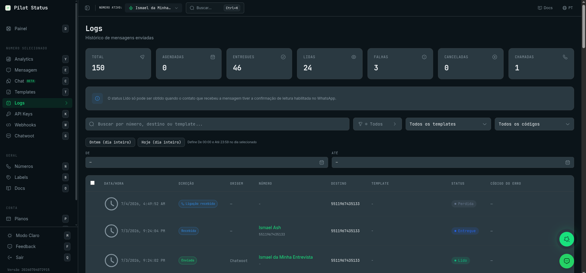
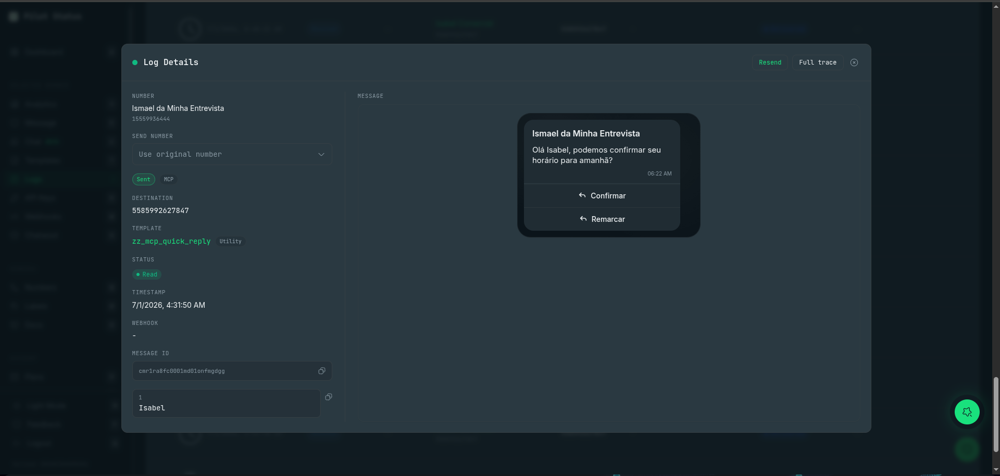
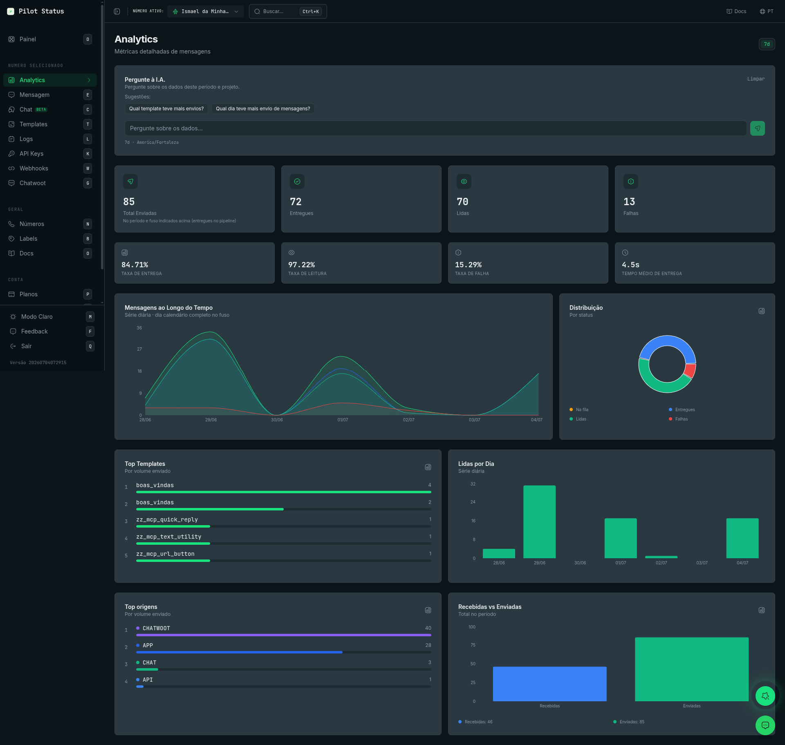

Pilot Status registra cada mensaje que pasa por tus números y muestra esos datos en dos pantallas: **Logs**, un historial con búsqueda de mensajes y llamadas individuales, y **Analytics**, métricas agregadas de un período. Ambas pantallas muestran el número elegido en el selector de números del encabezado, no todo el workspace.

## Logs

**Logs** (`/logs`) es donde revisas qué pasó con un mensaje específico: si se entregó, por qué falló, qué se envió exactamente y a quién. Desde aquí también puedes reenviar mensajes fallidos y cancelar envíos programados.

Ábrela desde la barra lateral: **Logs**, en el grupo **Selected Number** (atajo de teclado: `L`). El título de la página es **Logs**, con el subtítulo **Message delivery history**.

<Frame caption="La página Logs: tarjetas de estadísticas (total, programados, entregados, leídos, fallas, cancelados, llamadas), filtros y la tabla de mensajes.">
  
</Frame>

### Quién puede hacer qué

| Acción | Owner | Admin | Agent | Analyst |
| --- | --- | --- | --- | --- |
| Abrir **Logs**, filtrar, abrir **Log Details** | Sí | Sí | Sí | No |
| **Cancel schedule(s)** | Sí | Sí | Sí | No |
| **Resend**, **Resend message(s)**, elegir un **Send number** | Sí | Sí | No | No |

Los permisos detrás de esto: `logs:read:content` abre la pantalla, `messages:cancel_scheduled` cancela envíos programados y `messages:resend` reenvía. Analyst no puede abrir Logs porque cada fila lleva contenido de mensajes y el teléfono del contacto. Un miembro restringido a algunos números solo ve esos números. Consulta [Roles y permisos](/es/concepts/roles-and-permissions).

### Tarjetas de estadísticas

Hay siete tarjetas en la parte superior de la página:

| Tarjeta | Qué cuenta |
| --- | --- |
| **Total** | Cada registro que coincide con los filtros actuales de búsqueda, estado, plantilla y fecha, en el servidor. Muestra `…` mientras el conteo sigue cargando. |
| **Scheduled** | Mensajes que todavía esperan una hora de envío futura. |
| **Delivered** | Mensajes con estado Sent, Delivered, Read o Played. |
| **Read** | Mensajes con estado Read o Played. |
| **Failures** | Mensajes con estado Failed. |
| **Canceled** | Mensajes cuyo envío programado se canceló. |
| **Calls** | Registros de llamadas (las llamadas no se cuentan en las tarjetas de mensajes). |

<Note>
  Solo **Total** se cuenta en el servidor. Las otras seis tarjetas cuentan las filas ya cargadas en pantalla (50 por página), no el historial completo. Para incluir filas más antiguas, haz clic en **Load more logs** al final de la tabla, o acota el rango de fechas. Las tarjetas siguen los filtros de búsqueda, estado, plantilla y fecha, pero no los de dirección, origen, ventana o código de error, que solo ocultan filas en la tabla.
</Note>

Debajo de las tarjetas, un cuadro informativo te recuerda que el estado **Read** solo llega cuando el destinatario tiene activadas las confirmaciones de lectura en WhatsApp.

El botón **Refresh** arriba a la derecha recarga la lista. La lista también se actualiza sola cada pocos segundos mientras estás en las primeras páginas.

### Búsqueda y filtros

El cuadro de búsqueda (**Search by number, destination or template...**) acepta un número de teléfono en cualquier formato (`+55 (11) 99999-9999` funciona) o el nombre de una plantilla.

La barra de filtros tiene:

| Filtro | Opciones |
| --- | --- |
| Estado | **All**, **Scheduled**, **Queued**, **Sent**, **Delivered**, **Read**, **Played**, **Failed**, **Canceled**, **Preview**, **Calls** |
| Dirección | **All**, **Sent**, **Received** |
| **Origin** | **All**, **API**, **MCP**, **Chat**, **Chatwoot**, **Dashboard**, **System**, **App**, **Meta layer** |
| **Window** | **All**, **Open**, **Closed**: la ventana de servicio de 24 h en el momento del envío |
| **Filter by template** | **All templates** o una plantilla |
| **Filter by error code** | **All codes**, **With error (any)** o un código de la lista de [Códigos de error del log](/es/api/messages/log-error-codes) |
| Rango de fechas | **From** y **To**, cada uno con una fecha, **Hour** y **Minute**. **Yesterday (full day)** y **Today (full day)** completan ambos lados. **Clear range** los vacía. |

Definir solo **From** filtra hasta ahora. Definir solo **To** filtra todo lo anterior. Si **From** es posterior a **To**, la pantalla dice **Invalid range: From must be before To.** e ignora el rango. **Clear filters** reinicia todo a la vez.

<Note>
  Los filtros de búsqueda, estado, plantilla y fecha se ejecutan en el servidor. Los filtros de dirección, origen, ventana y código de error (y la opción **Calls** del filtro de estado) se ejecutan sobre las filas ya cargadas. Si ocultan todo, la tabla dice **No loaded logs match the error code filter.**: carga más filas o acota primero el rango de fechas.
</Note>

<Note>
  Los filtros de **estado** y **plantilla** muestran solo mensajes que tuvieron una solicitud de envío. Los mensajes salientes que no pasaron por el envío propio de Pilot Status (origen **App**, **Meta layer** y respuestas de Chatwoot desde una bandeja nativa de WhatsApp Cloud) nunca coinciden con ellos. Quita esos filtros para verlos.
</Note>

### Columnas de la tabla

| Columna | Qué muestra |
| --- | --- |
| Casilla | Solo en mensajes programados y fallidos, para seleccionarlos en una acción por lote. La casilla del encabezado selecciona todas las filas programadas y fallidas visibles, respetando los filtros. |
| **Timestamp** | Fecha y hora del registro. |
| **Direction** | **Sent**, **Received** u **Outbound** (un mensaje saliente que no se confirmó como enviado, por ejemplo uno fallido). |
| **Origin** | De dónde vino un mensaje saliente (API, MCP, Chat, Chatwoot, Dashboard, App, Meta layer). Vacío en los mensajes recibidos. |
| **Number** | El nombre y teléfono de tu número. Haz clic para abrir **Numbers**. |
| **Destination** | El otro lado de la conversación. |
| **Template** | El nombre de la plantilla (haz clic para abrirla), su distintivo de categoría (**Marketing**, **Utility**, **OTP**) y el distintivo de la ventana de 24 h. |
| **Status** | El estado actual (consulta la tabla de abajo). |
| **Error code** | El código de error de un mensaje fallido. Pasa el cursor por encima para ver la explicación. |

Las filas de llamadas muestran **Incoming call** u **Outgoing call**, el estado de la llamada (**Initiated**, **Ringing**, **Accepted**, **Completed**, **Rejected**, **Failed**, **Missed**) y la duración. Las filas de llamadas no abren un modal de detalles. Consulta [Llamadas](/es/api/calls/overview).

La tabla carga 50 filas por vez. **Load more logs** carga la página siguiente. Después de 10.000 filas, la pantalla se detiene y dice **This is the paging limit, not the end of the history.** Acota el rango de fechas para llegar a registros más antiguos.

Si el modo de privacidad del número es solo retransmisión (relay-only), la pantalla dice **Messages are not stored for this number (relay-only mode).** y la tabla queda vacía. Consulta [Retención de datos y modos PII](/es/trust/data-retention).

### Estados de los mensajes

| Estado | Significado |
| --- | --- |
| Scheduled | Esperando una hora de envío futura (`deliverAt`). Puedes cancelarlo. |
| Queued | En la cola, esperando ser enviado. |
| Sent | Aceptado por WhatsApp. |
| Delivered | Llegó al dispositivo del destinatario. |
| Read | El destinatario lo abrió (solo con confirmaciones de lectura activadas). |
| Played | El destinatario escuchó el mensaje de audio. |
| Failed | No se entregó. Abre la fila para ver el código de error y los detalles. |
| Canceled | Un envío programado que se canceló. |
| Preview | Un envío de prueba de plantilla. |

### El distintivo de la ventana de servicio de 24 h

Las filas salientes también llevan un **distintivo de ventana de servicio**: **24h open** significa que el destinatario le había escrito a tu número en las 24 horas anteriores, así que el envío se trató como una **respuesta** y se despachó de inmediato; **24h closed** significa que fue un **envío en frío** (primer contacto, o la ventana de conversación había vencido). Los envíos en frío se espacian intencionalmente con el motor antibloqueo en los números conectados por web, y en los números oficiales (Meta) requieren una plantilla aprobada. Si un mensaje parece quedarse en la cola, revisa primero este distintivo: una ventana _cerrada_ explica el ritmo. Filtra por él con **Window**. Las filas enviadas antes de que existiera esta función no muestran distintivo.

### Log Details

Haz clic en una fila de mensaje para abrir el modal **Log Details**.

<Frame caption="Haz clic en cualquier fila para abrir Log Details: número, destino, plantilla, estado, webhook, ID del mensaje, el mensaje renderizado y Resend.">
  
</Frame>

Muestra:

- **Number**: el número que envió o recibió el mensaje.
- **Send number**: solo si puedes reenviar; elige otro de tus números para reenviar desde él, o deja **Use original number**.
- Los chips de dirección y origen. Los mensajes escritos en el propio teléfono muestran **Sent from app**.
- **Destination** (o **Sender** en un mensaje recibido). En una fila censurada dice **content unavailable**.
- **Template**: haz clic para abrir la plantilla. Una plantilla de Marketing enviada con la reescritura con IA muestra **AI rewrite enabled**.
- **Status**.
- **Timestamp**: en un mensaje programado, **Recorded at** (cuándo se solicitó el envío), más **Send scheduled for** y **Expires at** (`deliverUntil`).
- **Webhook**: el estado HTTP de la entrega del webhook para este mensaje, o por qué no hay ninguno: **no webhook**, **delivery not matched** (no se pudo vincular una entrega a esta fila; no significa que haya fallado), **outside the retention window**.
- **Message ID**: con un botón de copiar. Vincula esta fila con los eventos de webhook y las respuestas de la API.
- Las **variables del envío**: cada valor de variable usado en el envío, cada uno con **Copy value**.
- **Error code**: en un mensaje fallido, el código, su explicación, el mensaje de error propio del proveedor y **Code meanings**, que abre la página [Códigos de error del log](/es/api/messages/log-error-codes).
- **Message**: el mensaje renderizado como lo muestra WhatsApp: encabezado, multimedia, cuerpo, pie, botones y listas. Cuando la reescritura antispam con IA cambió el texto, ves **Sent (AI rewrite)** o **Result (AI)** junto al **Original**.

#### Respuestas de WhatsApp Flow

Cuando la fila es un formulario de WhatsApp Flow enviado, la sección **Message** agrega la etiqueta del botón que tocó el cliente, **Response sent**, las **Answers by screen** (cada campo que completó el cliente, por pantalla) y los **Attachments** subidos en el formulario, cada uno con su estado (**Available**, **Transferring**, **Failed**) y **Open attachment**.

Cuando el mensaje renderizado tiene un botón de Flow, haz clic en él para abrir **Form preview**, con **Open in a new tab**. Abrir una vista previa siempre genera un enlace nuevo, lo que hace vencer cualquier enlace de vista previa abierto antes.

### Reenviar un mensaje fallido

En **Log Details**, haz clic en **Resend** y confirma **Do you want to resend this message?**. La pantalla dice **Message added to the resend queue**. Para reenviar desde otro número, elígelo antes en **Send number**. En **Log Details**, el botón **Resend** se ofrece en cualquier mensaje que tenga un ID de mensaje, sea cual sea su estado: úsalo en mensajes fallidos, a menos que de verdad quieras que el destinatario reciba el mensaje otra vez.

Para reenviar varios a la vez, marca las filas fallidas y haz clic en **Resend message(s)** en la barra que aparece, luego confirma (_"Resend N failed message(s)?"_). La barra de lote solo reenvía filas con estado Failed. Luego la pantalla indica cuántos se agregaron a la cola de reenvío y cuántos no se pudieron reenviar.

Un reenvío reutiliza la **misma fila del log**: su estado vuelve a **Queued**, el error anterior y las horas de envío/entrega se borran, y el mensaje se envía otra vez a partir de la solicitud original. Se rechaza cuando la retención de datos del número ya eliminó el contenido del mensaje (_"Cannot resend: the content of this message was removed by the number's data retention policy. Send a new message instead."_), y cuando el mensaje es una plantilla de WhatsApp Flow y el número elegido no es un número oficial (Meta).

Los Agents pueden marcar filas fallidas, pero la barra muestra _"Resending is an Admin or Owner action."_ en lugar del botón, y **Log Details** no les muestra ni **Resend** ni **Send number**.

### Cancelar envíos programados

Marca las filas programadas y haz clic en **Cancel schedule(s)**, luego confirma (_"Cancel scheduling for N message(s)?"_). La pantalla te indica cuántos se cancelaron y cuántos no se pudieron cancelar. Solo se pueden cancelar los mensajes que todavía esperan una hora de envío futura. Si mezclas filas programadas y fallidas, la barra te pide seleccionar solo mensajes del mismo tipo.

### Hazlo por API / MCP

| Acción en el panel | API (`/v1`) | Herramienta MCP |
| --- | --- | --- |
| Listar y filtrar el log | [`GET /v1/messages`](/es/api/messages/list) | `messages_list` |
| Estado y detalles de un mensaje | [`GET /v1/messages/{messageId}`](/es/api/messages/status) | `message_get` |
| Historial de conversación con un contacto | [`GET /v1/messages/history`](/es/api/messages/history) | `messages_history` |
| **Resend** | [`POST /v1/messages/{id}/resend`](/es/api/messages/resend) | Ninguna, solo API |
| **Cancel schedule(s)** | [`DELETE /v1/messages/cancel`](/es/api/messages/cancel) | `messages_cancel` |
| Respuestas de WhatsApp Flow | [`GET /v1/flows/{id}/responses`](/es/api/flows) | `flows_responses_list` |
| Tarjetas de estadísticas, **Form preview** | — | Solo en el panel |

Los códigos de error están en [Códigos de error del log](/es/api/messages/log-error-codes).

## Analytics

**Analytics** (`/analytics`) muestra cómo se comportaron los mensajes del número seleccionado en un período: cuántos se enviaron, entregaron, leyeron y fallaron, y qué plantillas y orígenes enviaron más.

Ábrela desde la barra lateral: **Analytics**, en el grupo **Selected Number** (atajo de teclado: `Y`). El subtítulo es **Detailed message metrics**.

<Frame caption="La página Analytics: KPI de entrega/lectura/falla, una línea de tiempo de mensajes, las plantillas principales y los orígenes principales.">
  
</Frame>

### Período

El selector de período arriba a la derecha solo ofrece **7d** (los últimos 7 días). Los días se cuentan en la zona horaria de tu navegador, que se muestra junto al período en el panel **Ask AI**. La API también acepta `30d` y `90d`.

### KPI

| Tarjeta | Significado |
| --- | --- |
| **Total Sent** | Cada intento de envío del período: entregados, fallidos y aún en cola. |
| **Delivered** | Mensajes que llegaron a WhatsApp: estado Sent, Delivered o Read. |
| **Read** | Mensajes con estado Read. |
| **Failures** | Mensajes que fallaron. |
| **Delivery Rate** | Entregados como proporción de enviados, en %. |
| **Read Rate** | Leídos como proporción de entregados, en %. |
| **Failure Rate** | Fallidos como proporción de enviados, en %. |
| **Avg Delivery Time** | Tiempo promedio desde el envío hasta la entrega. |

### Gráficos

- **Messages Over Time**: una serie diaria (días calendario completos en tu zona horaria) con Total, Delivered, Read y Failures.
- **Distribution**: la proporción de mensajes por estado: Queued, Delivered, Read, Failed.
- **Top Templates**: plantillas ordenadas por volumen enviado.
- **Read per Day**: mensajes leídos por día.
- **Top origins**: de dónde vinieron los envíos (API, MCP, Chat, Chatwoot, Dashboard…), por volumen enviado.
- **Received vs Sent**: total recibido y total enviado en el período.

### Ask AI

El panel **Ask AI** responde preguntas sobre los datos del período en lenguaje natural (**Ask about this period and project data.**). Escribe en **Ask about the data...** o haz clic en una de las **Suggestions**, como **Which template had the most sends?**. **Clear** vacía la conversación.

### Quién puede verla

Todos los roles (**Owner**, **Admin**, **Agent** y **Analyst**) pueden abrir Analytics y usar **Ask AI** (permiso `analytics:read`). Un miembro restringido a algunos números solo ve esos números.

### Hazlo por API / MCP

Los KPI y la serie diaria vienen de [`GET /v1/analytics/dashboard`](/es/api/analytics) (herramienta MCP `analytics_dashboard`), limitado al número de la API key, con `period` en `7d`, `30d` o `90d`. **Ask AI** es solo del panel.

## Retención de datos

Cuánto tiempo se guardan los registros del log, y si el contenido de los mensajes se guarda o no, depende del modo PII del número. Consulta [Retención de datos y modos PII](/es/trust/data-retention).
