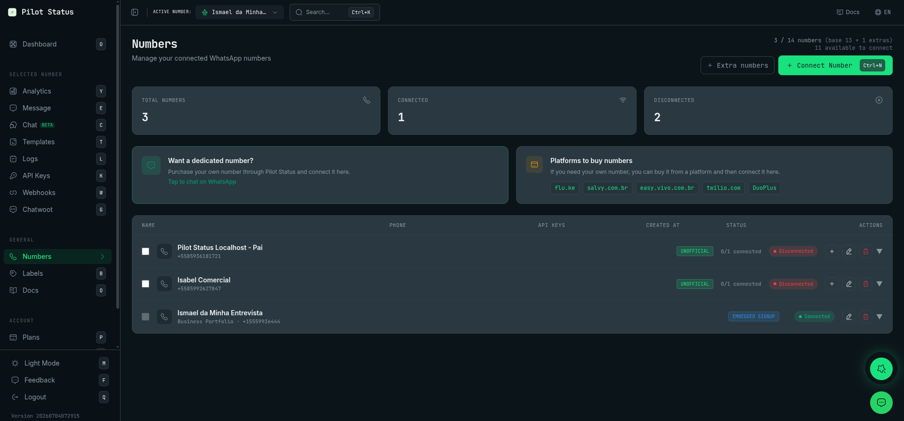
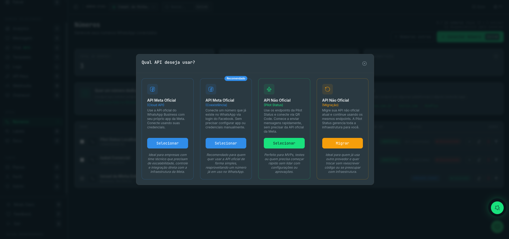
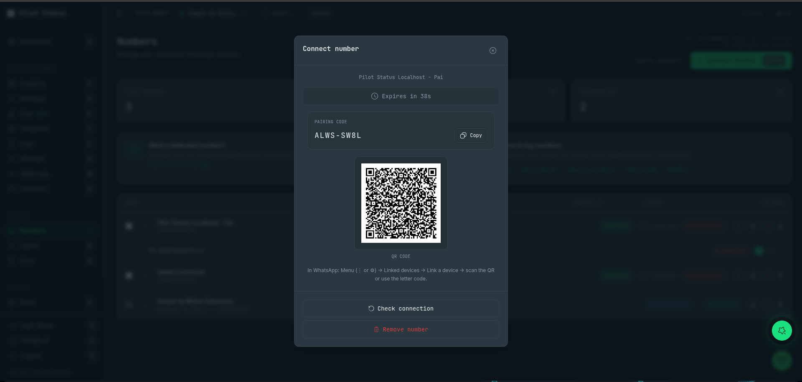
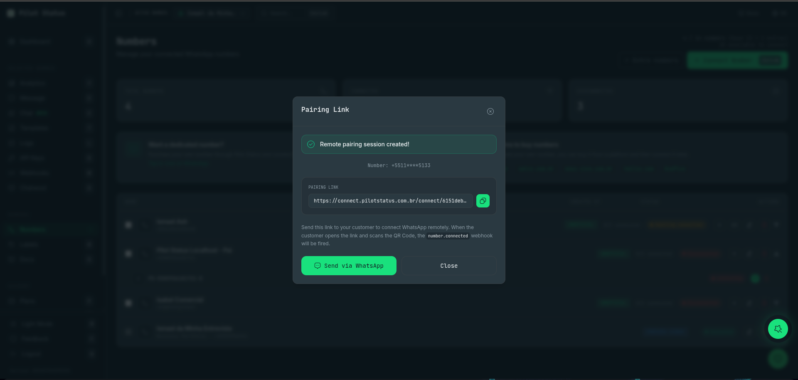

**Números** es donde vive cada número de WhatsApp del workspace: conectas números nuevos, vigilas su salud, copias los IDs y los valores de webhook que pide Meta, y los eliminas. Se llega desde el elemento **Numbers** de la barra lateral (atajo `n`), en la ruta `/numbers`.

<Frame caption="La pantalla Números: una fila por número, con estado, API keys y acciones.">
  
</Frame>

## Quién puede hacer qué

Todos los roles pueden **abrir** la pantalla y ver los números (`numbers:read` se otorga a todos, Analyst incluido). Lo que un rol puede **cambiar** es más acotado: los botones que un rol no puede usar no se muestran.

| Acción | Owner | Admin | Agent | Analyst |
|---|:-:|:-:|:-:|:-:|
| Ver números, estado, detalles de Meta, grupos e IDs de newsletters | ✓ | ✓ | ✓ | ✓ |
| **Connect Number**, **Add connection**, **Reconnect**, **Reconnect with Meta**, nuevo enlace de emparejamiento, **I already connected, sync**, **Sync history**, **Resume sending** | ✓ | ✓ | | |
| **Edit name**, **Refresh** (datos de Meta), **Register on the Cloud API** | ✓ | ✓ | | |
| **Enable calling** | ✓ | ✓ | | |
| **Delete number** / **Remove connection**, ver **Recently deleted** y **Restore** | ✓ | ✓ | | |
| **Delete permanently** (purgar) | ✓ | | | |
| Copiar el **Verify Token** de Meta desde la tarjeta del número | ✓ | | | |
| **Extra numbers**, **Add extra number**, **Pay now** | ✓ | | | |

Un Agent o Analyst limitado a números específicos ve solo esos números; consulta [Miembros](/es/dashboard/members).

## Lo que ves

**Encabezado.** El título **Numbers** (*"Manage your connected WhatsApp numbers"*, gestiona tus números de WhatsApp conectados) y una línea de uso que depende del plan:

- planes fijos: `used / limit numbers`, con `(base N + M extras)` cuando tienes números extra, y cuántos están **disponibles para conectar**;
- **On Demand**: también el precio por número/mes;
- **Pay As You Go**: `N billable number(s)` y el precio por número/mes. Es un conteo de **facturación**: todos los números de la cuenta, conectados o no (excluidos los emparejamientos sin terminar).

**Tarjetas de resumen.** **Total Numbers**, **Connected** y **Disconnected** (total, conectados, desconectados). Los números bloqueados y los emparejamientos sin terminar no cuentan en ninguna de las dos últimas: se indican debajo del total (por ejemplo, *2 blocked · 1 awaiting connection*).

**Tarjeta de líneas telefónicas.** Para Owners y Admins, un acceso directo a [Líneas telefónicas](/es/dashboard/phone-lines).

**Lista de números.** El encabezado dice **Name · Phone · Created at**, **Status** y **Actions**. Cada fila muestra el nombre y el teléfono del número (los números conectados con Facebook muestran *Business Portfolio · &lt;phone&gt;*) seguidos de **Created at** y la fecha en que se agregó el número, una etiqueta del tipo de conexión (**EMBEDDED SIGNUP**, **CLOUD API**, **MIGRATION** o **UNOFFICIAL**), en los números no oficiales cuántas de sus conexiones están activas (*1/2 connected*), los badges de abajo, la píldora de estado y los íconos de acción (**Add connection**, **Generate new link**, **Edit name**, **Delete number**, según el número y tu rol). Al hacer clic en una fila, se expande. Sin ningún número todavía, la lista dice *No connected number*.

### Badges de estado en una fila

| Badge | Significado |
|---|---|
| **Connected** / **Disconnected** | Estado de la conexión. |
| **Awaiting connection** | Un emparejamiento (QR, enlace remoto o signup de Meta) que nunca se completó. Tooltip: *"Connection not completed yet: it is not billed and is removed automatically after 24h. Generate a new link to try again."* (Conexión aún no completada: no se factura y se elimina automáticamente después de 24 h. Genera un enlace nuevo para intentarlo otra vez.) |
| **Blocked** / **Send blocked** | Meta restringió o baneó el número, o se cayeron todas las conexiones; la cola de envío está en pausa. |
| **Shadowban** | El envío web está bloqueado y la cola está **en pausa**. El número sigue funcionando desde la app del teléfono. Baja el volumen, espera unas horas y luego usa **Resume sending**. |
| **Degraded** | El envío funciona pero con problemas. |
| **Not registered on the Cloud API** | Números de Meta cuyo registro falló: usa **Register on the Cloud API** en la fila expandida. |
| **Receiving stalled** | El número sigue enviando, pero los mensajes entrantes están retenidos aguas arriba y deberían llegar en lote. |
| **Connection lost** | Pilot Status perdió el acceso al número en Meta (app eliminada del Business Manager o WABA eliminada). Si se quitó el acceso, haz clic en **Reconnect with Meta**: el mismo número vuelve con las mismas API keys y webhooks. |
| **Payment pending** / **Beyond the plan** | El envío está bloqueado porque falló el cobro del número extra, o el número supera el único número del plan Free. La fila expandida muestra la fecha en que se desconectará y el botón **Pay now** / **Add extra number** (solo Owner). |
| **Meta payment pending** | *Meta has blocked the templates of this WhatsApp Business account because of a payment problem. Sending through Pilot Status has not been paused.* (Meta bloqueó las plantillas de esta cuenta de WhatsApp Business por un problema de pago. El envío por Pilot Status no se pausó.) |
| **History not imported** | WhatsApp envió el historial de chats mientras la importación de historial estaba desactivada (se descartó), o Meta se negó a enviarlo. Meta envía el historial una sola vez. |

Cuando Meta reporta una infracción de políticas, la fila expandida muestra **Reason given by Meta** (motivo informado por Meta) con la infracción, las restricciones y la fecha.

### La fila expandida

**Los números no oficiales** listan cada **conexión** (instancia) con su estado y, cuando está conectada, dos botones:

- **Groups**: abre **WhatsApp groups**: cada grupo con su **ID** y un botón **Copy group ID**, filtrable por nombre. Así obtienes el `groupId` para [enviar a grupos](/es/api/groups).
- **Newsletters**: abre **WhatsApp newsletters**: canales y sus IDs (**Copy newsletter ID**). *"Cached list (up to 1h)."* (Lista en caché, hasta 1 h.) Consulta [Canales (newsletters)](/es/api/newsletters).

…más **Reconnect** (QR nuevo) y **Delete** (eliminar esa conexión).

Cuando un número no oficial no puede enviar, una franja roja en la fila expandida explica por qué (un shadowban, todas las conexiones caídas: *"Reconnect the number and click Resume sending — the waiting messages go out right after."*, reconecta el número y haz clic en Resume sending; los mensajes en espera salen enseguida; u otro bloqueo) con el botón **Resume sending**. Esta franja y el botón existen solo para números no oficiales.

**Los números de Meta** muestran:

- un badge **Webhook Configured** / **Webhook Pending**, la **URL:** del webhook con un botón para copiar, y **Verify Token:**: el **Owner** tiene un botón para copiar; los demás leen *"Only the workspace owner can view it"* (solo el owner del workspace puede verlo). Este bloque aparece para los números conectados **con credenciales** (Cloud API), porque son aquellos en los que pegas el webhook en tu propia app de Meta.
- **Phone Number**, **Phone ID**, **WABA ID** y **Business Account ID**, cada uno con un botón para copiar.
- **Sync history** (solo números en Coexistencia): *"Imports this number's earlier messages."* (Importa los mensajes anteriores de este número.)
- una vista previa estilo WhatsApp del perfil de empresa.
- **Meta details**: una instantánea leída de Meta (se obtiene automáticamente cuando expandes una fila que todavía no tiene una; **Updated:** muestra cuándo se tomó). Contiene:
  - badges de **Quality** (verde, amarillo o rojo), **Tier** (el límite de mensajería propio del número, `—` cuando Meta no le asigna ninguno), más un tier de **Portfolio** cuando el límite del Business Portfolio es distinto (*"Business Portfolio messaging limit, not this number's. Meta requires the NUMBER's own limit to be 2K/24h before calling can be enabled."*, límite de mensajería del Business Portfolio, no de este número; Meta exige que el límite propio del NÚMERO sea 2K/24h antes de poder activar las llamadas), **Calling** (**Enabled**/**Disabled**), throughput, el estado en Meta (`CONNECTED`…), la plataforma y el modo de la cuenta;
  - **Number:** estado de verificación, **Name:** (el estado del nombre visible en Meta) y **New name:** cuando un cambio de nombre está en revisión. Solo `APPROVED` es verde; `AVAILABLE_WITHOUT_REVIEW`, `PENDING_REVIEW` y `PENDING` son ámbar (el nombre todavía no está aprobado). Los badges **Official** y **PIN** aparecen cuando aplican;
  - **Onboarded at**, **Business profile** (About, Description, Email, Address, Vertical, Websites) y **WhatsApp Business Account (WABA)** (Name, Currency, Timezone, Country, Account review, Business verification, Ownership, Template namespace, Owner business);
  - una franja roja **Unable to send** o ámbar **Degraded sending** con el motivo, o **Not registered on the Cloud API**, cuando esa es la salud del número;
  - *"Some data could not be loaded (token missing permission or expired)."* (No se pudieron cargar algunos datos: al token le falta un permiso o expiró.) cuando parte de la instantánea falló.

  Botones: **Refresh** (Owner y Admin) recarga la instantánea; **Enable calling** (Owner y Admin) aparece mientras las llamadas no están activadas; **Register on the Cloud API** (Owner y Admin) aparece solo cuando el número lo necesita: su registro falló, Meta lo muestra como no verificado, o Meta lo reporta desconectado.

<Note>
  **Los números en Coexistencia no pueden activar llamadas ni registrarse en la Cloud API**: Meta lo rechaza mientras el número siga viviendo en la app WhatsApp Business. La mensajería sigue funcionando. El panel lo indica en la fila, en ámbar: *"This number is in coexistence with the WhatsApp Business app (confirmed by Meta)…"*, o *"This number is likely in coexistence…"* cuando Meta no lo ha confirmado.
</Note>

## Conectar un número

Haz clic en **Connect Number** (atajo `N`). El primer diálogo, **Which API do you want to use?** (¿Qué API quieres usar?), ofrece cuatro tarjetas; una puede llevar la etiqueta **Recommended**:

<Frame caption="Which API do you want to use?: las cuatro tarjetas de conexión.">
  
</Frame>

| Tarjeta | Qué hace |
|---|---|
| **Official Meta API** (Cloud API) | Tu propia app de Meta, conectada con credenciales. |
| **Official Meta API** (Coexistence) | Conecta un número que ya está en WhatsApp mediante el login de Facebook, sin app ni credenciales. |
| **Unofficial API** (Pilot Status) | Endpoints de Pilot Status, conectados por código QR. |
| **Unofficial API** (Migration), botón **Migrate** | Mueve una instancia de otro proveedor y conserva tu código. |

Si tu plan no tiene un espacio libre, se abre **Number limit reached** (límite de números alcanzado): muestra cuántos números usas y ofrece **Upgrade** (a [Planes](/es/dashboard/plans), para los roles que pueden ver la facturación) y **Buy extra number** / **Add extra number** (Owner).

En **Pay As You Go**, cada formulario de conexión muestra el costo mensual estimado y *"This number will be charged (Pay As You Go) after connecting"* (este número se cobrará después de conectarse), prorrateado al resto del ciclo.

### API no oficial: código QR o enlace remoto

1. **Modo de emparejamiento**: **Direct (QR Code)** (*"Scan the QR Code on your phone to connect"*, escanea el código QR en tu teléfono para conectar) o **Remote (Link)** (*"Generate a link to send to your customer to connect remotely"*, genera un enlace para enviar a tu cliente y que se conecte de forma remota).
2. Formulario **Connect number**: **Name** (por ejemplo, *Main Support*), **Number**, y la casilla **Bring this device's previous conversations** (traer las conversaciones anteriores de este dispositivo): *"Imports up to 30 days of conversation at the moment the number connects. On by default. ⚠️ The choice is now: WhatsApp hands that history over once, right after the connection, and there is no way to ask for it again."* (Importa hasta 30 días de conversación en el momento en que el número se conecta. Activado por defecto. ⚠️ La decisión es ahora: WhatsApp entrega ese historial una sola vez, justo después de la conexión, y no hay forma de pedirlo de nuevo.) Luego **Generate QR Code**.
3. **Direct**: el diálogo del QR muestra el **código QR**, una cuenta regresiva (*"Expires in N s"*) y el **Pairing code** en letras con **Copy**. En WhatsApp: *Menú → Dispositivos vinculados → Vincular un dispositivo*, luego escanea o escribe el código. Botones: **Generate new QR Code**, **Try fetching QR again**, **Check connection**, **Remove number**.

<Frame caption="Connect number: código QR y código de emparejamiento en letras.">
  
</Frame>

4. **Remote**: el diálogo **Pairing Link** (*"Remote pairing session created!"*, ¡sesión de emparejamiento remoto creada!) muestra el número enmascarado y el enlace con **Copy link** y **Send via WhatsApp**. Cuando tu cliente lo abre y escanea el código QR, se dispara el webhook `number.connected`. Lo que ve el cliente se describe en [Página Connect](/es/dashboard/connect-page).

<Frame caption="El diálogo Pairing Link para el emparejamiento remoto.">
  
</Frame>

Un emparejamiento remoto sin terminar se queda en **Awaiting connection** (no se factura, se elimina después de 24 h); el botón de enlace de la fila (**Generate new link**) emite uno nuevo.

### API oficial de Meta (Cloud API): con credenciales

1. **How do you want to connect?** (¿Cómo quieres conectar?): **Connect now** (*"Set up this number right now"*, configura este número ahora mismo) o **Remote (Link)** (envía un enlace a tu cliente). El enlace abre el formulario de credenciales de la [página Connect](/es/dashboard/connect-page), que agrega una casilla para enrutar automáticamente los webhooks de la WABA a Pilot Status.
2. **Connect now** abre el formulario con **Name**, **Phone Number ID**, **WABA ID**, **System Token**, **App Secret** y **App ID** (todos obligatorios; el número de teléfono en sí se lee de Meta con el Phone Number ID y el System Token; si eso falla: *"Could not resolve the number from the Phone Number ID. Check the ID and System Token."*, no se pudo resolver el número a partir del Phone Number ID; revisa el ID y el System Token). Haz clic en **Connect Meta**. Este formulario del panel no tiene casilla de enrutamiento: siempre configuras el webhook tú mismo.
3. **Meta Number Created!** (*"Configure the webhook in Meta Business Dashboard:"*, configura el webhook en el Meta Business Dashboard) muestra dos valores con botones para copiar:
   - **Callback URL**: la URL que debes pegar en tu app de Meta;
   - **Verify Token**: el token que Meta devuelve para verificar esa URL.

   Luego el diálogo lista los pasos: 1. *Open the Meta App Dashboard* (abre el App Dashboard de Meta) · 2. *WhatsApp → Configuration → Webhook* · 3. *Paste the Callback URL and Verify token above and click “Verify and save”* (pega la Callback URL y el Verify token de arriba y haz clic en “Verify and save”) · 4. *Subscribe to the fields:* (suscríbete a los campos) `messages`, `message_template_status_update`. Haz clic en **Done**.

<Warning>
  El **Verify Token** no se pierde al cerrar este diálogo: el **Owner** lo vuelve a copiar desde la fila expandida del número (**Verify Token:** → copiar). Admins, Agents y Analysts ven *"Only the workspace owner can view it"*. Nunca necesitas soporte para esto. Por la API se devuelve solo una vez, en `webhook.verifyToken` de [`POST /v1/numbers/meta`](/es/api/numbers/create).
</Warning>

### API oficial de Meta (Coexistencia): Conectar con Facebook

Elige **Connect now** o **Remote (Link)**. **Connect now** muestra **Connect with Facebook**: el Embedded Signup de Meta se abre en una ventana de Facebook, eliges o creas la WABA y el número, y el número aparece conectado (*"Number connected!"*). Sin credenciales ni webhook que pegar: Pilot Status suscribe el webhook por ti.

Si la ventana de Facebook se cerró antes de que el panel lo notara, la fila se queda en **Awaiting connection** con el botón **I already connected, sync** (*"If you already finished connecting in the Facebook window, sync to activate the number here."*, si ya terminaste de conectar en la ventana de Facebook, sincroniza para activar el número aquí).

### Migración desde otro proveedor

**Migrate instance** (*"Enter the instance name and token you used in your previous provider."*, ingresa el nombre de la instancia y el token que usabas en tu proveedor anterior). Campos: **Source provider** (**Evolution GO** o **Evolution V2**), **Name**, el número de teléfono, **Old instance name**, **Instance ID (UUID)** y **Old instance token**. Haz clic en **Migrate and connect**; luego aparece un código QR. El diálogo te recuerda: *"After creation, point your base URL to `https://pilotstatus.com.br/api/layer/<provider>/` and your code will keep working."* (Después de crearla, apunta tu URL base a `https://pilotstatus.com.br/api/layer/<provider>/` y tu código seguirá funcionando.) Consulta la [API Layer](/es/api/layer/overview).

## Otras acciones en una fila

- **Add connection** (no oficial): un segundo dispositivo/conexión para el mismo número; mismo diálogo de QR.
- **Edit name**: diálogo **Edit number name** con **Name**. En los números migrados también muestra **Instance Name**, **Instance ID (UUID)** e **Instance Token** (los valores del proveedor anterior que usa la API Layer).
- **Reconnect**: QR nuevo para una conexión no oficial; **Reconnect with Meta** para un número de Meta que perdió el acceso.
- **Resume sending** (números no oficiales): después de que una desconexión o un shadowban pausó la cola; los mensajes en espera salen enseguida. Toast: *"Sending resumed. Start slowly and watch for failures."* (Envío reanudado. Empieza despacio y vigila los fallos.)
- **PIN de verificación en dos pasos**: se abre cuando **Register on the Cloud API** falla porque el número ya tiene un PIN que configuraste. Campo **6-digit PIN** (*"not the code received by SMS"*, no el código recibido por SMS), botón **Register with this PIN**. Varios PINs incorrectos hacen que Meta bloquee los intentos por un tiempo. ¿No lo sabes? Desactiva la verificación en dos pasos en WhatsApp Manager y vuelve a registrar. El PIN se envía una vez y no se guarda.

## Números extra (Owner)

- **Extra numbers** (planes pagos fijos): un selector para números extra recurrentes: *"Increasing charges a prorated amount immediately; reducing is not refunded."* (Aumentar cobra un monto prorrateado de inmediato; reducir no se reembolsa.) Muestra el **Total limit**; **Save**.
- **Add extra number** (Free y On Demand): un selector de **Quantity**, luego el precio por número, **Charged now (prorated)**, **Then, monthly** y **How to charge**: **Credits (wallet)** (con saldo; una tarjeta guardada cubre el resto) o **Card**; sin ninguno de los dos te envía al checkout. **Confirm purchase**. Si ya tienes espacios pagados vacíos, advierte que la compra abre otro espacio.
- **Pay now**: en un número con **Payment pending**: cobra la billetera o la tarjeta guardada de inmediato y libera el envío.

Pay As You Go no tiene compra de números extra: cada conexión paga su propio cobro prorrateado.

## Eliminar, restaurar y purgar

### Eliminar número

El ícono de papelera en una fila (Owner y Admin) abre **Delete Number** (*"Are you sure you want to delete the number &lt;name&gt; (&lt;phone&gt;)"*, ¿seguro que quieres eliminar el número &lt;name&gt; (&lt;phone&gt;)?) o, para un número de Meta, **Remove Meta Number**. En ambos debes **escribir el número de teléfono de la línea** (*"Type this line's phone number to confirm."*); el botón (**Delete** / **Confirm Removal**) queda deshabilitado hasta que los dígitos coincidan, y el servidor vuelve a verificar el número escrito.

Cuando tienes números extra pagados (planes fijos y On Demand), el diálogo agrega: *"This does not reduce your paid capacity: the slot stays free to reconnect another number this cycle. To lower capacity, use the General tab in Plans — the new value only applies next cycle."* (Esto no reduce tu capacidad pagada: el espacio queda libre para reconectar otro número en este ciclo. Para bajar la capacidad, usa la pestaña General en Planes; el nuevo valor solo aplica en el siguiente ciclo.)

Lo que hace confirmar, para cualquier tipo de número:

- cada conexión del número se cierra y se elimina de inmediato (un dispositivo no oficial se desvincula del teléfono);
- el número sale de la lista y del conteo facturable, sus API keys dejan de funcionar en la siguiente solicitud, y se descarta un cobro de número extra impago sobre él;
- se envía `number.removed` a los webhooks suscritos a ese número;
- el número va a **Recently deleted**, con su historial, plantillas, webhooks y API keys conservados durante 30 días.

#### Eliminar número de Meta

El diálogo de Meta dice lo que la eliminación realmente hace: *"The number goes to Recently deleted and can be restored for 30 days. Nothing changes at Meta now: the number stays registered on WhatsApp Business. Only on permanent deletion (manual, or automatic after the 30 days), and only for numbers connected through Facebook, is the app's access revoked, the WABA webhook subscription cancelled and the number deregistered. Confirm removal of &lt;name&gt; (&lt;phone&gt;)"* (El número va a Recently deleted y puede restaurarse durante 30 días. Nada cambia en Meta ahora: el número sigue registrado en WhatsApp Business. Solo en la eliminación permanente, manual o automática después de los 30 días, y solo para números conectados mediante Facebook, se revoca el acceso de la app, se cancela la suscripción de webhook de la WABA y se da de baja el número.)

En detalle: mientras el número está en **Recently deleted**, no se cambia nada en Meta, que es lo que permite que **Restore** lo traiga de vuelta. Los pasos en Meta se ejecutan solo cuando el número se elimina definitivamente (**Delete permanently**, o automáticamente después de los 30 días) y solo para un número conectado **con Facebook** (Embedded Signup): Pilot Status da de baja el número de la Cloud API y, cuando ningún otro número activo usa la misma WABA, también desuscribe la WABA de sus webhooks y revoca el acceso de la app. Estas llamadas son de mejor esfuerzo. Para un número conectado **con tus propias credenciales** (Cloud API), nunca se cambia nada en Meta: el webhook y el registro se quedan en tu app de Meta hasta que los quites allí.

En una pantalla angosta (ancho de teléfono), el ícono de papelera de la fila se muestra para todos los números (incluidos los de Meta y los que tienen más de una conexión) y abre el mismo diálogo.

### Eliminados recientemente

Owner y Admin ven el bloque **Recently deleted** al final de la pantalla: *"Recoverable for 30 days. After that the deletion is permanent — and the number becomes connectable by any account."* (Recuperable durante 30 días. Después, la eliminación es permanente y el número puede conectarlo cualquier cuenta.) Cada entrada muestra los días restantes (*purge imminent* el último día) y:

- **Restore**: primero pregunta. **Restore number?** muestra el número, indica que vuelve **DISCONNECTED** (desconectado) y lo que puede costar restaurarlo: en el límite de números, *"Your account is at its number limit (N of N). If this number had been connected before, restoring it is charged now as an extra number — from credits first, then the card"* (tu cuenta está en su límite de números; si este número ya se había conectado antes, restaurarlo se cobra ahora como número extra, primero de los créditos y luego de la tarjeta), con el precio mensual por número en On Demand y Pay As You Go; con espacio disponible, que ocupa uno de los espacios libres sin cobro extra; si no se pudo cargar el plan, que **puede** cobrarse. **Restore** confirma, **Cancel** no hace nada. Restaurar trae el número de vuelta (con su historial, plantillas, webhooks y API keys) **desconectado**: lo reconectas desde cero (QR nuevo o reaprovisionamiento de Meta), y se envía `number.restored`. Si el workspace ya está en su límite de números, restaurar un número que se había conectado antes **compra un número extra** para él, cobrado a la billetera o a la tarjeta guardada. Rechazos: *"The 30-day window has expired: this number can no longer be restored."* (venció el plazo de 30 días), *"This number has already been reconnected elsewhere and cannot be restored."* (el número ya se reconectó en otro lugar), *"Restoring this number goes past your plan's limit, and the extra number could not be charged. Add credits or a card and try again."* (restaurar supera el límite del plan y no se pudo cobrar el número extra) y *"The extra number's payment did not go through, and the number was NOT restored. Check your statement before trying again."* (el pago del número extra no se concretó y el número NO se restauró; revisa tu extracto antes de reintentar).
- **Delete permanently** (Owner): diálogo **Delete permanently**: *"There is no undo. Confirm the permanent deletion of &lt;number&gt;"* (no se puede deshacer). Primero cuenta lo que se borrará (*"This deletes the number and its whole history forever: N conversations and N messages."*, esto borra el número y todo su historial para siempre) y luego, en **Also deleted:** (también se elimina), entradas del log de envíos, registros de llamadas, plantillas de mensajes, webhooks configurados solo para este número, API keys de este número, la integración con Chatwoot y *"the number registration on the official Meta API"* (el registro del número en la API oficial de Meta; se lista solo cuando la baja en Meta realmente se va a ejecutar). Sugiere las alternativas (**Restore**, o simplemente dejar que se elimine automáticamente). Si el conteo falla, indica que asumas que se eliminará todo. Escribes el número para confirmar.

### Eliminar conexión

**Remove connection** (el ícono de papelera en una conexión de un número no oficial): *"This logs the device out and deletes this connection of &lt;connection&gt;"* (esto cierra la sesión del dispositivo y elimina esta conexión), con la nota *"Unlike deleting the number: the connection does NOT go to the trash and cannot be restored. The number keeps existing and can be connected again from scratch."* (A diferencia de eliminar el número: la conexión NO va a la papelera y no se puede restaurar. El número sigue existiendo y puede volver a conectarse desde cero.) Se confirma escribiendo el número de teléfono de la conexión.

## Hazlo por API / MCP

| Acción en el panel | API | Herramienta MCP |
|---|---|---|
| Listar / ver un número (estado, detalles de Meta, `?refresh=1` = Refresh de los datos de Meta) | [`GET /v1/numbers`, `GET /v1/numbers/{id}`](/es/api/numbers/list) | `numbers_list`, `numbers_get` |
| Estado de la conexión | [`GET /v1/numbers/{id}/status`](/es/api/numbers/status) | `numbers_status` |
| Conectar no oficial (QR) | [`POST /v1/numbers`](/es/api/numbers/create) | `numbers_create` |
| QR nuevo / reconectar | [`GET /v1/numbers/{id}/connect`](/es/api/numbers/create) | `numbers_connect` |
| Enlace de emparejamiento remoto (no oficial o Meta) | [`POST /v1/numbers/remote-pairing`](/es/api/numbers/remote-pairing) | `numbers_remote_pairing` |
| Meta con credenciales (devuelve Callback URL + Verify Token una vez) | [`POST /v1/numbers/meta`](/es/api/numbers/create) | — |
| Conectar con Facebook (Embedded Signup) | mediante un enlace de emparejamiento remoto con `metaFlow` | `numbers_remote_pairing` |
| Migración | [API Layer](/es/api/layer/overview) (el panel crea la instancia) | solo en el panel |
| Configuración del número (historial, retención, confirmaciones de lectura) | [`PATCH /v1/numbers/{id}`](/es/api/numbers/settings) | `numbers_settings_update` |
| Cerrar sesión sin eliminar | [`POST /v1/numbers/{id}/logout`](/es/api/numbers/logout) | — |
| Eliminar / Restaurar / Eliminar permanentemente | [`DELETE /v1/numbers/{id}`, `POST …/restore`, `DELETE …/purge`](/es/api/numbers/create) | `numbers_delete`, `numbers_restore`, `numbers_purge` |
| Pagar ahora | [`POST /v1/numbers/{id}/pay`](/es/api/numbers/pay) | `numbers_pay` |
| Números extra | [`/v1/subscription/extra-numbers`](/es/api/extra-numbers) | `subscription_extra_numbers_get`, `subscription_extra_numbers_add`, `subscription_extra_numbers_remove` |
| Activar llamadas | [`PUT /v1/calls/settings`](/es/api/calls/endpoints) | `call_enable`, `call_settings_update` |
| Lista de grupos | [`GET /v1/groups`](/es/api/groups) | `groups_list` |
| Lista de newsletters | [`GET /v1/newsletters`](/es/api/newsletters) | `newsletters_list` |
| Editar nombre, Sync history, Resume sending, Register on the Cloud API (PIN), copiar el Verify Token después | — | solo en el panel |

Los eventos del ciclo de vida (`number.connected`, `number.removed`, `number.restored`…) se describen en [Eventos de webhook](/es/api/webhooks/events).
