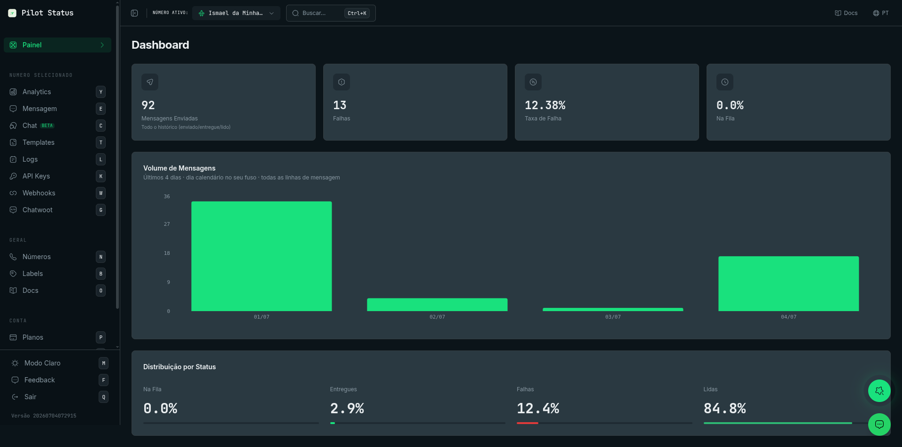
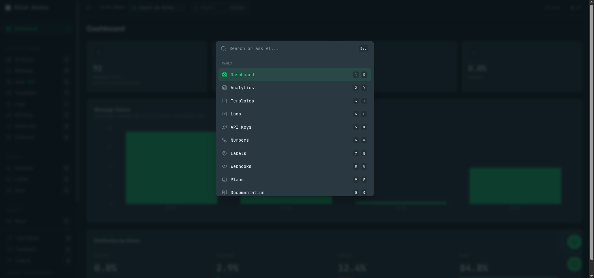

El dashboard de Pilot Status es la app web en `https://pilotstatus.com.br/dashboard`. Todo lo que puedes hacer con un número de WhatsApp (conectarlo, enviar y recibir mensajes, chatear en vivo, crear plantillas y Flows, leer registros, configurar webhooks y administrar claves, miembros y facturación) tiene una pantalla allí. Esta página describe la **pantalla de inicio** (`/dashboard`) y enlaza a una página por pantalla.

<Tip>
  ¿Buscas una credencial o un valor? Los secretos de firma de webhooks, las API keys, las claves del endpoint de Flows y valores similares se muestran en el dashboard, en la pantalla que los crea, no a través del soporte. Usa el [índice de pantallas](#índice-de-pantallas) de abajo para encontrar la página correcta.
</Tip>

<Frame caption="La pantalla de inicio del dashboard de Pilot Status: KPIs, volumen de mensajes y distribución por estado.">
  
</Frame>

## Cómo está organizado el dashboard

La barra lateral izquierda agrupa las pantallas en este orden:

| Grupo | Pantallas (etiqueta de la barra lateral → ruta) |
| --- | --- |
| *(arriba)* | **Dashboard** → `/dashboard` |
| **Selected Number** (número seleccionado): actúa sobre el número elegido en el selector de números del encabezado | **Analytics** → `/analytics`, **Ads** → `/ads`, **Message** → `/messages`, **Chat** → `/chat`, **Flows** → `/flows`, **Templates** → `/templates`, **Logs** → `/logs`, **API Keys** → `/api-keys`, **Webhooks** → `/webhooks`, **Chatwoot** → `/chatwoot` |
| **Workspace** | **Numbers** → `/numbers`, **Phone lines** → `/linhas`, **Labels** → `/labels`, **API Keys** → `/workspace-api-keys`, **Docs** (abre este sitio) |
| **Account** (cuenta) | **Plans** → `/plans`, **Profile** → `/profile` |

<Note>
  La barra lateral tiene **dos entradas con la etiqueta API Keys**. La que está bajo **Selected Number** (`/api-keys`) contiene la clave `ps_` del número seleccionado. La que está bajo **Workspace** (`/workspace-api-keys`) contiene las claves del workspace (la clave principal y las claves con nombre). Tus claves personales de cuenta (`ps_account_`) están en **Profile**. Consulta [Autenticación de la API](/es/api/authentication).
</Note>

La barra lateral solo muestra las pantallas que tu [rol](/es/concepts/roles-and-permissions) puede abrir. **Flows** solo se muestra cuando el número seleccionado es un número oficial (Meta Cloud API). **Ads**, **Chat**, **Flows** y **Phone lines** llevan una insignia **beta**.

### Atajos de teclado

Fuera de un campo de texto, presiona una sola letra para saltar a una pantalla: **D** Dashboard, **Y** Analytics, **S** Ads, **E** Message, **C** Chat, **H** Flows, **T** Templates, **L** Logs, **K** API Keys (número), **W** Webhooks, **G** Chatwoot, **N** Numbers, **I** Phone lines, **B** Labels, **V** API Keys (workspace), **O** Docs, **P** Plans, **U** Profile. **M** alterna el modo claro/oscuro, **F** abre los comentarios y **Q** cierra la sesión.

### Paleta de comandos

<Frame caption="Ctrl+K abre la paleta de comandos: salta a cualquier página con un atajo de número o letra, o pregúntale a la IA.">
  
</Frame>

Presiona **Ctrl+K** (**⌘K** en macOS) para abrir la paleta (**Search or ask AI...**). Escribe para filtrar páginas y acciones, presiona **1**–**9** o **0** para elegir un resultado o, cuando nada coincide, presiona **Enter** o haz clic en **Ask AI** para obtener una respuesta de la documentación. **Copy AI answer** copia la respuesta.

## La pantalla de inicio (`/dashboard`)

Haz clic en **Dashboard** en la barra lateral (o presiona **D**). Es la pantalla a la que llegas después de iniciar sesión, incluidas las cuentas nuevas: no hay un asistente de configuración al que se te envíe primero. Conectas tu primer número desde [Numbers](/es/dashboard/numbers) cuando quieras.

Cuando el workspace todavía no tiene ningún número (o no hay ningún número seleccionado en el encabezado), aparece arriba un banner **No connected numbers**: *"Connect a WhatsApp number to start sending messages."* Para **Owner** y **Admin** incluye un botón **Add Number** que abre el asistente de conexión en [Numbers](/es/dashboard/numbers); los Agents y Analysts ven el banner sin el botón.

A diferencia de las pantallas bajo **Selected Number**, la pantalla de inicio agrega **todos los números del workspace** (o, para un miembro restringido a algunos números, solo los números que se le asignaron). Se actualiza sola y cuando vuelves a la pestaña; los valores pueden tener hasta aproximadamente un minuto de antigüedad.

### Tarjetas de KPI

| Tarjeta | Qué cuenta |
| --- | --- |
| **Messages Sent** | Mensajes salientes de todo el historial cuyo estado es enviado, entregado o leído (*All history (sent/delivered/read)*). |
| **Messages Received** | Mensajes entrantes de todo el historial, de todos los proveedores (*All history (all webhooks)*). |
| **Failures** | Mensajes salientes de todo el historial con estado fallido. |
| **Failure Rate** | Fallas ÷ (enviados + fallas), con dos decimales. |
| **Queued** | El **porcentaje** de todos los mensajes salientes que siguen en cola, no una cantidad. |

### Message Volume

Un gráfico de mensajes por día para los **Last 4 days · calendar day in your timezone · all message rows** (últimos 4 días, día calendario en tu zona horaria, todas las filas de mensajes). Los días se calculan en la zona horaria de tu navegador.

### Distribution by Status

Cuatro porcentajes de todos los mensajes salientes, cada uno con una barra: **Queued**, **Delivered** (enviados y entregados juntos), **Failures** y **Read**.

### Top Numbers

Los 5 números con mayor volumen de todo el historial (**By sent + received volume**), cada uno con su nombre (o número de teléfono), la cantidad ↑ de salientes (todos los mensajes salientes del número, sea cual sea su estado, incluidos los fallidos y los que están en cola) y la cantidad ↓ de recibidos. El bloque se oculta cuando todavía no hay tráfico.

### Quién puede verla

Todos los roles (**Owner**, **Admin**, **Agent** y **Analyst**) pueden abrir la pantalla de inicio (permiso `analytics:read`).

### Hazlo por API / MCP

Los totales de todo el historial y de todo el workspace de la pantalla de inicio son **solo del dashboard**. Para KPIs por número y una serie diaria de 7, 30 o 90 días, usa [`GET /v1/analytics/dashboard`](/es/api/analytics) (herramienta MCP `analytics_dashboard`), que devuelve los datos detrás de la pantalla [Analytics](/es/dashboard/logs-analytics) para el número de la API key.

## Índice de pantallas

<CardGroup cols={2}>
  <Card title="Números" icon="phone" href="/es/dashboard/numbers">
    Conecta, reconecta, configura y elimina números de WhatsApp; estado de conexión y el asistente de conexión.
  </Card>
  <Card title="Chat en vivo" icon="message" href="/es/dashboard/live-chat">
    Bandeja de entrada de WhatsApp: conversaciones, respuestas, multimedia, llamadas, reenvío, información de contactos y grupos.
  </Card>
  <Card title="Enviar mensajes" icon="paper-plane" href="/es/dashboard/send-messages">
    La pantalla **Message**: envía una plantilla aprobada a una lista de destinatarios desde una etiqueta o una hoja de cálculo, ahora o programado.
  </Card>
  <Card title="Plantillas" icon="rectangle-list" href="/es/dashboard/templates">
    Crea, edita, prueba y envía plantillas a Meta; sincronización, insights y el ejemplo de solicitud a la API.
  </Card>
  <Card title="Flows" icon="diagram-project" href="/es/dashboard/flows">
    WhatsApp Flows: crea, publica, previsualiza, trazas y las claves del endpoint y el secreto de firma.
  </Card>
  <Card title="Registros y analíticas" icon="chart-bar" href="/es/dashboard/logs-analytics">
    Historial de mensajes, detalles, reenvío, cancelación de envíos programados y analíticas por número.
  </Card>
  <Card title="Etiquetas" icon="tag" href="/es/dashboard/labels">
    Contactos y etiquetas usados para segmentación y envíos masivos.
  </Card>
  <Card title="Webhooks" icon="link" href="/es/dashboard/webhooks">
    Endpoints de webhook, eventos y el secreto de firma que se muestra después de crear un webhook.
  </Card>
  <Card title="API keys" icon="key" href="/es/dashboard/api-keys">
    Claves de número y claves de workspace: ver, copiar, regenerar.
  </Card>
  <Card title="Chatwoot" icon="headset" href="/es/dashboard/chatwoot">
    Conecta un número a una bandeja de entrada de Chatwoot.
  </Card>
  <Card title="Ads" icon="bullhorn" href="/es/dashboard/ads">
    Rendimiento de los anuncios Click-to-WhatsApp.
  </Card>
  <Card title="Página de conexión" icon="qrcode" href="/es/dashboard/connect-page">
    La página que compartes para que otra persona conecte un número.
  </Card>
  <Card title="Líneas telefónicas" icon="phone-volume" href="/es/dashboard/phone-lines">
    Compra y administra líneas telefónicas virtuales.
  </Card>
  <Card title="Planes" icon="credit-card" href="/es/dashboard/plans">
    Suscripción, facturación y método de pago.
  </Card>
  <Card title="Perfil" icon="user" href="/es/dashboard/profile">
    Tu perfil, las API keys de cuenta y las preferencias.
  </Card>
  <Card title="Acceso a la cuenta" icon="lock" href="/es/dashboard/account-access">
    Inicio de sesión, sesiones y acceso a tu cuenta.
  </Card>
  <Card title="Miembros" icon="users" href="/es/dashboard/members">
    Invita miembros, asigna roles y restríngelos a números.
  </Card>
</CardGroup>
