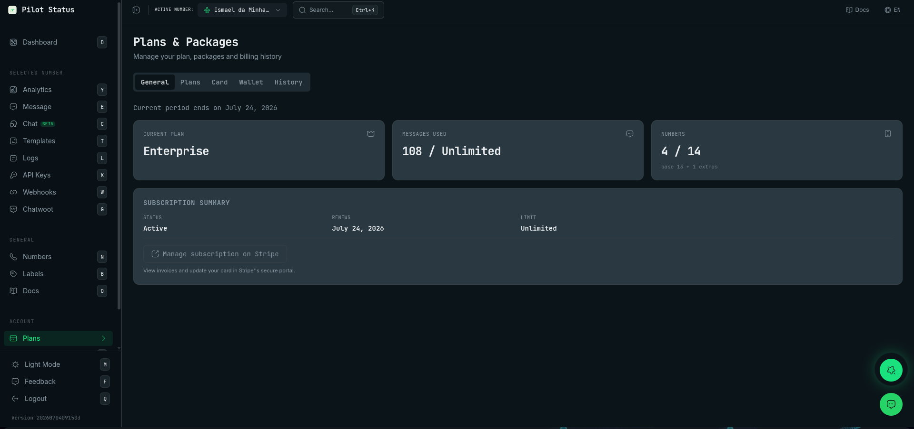
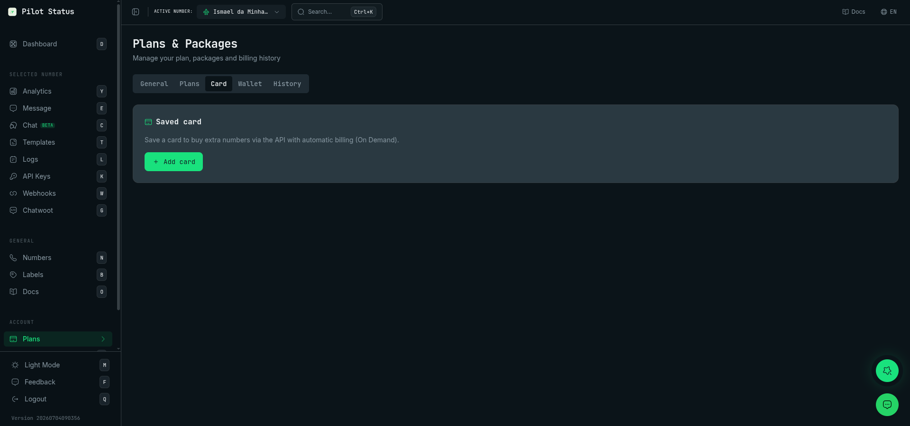
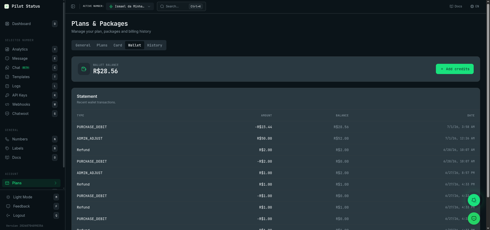

**Plans & Packages** es donde un workspace ve y paga lo que usa: el plan, los números adicionales, la billetera prepagada, la tarjeta guardada, los recibos y el registro completo de eventos de facturación. Los precios y lo que incluye cada plan están en [Planes](/es/plans); esta página describe la pantalla.

## Cómo llegar

- Barra lateral: **Plans** (atajo de teclado: `p`), o **Plans** en la paleta de comandos (`Ctrl+K` / `⌘K`).
- Ruta: `/plans`. Cada pestaña tiene su propio link con `?tab=`: `/plans?tab=general`, `plans`, `card`, `wallet`, `finance`, `history`. Un e-mail de aviso de facturación puede abrir esta pantalla directamente.
- El título de la pantalla es **Plans & Packages**, con el subtítulo **Manage your plan, packages and billing history**.

## Quién ve qué

La pantalla es para **Owner** y **Admin**. Agent y Analyst no la ven: no hay un ítem **Plans** en su barra lateral ni en su paleta de comandos, y abrir `/plans` desde un link muestra **Your role does not include this area** en su lugar.

| Pestaña | Owner | Admin |
| --- | --- | --- |
| **General** | Todo, incluido **Cancel Plan** / **Reactivate Plan** | Solo lectura: sin botones de pago ni de capacidad (consulta la nota de abajo) |
| **Plans** | Sí | Oculta |
| **Card** | Sí | Oculta |
| **Wallet** | Saldo, extracto y **Add credits** | Saldo y extracto; sin **Add credits** |
| **Finance** | Todo; edita **Billing details** | Lee todo; **Billing details** muestra el CPF/CNPJ y la dirección enmascarados, con **Only the account owner can change these details.** |
| **History** | Sí | Sí |

Mover dinero (comprar o cambiar un plan, pagar, guardar o quitar una tarjeta, recargar la billetera, cancelar, cambiar la capacidad pagada, editar los datos de facturación) es **solo para el Owner**. Una pestaña oculta sigue oculta aunque se abra desde un link (`/plans?tab=card` vuelve a **General**).

<Note>
  En **General**, un Admin ve los avisos, las tarjetas, el ciclo de facturación y el resumen de la suscripción, pero ninguno de los botones exclusivos del Owner: no hay **Manage subscription on Stripe**, ni **Schedule reduction** / **Cancel reduction**, ni **Pay invoice** o **Add credits** en los avisos. Donde el aviso tendría un botón de pago, un Admin lee **Only the workspace owner can pay the invoice.** o **Only the workspace owner can add credits.** en su lugar. Pide al Owner que haga estas acciones.
</Note>

<Frame caption="Plans & Packages: la pestaña General.">
  
</Frame>

## General

### Avisos en la parte superior

- **Billing suspended**: los envíos están pausados. El texto dice por qué y desde cuándo:
  - el cargo de la suscripción fue rechazado → **Pay invoice** (abre el portal de Stripe; solo Owner);
  - saldo insuficiente → **Add credits** (va a la pestaña **Wallet**) y, cuando todavía no hay tarjeta guardada, **Add card**; guardar una tarjeta también liquida el ciclo abierto (ambos solo Owner);
  - la reactivación depende del soporte → sin botón, solo **Support needed**, y el texto te pide mencionar el ID del ciclo que muestra.
- **Payment overdue**: el último cargo de la suscripción fue rechazado, pero los envíos todavía no se detuvieron. Indica la fecha límite para pagar la factura abierta, con **Pay invoice** (solo Owner).
- **Current period ends on …**: el fin del período de facturación actual.

Si una compra o un cambio de plan en esta pantalla se rechaza porque la facturación está suspendida, el error indica la misma causa que el aviso: un cargo de suscripción rechazado pide pagar la factura abierta (con **Pay invoice**), una suspensión de la billetera indica saldo insuficiente (con **Wallet**), y una suspensión que solo el soporte puede levantar lo dice.

Los envíos por API mientras la facturación está suspendida devuelven `422 BILLING_SUSPENDED`; consulta [Planes → Modos de facturación](/es/plans#modos-de-facturación).

### Tarjetas

- **Current Plan**: **Free**, **Basic**, **Premium** o **Enterprise**; otros planes muestran su código, como `ON_DEMAND`, `PAY_AS_YOU_GO` o `CUSTOM`.
- **Messages Used**: mensajes usados / el límite del plan, o **Limit exceeded**.
- **Usage**: solo en el plan Free; el porcentaje del tope de mensajes, con una barra.
- **Numbers**: números conectados / números permitidos, con **base … + … extras** cuando tienes números adicionales. En Pay As You Go: **… billable number(s)**.

### Ciclo de facturación

Solo planes pagos. Dos columnas:

- **Current cycle**: fechas de inicio → fin, **Capacity: … number(s)** (o los números facturables en Pay As You Go) y, en On Demand, **Current cycle amount**.
- **Next cycle**: fechas, **Capacity kept: …** o **Capacity drops from … to … number(s)** y, en On Demand y Pay As You Go, **Next cycle amount**.

Cambiar la capacidad pagada (solo Owner; cualquier plan con números adicionales pagos, excepto Pay As You Go):

- **Reduce to** [número] **paid no.** → **Schedule reduction**. La nueva capacidad solo entra en vigor, y solo se factura, a partir del próximo ciclo; conservas la actual hasta entonces. No puedes bajar de la cantidad de números que tienes conectados (**You have more connected numbers than that target. Disconnect numbers before reducing.**).
- Con una reducción programada, **Cancel reduction** mantiene la capacidad actual para el próximo ciclo.
- La pestaña te recuerda: **Your paid capacity is a 30-day entitlement: deleting a number does not reduce it.** En Pay As You Go dice en cambio: **On Pay As You Go the renewal bills every number that has been connected and has not been deleted, even if it is disconnected now. To pay less, delete the number: disconnecting is not enough.**

Los números adicionales no se compran aquí: se compran en la pantalla **Numbers** (el diálogo de compra) o por la API. Consulta [Números adicionales y On Demand](/es/api/extra-numbers).

### Resumen de la suscripción

**Status** (**Active**, **Payment overdue** o **Cancelled**), **Renews** (fecha) y **Limit** (mensajes).

- **Manage subscription on Stripe**: se muestra cuando el plan se paga con tarjeta a través de Stripe, con *View invoices and update your card in Stripe's secure portal.* Te lleva al portal seguro de Stripe (en la misma pestaña), donde ves las facturas de Stripe y actualizas la tarjeta que usa la suscripción. Solo Owner: un Admin no ve este botón.
- **Cancel Plan** (Owner, y solo para un plan pagado con tarjeta a través de Stripe; un plan pagado con Pix o desde la billetera no tiene **Cancel Plan**): abre el diálogo **Cancel Plan**: **Your plan will remain active until the end of the billing period. It will then be migrated to FREE.** y **You can reactivate at any time before the period ends.** Botones: **Confirm Cancellation** y **Back**. Después de cancelar, la pestaña muestra **Cancelled — valid until …** y **Reactivate Plan**.

## Plans

Solo Owner. Un selector **Monthly** / **Annual** (anual muestra **-20%**), la línea **Numbers: … / …**, y una tarjeta por plan (**Free**, **Basic**, **Premium** (marcado como **Popular**) y **Enterprise**) con el precio, cuántos números, cuántos mensajes y las funciones. Precios: [Planes](/es/plans#comparación-de-planes).

El botón de cada tarjeta depende de tu situación:

| Botón | Cuándo | Qué pasa |
| --- | --- | --- |
| **Current plan** | Es tu plan | Nada (deshabilitado). Si tu pago está vencido, dice **Payment overdue** y abre el portal de Stripe. |
| **Free plan** | La tarjeta Free, cuando estás en otro plan | Nada (deshabilitado). Para volver a Free, usa **Cancel Plan** en **General**. |
| **Credit card** / **PIX** | Todavía no tienes una suscripción con tarjeta | **Credit card** abre Stripe Checkout. **PIX** abre el diálogo **PIX Payment** (solo se muestra cuando el dashboard está en portugués). |
| **Upgrade** / **Downgrade** | Ya pagas un plan con tarjeta (no On Demand: una suscripción On Demand ve **Credit card** / **PIX**) | Abre el diálogo **Upgrade plan** o **Downgrade plan**. |

- **Upgrade plan**: **The prorated difference is charged now to your card on file and the new plan takes effect immediately.** → **Confirm** / **Back**.
- **Downgrade plan**: **The change takes effect at the end of the current period (…); you keep your current plan until then. No refund.** También advierte: **If you have more connected numbers than the chosen plan allows, disconnect them before continuing.** → **Confirm** / **Back**. La confirmación dice **Downgrade scheduled for …**.

### Diálogo PIX Payment

Muestra lo que estás pagando, el monto, **Expires at** (fecha y hora), el **código QR** y **Copy PIX code** (el código Pix copia y pega). Después de pagar en la app de tu banco, haz clic en **Check payment**: **Payment confirmed!** o **Payment is still pending.** **Close** lo cierra.

<Warning>
  El código Pix y el código QR existen solo en este diálogo. Una vez que lo cierras, no se vuelven a mostrar: inicia el pago de nuevo desde la tarjeta del plan para obtener un código nuevo. Un Pix que no se paga antes de **Expires at** deja de funcionar.
</Warning>

Un plan pagado con Pix se renueva desde la billetera en cada ciclo; consulta [Modos de facturación](/es/plans#modos-de-facturación).

**Need more numbers?**, al final, tiene **Talk to our team** (WhatsApp), para más de 13 números o un plan personalizado.

## Card

Solo Owner. **Saved card**: *Save a card to buy extra numbers via the API with automatic billing (On Demand).* La misma tarjeta también paga los cargos automáticos cuando la billetera no los cubre.

- Con tarjeta: la **marca** y **•••• últimos 4 dígitos**, y **Remove card**. La eliminación ocurre de inmediato, sin diálogo de confirmación. Se rechaza mientras la tarjeta sea necesaria: **Cancel On Demand before removing the card.** o **Disable auto-recharge before removing the card.**
- Sin tarjeta: **Add card** abre una página de Stripe para guardar una; vuelves a `/plans` al terminar.
- **Using the card of workspace … as a backup**: el workspace no tiene tarjeta propia, pero los cargos recurren a la tarjeta de otro workspace (la [tarjeta compartida](/es/reseller-billing#tarjeta-compartida) de un revendedor). Muestra la marca y los últimos 4 dígitos de esa tarjeta, solo lectura. **A card of your own takes precedence over the backup card.**

El número completo de la tarjeta nunca se muestra en ninguna parte de Pilot Status; lo guarda Stripe.

<Frame caption="La pestaña Card con una tarjeta guardada.">
  
</Frame>

## Wallet

La billetera prepagada: **Wallet balance** (en la moneda de la billetera) y el **Statement** (**Recent wallet transactions.**), con **Type** (**Top-up**, **Debit**, **Credit**, **Refund**, **Adjustment**, **Purchase** y **Monthly fee**; las compras y mensualidades vienen de planes, números adicionales y líneas telefónicas), **Amount**, **Balance** y **Date**. Los botones **All**, **WhatsApp** y **Phone lines** filtran por producto.

**Add credits** (Owner) abre el diálogo **Add credits**:

1. **Amount** (en la moneda de la billetera).
2. **Payment method**: **PIX** (solo billeteras en BRL; si no, **Pix is available only for BRL wallets.**) o **Card**. Con una tarjeta guardada, elige **Use card •••• 1234** (se cobra de inmediato, sin página adicional: **Credits added.**) u **Other card** (abre Stripe Checkout).
3. **Continue**.

Con Pix, el diálogo muestra el código QR y **Copy Pix code**, y **After payment, the balance is credited automatically.**; **Done** lo cierra. Igual que con el Pix del plan, el código no se vuelve a mostrar después de cerrar el diálogo; inicia una nueva recarga si la necesitas.

<Frame caption="La pestaña Wallet: saldo, Add credits y el extracto.">
  
</Frame>

## Finance

**What the account spent, what the Phone Lines will charge next, who the receipts are issued to, and the documents of every paid charge.** (Lo que gastó la cuenta, lo que cobrarán las líneas telefónicas a continuación, a nombre de quién se emiten los recibos y los documentos de cada cargo pagado.) Cuatro secciones:

- **Consolidated spend**: todo lo cobrado, por producto y por mes (en la zona horaria de la cuenta): **Plan subscription**, **Monthly fee from the wallet (plan and extra numbers)**, **Extra numbers**, **Phone lines**, **Message packages**. **Period**: **2 months**, **6 months** o **12 months**; los dos meses más recientes son tarjetas (**Current month**, **Previous month**) y **Earlier months** es una tabla. También muestra **Wallet** (**Top-ups**, **Spent on products**, **Refunded to the wallet**), que no se suma al total, y **Returned to you** (**Refunds (card or Pix)**, **Chargebacks lost at the bank**). Los costos de mensajes de Meta no están aquí: Meta los factura directamente (**See Meta prices**).
- **Phone line charges**: saldo de la billetera, cobertura de las próximas renovaciones e historial de cargos de las líneas. Se describe en [Líneas telefónicas en el dashboard](/es/dashboard/phone-lines#cobros-en-plans).
- **Billing details**: a nombre de quién se emiten los recibos y comprobantes de pago: **Country** (**Brazil** u **Another country** con **Country code (2 letters)**), **Document type**, **CPF or CNPJ**, **Full name or company name**, **Billing e-mail**, **Postal code (CEP)** (en Brasil la dirección se busca a partir del CEP), **Street address**, **Number**, **Address line 2 (optional)**, **District (optional)**, **City**, **State**. Cuando todavía no hay datos de facturación guardados, el Owner ve el formulario directamente y, si existe, **Use the Phone Lines verification details** lo completa con la verificación del titular de la línea. Una vez guardados, **Edit** → **Save details** (Owner). Guardar también actualiza el nombre, e-mail, dirección y CPF/CNPJ en el cliente de Stripe, así que las próximas facturas de tarjeta los incluyen. **Updated on …** muestra el último cambio.
- **Receipts and invoices**: una fila por cargo pagado, con **Load more**. **Payment proof** descarga un archivo HTML que puedes abrir e imprimir o guardar como PDF; funciona con cualquier método de pago y no es una factura fiscal (nota fiscal). **Stripe invoice/receipt** abre el documento de Stripe; el botón solo aparece cuando hubo una tarjeta involucrada y Stripe tiene un documento (si al final Stripe no tiene ninguno: **This charge has no Stripe document. Use the payment proof.**).

<Note>
  Para un Admin, el CPF/CNPJ y la dirección en **Billing details** (y en los comprobantes de pago que descarga ese Admin) aparecen enmascarados. Solo el Owner los ve completos.
</Note>

## History

**Billing Events**: la línea de tiempo de todo lo que pasó con la facturación de la cuenta, del más reciente al más antiguo, con **Load more**. Cada evento muestra su nombre, monto, método de pago y fecha. Ejemplos: **Checkout started**, **Checkout completed**, **Checkout canceled**, **Subscription activated**, **Subscription renewed**, **Subscription canceled**, **Plan change proration paid**, **Extra numbers purchased**, **Extra numbers removed**, **Number reduction scheduled**, **Number reduction canceled**, **Credits added**, **Top-up not completed**, **Card saved**, **Card removed**, **Backup card linked**, **Backup card unlinked**, **Monthly charge paid**, **Monthly charge outstanding**, **Account suspended for non-payment**, **Account reactivated**, **Price updated**, **Payment disputed at the bank**, **Refunded at the PSP**, además de otros como el fin de una suscripción, planes personalizados, paquetes y recarga automática, y los eventos de líneas telefónicas (**Line purchased**, **Line monthly fee paid**, **Line charge failed**, **Line suspended for non-payment**, **Line reactivated**, **Line canceled** y más). Más en [Planes → Historial de facturación](/es/plans#historial-de-facturación).

## Valores que se muestran solo una vez

- El **código Pix copia y pega y el código QR** (pago del plan y recarga de la billetera) se muestran solo en su diálogo. Al cerrarlo se pierden; inicia un pago nuevo para obtener otro código. Por la API, `POST /v1/billing/checkout` devuelve el código en su respuesta y `GET /v1/billing/topups/{id}` te dice si se pagó.

Nada más en esta pantalla es secreto: la tarjeta muestra solo la marca y los últimos 4 dígitos, y las facturas siguen disponibles en **Receipts and invoices** y en el portal de Stripe.

## Hazlo vía API / MCP

| Acción en la pantalla | Endpoint `/v1` | Herramienta MCP |
| --- | --- | --- |
| Recarga de la billetera (Pix o tarjeta) | [`POST /v1/billing/checkout`](/es/api/wallet-and-card) con `purpose: "wallet_topup"` | `billing_checkout` |
| Seguir una recarga | [`GET /v1/billing/topups/{id}`](/es/api/wallet-and-card#seguir-una-recarga) | `billing_topups_get` |
| Guardar una tarjeta | `POST /v1/billing/checkout` con `purpose: "add_card"`, o [Stripe Elements](/es/api/wallet-and-card#tarjeta-en-tu-propia-página-stripe-elements) vía `/v1/billing/card/setup-intent` | `billing_checkout` |
| Vista previa / compra de números adicionales | [`GET` / `POST /v1/subscription/extra-numbers`](/es/api/extra-numbers) | `subscription_extra_numbers_get`, `subscription_extra_numbers_add` |
| Programar una reducción de capacidad | `DELETE /v1/subscription/extra-numbers` | `subscription_extra_numbers_remove` |
| Cancelar la reducción programada | `DELETE /v1/subscription/extra-numbers/schedule` | `subscription_extra_numbers_cancel_scheduled` |
| Plan actual y miembros | [`GET /v1/workspace`](/es/api/workspace) | `workspace_get` |
| Precios de mensajes de Meta | [`GET /v1/meta/pricing`](/es/api/pricing) | `meta_pricing_get` |
| Tarjeta compartida (de respaldo) del workspace de un revendedor | [`PUT` / `DELETE /v1/workspaces/{id}/shared-card`](/es/api/workspaces) (key de revendedor) | `workspaces_shared_card_link`, `workspaces_shared_card_unlink` |

**Solo en el dashboard** (sin endpoint `/v1` ni herramienta MCP): comprar un plan con tarjeta o Pix, upgrade, downgrade, cancelar y reactivar el plan, el portal de Stripe, quitar la tarjeta guardada, el saldo y el extracto de la billetera, **Finance** (gasto, datos de facturación, recibos y comprobantes de pago) e **History**.

Los endpoints que mueven dinero necesitan una credencial de **Owner** (key de cuenta o token OAuth/MCP); consulta [Billetera y tarjeta vía API](/es/api/wallet-and-card#credenciales-y-permisos).
