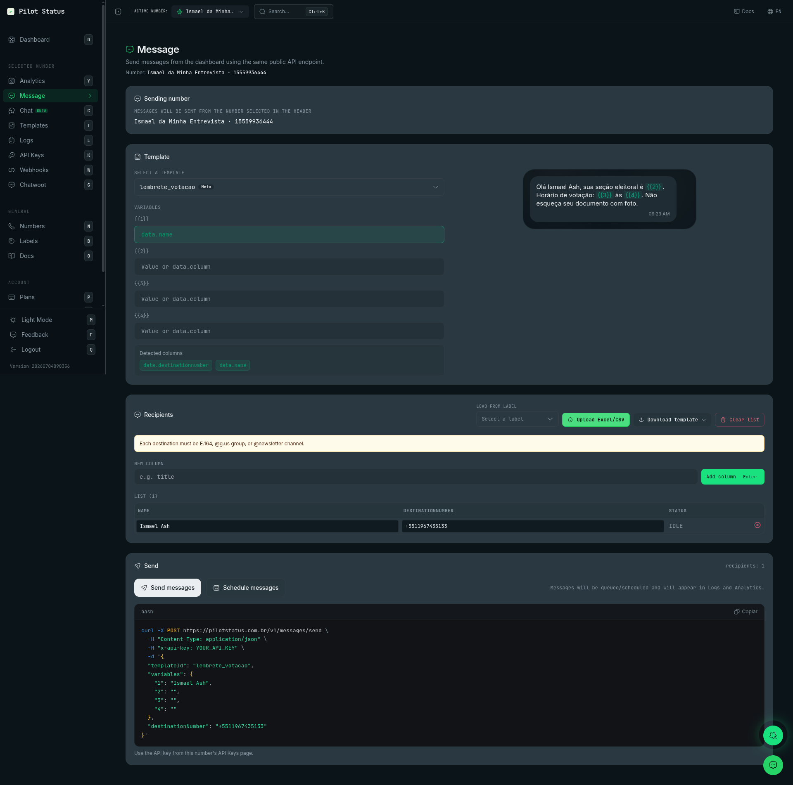

La pantalla **Message** (`/messages`) envía una plantilla aprobada desde el panel, a una persona o a una lista completa. Cada destinatario se convierte en un envío por el mismo camino que el endpoint público que usa tu código, [`POST /v1/messages/send`](/es/api/messages/send), así que un envío desde aquí se comporta exactamente igual que un envío por API: pasa por la cola y aparece en [Logs y analíticas](/es/dashboard/logs-analytics).

El envío se hace con la API key más reciente del número seleccionado, así que se aplica la configuración de esa key (como su webhook y su retención de datos). Si el número aún no tiene API key, se crea una **Default API Key** para él en el primer envío.

<Frame caption="La página Message: selector y vista previa de plantilla, variables asociadas a columnas de la hoja de cálculo, lista de destinatarios con carga de Excel/CSV, acciones Enviar y Programar, y el curl generado automáticamente de la llamada exacta a la API.">
  
</Frame>

## Cómo llegar

En la barra lateral, haz clic en **Message**, en el grupo **Selected Number** (atajo de teclado: `E`). El título de la página es **Message**, con el subtítulo **Send messages from the dashboard using the same public API endpoint.** y el **Number:** desde el que envías.

## Quién puede usarla

**Owner**, **Admin** y **Agent** pueden abrir la pantalla y enviar (permisos `messages:bulk_send` y `messages:send`). **Analyst** no la ve. Un miembro restringido a algunos números solo puede enviar desde esos números. Consulta [Roles y permisos](/es/concepts/roles-and-permissions).

La pantalla en sí no depende del plan. Cada destinatario es un mensaje y cuenta para la cuota de mensajes de tu plan; un mensaje por encima de la cuota falla con `PLAN_LIMIT_REACHED` (consulta [Códigos de error del log](/es/api/messages/log-error-codes)).

## Qué ves

La pantalla tiene cinco bloques, de arriba hacia abajo.

### Número de envío

Los mensajes salen desde el número seleccionado en el encabezado (**Messages will be sent from the number selected in the header**). Para enviar desde otro número, cámbialo en el selector de números del encabezado. Sin un número seleccionado, el bloque dice **Select a number in the header**.

<Note>
  No puedes enviar desde el número de prueba de Pilot Status. Si es el número seleccionado, el envío se bloquea con **Test number: select one of your numbers to send messages.**
</Note>

### Plantilla

Elige la plantilla en **Select a template** (con búsqueda). La pantalla envía **solo plantillas**: aquí no hay envío de texto libre ni de multimedia suelta; para eso, usa el [Chat en vivo](/es/dashboard/live-chat) o la API.

- En un número **oficial (Meta Cloud API)**, la lista muestra solo las plantillas de ese número **aprobadas por Meta**. Una plantilla aún no aprobada falla con **Template not yet approved by Meta. Submit the template for approval in /templates and wait for Meta to approve it before sending via this number.**
- Las plantillas que vinieron de Meta llevan un distintivo **Meta** en la lista.
- En otros números, la lista muestra todas tus plantillas.

Las plantillas se crean y editan en la pantalla **Templates**. Consulta [Plantillas](/es/concepts/templates).

### Variables

Si la plantilla tiene variables, cada una recibe un campo (**Value or data.column**). Puedes escribir:

- un valor fijo, igual para todos los destinatarios; o
- `data.<column>`, para tomar el valor de esa columna de la lista de destinatarios (por ejemplo, `data.link`).

Cuando una columna tiene el mismo nombre que una variable, el campo se completa con `data.<column>` automáticamente. **Detected columns** muestra cada columna de la lista como un chip `data.`; haz clic en uno para copiarlo. Una plantilla sin variables dice **This template has no variables.**

En las plantillas de **Marketing** creadas en Pilot Status aparece el interruptor **Rewrite with AI (anti-spam)**: después de renderizar la plantilla, la IA varía el texto final manteniendo una longitud y un tono similares, para que los envíos masivos se vean menos repetitivos. Está desactivado por defecto y se reinicia al cambiar de plantilla. No aparece en las plantillas de Marketing que vinieron de Meta.

**Message preview** muestra el mensaje renderizado (encabezado, multimedia, cuerpo, pie, botones y listas) con las variables completadas a partir del **primer** destinatario de la lista.

### Destinatarios

Arma la lista con cualquier combinación de estas formas. Agregar nunca crea duplicados: un destino que ya está en la lista se omite.

- **Load from label**: elige una etiqueta (cada una muestra su cantidad de contactos) para agregar todos sus contactos. Las etiquetas se gestionan en la pantalla [Etiquetas](/es/dashboard/labels).
- **Upload Excel/CSV**: un archivo `.xlsx`, `.xls` o `.csv` con una columna `name` y una columna de destino. La columna de destino puede llamarse `destinationNumber`, `number`, `numero`, `telefone` o `phone`. Cualquier otra columna se convierte en una columna `data.` para las variables.
- **Download template**: descarga un modelo de hoja de cálculo (**Excel (.xlsx)** o **CSV (.csv)**) con las columnas `name`, `destinationNumber` y una columna por variable de la plantilla, precompletado con tu propio nombre y teléfono y el número de Pilot Status.
- **New column** / **Add column** (o `Enter`): agrega una columna vacía a todas las filas, para completar a mano. Cada columna extra tiene **Remove column**.
- **Clear list**: vacía la lista.

Al abrir la pantalla, la lista empieza con una fila: el teléfono de tu propio perfil, para que el primer envío te llegue a ti.

La tabla **List**, con la cantidad de filas, muestra **Name**, **destinationNumber**, cada columna extra y **Status**. Cada celda es editable y cada fila se puede quitar. Un destino puede ser:

- un número de teléfono en formato E.164 (`+5511999999999`);
- un grupo de WhatsApp (que termina en `@g.us`);
- un canal de WhatsApp (que termina en `@newsletter`).

Un destino inválido pone su fila en rojo con la pista **E.164 / @g.us / @newsletter**, y uno repetido se marca como **Duplicate**. Mientras quede alguno, el envío está bloqueado.

### Enviar

El bloque muestra cuántos **recipients** (destinatarios) hay en la lista.

- **Send messages**: envía ahora.
- **Schedule messages**: abre un selector con una fecha, **Hour** y **Minute** (en la zona horaria de tu navegador), que empieza en la fecha y hora actuales, y luego **Schedule**. **Clear** vacía la fecha.

Ningún botón envía de inmediato. Primero se abre una confirmación (**Send N messages now?** o **Schedule N messages?**) que indica cuántos destinatarios reciben qué plantilla, la fecha y hora de entrega cuando programas, y que el lote se envía desde esta pestaña del navegador: **Keep this tab open until it finishes: closing or reloading it stops the batch halfway, and the remaining recipients get nothing.** **Send N messages** (o **Schedule N messages**) inicia el lote para todas las filas de la lista; **Cancel** no envía nada.

El envío se ejecuta en tu navegador: esta pestaña envía cada destinatario como su propia solicitud, de a tres a la vez, y actualiza el **Status** de cada fila: `SENDING`, luego `QUEUED` (aceptado, con su ID de mensaje) o `FAILED` con el error debajo. Mientras se ejecuta, la lista y los botones quedan bloqueados y el botón dice **Sending...**.

<Note>
  Mantén esta pestaña abierta hasta que termine, es decir, hasta que ninguna fila esté en `SENDING`. Cerrar o recargar la pestaña detiene el envío: los destinatarios que ya estaban en `QUEUED` igual salen, el resto nunca se envía. Pasar a otra pantalla oculta los resultados por fila. Mientras el lote se ejecuta, el navegador pide confirmación antes de cerrar o recargar la pestaña.
</Note>

Al final, un mensaje indica cuántos se encolaron o programaron y cuántos fallaron.

`QUEUED` significa que el mensaje entró en la cola, no que se entregó. La entrega, la lectura y las fallas aparecen en [Logs](/es/dashboard/logs-analytics), donde también puedes cancelar un envío programado o reenviar uno fallido. En números conectados por web, los envíos en frío (ventana de 24 h cerrada) se espacian con el motor antibloqueo, así que una lista grande tarda en salir.

### El curl de la misma llamada

Debajo del bloque de envío, un **curl** muestra la solicitud exacta `POST /v1/messages/send` para el **primer** destinatario, con la plantilla seleccionada y las variables resueltas. Mientras el selector **Schedule messages** está abierto, también lleva la fecha y hora elegidas como `deliverAt`; cerrar el selector sin programar lo quita de nuevo, así que el comando copiado es un envío inmediato. Cópialo para reproducir el envío desde tu código. Reemplaza `YOUR_API_KEY` con la key de la página **API Keys** de este número (**Use the API key from this number's API Keys page.**).

## Hazlo por API / MCP

| Acción en el panel | API (`/v1`) | Herramienta MCP |
| --- | --- | --- |
| Enviar una plantilla a un destinatario | [`POST /v1/messages/send`](/es/api/messages/send) con `templateId`, `variables` y un destino (`destinationNumber`, `groupId` o `newsletterId`) | `messages_send` |
| Enviar a una lista | Un `POST /v1/messages/send` por destinatario; no hay endpoint masivo | `messages_send`, una vez por destinatario |
| **Schedule messages** | El campo `deliverAt` (y opcionalmente `deliverUntil`) | `messages_send` con `deliverAt` |
| **Rewrite with AI (anti-spam)** | `marketingOptions.aiRewriteEnabled: true` | `messages_send` con `marketingOptions` |
| Etiquetar a los destinatarios | El campo `labels`; consulta [Etiquetas](/es/api/labels) | `messages_send` con `labels` |
| Cargar destinatarios desde una etiqueta | — | Solo en el panel |

Usa una API key asociada al número; consulta [Autenticación de la API](/es/api/authentication). La guía paso a paso es [Enviar mensajes](/es/guides/send-messages).
