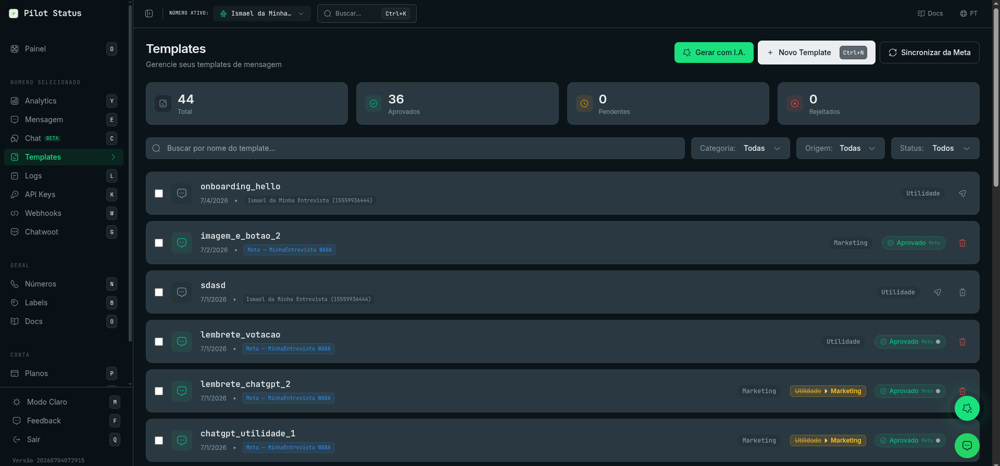
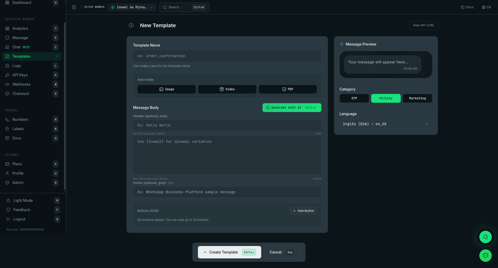

Las plantillas son los mensajes reutilizables que envías con `templateId`. Esta página describe lo que muestran y hacen las pantallas del panel. Para las reglas de la plantilla en sí (categorías, variables, aprobación de Meta, estructura), consulta [Plantillas](/es/concepts/templates) y la [API de plantillas](/es/api/templates).

<Frame caption="La lista de plantillas: tarjetas de estado, filtros y una fila por plantilla.">
  
</Frame>

## Cómo llegar

| Pantalla | Ruta | Cómo llegas |
| --- | --- | --- |
| Lista de plantillas | `/templates` | **Templates** en la barra lateral (atajo de teclado: `t`), o busca "Templates" en la paleta de comandos |
| Nueva plantilla | `/templates/new` | **New Template** en la lista, `Ctrl+Shift+1` (`⌘+Shift+1` en Mac), o "Create Template" en la paleta de comandos |
| Editar plantilla | `/templates/:id/edit` | Haz clic en una fila de la lista |

La lista muestra las plantillas del número seleccionado en el encabezado del panel. Cuando el número seleccionado es el número de prueba de Pilot Status, la lista muestra en su lugar todas las plantillas del workspace, pero ese número es solo para pruebas: eliminar, sincronizar, enviar a Meta y guardar están bloqueados, con el mensaje _"Test number: select one of your numbers to manage templates."_ (Número de prueba: selecciona uno de tus números para administrar plantillas.) Elige uno de tus propios números en el encabezado para administrar plantillas.

## Quién puede hacer qué

| Acción | Owner | Admin | Agent | Analyst |
| --- | --- | --- | --- | --- |
| Ver la lista, los filtros, las tarjetas de estado | ✓ | ✓ | ✓ | ✓ |
| Abrir **Template insights** | ✓ | ✓ | ✓ | ✓ |
| Copiar el nombre de una plantilla | ✓ | ✓ | ✓ | ✓ |
| Crear, editar (abrir el editor), **Generate with AI** | ✓ | ✓ | — | — |
| **Sync from Meta**, **Submit to Meta**, envío de prueba, eliminar, acciones masivas | ✓ | ✓ | — | — |

Agents y Analysts leen la lista (permiso `templates:read`). Todo lo que escribe (incluido el envío de prueba, que es un mensaje real) necesita `templates:manage`, que tienen Owner y Admin. Para Agents y Analysts, las filas no son clicables y los botones de escritura y las casillas no se muestran.

No hay restricción de plan en estas pantallas.

## Lista de plantillas (`/templates`)

### Botones del encabezado

- **Generate with AI**: abre el modal **Generate Template with AI** (consulta [Generación con IA](#generación-con-ia)). Se muestra solo cuando la IA está disponible en la plataforma.
- **New Template**: abre `/templates/new`.
- **Sync from Meta**: se muestra cuando el workspace tiene al menos un número oficial (Meta). Consulta [Sync from Meta](#sync-from-meta).

### Tarjetas de estado

Cuatro tarjetas: **Total**, **Approved**, **Pending**, **Rejected**. Cuentan las plantillas cargadas en ese momento con los filtros activos; no son totales de todo el workspace. **Rejected** cuenta tanto las plantillas rechazadas como las deshabilitadas. Hacer clic en una tarjeta establece el filtro **Status** (**Total** lo borra).

### Filtros

- **Search by template name...**: filtra por nombre mientras escribes.
- **Category:** **All**, **OTP**, **Marketing**, **Utility**. Al pasar el cursor sobre una opción se muestra para qué sirve la categoría, ejemplos y la regla que aplica en el número de Pilot Status.
- **Source:** **All**, **Pilot Status** (plantillas que no están en Meta: borradores nunca enviados y plantillas de números que no son de Meta), **Meta** (plantillas en tu WhatsApp Business Account, importadas con **Sync from Meta** o enviadas desde Pilot Status; una plantilla pasa aquí en cuanto Meta acepta el envío).
- **Status:** **All**, **Approved**, **Pending**, **Rejected**, **Disabled**, **Paused** (estado de revisión de Meta).

La lista muestra 20 plantillas a la vez; **Load more** muestra las 20 siguientes. Se actualiza cuando vuelves a la pestaña. Un resultado vacío muestra _"No templates found"_.

### Qué muestra cada fila

- El **nombre** de la plantilla (monoespaciado) y un ícono que copia el nombre al portapapeles.
- La fecha de la última actualización.
- Una insignia **Meta** (con el nombre de la WABA, `Meta — <WABA name>`) cuando la plantilla está en Meta, o el número al que pertenece la plantilla.
- La **categoría**. Cuando Meta cambió la categoría tras la revisión, una insignia muestra la categoría anterior tachada y la nueva (tooltip: _"Category changed by Meta"_).
- La insignia de **estado de Meta** (**Approved**, **Pending**, **Rejected**, **Disabled** o **Paused**) con un punto de color para la calificación de calidad de Meta (verde, amarillo, rojo) cuando Meta informa una.
- Para una plantilla rechazada, **Reason:** seguido del motivo de rechazo de Meta.

### Acciones de fila

Pasa el cursor sobre una fila para ver sus íconos de acción. Cuáles aparecen depende de la plantilla y de tu rol:

| Ícono (tooltip) | Cuándo aparece | Qué hace |
| --- | --- | --- |
| Gráfico (**Template insights**) | La plantilla está en Meta y su WABA no es una cuenta de WhatsApp Business App / coexistencia | Abre el modal [Template insights](#template-insights) |
| Matraz (**Test template**) | La plantilla todavía no está en Meta, el número de prueba de Pilot Status está conectado, Owner/Admin | Abre el modal [Send Test](#send-test) |
| Enviar (**Submit for Meta approval** / **Re-submit for Meta approval**) | La plantilla todavía no está en Meta, el workspace tiene un número de Meta, Owner/Admin | Abre el modal [Submit to Meta](#submit-to-meta) |
| Papelera | La plantilla nunca estuvo en Meta, Owner/Admin | Elimina la plantilla ([Delete Template](#eliminar)) |
| Papelera roja (**Delete template from Meta**) | La plantilla está en Meta, Owner/Admin | La elimina en Meta y en Pilot Status ([Delete Template from Meta](#eliminar)) |

Hacer clic en cualquier otra parte de la fila abre el editor (Owner/Admin).

Una vez que Meta acepta un envío, la plantilla cuenta como plantilla de Meta: los íconos de enviar y de matraz desaparecen de su fila, y los cambios posteriores pasan por **Save** en el editor (consulta [Editar y volver a enviar](#editar-y-volver-a-enviar)).

### Acciones masivas

Owner y Admin ven una casilla en cada fila. Seleccionar al menos una muestra una barra con:

- **Delete selected**: pide confirmación en el modal **Delete Templates** y luego elimina cada una. Las plantillas que están en Meta también se eliminan en Meta.
- **Submit selected to Meta**: abre la confirmación de [Submit to Meta](#submit-to-meta) y envía cada plantilla seleccionada al número de Meta seleccionado en el encabezado. Las plantillas que ya están en Meta se omiten.
- **Deselect all**.

## Sync from Meta

**Sync from Meta** importa a Pilot Status las plantillas que existen en tus WhatsApp Business Accounts, para **todos** los números de Meta del workspace (no solo el del encabezado). Se crean las plantillas nuevas y se actualizan las existentes. El resultado aparece como un aviso: _"Synced from Meta: 2 new, 3 updated"_ o _"No new templates found on Meta."_

Si no se puede acceder a Meta para una cuenta, ves: _"Could not access the WhatsApp Business Account (WABA) on Meta. It may have been removed/deleted, or the System Token lacks permission. Reconnect the number on Meta."_ (No se pudo acceder a la WABA en Meta. Puede haber sido eliminada, o el System Token no tiene permiso. Vuelve a conectar el número en Meta.)

## Eliminar

Hay dos caminos de eliminación, y cuál ofrece una fila depende de si la plantilla está en Meta.

- **Delete Template** (ícono de papelera simple): para una plantilla que nunca se envió a Meta. El modal pregunta _"Are you sure you want to delete the template"_ con el nombre. Si tiene éxito: _"Template deleted!"_
- **Delete Template from Meta** (ícono de papelera roja): para una plantilla en Meta. El modal dice _"Are you sure you want to delete this template from Meta? This action cannot be undone."_ Elimina la plantilla en Meta **y** en Pilot Status. Si tiene éxito: _"Template deleted from Meta!"_

<Warning>
  Eliminar una plantilla en Meta no se puede deshacer.
</Warning>

### Cuando Meta rechaza la eliminación

Si Meta la rechaza (por ejemplo, el token no tiene permiso sobre la WABA), no se elimina nada y se abre el modal **Meta refused the deletion**. Muestra el motivo de Meta y el nombre de la plantilla, y explica que puedes eliminar solo la copia de Pilot Status: la plantilla **se queda** en Meta y puede reaparecer en la próxima sincronización. **Remove local copy only** hace eso, y el aviso confirma: _"Removed from Pilot Status only. The template STAYS on Meta and may reappear on the next sync."_ Esta opción solo aparece después de un rechazo; nunca es la predeterminada.

Si Meta dice que la plantilla no existe allí, ves _"This template was not found on Meta. Try deleting it locally only."_

## Template insights

El modal **Template insights** muestra las analíticas de Meta para una plantilla que está en Meta:

- El nombre de la plantilla, su estado en Meta y su calificación de calidad (**GREEN**, **YELLOW**, **RED**).
- Un selector de período: **7 days**, **30 days** (por defecto), **90 days**.
- Cuatro cifras: **Sent**, **Delivered**, **Read**, **Read rate** (— cuando no se entregó nada).
- **Sent per day**: una barra por día.
- **Button clicks**: cada botón con su cantidad de clics, o _"No clicks recorded in this period."_

Si Meta lo rechaza (por ejemplo, la cuenta es de WhatsApp Business App / coexistencia, donde Meta no ofrece insights), el modal muestra el motivo y un botón **Try again**; en el caso de coexistencia, el ícono de gráfico desaparece de las plantillas de esa cuenta. Los insights son de solo lectura: todos los roles pueden abrirlos.

## Editor (`/templates/new` y `/templates/:id/edit`)

<Frame caption="El editor de plantillas: el formulario a la izquierda, la vista previa en vivo y la categoría/idioma a la derecha.">
  
</Frame>

El editor tiene el formulario a la izquierda y una barra lateral a la derecha. El título de la página es **New Template** o **Edit Template**. Al editar, el área del título también muestra el nombre de la plantilla, su insignia de estado y, para una plantilla rechazada, **Reason:** con el motivo de Meta y _"See WhatsApp Manager for more details."_ El botón **View API cURL** está arriba a la derecha.

### Formulario

- **Template Name** (solo al crear): se convierte a snake_case mientras escribes. Si el nombre ya existe, ves _"A template with this name already exists."_ El nombre no se puede cambiar después de la creación.
- **Add media**: medio del encabezado: **Image**, **Video** o **PDF**. Elige **Use URL** para pegar un enlace directo `http(s)`, o **Upload** para enviar un archivo (**Choose image**, **Choose MP4 video**, **Choose PDF**). Límites: PNG, JPEG, WebP o GIF hasta 5 MB; MP4 hasta 16 MB; PDF hasta 10 MB. Después de una carga ves **Media on server** y _"Remember to click 'Save' to persist this media in the template."_: la carga solo se conserva cuando guardas. El medio no está disponible mientras haya un encabezado de texto, una lista o un carrusel. **Remove media** lo borra.
- **Message Body**: tres campos, con `{{variable}}` resaltado:
  - **Header (optional, bold)**: máximo 60 caracteres, como máximo 1 variable, sin emojis, saltos de línea ni formato. No disponible mientras haya medio en el encabezado, una lista o un carrusel.
  - El cuerpo: máximo 1024 caracteres (se muestra un contador).
  - **Footer (optional, grey)**: máximo 60 caracteres.
- **Detected variables**: cada `{{variable}}` encontrada, como chips.
- **Variable examples**: un valor de ejemplo por variable, enviado a Meta para la aprobación. **Generate examples with AI** los completa (cuando la IA está disponible).
- **Buttons**: la lista de botones (hasta 10) con **Add Button**, que abre el [modal de botones](#modal-de-botones). Haz clic en un botón para editarlo; el ícono de papelera lo elimina.
- **Carousel**: **Add carousel** convierte la plantilla en un carrusel de 2 a 10 tarjetas, cada una con una imagen, un texto corto y hasta 2 botones. Es exclusivo: con un carrusel no hay encabezado ni sección de botones, y **Add carousel** desaparece cuando la plantilla ya tiene botones, una lista o una tarjeta de pedido.

En un número oficial (Meta) con categoría **OTP**, el formulario cambia al diseño fijo de autenticación de Meta: ves el texto fijo, un botón **Copy code**, un interruptor **Security recommendation** (agrega la línea de "no lo compartas") y **Code expiration (min)** (opcional, de 1 a 90). Cuerpo, encabezado, pie y botones no son editables allí.

### Barra lateral

- **Message Preview**: una vista previa en vivo al estilo de WhatsApp del mensaje mientras escribes, con los ejemplos de variables aplicados, medios, botones, lista, tarjeta de pedido o carrusel. Cuando la plantilla contiene un enlace, una nota recomienda acortarlo con ShareContent.
- **Category**: **OTP**, **Utility** o **Marketing**, con un tooltip en cada una. Se define al crear; al editar es de solo lectura (_"Category cannot be changed after creation."_). En una plantilla aprobada: _"Approved template — changes require new Meta approval."_; en una pendiente: _"Pending template — changes may affect approval."_
- **Language**: lista con búsqueda de los idiomas de Meta. También queda fijo después de la creación.

### Barra inferior

- **Create Template** (al crear) o **Save** (al editar). Deshabilitado mientras está seleccionado el número de prueba de Pilot Status (_"Test number: select one of your numbers to save or publish templates."_).
- **Submit to Meta** (solo al editar): se muestra para plantillas que todavía no están en Meta, cuando el workspace tiene un número de Meta. Primero guarda (o, si no hay cambios, sigue directamente) y luego abre la confirmación de [Submit to Meta](#submit-to-meta).
- **Send Test**: se muestra cuando el número de prueba de Pilot Status está conectado. Abre [Send Test](#send-test).
- **Cancel** (`Esc`).

### Editar y volver a enviar

Lo que hace **Save** depende de si la plantilla ya está en Meta. El nombre, la categoría y el idioma nunca cambian después de la creación, sea cual sea el estado.

- **Todavía no está en Meta** (un borrador, o una plantilla de un número que no es de Meta): **Save** solo guarda el cambio en Pilot Status. Envíala a revisión con **Submit to Meta**.
- **Está en Meta** (enviada desde Pilot Status o importada con **Sync from Meta**): **Save** envía la versión editada a Meta como una edición de la misma plantilla. Pilot Status solo escribe la nueva versión después de que Meta la acepta; el estado vuelve entonces a **Pending** hasta que Meta la revise de nuevo. Si Meta la rechaza, nada cambia, ni en Pilot Status ni en Meta.

Así se corrige una plantilla **rechazada**: ábrela desde la lista, lee **Reason:** junto al estado, corrige el contenido y haz clic en **Save**. No hay un botón separado para volver a enviar una plantilla que ya está en Meta: guardar es el reenvío.

Meta solo acepta ediciones de plantillas en ciertos estados. Una plantilla **aprobada** se rechaza, y ves _"Meta does not allow editing this template in its current state (only rejected templates can be edited). Create a new template with the change, or send the document at send time."_ La versión aprobada queda como estaba, en Pilot Status y en Meta; crea una plantilla nueva con el cambio. Para las plantillas **Paused** y **Disabled**, Meta decide de la misma forma; cuando la rechaza por un motivo que Pilot Status no traduce, ves _"Failed to save template"_ y nada cambia.

Si nada cambió, ves _"No changes detected in the template."_ Después de un guardado exitoso vuelves a la lista.

### Plantillas con un botón de Flow

Una plantilla cuya versión almacenada tiene un botón **Flow** (ya sea que lo agregaste con el [selector de Flow](#selector-de-flow) o que vino de Meta) es de solo lectura en el editor, y lo mismo ocurre con una que tenga un botón de catálogo o de WhatsApp Pay creado en la consola de Meta. Puedes abrirla e incluso abrir el botón, pero **Save** se rechaza con _"This template has a button Pilot Status does not support yet (FLOW). Saving here would delete it on Meta. Edit it in Meta's console."_, porque guardar recrearía la plantilla en Meta sin ese botón. El mismo mensaje aparece para **Submit to Meta** en la barra inferior del editor, porque primero guarda.

- Para enviar un borrador que tiene un botón de Flow, usa el ícono de enviar en su fila de la lista (o **Submit selected to Meta**), que envía sin guardar.
- Para cambiar el texto de la plantilla o su Flow, crea una plantilla nueva. A través de la API, `PUT /v1/templates/{id}` acepta una edición solo si el botón de Flow sigue vinculado al mismo Flow.

## Modal de botones

**Add Button** abre el modal **Add Button** (**Edit Button** cuando haces clic en uno existente): _"Choose the type of button to add."_

| Opción | Qué agrega |
| --- | --- |
| **Reply Button** | Una respuesta rápida con texto predefinido |
| **Action Button** | **Action Type**: **Open Website (URL)**, **Call (Phone)** o **Copy**; además de **Button Text**. Una URL puede terminar en una variable después de una base fija |
| **List Button** | Una lista interactiva: hasta 10 secciones y 10 opciones en total, cada opción con título, descripción opcional e ID opcional (devuelto en la respuesta). Una lista es exclusiva: ningún otro botón ni tarjeta de pedido |
| **Payment Button** | **Payment format**: **Pix** (un botón que copia el código Pix copia y pega, o una `{{variable}}`) u **Order card** (ítems, cantidades, precios, número de pedido y **Payment method**: **Pix**, **Boleto**, **Payment link**, **Card**) |
| **Flow** | Un botón que abre un WhatsApp Flow en la conversación |

Las opciones que la combinación actual no permite aparecen deshabilitadas con el motivo (límite de botones alcanzado, exclusividad de la lista).

### Selector de Flow

La opción **Flow** siempre está visible. Está deshabilitada con _"Meta Cloud API numbers only."_ en un número que no es de Meta, y con _"This template already has a Flow — Meta allows one per template."_ cuando ya hay uno. El paso pide:

- **Button label** (hasta 25 caracteres).
- **Flow**: una lista de todos los Flows de la WhatsApp Business Account del número, cada uno con su estado (**Select a Flow**). Si eliges uno que no está publicado, ves que la plantilla puede aprobarse, pero el botón solo se abre cuando el Flow esté publicado. Sin Flows: _"No Flows on this account. Create one in Meta's manager and sync before binding."_ Si la lista no carga, el mensaje lo indica: no significa que no haya ninguno.
- **Action**: **Open a screen** (con **First screen**) o **Exchange data with the endpoint**.

Elige el Flow antes de guardar la plantilla: una vez creada la plantilla, su botón de Flow ya no se puede cambiar desde el editor (consulta [arriba](#plantillas-con-un-botón-de-flow)). Consulta [La pantalla de Flows](/es/dashboard/flows) y la [API de Flows](/es/api/flows) para crear y publicar Flows.

## Generación con IA

**Generate with AI** (en la lista, y junto a **Message Body** en el editor de nueva plantilla; atajo `Ctrl+I` / `⌘+I`) abre **Generate Template with AI**: _"Describe your template's goal. The AI will create the name, message text, and even suggest buttons if necessary."_ Escribe el briefing y haz clic en **Generate**. Desde la lista, abre `/templates/new` y empieza a generar de inmediato.

Mientras se ejecuta ves _"AI is working..."_: completa la categoría, el nombre, el cuerpo, el encabezado, el pie, los botones, el idioma y los ejemplos de variables. Si un campo generado supera el límite de Meta, se le pide a la IA que lo acorte automáticamente, y un aviso te dice qué campos se acortaron (_"Shortened to fit Meta's limit: …"_). Si un campo todavía no cabe, una advertencia te indica su longitud y el máximo para que lo recortes antes de guardar: el texto nunca se corta en silencio.

La generación con IA es solo para plantillas nuevas; al editar, solo se ofrece **Generate examples with AI**. Los puntos de entrada de IA se ocultan cuando la IA no está disponible en la plataforma.

## Send Test

El modal **Send Test** envía un mensaje real para que veas la plantilla en WhatsApp. Necesita que el número de prueba de Pilot Status esté conectado (si no: _"The default Pilot Status number is disconnected. Connect the instance to send a test."_).

- _"The message will be sent to the number configured in your profile."_ (El mensaje se enviará al número configurado en tu perfil.)
- **Fill in the variables:** un campo por variable. _"Empty fields are sent as an empty string ("") to the API."_
- **Send Test** lo envía. Desde el editor puedes probar una plantilla que todavía no está guardada.

Después de enviar, el modal sigue el mensaje: **Test queued** → **Test sent** → **Test delivered** → **Test read**, o **Test failed** con el motivo. También muestra **Equivalent request (cURL):**, la llamada `POST /v1/messages/send` que envía esta plantilla, con un botón **Copy**. **Send another test** reinicia el formulario.

Una prueba con medio de video o PDF no puede tener botones (_"Remove all buttons before sending a test with video or PDF."_), y debes esperar a que termine cualquier carga de medios.

## View API cURL

**View API cURL** en el editor abre **Send this template via the API**: un `curl` listo para copiar para `POST /v1/messages/send` con:

- `templateId` con el **nombre** de la plantilla,
- un `destinationNumber` de ejemplo (`+5511999999999`),
- un marcador `<variable>` por variable,
- `media` y `mediaType` cuando la plantilla tiene un encabezado de medio.

La clave en el comando es el marcador `ps_sua_chave_aqui`: el modal nunca muestra tu clave de API real. Reemplázala por la clave del número desde la página **API Keys**, y reemplaza los marcadores y `destinationNumber` por valores reales. En una plantilla nueva todavía sin nombre, advierte: _"Save the template first to get its final ID (templateId)."_

## Submit to Meta

Enviar manda una plantilla creada en Pilot Status a Meta para su revisión. Siempre va al **número de Meta seleccionado en el encabezado**: si el encabezado tiene un número que no es de Meta, ves _"Select a Meta number in the header."_

El modal **Submit to Meta** pregunta _"Submit the template to &lt;number name&gt; (&lt;number&gt;)?"_ con el nombre de la plantilla, y **Submit** / **Cancel**.

Llegas allí desde:

- el ícono de enviar en una fila (**Submit for Meta approval**, o **Re-submit for Meta approval** si ya se envió antes),
- **Submit selected to Meta** en la barra de acciones masivas,
- **Submit to Meta** en la barra inferior del editor (primero guarda),
- justo después de **Create Template** en un número de Meta: un aviso **Template created!** / **Submit to Meta?** con **Yes** (abre la confirmación) y **Later** (la conserva como borrador y vuelve a la lista).

Las plantillas con un **List Button** no se pueden enviar a Meta: en un número oficial salen como mensaje interactivo, solo dentro de la ventana de atención al cliente de 24 horas. Las plantillas que ya están en Meta no muestran esta acción: para volver a enviar una rechazada, edítala y usa **Save** (consulta [Editar y volver a enviar](#editar-y-volver-a-enviar)).

Después del envío, la plantilla está en Meta y su estado es **Pending** hasta que Meta la revise; Meta también puede cambiar su categoría (se muestra en la fila como _"Category changed by Meta"_). Usa **Sync from Meta** o vuelve a abrir la lista para ver el resultado. Consulta [Plantillas](/es/concepts/templates) y los errores de envío y rechazo en la [API de plantillas](/es/api/templates).

## Valores en estas pantallas

Nada en estas pantallas se muestra una sola vez, y no se muestra ningún secreto: los comandos cURL usan una clave de API de marcador. Todo lo demás (el nombre de la plantilla, el estado, el motivo de rechazo, la calidad, los insights) puede volver a leerse en cualquier momento en la lista, en el editor o a través de la API.

## Hazlo por API / MCP

| Acción del panel | REST (`/v1`) | Herramienta MCP |
| --- | --- | --- |
| Listar plantillas | `GET /v1/templates` | `templates_list` |
| Abrir una plantilla | `GET /v1/templates/{id}` | `templates_get` |
| Crear una plantilla | `POST /v1/templates`: en un número de Meta se envía a Meta al crearla | `templates_create` |
| Editar (Save) | `PUT /v1/templates/{id}`: vuelve a enviar en números de Meta | `templates_update` |
| Delete / Delete from Meta | `DELETE /v1/templates/{id}` | `templates_delete` |
| Eliminar solo la copia local (tras un rechazo de Meta) | `DELETE /v1/templates/{id}?force_local=true` | `templates_delete` con `force_local_delete: true` |
| Template insights | `GET /v1/templates/{id}/insights` (`days`: 7, 30 o 90) | `templates_insights` |
| Enviar la plantilla (lo que muestra el cURL) | `POST /v1/messages/send` | `messages_send` |
| Listar Flows para el selector de Flow | `GET /v1/flows` | `flows_list` |

Solo en el panel: **Sync from Meta**, enviar a Meta por separado un borrador existente, **Send Test**, **Generate with AI** / **Generate examples with AI**, **Upload** de medios (la API recibe los encabezados de medio por URL) y las acciones masivas.

La API necesita una clave de API con alcance de número. Consulta [API de plantillas](/es/api/templates), [Enviar un mensaje](/es/api/messages/send) y [Servidor MCP](/es/integrations/mcp-server).
