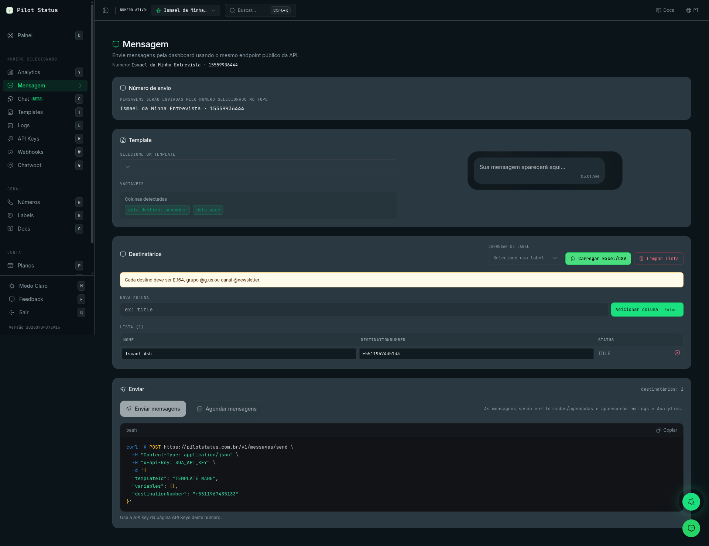

# Guía para enviar mensajes

Esta guía muestra cómo enviar mensajes de WhatsApp mediante la API de Pilot Status. Todos los envíos pasan por un **único endpoint**:

```text
POST https://pilotstatus.com.br/v1/messages/send
```

La autenticación usa el header `x-api-key: ps_...` (o `x-api-key-id`) con una key **limitada a un número**; consulta [Autenticación de la API](/es/api/authentication). No hay autenticación con Bearer token.

<Frame caption="También puedes enviar desde la página Message del panel: llama al mismo endpoint POST /v1/messages/send y muestra un curl listo para copiar.">
  
</Frame>

El endpoint tiene tres modos mutuamente excluyentes: **envío de plantilla** (`templateId`), **texto libre** (`text`) y **multimedia directa** (`media` \+ `mediaType`). Referencia completa: [POST /v1/messages/send](/es/api/messages/send).

## Requisitos previos

1. Un número de WhatsApp conectado (panel `/numbers`).
2. Una API key para ese número (panel `/api-keys`).
3. Para envíos de plantilla: una plantilla creada en `/templates` (los números de Meta requieren aprobación de Meta).

## 1. Enviar un mensaje de plantilla

El modo más confiable: funciona en cualquier momento, incluso fuera de la ventana de 24 h en números de Meta.

<CodeGroup>

```bash cURL
curl -X POST "https://pilotstatus.com.br/v1/messages/send" \
  -H "Content-Type: application/json" \
  -H "x-api-key: ps_your_key_here" \
  -d '{
    "templateId": "onboarding-test",
    "destinationNumber": "+5511999999999",
    "variables": { "name": "John", "order_id": "123" }
  }'
```

```javascript Node.js (fetch)
const res = await fetch("https://pilotstatus.com.br/v1/messages/send", {
  method: "POST",
  headers: {
    "Content-Type": "application/json",
    "x-api-key": process.env.PILOT_STATUS_API_KEY, // ps_...
  },
  body: JSON.stringify({
    templateId: "onboarding-test",
    destinationNumber: "+5511999999999",
    variables: { name: "John", order_id: "123" },
  }),
});

const data = await res.json(); // 202 => { id, correlationId, status: "QUEUED", ... }
console.log(data.id); // guarda este valor para rastrear la entrega
```

</CodeGroup>

## 2. Enviar texto libre

Envía texto simple con el campo `text` (sin `templateId`).

<Warning>
  En números de **Meta**, los mensajes de formato libre solo funcionan dentro de la **ventana de conversación de 24 h** de WhatsApp (es decir, después de que el destinatario te haya escrito en las últimas 24 horas). Fuera de la ventana, el envío falla de forma asíncrona con `META_OUTSIDE_24H_WINDOW` en el webhook `message.failed`; usa una plantilla aprobada en su lugar. Verifica si la ventana está abierta antes de enviar con [`GET /v1/service-window`](/es/playground/messages/service-window).
</Warning>

<CodeGroup>

```bash cURL
curl -X POST "https://pilotstatus.com.br/v1/messages/send" \
  -H "Content-Type: application/json" \
  -H "x-api-key: ps_your_key_here" \
  -d '{
    "text": "Hi! Your delivery has been confirmed for tomorrow.",
    "destinationNumber": "+5511999999999"
  }'
```

```javascript Node.js (fetch)
await fetch("https://pilotstatus.com.br/v1/messages/send", {
  method: "POST",
  headers: {
    "Content-Type": "application/json",
    "x-api-key": process.env.PILOT_STATUS_API_KEY,
  },
  body: JSON.stringify({
    text: "Hi! Your delivery has been confirmed for tomorrow.",
    destinationNumber: "+5511999999999",
  }),
});
```

</CodeGroup>

Puedes agregar hasta 3 `buttons` (y, con botones, un `header`/`footer`) a los mensajes de formato libre; consulta la [referencia de envío](/es/api/messages/send).

## 3. Enviar multimedia directa

Envía una imagen, video, documento o audio por sí solo: proporciona `media` \+ `mediaType`, sin `templateId` y sin `text`. Se admite un `caption` opcional para imagen/video/documento (no para audio ni voz). Usa `mediaType: "voice"` para una nota de voz de WhatsApp (PTT) en cualquier número; `mediaType: "audio"` llega como archivo de audio en números oficiales (Meta Cloud API) y como nota de voz en números no oficiales; consulta [Audio y notas de voz](/es/guides/media-messages#audio-y-notas-de-voz).

<CodeGroup>

```bash cURL
curl -X POST "https://pilotstatus.com.br/v1/messages/send" \
  -H "Content-Type: application/json" \
  -H "x-api-key: ps_your_key_here" \
  -d '{
    "destinationNumber": "+5511999999999",
    "media": "https://cdn.example.com/voice.ogg",
    "mediaType": "voice"
  }'
```

```javascript Node.js (fetch)
await fetch("https://pilotstatus.com.br/v1/messages/send", {
  method: "POST",
  headers: {
    "Content-Type": "application/json",
    "x-api-key": process.env.PILOT_STATUS_API_KEY,
  },
  body: JSON.stringify({
    destinationNumber: "+5511999999999",
    media: "https://cdn.example.com/report.pdf",
    mediaType: "document",
    caption: "Your monthly report",
  }),
});
```

</CodeGroup>

<Note>
  Se aceptan data URIs en Base64 en Meta Cloud API y en números **no oficiales (conexión por código QR)**. En números no oficiales, Pilot Status sube el archivo decodificado a su propio almacenamiento y le envía al proveedor una URL; si esa subida falla, el mensaje falla con `MEDIA_REHOST_FAILED`. Para stickers en números no oficiales, usa una URL pública http(s). Base64 admite hasta 50 MiB decodificados para un `document` y 16 MiB para todos los demás tipos; envía los archivos más grandes por URL.
</Note>

## 4. Rastrear la entrega

La respuesta `202` devuelve un `id`. Guárdalo y:

- Consulta [`GET /v1/messages/{id}`](/es/api/messages/status) para ver `QUEUED` → `SENT` → `DELIVERED` → `READ` → `PLAYED` (o `FAILED` / `CANCELED`), o
- Consume webhooks: el `id` de la respuesta coincide con el campo `id` de los eventos `message.sent`, `message.delivered`, `message.read` y `message.failed`.

## Próximos pasos

- Referencia completa de campos y códigos de error: [POST /v1/messages/send](/es/api/messages/send)
- Programación con `deliverAt` y cancelación: [DELETE /v1/messages/cancel](/es/api/messages/cancel)
- Diagnóstico de fallas: [Códigos de error del log](/es/api/messages/log-error-codes)
