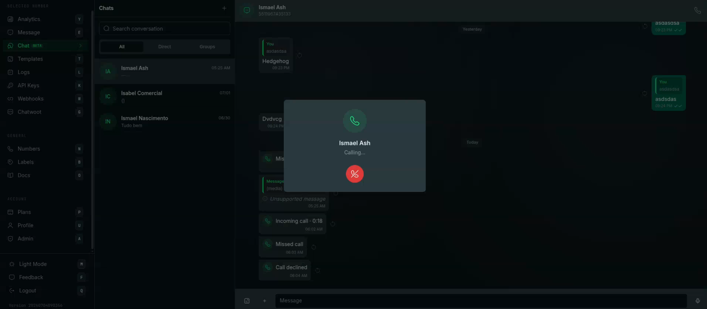

WhatsApp Business Calling te permite hacer y recibir **llamadas de voz** con tus clientes por WhatsApp. Pilot Status se encarga de la señalización; cómo fluye el audio depende del tipo de número que uses.

<Note>
  Las llamadas funcionan en **dos tipos de proveedor**:

  - **Números de Meta Cloud API**: números oficiales de WhatsApp Business Platform. Los medios fluyen por **WebRTC** (navegador ↔ WhatsApp), así que intercambias ofertas/respuestas **SDP**.
  - **Números de la API no oficial** (conexión por código QR): los medios se manejan **en el servidor**. **No se intercambia SDP**; en su lugar, controlas el audio mediante los endpoints `/play` y `/realtime-session`.

  Cualquier otro tipo de número devuelve `400 FEATURE_NOT_SUPPORTED`. Un número web que no está conectado devuelve `409 WHATSAPP_INSTANCE_NOT_CONNECTED`.
</Note>

## Los dos tipos de llamada

| Tipo | Quién la inicia | Facturación |
| --- | --- | --- |
| **BIC**: Business-Initiated Call (llamada iniciada por la empresa) | Tú llamas al cliente | En números de **Meta**: la factura **Meta directamente en tu WABA** (por minuto, pulsos de 6 segundos, solo cuando se atiende). En números **web**: **sin cobro por minuto de Meta**. |
| **UIC**: User-Initiated Call (llamada iniciada por el usuario) | El cliente te llama | **Gratis** en ambos. |

Pilot Status **no cobra** nada por las llamadas. En números de Meta, los minutos se miden en **pulsos de 6 segundos** (las fracciones se redondean hacia arriba a un pulso completo) y se cobran según el país de destino y el nivel de volumen mensual: consulta los [precios oficiales de llamadas de Meta](https://developers.facebook.com/documentation/business-messaging/whatsapp/calling/pricing) y los [detalles de facturación](/es/api/calls/overview#precios-de-meta-para-llamadas-iniciadas-por-la-empresa-números-oficiales).

## Lo que comparten ambos proveedores

Sin importar el proveedor, estos endpoints funcionan igual:

- `POST /v1/calls`: hacer una llamada iniciada por la empresa
- `GET /v1/calls`: listar llamadas
- `GET /v1/calls/{callId}`: obtener una llamada
- `POST /v1/calls/{callId}/accept`: atender una llamada entrante
- `POST /v1/calls/{callId}/reject`: rechazar
- `POST /v1/calls/{callId}/terminate`: colgar

Y los mismos webhooks se disparan en ambos: `call.ringing`, `call.connected`, `call.ended` (incluye `duration` en segundos cuando se atendió), `call.missed` y `call.permission_updated`.

La diferencia es **cómo se negocian los medios** (SDP en Meta frente a servidor en web) y algunos endpoints específicos de cada proveedor que se describen abajo.

## El camino más fácil: el softphone del panel

La página **/chat** del panel tiene un **softphone** integrado que funciona en **ambos tipos de número**: atiende, haz, rechaza y cuelga llamadas de WhatsApp sin nada de código. En números de Meta usa WebRTC del navegador; en números de la API no oficial (conexión por código QR) el audio se maneja en el servidor. Es la forma más rápida de probar las llamadas. Usa la API de abajo cuando quieras construir tu propia experiencia de llamadas.

<Frame caption="El softphone integrado en /chat: haz, atiende y cuelga llamadas de WhatsApp; los eventos de llamada (entrante, perdida, rechazada) aparecen en el hilo de la conversación.">
  
</Frame>

---

## Números de Meta Cloud API

### Requisitos

1. Un número de **Meta Cloud API** conectado.
2. Llamadas **activadas** en el número: `PUT /v1/calls/settings` con `{ "status": "ENABLED" }`. Los números con un nivel de mensajería inferior a **2,000/día no pueden activar las llamadas** (error de Meta `138015`).
3. Para llamadas iniciadas por la empresa, un **permiso de llamada** válido del usuario (ver abajo).
4. Un método de pago asociado a tu WABA: Meta factura los minutos de las llamadas iniciadas por la empresa; sin uno, la llamada falla con el error de Meta 131044 (`META_CALLING_PAYMENT_REQUIRED`).

<Note>
  `GET`/`PUT /v1/calls/settings`, `GET /v1/calls/permissions`, `POST /v1/calls/permissions/request` y `POST /v1/calls/{callId}/pre-accept` son **solo de Meta**. En un número web devuelven `400 FEATURE_NOT_SUPPORTED`.
</Note>

### Paso 1: obtén permiso para llamar (solo BIC)

Solo puedes iniciar una llamada iniciada por la empresa después de que el usuario otorgue un **permiso de llamada**. Solicítalo dentro de la ventana de atención al cliente de 24 horas:

```bash
curl -X POST https://pilotstatus.com.br/v1/calls/permissions/request \
  -H "Content-Type: application/json" \
  -H "x-api-key: ps_your_token_here" \
  -d '{ "to": "+5511999999999", "text": "Can we call you about your order?" }'
```

La respuesta del usuario llega como un webhook `call.permission_updated`. Consulta el permiso actual en cualquier momento:

```bash
curl "https://pilotstatus.com.br/v1/calls/permissions?to=+5511999999999" \
  -H "x-api-key: ps_your_token_here"
```

Devuelve `no_permission`, `temporary` o `permanent` más los límites por acción. Sin permiso, `POST /v1/calls` devuelve `META_CALL_PERMISSION_REQUIRED`.

### Paso 2: haz una llamada (BIC)

Tu cliente WebRTC produce una oferta SDP; pásala a Pilot Status, que la retransmite a WhatsApp. Luego el audio fluye directamente navegador ↔ WhatsApp.

```bash
curl -X POST https://pilotstatus.com.br/v1/calls \
  -H "Content-Type: application/json" \
  -H "x-api-key: ps_your_token_here" \
  -d '{ "to": "+5511999999999", "sdp": "<RFC 8866 SDP offer>", "sdpType": "offer" }'
```

```json
HTTP 201
{ "id": "call_abc", "externalCallId": "wacid.HBg...", "status": "RINGING" }
```

### Paso 3: recibe una llamada (UIC)

Cuando un cliente te llama, se dispara un webhook `call.ringing`. Atiende con tu respuesta SDP:

```bash
curl -X POST https://pilotstatus.com.br/v1/calls/call_abc/accept \
  -H "Content-Type: application/json" \
  -H "x-api-key: ps_your_token_here" \
  -d '{ "sdp": "<RFC 8866 SDP answer>" }'
```

- `POST /v1/calls/{callId}/pre-accept`: respuesta anticipada opcional que reduce los cortes de audio; la llamada igual solo se conecta con `accept`.
- `POST /v1/calls/{callId}/reject`: rechazar (sin cuerpo).
- `POST /v1/calls/{callId}/terminate`: colgar una llamada activa (sin cuerpo).

---

## Números de la API no oficial (conexión por código QR)

Los números web se conectan con código QR y manejan los medios **en el servidor**: no hay SDP, ni cliente WebRTC, ni **ninguna superficie de permisos o configuración**. Haces y atiendes llamadas, y luego controlas el audio con dos endpoints exclusivos de web.

<Warning>
  En números web, **no envíes un `sdp`** a `POST /v1/calls` ni a `/accept`: los campos `sdpOffer` / `sdpAnswer` quedan en `null`. Llamar a `pre-accept`, a los endpoints de `settings` o a los de `permissions` devuelve `400 FEATURE_NOT_SUPPORTED`.
</Warning>

### Haz o atiende una llamada

No se requiere solicitud de permiso ni activar ninguna configuración. Solo haz la llamada:

```bash
curl -X POST https://pilotstatus.com.br/v1/calls \
  -H "Content-Type: application/json" \
  -H "x-api-key: ps_your_token_here" \
  -d '{ "to": "+5511999999999" }'
```

Atiende una llamada entrante sin cuerpo:

```bash
curl -X POST https://pilotstatus.com.br/v1/calls/call_abc/accept \
  -H "x-api-key: ps_your_token_here"
```

Luego rechaza o termina con los mismos endpoints que en Meta (sin cuerpo).

### Controla el audio (solo web)

Una vez conectada la llamada, usa estos para controlar el flujo de audio:

<CodeGroup>

```bash Enviar un archivo de audio
# El backend descarga tu archivo de audio y lo reproduce en la llamada
curl -X POST https://pilotstatus.com.br/v1/calls/call_abc/play \
  -H "Content-Type: application/json" \
  -H "x-api-key: ps_your_token_here" \
  -d '{ "url": "https://example.com/greeting.ogg" }'
```

```bash Abrir una sesión PCM16 en tiempo real
# Devuelve un wsUrl de un solo uso (host público de medios dedicado, TTL de ~2 min)
curl -X POST https://pilotstatus.com.br/v1/calls/call_abc/realtime-session \
  -H "x-api-key: ps_your_token_here"
```

</CodeGroup>

- **`/play`**: el backend descarga tu archivo de audio (a través de una protección contra SSRF) y lo reproduce en la llamada en curso. Ideal para saludos, mensajes de IVR o mensajes pregrabados.
- **`/realtime-session`**: abre un **WebSocket PCM16 full-duplex** para audio en tiempo real (por ejemplo, un agente de voz con IA). El `wsUrl` devuelto vive en un host público de medios dedicado, usa un **token de un solo uso** con un **TTL de ~2 minutos**, y te conectas a él **directamente**: no pasa por proxy y la capa HTTP no hace el upgrade del WebSocket.

---

## Sigue el progreso de la llamada con webhooks

Suscríbete a estos eventos en tu webhook; se disparan tanto en números de Meta **como** en números web: `call.ringing`, `call.connected`, `call.ended` (incluye `duration` en segundos cuando se atendió), `call.missed` y `call.permission_updated`. En números de Meta, también se entrega el sobre nativo `calls` para señalización WebRTC personalizada.

## Próximos pasos

<CardGroup cols={2}>
  <Card title="Referencia de la API de llamadas" icon="phone" href="/es/api/calls/endpoints">
    Cada endpoint de /v1/calls, sus parámetros y configuraciones.
  </Card>

  <Card title="Descripción general de las llamadas" icon="circle-info" href="/es/api/calls/overview">
    Modelo de señalización, detalles de facturación y límites.
  </Card>
</CardGroup>
