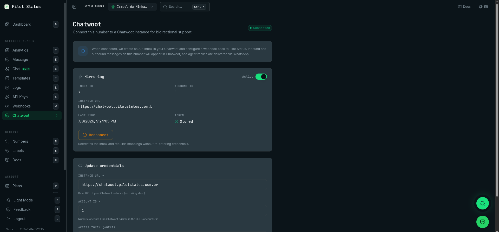

Pilot Status tiene una integración nativa con Chatwoot: conecta cualquier número de WhatsApp a una cuenta de Chatwoot y las conversaciones se sincronizan **en ambos sentidos**: los mensajes entrantes de WhatsApp aparecen en Chatwoot, y las respuestas de los agentes en Chatwoot se entregan en WhatsApp.

<Frame caption="La página de Chatwoot: estado de la conexión, interruptor de espejado, IDs de bandeja/cuenta, reconectar y actualizar credenciales.">
  
</Frame>

## Requisito previo: `FRONTEND_URL` (Chatwoot autoalojado)

Si usas un Chatwoot **autoalojado**, su variable de entorno `FRONTEND_URL` **debe** estar definida antes de conectar:

```env
FRONTEND_URL=https://chatwoot.your-domain.com
```

- Usa la URL **pública** exacta (el mismo esquema/host que el navegador), **sin barra final**, accesible desde internet: nunca `localhost` ni una IP interna.
- Reinicia **ambos** contenedores, web y sidekiq, después (Rails deriva `default_url_options[:host]` de ella al arrancar).

<Warning>
  Sin `FRONTEND_URL`, Chatwoot no puede construir URLs absolutas de adjuntos ni webhooks salientes válidos. Síntomas en Pilot Status: mensajes marcados como **"Failed to send"**, media que nunca se entrega y `ArgumentError: Missing host to link to!` en los logs de Chatwoot/sidekiq.
</Warning>

Para validar: envía un mensaje con un adjunto en una conversación de prueba. No debe aparecer `Missing host to link to!` en los logs, el mensaje debe mostrarse como enviado en Pilot Status y la media debe llegar a WhatsApp.

## Configura la integración

La integración se configura **por número** en la página **Chatwoot** del dashboard de Pilot Status.

<Steps>
  <Step title="Reúne tres credenciales de Chatwoot">
    - **Instance URL**: la URL base de tu Chatwoot (por ejemplo, `https://chatwoot.your-domain.com` o `https://app.chatwoot.com`).
    - **Account ID**: el número que aparece en tu URL de Chatwoot después de `/app/accounts/`.
    - **User Access Token**: en la configuración de tu perfil de Chatwoot.
  </Step>
  <Step title="Conecta en Pilot Status">
    Abre la página **Chatwoot** en el dashboard, selecciona el número de WhatsApp y pega los tres valores. Pilot Status **crea automáticamente la bandeja y el webhook** en tu cuenta de Chatwoot: nunca pegas una URL de webhook manualmente. Los números no oficiales (web/QR) reciben una **bandeja API** (espejo de mensajes); los **números oficiales de Meta Cloud** reciben una **bandeja nativa `whatsapp_cloud`** (consulta el requisito previo más abajo).
  </Step>
  <Step title="Conversa">
    Los mensajes entrantes de WhatsApp (incluida la media) abren conversaciones en la nueva bandeja; las respuestas de los agentes vuelven a WhatsApp. El historial de mensajes y el estado de entrega se mantienen sincronizados.
  </Step>
</Steps>

<Warning>
  **Los números oficiales (Meta Cloud API) requieren `WHATSAPP_CLOUD_BASE_URL`.** Para un número oficial, Pilot Status crea una **bandeja nativa `whatsapp_cloud`** (precargada con el phone number ID, el WABA ID y tu key `ps_`) para que Chatwoot hable con Meta a través de la capa de Pilot Status. La variable global `WHATSAPP_CLOUD_BASE_URL` de tu Chatwoot **autoalojado** debe apuntar a la capa Meta de Pilot Status **antes** de conectar:

  ```env
  WHATSAPP_CLOUD_BASE_URL=https://pilotstatus.com.br/api/layer/meta
  ```

  Si se deja el valor por defecto (`graph.facebook.com`), Chatwoot valida tu key `ps_` directamente contra Meta y la conexión falla con **"invalid credentials" / un 422** (_"Chatwoot rejected the WhatsApp Cloud channel"_). Esta variable es **global** en Chatwoot: si el mismo servidor también tiene bandejas de Meta Cloud **directas** (cada una con su propio token de Meta), apuntarla a Pilot Status las rompe; usa una instancia de Chatwoot **dedicada** para los números de Pilot Status. En concreto, una bandeja redirigida cuya **API key de canal es un token crudo de Meta** (no una key `ps_`) falla **en silencio al enviar**: la capa la rechaza con un 401 y Chatwoot deja la respuesta atascada con un ícono de reloj y sin entrega. Toda bandeja `whatsapp_cloud` enrutada por la capa debe usar la **key `ps_`** del número como API key de canal. Chatwoot Cloud (`app.chatwoot.com`) no puede definir esta variable y no es compatible con números oficiales. Configuración completa: [Llamadas de voz en Chatwoot → Paso 1](/es/integrations/chatwoot-voice).
</Warning>

## Modo de canal: espejo API vs Cloud nativo

Cada número se conecta en uno de dos modos. Elígelo en el selector **Channel mode** (Modo de canal) de la página de Chatwoot (por defecto **Automatic**):

- **Espejo API (Modelo A)**: Pilot Status replica mensajes y media en una **bandeja API** de Chatwoot. Solo chat (sin voz nativa). **No** depende de `WHATSAPP_CLOUD_BASE_URL`, así que funciona en un Chatwoot **compartido**.
- **WhatsApp Cloud nativo (Modelo B)**: Chatwoot habla con Meta directamente a través de la capa de Pilot Status usando una bandeja nativa `whatsapp_cloud`. Habilita **voz/llamadas nativas** y mensajería nativa (sin espejo). Requiere un Chatwoot **dedicado** con `WHATSAPP_CLOUD_BASE_URL` apuntando a la capa (consulta la advertencia de arriba).
- **Automatic** (por defecto): números oficiales → nativo; números no oficiales → espejo.

Ambos modos entregan texto y media (imagen, audio, video, documento). Elige respondiendo tres preguntas: ¿el número es oficial o no oficial?, ¿el Chatwoot es compartido o dedicado?, y ¿necesitas voz nativa?

| Si tú… | Elige | Por qué |
| --- | --- | --- |
| Conectas en un Chatwoot **compartido** que ya tiene otros números de Meta **directos** | **Espejo API (A)** | El nativo cambia una configuración **global** de Chatwoot y rompe esos números (la capa solo acepta una key `ps_`). |
| Usas un número **no oficial** (web/QR) | **Espejo API (A)** | Los mensajes no oficiales solo fluyen por el espejo; el nativo aquí solo serviría para voz (y aun así requiere un Chatwoot dedicado). |
| Tienes un Chatwoot **dedicado** \+ número **oficial** \+ necesitas **voz/llamadas nativas** | **Cloud nativo (B)** | Es el único modo con llamadas nativas; la mensajería funciona de forma nativa (sin espejo = menos piezas móviles). |
| Tienes un Chatwoot **dedicado** \+ número oficial, **solo chat** | Cualquiera: **Automatic** elige nativo | Quédate en el espejo si el número podría pasar más adelante a un Chatwoot compartido (evitas retrabajo). |
| Quieres la **menor fricción**, sin restricciones de instancia | **Automatic** | Resuelve bien el caso común: oficial → nativo, no oficial → espejo. |

<Warning>
  **Cambiar de modo = reconectar.** Cuando el cambio modifica el tipo de bandeja (espejo API ↔ WhatsApp Cloud nativo), Chatwoot recibe una **bandeja nueva** y la anterior deja de recibir mensajes. Los mapeos de conversación se reinician, así que los mensajes nuevos abren conversaciones nuevas; las conversaciones abiertas no migran y el historial no se copia por sí solo (usa [Enviar historial a Chatwoot](#enviar-historial-a-chatwoot)). Un cambio que mantiene el mismo tipo de bandeja conserva la actual. El mismo reinicio de mapeos ocurre cada vez que una reconexión o una actualización de credenciales tiene que recrear la bandeja (por ejemplo, si se eliminó en Chatwoot). Si puedes, elige el modo antes de conectar.
</Warning>

## Enviar una plantilla desde Chatwoot

En una bandeja de **espejo API (Modelo A)**, la respuesta de un agente sale como una plantilla aprobada (la forma de reabrir una conversación en un número oficial fuera de la ventana de 24 horas de Meta) cuando la pide de cualquiera de estas dos formas:

- **El comando `/template`.** Escribe `/template <name> [value1, value2, ...]` en el compositor: los valores separados por comas llenan `{{1}}`, `{{2}}`, … de la plantilla en orden. Un argumento escrito como `button_<N>=value` llena en cambio una variable de botón (un placeholder numerado de URL o, en un número oficial, el código de un botón de copiar código), donde `N` es la posición del botón en la lista de botones de la plantilla, empezando en 1, y todos los botones cuentan (consulta [Plantillas](/es/api/templates#marcadores-de-botón-en-plantillas-creadas-en-meta)):

  ```text
  /template link_pagamento_pix Maria, R$ 10, 21/09/2026, button_1=SdjLn
  ```

  Un argumento `button_<N>=` no consume un número posicional: `Ana, button_2=SdjLn, 50` llena `{"1": "Ana", "2": "50", "button_2": "SdjLn"}`. Los valores no pueden contener comas: `R$ 10,00` se convertiría en dos valores (`R$ 10` y `00`). Cualquier otro texto `key=value` sigue siendo un valor posicional simple.
- **Los parámetros de plantilla nativos de Chatwoot.** Las plantillas enviadas con los `template_params` propios de Chatwoot se respetan, incluido el formato estructurado que construye su selector de plantillas de WhatsApp (`processed_params` con `body` y `buttons`): los parámetros del cuerpo llenan las variables de la plantilla, y los parámetros de botón (URL y copiar código) se mapean por posición a `button_<N>`.

## Los envíos de Flows llegan como nota privada

Un [WhatsApp Flow](/es/concepts/flows) enviado trae sus respuestas en `interactive.nfm_reply`, y **ningún modo de canal las muestra en la burbuja**:

- **Espejo API (Modelo A)**: Pilot Status está en el camino, así que corrige ambas mitades: la burbuja pública se reemplaza por una línea fija corta (**`📋 Formulário respondido`**) en lugar de la etiqueta de Meta, y las respuestas se publican como una **nota privada** en la misma conversación, una línea `field: value` por respuesta. Los agentes las leen en el mismo hilo; el cliente nunca ve la nota.
- **Cloud nativo (Modelo B)**: Chatwoot lee el webhook de Meta por sí mismo y no tiene parser para `nfm_reply`, así que el mensaje llega con **`content: null`**. Es una limitación de Chatwoot; ninguna configuración de aquí cambia lo que entiende su parser. Pilot Status **no** replica estas conversaciones (hacerlo duplicaría cada mensaje), así que en este modo no hay nota privada ni nada que podamos agregar al hilo.

<Note>
  **El Modelo B tiene una forma de leer las respuestas, y el Modelo A tiene una mejor que la nota:** suscríbete al evento de webhook `flow.response_received`. La nota es una comodidad para humanos y limita cada valor a 500 caracteres; el evento trae el envío completo, ya parseado. Consulta [Recibir respuestas de Flows](/es/guides/flow-responses).
</Note>

<Note>
  Una nota que no se logra publicar no se reintenta: la burbuja y la respuesta guardada ya están ahí, y volver a ejecutar el espejo le mostraría al agente el mismo formulario dos veces. El evento es la copia que sí se reintenta.
</Note>

## Lo que ven los agentes en Chatwoot

- **Una respuesta que Pilot Status rechaza se marca como fallida, con el motivo.** Cuando una respuesta escrita en Chatwoot no puede enviarse (WhatsApp está rechazando envíos desde el número, la facturación está suspendida, la ventana de 24 h está cerrada en un número oficial, el nombre de `/template` no existe, el adjunto no tiene URL pública), el mensaje se marca como fallido en Chatwoot con el motivo en la burbuja, y una nota privada en la conversación explica por qué. No se reintenta. El mismo fallo aparece en los Logs del número, con su [código de error](/es/api/messages/log-error-codes#respuestas-de-agentes-en-chatwoot).
- **Cloud nativo (Modelo B): las respuestas de los agentes aparecen en Logs.** Chatwoot envía la respuesta de una bandeja nativa a Meta por sí mismo, a través de la capa de Pilot Status. Pilot Status la registra como un mensaje saliente con `origin: "CHATWOOT"` en **Logs**, [`GET /v1/messages`](/es/api/messages/list) y [`GET /v1/messages/history`](/es/api/messages/history), y actualiza su estado a medida que Meta informa entregas y lecturas. No tiene detalle de envío y no cuenta para el uso de mensajes de tu plan. Detalles: [Capa Meta → Los envíos se registran en Logs](/es/api/layer/meta#los-envíos-quedan-registrados-en-logs).
- **Cloud nativo (Modelo B): los mensajes enviados por la API de Pilot Status caen en la conversación abierta del contacto.** Chatwoot abre una conversación nueva para el contacto cada vez que se resuelve la anterior; un mensaje de la API la sigue. Si no hay conversación abierta, Pilot Status abre una, y la respuesta del cliente se une a ella.
- **Cloud nativo (Modelo B): "This message is unsupported. You can view this message on the WhatsApp app."** En números de coexistencia, WhatsApp a veces entrega un placeholder (error `131060`, "This message is unavailable") antes del mensaje real, con el mismo id de mensaje; lo más común es en el primer mensaje de un contacto nuevo, o después de un largo silencio. Chatwoot conserva el primero que recibe, así que Pilot Status retiene el placeholder unos segundos y lo descarta cuando llega el mensaje real. Cuando WhatsApp nunca entrega el contenido a la API, el placeholder se entrega tal cual: el mensaje existe solo en la app de WhatsApp, y la burbuja es tu señal para revisarlo allí.
- **Espejo API (Modelo A): media que aún no está disponible.** El espejo espera hasta 20 segundos a que se guarde un archivo recibido y luego publica la burbuja con el adjunto. Si sigue sin estar disponible, la burbuja dice `[mídia]` seguido de un enlace, y el enlace abre el archivo una vez guardado. Un archivo que llega sin nombre recibe el nombre de su tipo y el id del mensaje, por ejemplo `imagem-3EB03F18.jpg`.

## Enviar historial a Chatwoot

Los números de Meta en **coexistencia** (una WhatsApp Business App migrada a la plataforma mediante Embedded Signup) importan ~30 días de historial de chat al conectarse. Ese historial aparece en la vista **/chat** del dashboard, pero **no** se replica en Chatwoot automáticamente. En la página de Chatwoot, el botón **Sync history to Chatwoot** (Sincronizar historial con Chatwoot) reproduce ese historial ya guardado en la bandeja conectada.

- **Ambos modos de canal (números de coexistencia).** Funciona tanto si Chatwoot está conectado como **espejo API (Modelo A)** como si es una **bandeja nativa `whatsapp_cloud` (Modelo B)**. La reproducción **nativa** es **solo entrante** (se reproduce el historial entrante del cliente; las respuestas salientes del propio negocio no se reinyectan, ya que de todos modos nunca aparecieron en la bandeja nativa) y conviene ejecutarla en una ventana de mantenimiento, porque puede notificar brevemente a los agentes mientras se (re)crean las conversaciones.
- **Orden preservado, fecha en el cuerpo.** Los mensajes se publican del más antiguo al más reciente. Como Chatwoot marca cada mensaje publicado con la hora de importación (no acepta un timestamp con fecha anterior), la **fecha/hora original** se antepone al cuerpo de cada mensaje, `[dd/mm/yyyy hh:mm]`, en la zona horaria del tenant.
- **Idempotente.** Volver a hacer clic es seguro: solo vuelve a publicar los mensajes que nunca llegaron.
- **Al terminar (modo espejo API)**, las conversaciones afectadas se marcan como leídas y resueltas para que los agentes no se inunden de notificaciones. El modo nativo no puede marcar como leído automáticamente: ejecútalo en una ventana de mantenimiento.
- **La media antigua** cuya referencia en Meta ya expiró puede importarse como un placeholder `[mídia]` (los bytes de la media se guardan en el almacenamiento al momento de la importación, así que la media reciente sobrevive).

Mediante la API pública / MCP: `POST /v1/chatwoot/history-sync` para iniciar, `GET` en la misma ruta para el progreso y `DELETE` para cancelar, con la key del número, o una key de workspace más el header `x-whatsapp-number-id` (consulta el [playground](/es/playground/chatwoot/start-chatwoot-history-sync)), o las herramientas MCP `chatwoot_history_replay` (iniciar), `chatwoot_history_replay_get` (progreso) y `chatwoot_history_replay_cancel`. El body acepta `windowDays` (`30` o `90`; cualquier otro valor significa `30`) y `markRead` (por defecto `true`); con un body **vacío**, la API usa los valores por defecto (últimos 30 días, conversaciones marcadas como leídas). Una ejecución que ya está `QUEUED` o `RUNNING` responde `409 ALREADY_RUNNING`; `DELETE` cierra de inmediato una ejecución que aún no empezó (`code: "CANCELED"`), así que el siguiente `POST` se acepta, y le pide a una en curso que se detenga (`code: "CANCELING"`); un número que no es de coexistencia de Meta, no tiene una bandeja de Chatwoot conectada o no guarda contenido (`RELAY_ONLY`) responde `422`. Un body que **no es JSON válido** (por ejemplo, un `{"windowDays": 90` truncado) devuelve `400 INVALID_BODY` y no se inicia ninguna reproducción; ya no se ejecuta en silencio con el valor por defecto de 30 días. Consulta [Body JSON mal formado](/es/api/overview#cuerpo-json-mal-formado).

## Pausar o desconectar

En la misma página de Chatwoot puedes **pausar** la sincronización por número (un interruptor: no se borra nada; vuelve a activarlo para reanudar) o **desconectar** la integración por completo.

## Llamadas de voz

Las llamadas de voz y la bandeja de mensajería de arriba son **superficies separadas**: los eventos de llamadas de WhatsApp **no** se publican en las conversaciones replicadas. Hay dos formas de trabajar con llamadas:

- **Atender llamadas en el panel de Pilot Status (disponible, sin configuración).** La página **/chat** del dashboard tiene un **softphone** integrado que contesta y realiza llamadas de voz de WhatsApp para **ambos** tipos de conexión: números **oficiales (Meta Cloud API)** por WebRTC y números **no oficiales (conexión por código QR)** mediante una sesión de audio del lado del servidor. Es la forma más rápida de atender llamadas justo al lado de tus conversaciones. Consulta [Llamadas de voz](/es/api/calls/overview).
- **Contestar llamadas de forma nativa dentro de Chatwoot (avanzado, autoalojado).** Chatwoot **v4.15\+** incluye un canal de voz nativo que puede enrutarse a través de Pilot Status para **números de la Meta Cloud API**: los agentes ven un banner de llamada entrante en la bandeja de Chatwoot y hablan por WebRTC, mientras tu token de Meta se queda en Pilot Status. Guía completa validada: [**Llamadas de voz en Chatwoot**](/es/integrations/chatwoot-voice). Chatwoot Cloud (`app.chatwoot.com`) y los números no oficiales **no** son compatibles con esta vía.

## Relacionado

- [Llamadas de voz en Chatwoot](/es/integrations/chatwoot-voice): atiende llamadas de WhatsApp dentro de Chatwoot mediante la capa Meta de Pilot Status.
- [Dashboard de Live Chat](/es/dashboard/live-chat)
- [Retención de datos y modos PII](/es/trust/data-retention): el relay de Chatwoot sigue funcionando incluso en modo `RELAY_ONLY`.
