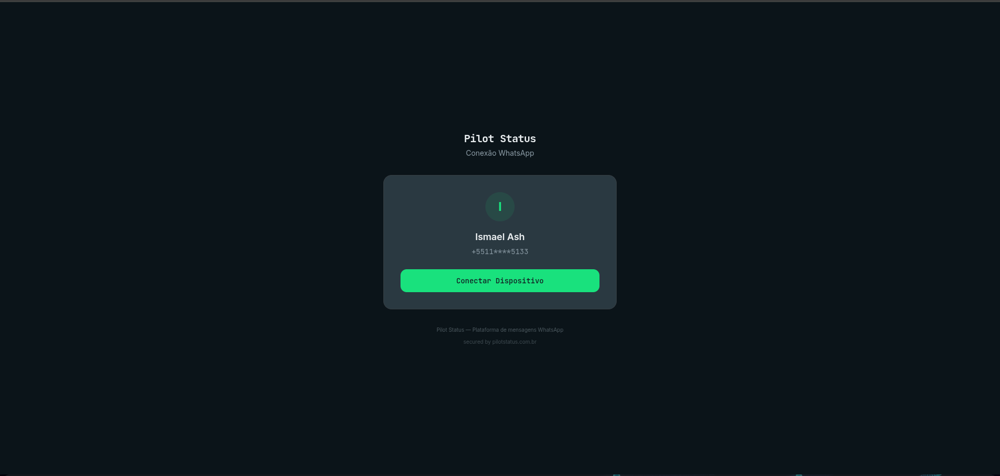

Incrusta el **flujo de vinculación de números de WhatsApp (Connect)** (código QR (no oficial) o Meta Embedded Signup (oficial)) en tu propio SaaS, en white-label. Los requisitos compartidos (SDK, key de tenant) están en [Incrusta la bandeja de chat](/es/integrations/embed-chat).

<Frame caption="La página de conexión alojada que ve tu cliente: logo, colores y título personalizables, con un único botón Connect Device.">
  
</Frame>

<Note>
  **Esta página es la referencia**: todas las opciones, ambos proveedores, el protocolo postMessage completo y la tabla completa de `branding.button`. Si estás integrando el onboarding de la Cloud API oficial por primera vez, empieza por el paso a paso: [**Embedded Signup en tu app**](/es/guides/embedded-signup) recorre las cuatro llamadas de principio a fin, con código de backend y frontend listo para copiar y pegar. Vuelve aquí para el detalle de cada campo.
</Note>

<Note>
  Diferencia clave frente a Chat: Connect **no** usa el token de `POST /v1/embed/sessions`. Usa el **token de vinculación remota** generado por `POST /v1/numbers/remote-pairing`, y ese token vive en la **ruta de la URL** del iframe (`/connect/<token>`), no en memoria vía postMessage.
</Note>

## Formato y validez del token

El token que recibes depende de `provider`: **no** son el mismo objeto y **no** comparten la misma validez:

| `provider` | Token | Validez | La respuesta incluye |
| --- | --- | --- | --- |
| `META` (Cloud API / Embedded Signup) | JWT firmado (contiene puntos) | **30 minutos** | `provider`, `remotePairingUrl`, `expiresAt` |
| `PILOT_STATUS` (vinculación por QR, predeterminado) | UUID simple | **24 horas** | `provider`, `instance`, `remotePairingUrl`, `maskedNumber`, `linkedApiKeyId` (siempre `null`), y `warnings` cuando hay algo que informar |

Genera el link de Meta **cuando el usuario esté a punto de hacer clic**, no con horas de anticipación: 30 minutos es corto a propósito. Cuando expira, el iframe emite `connect:expired`; genera uno nuevo.

## Flujo

<Steps>
  <Step title="El backend crea el link de vinculación">
    <CodeGroup>

    ```bash Meta (Embedded Signup)
    curl -X POST "https://pilotstatus.com.br/v1/numbers/remote-pairing" \
      -H "x-api-key: ps_your_tenant_key" \
      -H "Content-Type: application/json" \
      -d '{
        "provider": "META",
        "metaFlow": "embedded",
        "name": "Support",
        "externalRef": "crm-customer-4821",
        "redirectUrl": "https://app.yoursaas.com/whatsapp/done",
        "branding": { "primaryColor": "#1877F2" }
      }'
    ```

    ```bash Pilot Status (QR)
    curl -X POST "https://pilotstatus.com.br/v1/numbers/remote-pairing" \
      -H "x-api-key: ps_your_tenant_key" \
      -H "Content-Type: application/json" \
      -d '{
        "name": "Support",
        "number": "5511999999999",
        "branding": { }
      }'
    ```

    </CodeGroup>

    `201` en ambos casos. `remotePairingUrl` es `https://connect.pilotstatus.com.br/connect/<token>`; el **token** es el último segmento de la ruta. Envía a tu frontend solo el token (o la URL), nunca la key `ps_`.

    Para `provider: "META"`, `name`/`number` no son obligatorios: el usuario final elige el número dentro del diálogo de Facebook. Para `PILOT_STATUS`, ambos son obligatorios.

    **`warnings` en una vinculación por QR.** `externalRef` y `redirectUrl` viajan en la sesión firmada de Meta, y un link de QR no tiene ninguna, así que en `PILOT_STATUS` se aceptan pero no se pueden aplicar. Cada uno que envíes se informa en un arreglo `warnings` (`string[]`) en el `201`, y la vinculación se completa igual; **no** es un `400`. El campo está ausente cuando no hay nada que informar. Léelo en tus pruebas de integración: es la forma de saber que un valor que enviaste fue ignorado en lugar de aplicado.

    ```json
    {
      "provider": "PILOT_STATUS",
      "instance": { "id": "…", "instanceName": "…", "number": "5511999999999", "displayName": "Support", "state": "CLOSE" },
      "remotePairingUrl": "https://connect.pilotstatus.com.br/connect/<token>",
      "maskedNumber": "+5511****9999",
      "linkedApiKeyId": null,
      "warnings": ["redirectUrl is only supported for provider=META and was ignored"]
    }
    ```

    **`linkToApiKey` fue retirado, y `linkedApiKeyId` siempre es `null`.** La opción desapareció de las tres rutas de aprovisionamiento (`POST /v1/numbers`, `POST /v1/numbers/meta`, `POST /v1/numbers/remote-pairing`). Enviarla todavía se acepta, así que quien la tenga hoy en su payload no se rompe, pero no hace nada: no se toca ninguna API key, y `linkedApiKeyId` en el `201` nunca trae un id. Antes reasignaba una key con alcance de número al número recién creado, desvinculándola silenciosamente del número al que realmente estaba asociada.

    <Note>
      El campo de branding por link es `branding` (no `brandingOverride`). `externalRef` (máx. 200 caracteres) es tu propio id de cliente: se firma dentro del token de Meta y se te devuelve en `connect:paired`.
    </Note>
  </Step>
  <Step title="El frontend lo incrusta">
    El SDK construye la URL del iframe a partir del token; solo pasas el token:

    ```html
    <script src="https://pilotstatus.com.br/embed.js"></script>
    <script>
      PilotStatus.init();
      const { token } = await fetch("/api/my-saas/pairing-token").then(r => r.json());
    
      // Modal centrado:
      const h = PilotStatus.connect.open({
        token,
        onPaired: (d) => { save(d.numberId, d.externalRef); h.destroy(); },
        onError: (e) => alert(e.message),
        onExpired: () => { /* genera un link nuevo */ },
      });
    
      // o en línea:
      // PilotStatus.connect.mount("#connect-widget", { token, onPaired, onError, onExpired });
    </script>
    ```

    `ConnectOptions`: `token` (obligatorio), `baseUrl?` (predeterminado `https://connect.pilotstatus.com.br`), `mode?` (`"page"` | `"button"`; omítelo para automático, consulta [Modo botón](#modo-botón)), `onPaired(d)`, `onError(e)`, `onExpired()`.
  </Step>
</Steps>

## Modo botón

El modo botón renderiza **solo el botón de Facebook Embedded Signup**: sin encabezado, sin tarjeta, sin línea de tiempo, con fondo transparente y la altura controlada por el mensaje `resize` existente. Todo lo demás (token, protocolo postMessage, callbacks) es idéntico al modo página.

Úsalo cuando ya tienes tu propia pantalla de onboarding y la tarjeta alojada sería una segunda interfaz compitiendo dentro de ella. Usa el modo página cuando quieras el flujo explicativo completo, o para la vinculación por QR.

### Qué modo renderiza un link

**Un link generado con `branding.button` renderiza el botón por defecto.** Enviar ese objeto es pedir un botón: no hay un segundo flag que recordar, ni forma de estilizar un botón y luego llevarte la sorpresa de una tarjeta. Tres entradas lo deciden, en orden de prioridad:

| Entrada | Renderiza |
| --- | --- |
| `?mode=button` en la URL (o `mode: "button"` en el SDK) | botón, siempre |
| `?mode=page` (o `mode: "page"`) | la página completa: **la exclusión**, incluso para un link generado con `branding.button` |
| ninguna | **automático**: botón cuando el link lleva `branding.button`, la página completa en otro caso |

<Warning>
  **Esto cambió el 2026-08-17.** Un link generado con `branding.button` antes renderizaba la página completa, salvo que el host también agregara `?mode=button`. Si generas con `branding.button` y quieres deliberadamente la página completa (el estilo del token se aplica entonces al botón _dentro_ de la tarjeta), agrega **`?mode=page`** (o pasa `mode: "page"`). Nada más cambia: un link sin branding sigue renderizando la página, y un `?mode=button` explícito sigue renderizando el botón.
</Warning>

`branding.button` solo puede llegar a un link a través del token firmado, así que el modo automático solo puede activarse en un link cuyo propio backend lo pidió: no hay un ajuste a nivel de tenant que pueda cambiar tus otros links, ni un parámetro de consulta que pueda cambiar los de otra persona.

El modo botón también elimina el fondo propio de la página (`html` y `body`). Es una propiedad del modo botón en sí, no de estar dentro de un frame: se mantiene sin importar cómo se cargue la URL. En el embed normal, el efecto es que **tu página host se ve a través del iframe** y el botón queda sobre tu superficie en lugar de sobre un rectángulo sólido suelto. No hay nada que configurar de tu lado.

<CodeGroup>

```js SDK
PilotStatus.connect.mount("#connect-button", {
  token,                 // token de Meta, metaFlow: "embedded"
  mode: "button",
  onPaired: (d) => save(d.numberId, d.externalRef),
  onError: (e) => console.error(e.message),
  onExpired: () => refreshToken(),
});
```

```html Raw iframe
<iframe
  src="https://connect.pilotstatus.com.br/connect/<token>?embed=1&mode=button&parentOrigin=https://app.yoursaas.com"
  sandbox="allow-scripts allow-same-origin allow-forms allow-popups allow-popups-to-escape-sandbox"
  style="width:100%;border:0;display:block"
></iframe>
```

</CodeGroup>

**El modo botón requiere un token de Meta generado con `metaFlow: "embedded"`.** Un token `metaFlow: "credentials"` ignora el modo botón (pedido explícitamente o alcanzado por el modo automático) y vuelve a la página completa: el formulario de credenciales de la Cloud API no cabe en un botón. Los tokens de QR (`PILOT_STATUS`) también renderizan la página completa.

Los estados de carga, error de configuración, token expirado y éxito siguen apareciendo en modo botón, en línea y mínimos, nunca en pantalla completa.

<Warning>
  El iframe **debe** tener sandbox con `allow-popups` **y** `allow-popups-to-escape-sandbox`. La ventana de inicio de sesión de Facebook se abre desde dentro del frame; sin `allow-popups` el navegador la bloquea y **no pasa nada**: ni error, ni callback, ni mensaje en la consola. El SDK configura el sandbox correcto por ti (`allow-scripts allow-same-origin allow-forms allow-popups allow-popups-to-escape-sandbox`); si construyes el iframe a mano, cópialo exactamente.
</Warning>

<Note>
  Facebook valida el origen del **iframe**, no el de tu página principal. Ese es el objetivo de esta integración: el botón corre en `connect.pilotstatus.com.br`, un dominio ya registrado en la app de Meta de Pilot Status, así que nunca registras tu propio dominio (ni el de tu cliente).
</Note>

## Estilo del botón (solo por token)

La apariencia del botón se define **al generar el link**, dentro de `branding.button`, y viaja en el token firmado. Enviarlo también pone el link en [modo botón](#modo-botón) por defecto, así que este único objeto es toda la solicitud: _estiliza un botón y obtén un botón._

```bash
curl -X POST "https://pilotstatus.com.br/v1/numbers/remote-pairing" \
  -H "x-api-key: ps_your_tenant_key" \
  -H "Content-Type: application/json" \
  -d '{
    "provider": "META",
    "metaFlow": "embedded",
    "branding": {
      "primaryColor": "#0F172A",
      "button": {
        "variant": "whatsapp",
        "label": "Connect WhatsApp",
        "icon": "whatsapp",
        "radius": "pill",
        "size": "lg",
        "height": 56,
        "width": 320
      }
    }
  }'
```

Eso genera un link cuya página no es más que un botón verde de WhatsApp con su propio logo, de 56 px de alto y 320 px de ancho. Abre el `remotePairingUrl` devuelto en un navegador para ver exactamente lo que verá tu cliente; la única diferencia es el marcador "secured by", que se muestra cuando la página se abre directamente y se oculta dentro de tu iframe.

| Campo | Valores | Predeterminado |
| --- | --- | --- |
| `variant` | `facebook` \| `whatsapp` \| `dark` \| `light` \| `outline` | `facebook` |
| `label` | texto, recortado, máx. **40** caracteres | `Continuar com o Facebook` (portugués) |
| `primaryColor` | hex `#RRGGBB` | según la variante |
| `textColor` | hex `#RRGGBB` | según la variante |
| `radius` | `sm` \| `md` \| `lg` \| `pill` | `lg` |
| `size` | `sm` \| `md` \| `lg` | `md` |
| `fullWidth` | boolean | `true` |
| `icon` | `facebook` \| `whatsapp` \| `none` | derivado de `variant` |
| `height` | entero en px, **24–200** | lo que implique `size` |
| `width` | entero en px, **64–800** | `fullWidth` / automático |
| `hideProvenance` | boolean | `false` (consulta abajo) |

Todos los campos son opcionales. El `label` integrado es el texto en portugués `Continuar com o Facebook`: define `label` explícitamente para cualquier otro idioma. Mantén el objeto pequeño: viaja dentro del JWT que va en la URL de conexión.

- **`variant: "whatsapp"`** pinta el botón con el verde de WhatsApp (`#25D366`).
- **`icon`** es un glifo de marca en línea (SVG, sin llamada de red) dibujado antes del texto; hereda el color del texto. Si lo omites, sigue a la variante: `facebook` → el glifo de Facebook, `whatsapp` → el glifo de WhatsApp, **cualquier otra variante → ningún glifo**. Envía `icon: "none"` para quitarlo explícitamente.
- **`height`** se aplica como **altura mínima** (el texto nunca se corta) y reemplaza el padding vertical que `size` le habría dado al botón.
- **`width`** **tiene prioridad sobre `fullWidth`**: cuando `width` está presente, `fullWidth` se ignora. Sin `width`, el botón llena su contenedor por defecto; define `fullWidth: false` para reducirlo a su contenido.
- **Valida antes de llamar.** Cada límite de la tabla se aplica al generar el link: un valor fuera del rango o del enum permitido hace que `POST /v1/numbers/remote-pairing` responda `400 Validation error` con un desglose en `details`, y **no se crea nada**: ni token, ni link, ni placeholder. Un `height` de `1000` es una solicitud rechazada, no un botón que se ajusta silenciosamente a la altura implícita de `size`.

<Note>
  La propia página de conexión sí vuelve al valor predeterminado para cualquier campo del botón que no pueda interpretar, pero eso es una red de seguridad del renderizador para un valor antiguo que ya está dentro de un token firmado. No es alcanzable desde la API: un valor inválido enviado a `POST /v1/numbers/remote-pairing` te da un `400`, nunca un botón con valores predeterminados.
</Note>

<Warning>
  **Ninguno de estos se puede definir por parámetro de consulta**, y no hay planes de permitirlo. El estilo llega solo a través de un token generado con tu key `ps_`, así que cada página estilizada es atribuible a un tenant. Una página cuya apariencia cualquier visitante anónimo pudiera reescribir con la query string es exactamente la superficie de phishing que hizo que un dominio de Pilot Status fuera marcado una vez; la capa de query string sigue limitada a los parámetros cosméticos preexistentes que se describen abajo.
</Warning>

### El marcador “secured by pilotstatus.com.br”

Que el pequeño marcador de procedencia aparezca debajo del botón depende de **dónde se está ejecutando la página**; no tienes que configurar nada para el caso normal incrustado. Hay exactamente tres casos:

| Caso | Marcador |
| --- | --- |
| `mode=button` dentro de un iframe real (el embed normal) | **oculto por defecto** |
| `mode=button` abierto directamente, fuera de un frame | **visible** |
| Página de conexión completa (sin `mode=button`) | **siempre visible** |

- **El modo botón dentro de un frame lo oculta automáticamente.** La página verifica si realmente está dentro de un frame (`window.parent !== window`); si lo está, el marcador se quita. Sin campo en el token, sin interruptor, nada que pedir: incrusta el botón y ya no aparece.
- **El modo botón abierto directamente lo mantiene, a propósito.** Un botón de inicio de sesión solitario, con el estilo de un tenant, en una URL `*.pilotstatus.com.br` sin nada que identifique de quién es la página, es precisamente la superficie que Safe Browsing marca como engañosa. El marcador es lo que mantiene esa URL atribuible, así que se mantiene siempre que el botón no esté incrustado.
- **La página completa siempre lo mantiene,** incluso cuando `hidePilotStatusBranding` está activado.

`branding.button.hideProvenance: true` sigue existiendo como exclusión explícita para el caso del botón abierto directamente, y sigue asociado a un interruptor del lado del servidor que controla Pilot Status. Ese interruptor está **desactivado por defecto**, así que definir `hideProvenance` por sí solo no cambia nada; pide al soporte si realmente lo necesitas. No se puede definir por parámetro de consulta, solo en el token generado, y nunca afecta a la página de conexión completa.

## Protocolo postMessage (iframe → parent)

Connect nunca recibe un mensaje `init`: el token ya está en la URL. El SDK solo **escucha** (validando `origin === connect.pilotstatus.com.br` y `source === iframe.contentWindow`):

| Mensaje | Callback | Significado |
| --- | --- | --- |
| `connect:paired{…}` | `onPaired` | número conectado; payload abajo |
| `connect:error{message}` | `onError` | fallo **o el cliente cancela / cierra el popup de Facebook**: Facebook no distingue entre ambos, así que los dos llegan aquí. El botón **permanece en pantalla** para reintentar; la página no pasa a un estado de error. El iframe también muestra el `message` sin procesar de Facebook **en línea, debajo del botón**: tu cliente también lo lee, así que no cuentes con manejarlo en silencio. |
| `connect:expired` | `onExpired` | el token expiró (30 min para Meta, 24 h para QR) o el QR se agotó |
| `resize{height}` | — | el SDK ajusta la altura del iframe |

### Espacios del plan y el patrón delete-on-abandon

<Warning>
  **Generar el link no ocupa un espacio del plan ni cobra nada.** `POST /v1/numbers/remote-pairing` crea un número placeholder de inmediato, pero un placeholder no es un número: no cuenta para tu capacidad y no se factura. El número empieza a contar (y, cuando supera la capacidad que pagaste, se cobra su número adicional) en su **activación**, cuando se completa el registro y el número queda activo con nosotros. Consulta [Se cobra al conectar por primera vez](/es/api/extra-numbers#se-cobra-al-conectar-por-primera-vez). Un placeholder abandonado queda en tu lista de números como "awaiting connection" hasta que se elimina automáticamente, 24 horas después de creado; así que genera el link solo cuando el cliente esté a punto de hacer clic.

  En este paso queda un solo rechazo: la llamada responde **`402`** (el mismo body que devuelve `POST /v1/numbers`) y no se crea ni link ni placeholder. Dos códigos comparten ese status y **no** comparten la solución. **En el plan Free**, un número por encima de la franquicia del plan siempre responde `PLAN_NUMBER_LIMIT_REACHED`, y el dinero no cambia nada, porque Free nunca compra un número adicional por sí solo: libera un espacio, compra tú mismo un número adicional o sube de plan. **En un plan pago**, el rechazo solo ocurre cuando el número sería un adicional que el workspace no puede pagar (el saldo de la billetera no cubre el precio prorrateado y no hay tarjeta guardada): `PLAN_NUMBER_LIMIT_REACHED` cuando la franquicia propia del plan está llena y nunca se compró un adicional, `INSUFFICIENT_FUNDS` cuando es un adicional pago más. Créditos o una tarjeta guardada resuelven ambos. Decide según `code`, y lee `plan` / `maxNumbers` / `currentNumberCount` del mismo body. Antes esta ruta respondía `500` en este caso, e informaba una franquicia del plan llena como `INSUFFICIENT_FUNDS`. Consulta [errores de capacidad](/es/api/numbers/create#errores-de-capacidad-y-cómo-resolverlos).
</Warning>

Elimina tú mismo un placeholder abandonado en lugar de esperar la limpieza automática. `connect:error` es la señal de que un intento falló (incluido alguien que cierra el popup de Facebook), pero **no** es la señal para eliminar: el botón sigue en pantalla y pueden volver a hacer clic. Registra el intento fallido y ejecuta la limpieza cuando la sesión realmente haya terminado sin un `connect:paired` (cerraste el modal, el usuario salió de la página, te rendiste):

```js
PilotStatus.connect.mount("#connect-button", {
  token,
  mode: "button",
  onPaired: (d) => save(d.numberId, d.externalRef),
  onError: () => {
    // Cancelación o fallo: el botón sigue en pantalla para reintentar, así que marca el
    // intento como abandonado y deja que tu propia UI decida cuándo rendirse.
    markPairingAbandoned(customerId);
  },
});
```

Cuando decidas rendirte, tu backend elimina el placeholder que creó para ese cliente con `DELETE /v1/numbers/{id}` y la key `ps_`: sale de tu lista de números de inmediato en lugar de quedarse como "awaiting connection". La propia llamada de limpieza está escrita en [Embedded Signup](/es/guides/embedded-signup).

**De dónde sale el id del placeholder.** Hay exactamente dos fuentes soportadas, y ninguna es una llamada de listado:

- El claim `numberId` dentro del token de Meta. Divide el JWT por `.` y decodifica en base64url el segmento del medio: es una lectura de metadatos de un token que tú mismo generaste, sin necesidad de verificar la firma.
- El campo `numberId` en `connect:paired`, pero ese solo llega en caso de éxito, así que no sirve para el caso de abandono.

Decodifica el claim **cuando generes el link** y guárdalo junto a tu propio registro de cliente. No cuentes con redescubrirlo después desde `GET /v1/numbers`.

<Warning>
  **Eliminar el placeholder no invalida el link.** El token de vinculación se verifica sin estado (solo firma, tipo y expiración, sin consulta a la base de datos), así que `GET /v1/meta-embedded/{token}` sigue respondiendo `valid: true` después de que la fila del placeholder desaparece, y el botón del cliente sigue funcionando hasta que pasan los 30 minutos. Al completarse, no encuentra ningún placeholder y recurre a **crear un número totalmente nuevo**: la verificación de capacidad se ejecuta de nuevo en ese momento, y el número cuenta (y se cobra, cuando es un adicional) en su activación. Así que elimina solo cuando estés seguro de que el cliente no está reintentando: no porque el link deje de funcionar, sino porque un reintento después de tu eliminación te entrega un segundo número inesperado.
</Warning>

### Payload de `connect:paired`

```json
{
  "numberId": "wn_9f3c21ab",
  "phone": "5511999999999",
  "displayName": "Support",
  "provider": "META",
  "externalRef": "crm-customer-4821",
  "redirectUrl": "https://app.yoursaas.com/whatsapp/done",
  "routedToPilot": false,
  "webhookUrl": "https://webhook.pilotstatus.com.br/api/meta/webhook"
}
```

- `numberId` es el id que usas en todo el resto de la API (`GET /v1/numbers/{id}`, webhooks, envíos).
- `externalRef` es lo que pasaste al generar el link: crúzalo con tu propio registro de cliente. Lo llevan los links de Meta; en la vinculación por QR llega como `null`.
- Los seis campos (`numberId`, `phone`, `displayName`, `provider`, `externalRef`, `redirectUrl`) siempre están presentes: un flujo que no puede conocer uno envía **`null`, nunca lo omite**, así que no necesitas ramificar por cada camino.
- `redirectUrl`, cuando está presente, **no** se sigue mientras está incrustado: el iframe te lo entrega y deja que tu página decida si navegar y a dónde, en lugar de salirse del frame.

<Note>
  **Disponible después del próximo deploy:** `routedToPilot` y `webhookUrl`. Hasta entonces el payload lleva solo los seis campos de arriba.
</Note>

- `routedToPilot` (`boolean | null`): si los mensajes entrantes de este número de Meta Cloud API **realmente** llegan a Pilot Status. Es el resultado medido (la suscripción del webhook de la WABA se envió y Meta la aceptó), no lo que pidió el formulario. `false` cuando tu cliente desmarcó la opción de enrutamiento en el formulario de credenciales, o cuando Pilot no pudo aplicarla; `null` en la vinculación por QR, donde no aplica.
- `webhookUrl` (`string | null`): la URL de callback que tu cliente todavía tiene que configurar en los ajustes de webhook de su app de Meta. Presente solo cuando `routedToPilot` no es `true`; `null` en otro caso.
- Cuando `routedToPilot` es `false` después de una conexión por credenciales, la página alojada muestra a tu cliente la URL de callback, el verify token y los pasos de Meta en su pantalla de éxito. **El verify token nunca forma parte de `connect:paired`**: no sale de la página. Después, el owner del workspace puede copiarlo desde la tarjeta del número en la pantalla Numbers del dashboard.

## White-label / branding

Prioridad: **parámetros de consulta de la URL** \> **`branding`** por link (del token generado, o guardado en el número para los links de QR) \> **branding del tenant** (`GET`/`PUT /v1/branding`) \> valores predeterminados de Pilot Status.

Los parámetros de consulta son solo cosméticos y deliberadamente limitados: `primary`, `bg`, `logo`, `title`, `subtitle`, `support`, `hideBranding`. Se aplican **solo después de que el token se resuelve como válido**; con un token inválido o expirado, la página vuelve a los valores predeterminados de Pilot Status y los ignora por completo. `?logo` debe ser `https` y está restringido al host de assets propio. El estilo del botón y `hideProvenance` **no** forman parte de este conjunto.

## Modelo de seguridad

- `x-api-key` se queda en tu backend; solo él llama a `POST /v1/numbers/remote-pairing`.
- El token de vinculación autoriza solo los endpoints de vinculación de ese link, y expira: **30 minutos** para un token de Meta, **24 horas** para un token de vinculación por QR.
- Los orígenes se validan en ambos lados; el iframe corre en `connect.*`, así que sus llamadas a la API son del mismo origen (sin superficie CORS para tu app).
- Todo lo que cambia cómo _se ve_ la página para un usuario final está autenticado: viene de un token generado con tu key, nunca de una URL que un desconocido pueda escribir.

## Relacionado

- [Incrusta la bandeja de chat](/es/integrations/embed-chat)
- [Conectar números](/es/connecting-numbers)
