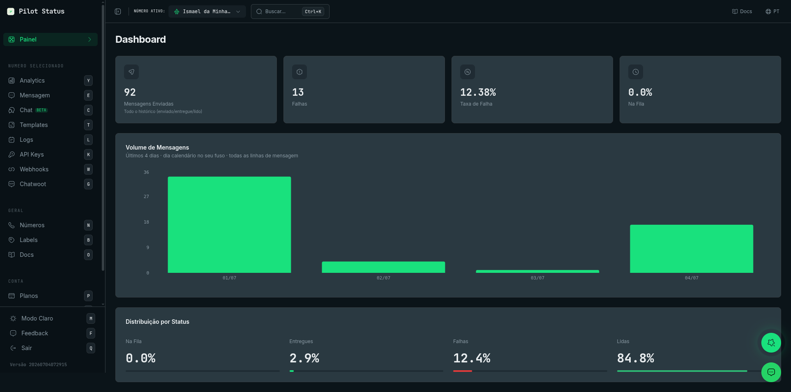

Pilot Status es una plataforma de infraestructura de WhatsApp administrada, diseñada para desarrolladores, fundadores de SaaS y creadores de automatizaciones que necesitan enviar y recibir mensajes de WhatsApp a escala, sin operar servidores, configurar proxies ni gestionar conexiones frágiles. Tú pones la lógica; Pilot Status se encarga de todo lo demás.

<Frame caption="El dashboard de Pilot Status: volumen de envíos, estado de entrega y todo por número.">
  
</Frame>

## Qué puedes construir

Usa Pilot Status como la columna vertebral de mensajería de cualquier producto o flujo que necesite WhatsApp como canal.

<CardGroup cols={2}>
  <Card title="Productos SaaS" icon="buildings" href="/es/concepts/numbers-and-tenants">
    Agrega mensajería de WhatsApp a tu SaaS con soporte multi-tenant. Cada cliente conecta su propio número dentro de tu proyecto, con aislamiento total de mensajes y claves de API por número.
  </Card>

  <Card title="Agentes de IA" icon="robot" href="/es/guides/ai-agents">
    Dale a tus agentes de IA y asistentes basados en LLM un canal de WhatsApp en vivo. El servidor MCP y los SDKs se integran directamente con frameworks de IA para que los agentes puedan enviar, recibir y reaccionar a mensajes.
  </Card>

  <Card title="Anuncios Click-to-WhatsApp" icon="megaphone" href="/es/concepts/official-vs-unofficial">
    Captura leads de anuncios de Meta y responde al instante mediante la API. Conecta tus campañas a mensajes de bienvenida automáticos, flujos de calificación o derivaciones a chat en vivo.
  </Card>

  <Card title="Automatizaciones" icon="webhook" href="/es/guides/send-messages">
    Conecta WhatsApp a n8n, GPT Maker o cualquier automatización basada en webhooks. Envía alertas de cobro, códigos OTP, actualizaciones de estado de pedidos y mensajes de onboarding sin escribir un backend.
  </Card>
</CardGroup>

## Funcionalidades clave

Pilot Status incluye todo lo que necesitas para construir una integración de WhatsApp de nivel productivo desde el primer momento.

<CardGroup cols={2}>
  <Card title="API REST" icon="code" href="/es/api/overview">
    Envía texto, multimedia, botones y mensajes de plantilla con una sola solicitud HTTP. Cada endpoint devuelve JSON estructurado con IDs de mensaje y estado de entrega.
  </Card>

  <Card title="Webhooks en milisegundos" icon="bolt" href="/es/concepts/webhooks">
    Recibe una notificación en el momento en que un mensaje se entrega, se lee o recibe respuesta. Los payloads de webhook se disparan en milisegundos para que tus automatizaciones y agentes estén siempre sincronizados.
  </Card>

  <Card title="Integración oficial con Meta" icon="meta" href="/es/concepts/official-vs-unofficial">
    Conéctate mediante Meta Cloud API o el modo Coexistence para un cumplimiento total y mayor capacidad de envío. Ideal para empresas que necesitan soporte oficial de la WhatsApp Business API.
  </Card>

  <Card title="Proxy administrado" icon="shield-check" href="/es/connecting-numbers">
    Cada conexión no oficial incluye un proxy administrado. Sin VPS, sin Nginx, sin listas de IPs permitidas: Pilot Status mantiene tu conexión estable y enrutada.
  </Card>

  <Card title="Multinúmero y multi-tenant" icon="layer-group" href="/es/connecting-numbers">
    Agrega varios números de WhatsApp a un solo proyecto. Los planes escalan de 1 a 13\+ números. Para productos SaaS, cada tenant puede conectar y administrar su propio número.
  </Card>

  <Card title="Dashboard de chat en vivo" icon="messages" href="/es/dashboard/live-chat">
    Monitorea y responde mensajes en tiempo real desde el dashboard de Pilot Status. Consulta el historial de conversaciones, los logs de mensajes y el estado de entrega sin salir de la interfaz.
  </Card>

  <Card title="Analítica y logs de mensajes" icon="chart-bar" href="/es/dashboard/logs-analytics">
    Sigue el volumen de mensajes, las tasas de entrega y el engagement desde el dashboard. Los logs completos de mensajes te permiten auditar cada evento de envío y recepción.
  </Card>

  <Card title="Migración con API Layer" icon="arrows-rotate" href="/es/guides/migration">
    Migra desde Evolution API (Evolution GO, Evolution V2) sin cambiar código. La API Layer habla la misma interfaz, así que tu integración actual sigue funcionando desde el primer día.
  </Card>
</CardGroup>

## Conexiones oficiales vs. no oficiales

Pilot Status admite dos modos de conexión, y puedes usar ambos dentro del mismo proyecto.

Las conexiones **oficiales (Meta)** usan la Cloud API de Meta o el modo Coexistence. Cumplen plenamente las políticas de WhatsApp Business, admiten mayores volúmenes de mensajes y son obligatorias para empresas que ejecutan anuncios click-to-WhatsApp o pertenecen a industrias reguladas. El modo Coexistence te permite usar la API oficial junto con tu app de WhatsApp Business existente.

Las conexiones **no oficiales** se autentican mediante código QR, como una sesión normal de WhatsApp. Se configuran más rápido (no necesitas una cuenta de Meta Business), incluyen el proxy administrado de Pilot Status y funcionan bien para automatizaciones, herramientas internas y productos en etapa inicial.

Para una comparación detallada de capacidades, límites y cuándo elegir cada modo, consulta [Conexiones oficiales vs. no oficiales](/es/concepts/official-vs-unofficial).

<Note>
  Sin servidor, sin VPS, sin configurar proxies: Pilot Status se encarga de todo.
</Note>
