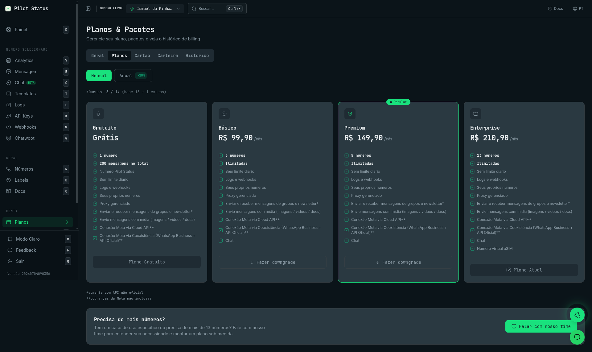
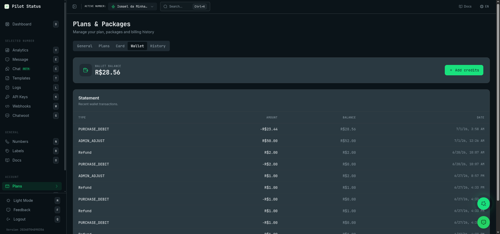
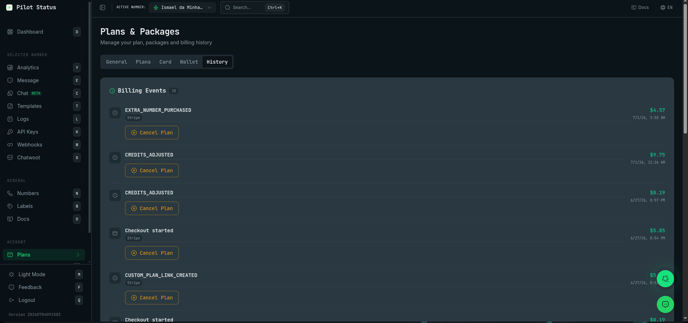

Los planes de Pilot Status se diferencian principalmente en **cuántos números de WhatsApp puedes conectar** y en el tope de mensajes del plan Free. Los miembros del workspace son ilimitados en todos los planes. Todos los planes pagos incluyen mensajes ilimitados, sin límite diario, logs y webhooks, tus propios números y proxy administrado. Elige el plan que se ajuste a tu escala y cambia a uno superior en cualquier momento desde el panel.

<Frame caption="La página Plans & Packages: facturación mensual/anual, comparación de planes y uso de números.">
  
</Frame>

## Comparación de planes

|  | Free | Básico | Premium | Enterprise |
| --- | --- | --- | --- | --- |
| **Precio (mensual)** | R\$ 0 | R\$ 99,90/mes | R\$ 149,90/mes | R\$ 210,90/mes |
| **Precio (anual, −20%)** | — | R\$ 959,04/año | R\$ 1.439,04/año | R\$ 2.024,64/año |
| **Números conectados** | 1 | 3 | 8 | 13 |
| **Miembros del workspace** | Ilimitados | Ilimitados | Ilimitados | Ilimitados |
| **Mensajes** | 200 en total | Ilimitados | Ilimitados | Ilimitados |
| **Grupos y newsletter\*** | ✓ | ✓ | ✓ | ✓ |
| **Meta Cloud API / Coexistence\*\*** | ✓ | ✓ | ✓ | ✓ |
| **Mensajes multimedia** | ✓ (dentro de la cuota de 200 mensajes) | ✓ | ✓ | ✓ |
| **Live Chat** | ✗ | ✓ | ✓ | ✓ |
| **Número virtual eSIM** | ✗ | ✗ | ✗ | ✓ |

\* Los mensajes a grupos y newsletters solo están disponibles en números conectados por la API no oficial. \*\* Meta cobra por mensaje, según la categoría del mensaje, y factura esos cargos por su cuenta; no están incluidos en ningún plan de Pilot Status. Consulta los [precios de WhatsApp de Meta](https://developers.facebook.com/docs/whatsapp/pricing).

<Note>
  Los precios están disponibles en **BRL y USD**, cada uno facturado con su propia tarifa. **Planes en USD:** Básico \$19/mes · \$187/año, Premium \$29/mes · \$280/año, Enterprise \$41/mes · \$395/año. La facturación anual tiene descuento (en BRL es −20%) y también se aplica al complemento de números extra.
</Note>

## Free

Un número conectado, **miembros ilimitados** y hasta **200 mensajes en total**, sin tarjeta de crédito. Los 200 son una **asignación única de por vida**, no una cuota mensual: **no** se reinicia en cada periodo, y en el plan Free **los mensajes entrantes también cuentan**. Al llegar a 200 debes suscribirte a un plan pago (o comprar un paquete de mensajes) para seguir enviando; un plan que más tarde vuelve a Free **no** recibe 200 nuevos. Es un sandbox para integrar la API y disparar eventos de webhook reales. El envío de medios funciona en todos los planes (dentro de la cuota de mensajes); Live Chat es una función solo de planes pagos.

## Básico, Premium, Enterprise

Los niveles pagos comparten el conjunto completo de funciones (mensajes ilimitados, medios, Live Chat, Meta Cloud API y Coexistence, grupos/newsletter en números no oficiales) y se diferencian en el tope de números: **3**, **8** y **13** números respectivamente. Enterprise incluye además un **número virtual eSIM** aprovisionado y administrado por Pilot Status.

## Complemento de números extra

¿Necesitas más números sin cambiar de plan? Agrega números extra a cualquier plan pago como un complemento recurrente: **R\$ 29,90/mes por número** (anual: R\$ 287,04/año por número, −20%). Cómpralos desde el panel o mediante `POST /v1/subscription/extra-numbers` (consulta antes el costo con `GET /v1/subscription/extra-numbers`). Tu límite efectivo es la base del plan más los extras comprados. El primer cargo es **prorrateado** por los días que quedan en el ciclo; el precio mensual completo empieza en el siguiente.

<Warning>
  **En el plan Free, comprar un número extra te pasa a On Demand.** On Demand no tiene números incluidos, así que el número que ya usas deja de ser gratuito y pasa a ser uno pago e ilimitado: comprar 1 extra estando en Free te factura **2 números**. A cambio, desaparece el tope de 200 mensajes. **Esto solo ocurre después de que lo confirmas:** el panel te pide confirmación antes de cobrar, y la API devuelve `409 CONFIRMATION_REQUIRED` a menos que envíes `confirm: true`. Un workspace Free nunca se convierte ni se cobra por conectar un número: un segundo número se rechaza con `402 PLAN_NUMBER_LIMIT_REACHED` hasta que compres el extra tú mismo o subas de plan. Consulta [Números extra y On Demand](/es/api/extra-numbers#plan-free).
</Warning>

## Líneas telefónicas

Las [líneas telefónicas](/es/guides/phone-lines) (números fijos brasileños para activar cuentas de WhatsApp) se facturan aparte de cualquier plan: **R\$ 33,90/mes por línea**, el mismo precio en todos los planes, incluido Free, y no cuentan para el límite de números. Cada línea se renueva el día del mes en que se compró, desde la billetera y luego desde la tarjeta guardada. Consulta [Precios y facturación de líneas telefónicas](/es/phone-lines-pricing).

## Custom y On Demand

- **Custom**: un plan a medida creado por el equipo de Pilot Status, con precio por tenant, números otorgados por el equipo y mensajes ilimitados. Adecuado para flotas de más de 13 números, SLA dedicados o requisitos especiales.
- **On Demand**: sin cuota de plan base y sin números incluidos: **cada número es un extra pago**, con mensajes ilimitados. La capacidad pagada es un **derecho de 30 días**: eliminar un número libera su espacio para reconectar otro número en el mismo ciclo, pero **no** reduce tu factura; para pagar por menos números programas una reducción que entra en vigor en el siguiente ciclo. Conviene cuando la cantidad de números fluctúa y quieres un precio puramente por número.

[Habla con el equipo por WhatsApp →](https://wa.me/5585984387245)

## Modos de facturación

Pilot Status admite dos modos de facturación:

- **Suscripción (tarjeta)**: un cargo recurrente mensual o anual en tu tarjeta guardada; Stripe lo renueva automáticamente.
- **Suscripción (Pix)**: un pago Pix recarga tu **billetera prepaga** y activa el plan desde ella. Como Pix es un pago único, la renovación funciona por la **vía de la billetera**: cada ciclo se cobra de tu saldo de crédito, y si no alcanza se usa una tarjeta guardada si tienes una; si ninguna lo cubre hay un **periodo de gracia de 2 días** y luego se suspenden los envíos. Mantén la billetera con saldo (vía Pix o tarjeta) para seguir activo.
- **Billetera (prepaga)**: recarga una billetera de crédito prepago y consume del saldo. Crea un checkout de recarga desde el panel o mediante `POST /v1/billing/checkout`.

<Frame caption="La pestaña Wallet: saldo prepago, Add credits y un estado de cuenta completo de transacciones.">
  
</Frame>

<Warning>
  Si un pago falla o el saldo de la billetera se agota, hay un periodo de gracia corto (2 días). Después, los envíos por la API se suspenden y las solicitudes devuelven `422` con el código `BILLING_SUSPENDED` hasta que se regularice la facturación.
</Warning>

## Historial de facturación

La pestaña **History** lista cada evento de facturación (números extra comprados, ajustes de crédito, checkouts, enlaces de planes personalizados) con el monto, el origen (por ejemplo Stripe) y la fecha y hora. También lista los eventos de las [líneas telefónicas](/es/phone-lines-pricing#dónde-ver-los-cobros): compradas, cuota mensual pagada, cargo fallido, cuota mensual reembolsada, suspendidas por falta de pago, reactivadas, devueltas y canceladas, cada uno con el nombre y el número de la línea.

<Frame caption="La pestaña History: un registro de auditoría completo de los eventos de facturación (compras, ajustes de crédito, checkouts).">
  
</Frame>
