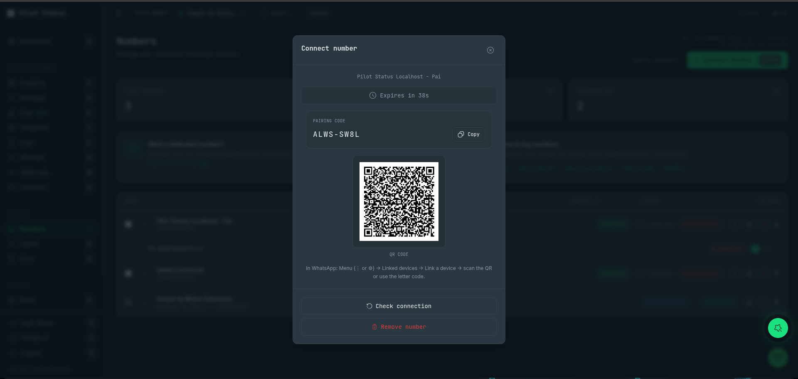

Esta guía te lleva por todo lo que necesitas para pasar de cero a enviar tu primer mensaje de WhatsApp con la API de Pilot Status. Crearás una cuenta, conectarás un número, obtendrás tu API key y harás una llamada real a la API, sin configurar servidores ni proxies.

<Steps>
  <Step title="Crea tu cuenta">
    Ve a [pilotstatus.com.br](https://pilotstatus.com.br) y regístrate para obtener una cuenta gratuita. El plan gratuito incluye un número de WhatsApp y hasta 200 mensajes, sin necesidad de tarjeta de crédito.
  </Step>
  <Step title="Conecta tu número">
    En el panel, haz clic en **Connect Number** (Conectar número) y elige tu método de conexión:

    - **Código QR (no oficial):** abre WhatsApp en tu teléfono, toca **Dispositivos vinculados → Vincular un dispositivo** y escanea el código QR que aparece en el panel.
    - **Credenciales de Meta (oficial):** selecciona el modo Cloud API o Coexistence y luego ingresa tus credenciales de Meta Business y el ID de tu cuenta de WhatsApp Business.

    <Frame caption="Conectar un número: escanea el código QR o usa el código de vinculación con letras en WhatsApp (Dispositivos vinculados).">
      
    </Frame>

    Tu número aparecerá como **Connected** (Conectado) cuando termine el enlace. Para ver el paso a paso completo de ambos métodos, consulta [Conectar un número de WhatsApp](/es/connecting-numbers).
  </Step>
  <Step title="Obtén tu API key">
    En el panel, abre la página **API Keys** (`/api-keys`) y copia la key de tu número conectado: empieza con `ps_`. Mantén este valor en secreto, ya que autentica cada solicitud que haces a la API.
  </Step>
  <Step title="Envía tu primer mensaje">
    Haz la siguiente solicitud, reemplazando `ps_your_key_here` con tu key y `destinationNumber` con un número de WhatsApp real en el que puedas verificar la entrega. La propia key identifica cuál de tus números envía el mensaje.

    <CodeGroup>

    ```bash cURL
    curl -X POST https://pilotstatus.com.br/v1/messages/send \
      -H "x-api-key: ps_your_key_here" \
      -H "Content-Type: application/json" \
      -d '{
        "destinationNumber": "+5511999999999",
        "text": "Hello from Pilot Status! 👋"
      }'
    ```

    </CodeGroup>

    Una respuesta exitosa devuelve `HTTP 202` con un `id` y un `status` de `QUEUED`. Pilot Status entrega el mensaje y dispara tu webhook a medida que llegan los eventos de entrega y lectura. El mismo endpoint también envía plantillas (`templateId` \+ `variables`) y multimedia (`media` \+ `mediaType`).

    <Tip>
      Los números de teléfono deben estar en formato E.164 **con el `+` inicial**, por ejemplo, `+5511999999999` para un número brasileño (\+55), código de área 11.
    </Tip>
  </Step>
  <Step title="Recibe eventos">
    Para obtener confirmaciones de entrega en tiempo real, avisos de lectura y mensajes entrantes, crea un webhook en la página **Webhooks** del panel (o mediante `POST /v1/webhooks`). Pilot Status enviará por POST un payload JSON a tu URL en milisegundos tras cada evento. Puedes usar un servicio como [Webhook.site](https://webhook.site) para inspeccionar los payloads durante el desarrollo.
  </Step>
</Steps>

## Qué sigue

Ahora que enviaste tu primer mensaje, explora el resto de la plataforma.

<CardGroup cols={2}>
  <Card title="Conectar números" icon="mobile" href="/es/connecting-numbers">
    Aprende a agregar números oficiales y no oficiales, configurar el modo Coexistence y gestionar conexiones multi-tenant.
  </Card>

  <Card title="Webhooks" icon="bolt" href="/es/concepts/webhooks">
    Entiende la estructura del payload del webhook y cómo manejar los eventos de entrega, lectura y mensajes entrantes.
  </Card>

  <Card title="Enviar mensajes" icon="paper-plane" href="/es/guides/send-messages">
    Envía texto, imágenes, documentos, audio, botones y mensajes de plantilla con la API REST.
  </Card>

  <Card title="Referencia de la API" icon="code" href="/es/api/overview">
    Explora la referencia completa de endpoints con esquemas de solicitud, ejemplos de respuesta y códigos de error.
  </Card>
</CardGroup>
