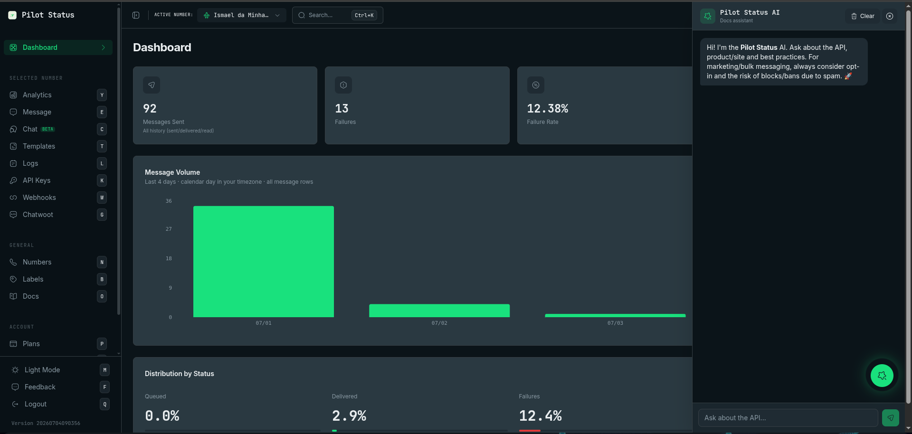

No hay ningún prompt para copiar y pegar que mantener. Para enseñarle a una IA todo sobre Pilot Status, apúntala a las fuentes canónicas legibles por máquinas.

<Frame caption="El asistente de IA de Pilot Status dentro del dashboard: pregunta sobre la API, el producto y las buenas prácticas.">
  
</Frame>

## Empieza aquí: la guía de integración

Para llevar a un usuario de cero a una integración funcionando (credencial, conexión MCP, primer mensaje, webhook con su secreto de firma, verificación de la firma, verify token de Meta, plantillas y errores), sigue [Integrar Pilot Status con IA](/es/guides/integrate-with-ai). Cada paso indica dónde se muestra cada valor, así que nada requiere contactar al soporte.

## llms.txt

El índice legible por máquinas de esta documentación se genera a partir de todas las páginas y se mantiene actualizado:

```text
https://docs.pilotstatus.com.br/llms.txt
https://docs.pilotstatus.com.br/llms-full.txt
```

`llms.txt` indexa endpoints, esquemas de webhook, conceptos y códigos de error, con un enlace por página (cada página también se sirve como Markdown agregando `.md` a su URL). Cuando es grande, grupos de páginas pasan a subíndices bajo `/_llms/`: sigue esos enlaces hasta llegar a las páginas. `llms-full.txt` es el texto completo de todas las páginas en un solo archivo. Pega cualquiera de las dos URLs en tu agente de código o herramienta LLM y leerá solo lo que necesita en lugar de un prompt gigante.

<Tip>
  Cuando le pidas a un asistente de código que construya una integración con Pilot Status, dale primero la URL de `llms.txt`. Obtendrá las formas exactas de solicitud y respuesta (por ejemplo, los tres modos de `POST /v1/messages/send`) en lugar de inventar endpoints.
</Tip>

<Note>
  `https://pilotstatus.com.br/llms.txt` sirve una copia periódica de `llms-full.txt` y puede quedar desactualizada. Prefiere las URLs de `docs.pilotstatus.com.br` de arriba.
</Note>

## Credenciales que solo muestra el dashboard

Algunos valores se le muestran al usuario **una sola vez**, o solo en el dashboard, y ninguna página de documentación ni endpoint de lectura los devuelve. Un asistente que ayuda a un usuario a integrarse debe decirle **dónde buscar**; ninguno de ellos requiere contactar al soporte:

| Credencial | Dónde la encuentra el usuario | ¿La perdiste? |
| --- | --- | --- |
| **Secreto de firma del webhook del número** | Se muestra una vez: en la ventana **Signing secret** justo después de crear el webhook en **Webhooks** (`/webhooks`), o en el campo `secret` de la respuesta de `POST /v1/webhooks`. | Rótalo: **Edit Webhook → Generate a new secret**, o `POST /v1/webhooks/{id}/rotate-secret`. El anterior deja de verificar de inmediato. Consulta [Configurar webhooks](/es/api/webhooks/configure#secreto-de-firma-en-el-panel). |
| **Secreto del webhook de línea / workspace** (`plwh_…`) | Se muestra una vez: en la ventana **Signing secret** justo después de crear el webhook en **Phone lines → Line webhooks** (`/linhas/webhooks`) o **Workspace keys → Webhooks** (`/workspace-api-keys`), o en la respuesta del `POST`. | No hay rotación: crea un webhook nuevo y elimina el anterior. Consulta [Webhooks de líneas](/es/api/phone-lines/webhooks#configurar). |
| **Callback URL y Verify Token de Meta** (número conectado mediante **Official Meta API (Cloud API)** con credenciales) | En la ventana **Meta Number Created!** justo después de conectar; más tarde, en la tarjeta del número en **Numbers** (bloque de webhook). Solo el **propietario del workspace** puede copiar el Verify Token. | Cópialo de nuevo desde la tarjeta del número. Consulta [Conectar números](/es/connecting-numbers). |
| **API keys** | Se muestran una vez, al crearlas o regenerarlas. | Regénerala. Consulta [Tipos de clave](/es/concepts/key-types). |

## Servidor MCP

Para agentes que deben **actuar** (enviar mensajes, leer conversaciones, administrar números) y no solo leer documentación, usa el servidor oficial de Model Context Protocol: un conector alojado en `https://mcp.pilotstatus.com.br/mcp` que expone la API pública `/v1` como herramientas, con autenticación OAuth o `x-api-key`.

- **151 herramientas** en `/mcp`; **Code Mode** en `https://mcp.pilotstatus.com.br/code` expone las mismas herramientas como 2 (`describe` y `execute`) para agentes que encadenan muchas llamadas. Consulta [MCP Code Mode](/es/integrations/mcp-code-mode).
- Las **herramientas destructivas** (`templates_delete`, `workspace_archive`, `workspace_transfer_ownership`, `workspace_members_remove`) devuelven primero una vista previa y un `confirm_token`; muéstrale la vista previa al usuario y vuelve a llamar con el token solo después de un sí explícito. Consulta [Confirmación para herramientas destructivas](/es/integrations/mcp-server#confirmación-para-herramientas-destructivas).
- **Por OAuth**, revelar o crear API keys `ps_` es exclusivo del **Owner** del workspace (de lo contrario, `403 OAUTH_SECRET_REQUIRES_OWNER`); los secretos de firma y el verify token de Meta van al Owner o al Admin. Consulta [Secretos y API keys por OAuth](/es/integrations/mcp-server#secretos-y-api-keys-por-oauth).

Consulta [Servidor MCP](/es/integrations/mcp-server) para la lista de herramientas y la configuración, y [Agentes de IA](/es/guides/ai-agents) para patrones de bots impulsados por webhooks.

## Relacionado

- [Integrar Pilot Status con IA](/es/guides/integrate-with-ai)
- [Guía de agentes de IA](/es/guides/ai-agents)
- [Servidor MCP](/es/integrations/mcp-server)
- [SDKs y n8n](/es/integrations/sdks)
