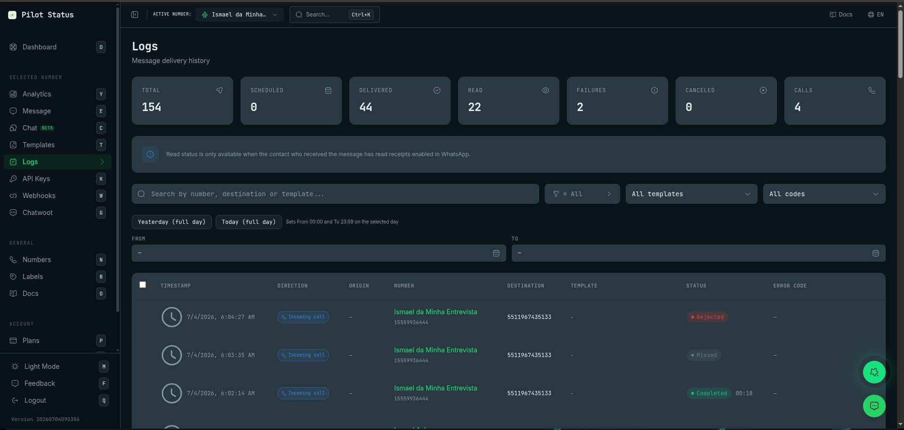

O WhatsApp Business Calling permite fazer e receber **chamadas de voz** com seus clientes pelo WhatsApp, através da API `/v1/calls*`.

## Provedores suportados

As chamadas funcionam em **dois** tipos de provedor — e se comportam de forma diferente em cada um:

| Provedor | O que é | Modelo de mídia |
| --- | --- | --- |
| **META** (Meta Cloud API) | Número oficial do WhatsApp Business | **Apenas sinalização** — o Pilot Status retransmite o SDP (RFC 8866); o áudio flui **navegador ↔ WhatsApp** diretamente via WebRTC |
| **API não oficial** (conexão por QR code) | Número conectado lendo um QR code | **Mídia no servidor** — sem SDP; o áudio roda no servidor. Você inicia/atende/recusa/encerra pela API e envia áudio ou abre um stream em tempo real por endpoints dedicados |

<Warning>
  Qualquer outro tipo de número retorna `400 FEATURE_NOT_SUPPORTED`. Mensagem do erro: _"Calling is only supported on Meta Cloud API numbers and unofficial API (QR code connection) numbers"_ Na API não oficial, chamadas só existem na **conexão por QR code atual**; números ainda na conexão por QR antiga retornam `400 FEATURE_NOT_SUPPORTED` (reconecte o número para ter chamadas). Um número não oficial desconectado retorna `409 WHATSAPP_INSTANCE_NOT_CONNECTED`.

  **Número em coexistência não liga.** A Meta só libera chamadas em número conectado direto na Cloud API. Um número que ainda está no app WhatsApp Business (coexistência) retorna `400 CALLS_NOT_AVAILABLE_COEXISTENCE` ao iniciar, aceitar, pré-aceitar e nos endpoints de permissão, antes de qualquer pedido chegar à Meta. Listar, rejeitar e encerrar chamadas existentes continua funcionando. O campo `coexistence` de `GET /v1/numbers/{id}` diz quais números são afetados.
</Warning>

<Note>
  **Habilitar chamadas em um número oficial (Meta Cloud) tem dois pré-requisitos do lado da Meta:** (1) tier de mensagens `TIER_2K` (2.000 msgs/24h) ou maior — o gate da Meta para a Calling API (tentar abaixo disso retorna o erro Meta `138015`); **e** (2) a WABA precisa ter o **campo de webhook `calls` subscrito** (ou SIP configurado) — senão a Meta retorna `138018` (_"pré-requisitos técnicos não atendidos"_). O Pilot Status habilita chamadas **automaticamente** ao conectar o número e re-tenta conforme o tier sobe, então um número novo em tier baixo (ex.: `TIER_250`) simplesmente ainda não recebe chamadas. O tier que vale é o **do próprio número** (`messaging_limit_tier`) — não o limite do Business Portfolio (`whatsapp_business_manager_messaging_limit`), que é outra coisa, costuma ser maior e não destrava chamadas. Você também pode disparar manualmente pelo botão **Habilitar chamada** nos detalhes Meta do número, na página **Números** — ele responde `ENABLED`, `PENDING_TIER` (tier ainda abaixo de 2K) ou `PENDING_WEBHOOK` (subscreva o campo de webhook `calls` na WABA / configure SIP e tente de novo). Números da API não oficial (conexão por QR code) não têm esse gate.
</Note>

<Warning>
  **Número em coexistência com o app WhatsApp Business não usa chamadas de jeito nenhum.** Quando o número continua rodando no app WhatsApp Business do aparelho e foi apenas _conectado_ à Cloud API, a Meta nunca o registra como número Cloud API de verdade: `POST /{phone-number-id}/register` é recusado com _"Register endpoint is not available for SMB businesses"_, e toda escrita nas configurações de chamada responde o erro Meta **`141000`** — _"The phone number is not a valid Cloud API number"_. As mensagens continuam funcionando normalmente; só a chamada fica bloqueada, e nenhum aumento de tier ou assinatura de webhook muda isso. Sinais nos detalhes Meta do número: `code_verification_status: NOT_VERIFIED`, `name_status: NON_EXISTS` e nenhum PIN habilitado. A única saída é migrar o número para fora do app WhatsApp Business, para a Cloud API (depois ele ainda precisa ser registrado e alcançar `TIER_2K`), o que também o remove do app no aparelho.
</Warning>

## Tipos de chamada

| Tipo | Quem inicia | Cobrança |
| --- | --- | --- |
| **BIC** — Chamada Iniciada pela Empresa | Você liga para o cliente | Na META, cobrada pela **Meta diretamente na sua WABA** (por minuto, pulsos de 6 segundos, só quando atendida). Em números da API não oficial não há cobrança por minuto da Meta. |
| **UIC** — Chamada Iniciada pelo Usuário | O cliente liga para você | Gratuita |

O Pilot Status **não cobra** nada pelas chamadas.

### Preços da Meta para chamadas iniciadas pela empresa (números oficiais)

Em números Meta Cloud API, os minutos de BIC são cobrados pela **Meta diretamente na sua WABA** ([preços oficiais](https://developers.facebook.com/documentation/business-messaging/whatsapp/calling/pricing)):

- **Chamadas iniciadas pelo usuário são gratuitas** — sempre, nos dois provedores.
- A duração de BIC é medida em **pulsos de 6 segundos**; pulso fracionado conta como pulso inteiro (uma chamada de 56 segundos = 9,33 → **10 pulsos**).
- A tarifa por pulso depende do **país de destino** e do seu **tier de volume mensal** (mesma estrutura de acúmulo de tiers das mensagens do WhatsApp). Quando uma chamada cruza a fronteira de um tier, a **chamada inteira é cobrada pela tarifa mais barata (do tier de maior volume)**.
- É **obrigatório ter um método de pagamento válido na WABA** para fazer chamadas — sem ele, as chamadas falham com o erro Meta `131044`.
- **Mensagens de solicitação de permissão de chamada** são cobradas como mensagens normais, não como minutos de chamada.
- As tarifas são publicadas por moeda nos rate cards da Meta (rate card em BRL vigente a partir de 1º de julho de 2026).

## Suporte de recursos por provedor

| Recurso | Endpoint | META | API não oficial (QR) |
| --- | --- | :-: | :-: |
| Fazer uma chamada (BIC) | `POST /v1/calls` | ✅ oferta SDP **obrigatória** | ✅ **sem SDP** |
| Listar chamadas | `GET /v1/calls` | ✅ | ✅ |
| Obter uma chamada | `GET /v1/calls/{callId}` | ✅ | ✅ |
| Atender (UIC) | `POST /v1/calls/{callId}/accept` | ✅ resposta SDP **obrigatória** | ✅ **sem SDP** |
| Pré-atender | `POST /v1/calls/{callId}/pre-accept` | ✅ | ❌ |
| Rejeitar | `POST /v1/calls/{callId}/reject` | ✅ | ✅ |
| Encerrar / desligar | `POST /v1/calls/{callId}/terminate` | ✅ | ✅ |
| Tocar um arquivo de áudio na chamada | `POST /v1/calls/{callId}/play` | ❌ | ✅ **só não oficial** |
| Sessão de mídia em tempo real (WS PCM16) | `POST /v1/calls/{callId}/realtime-session` | ❌ | ✅ **só não oficial** |
| Obter / atualizar configurações de chamada | `GET`·`PUT /v1/calls/settings` | ✅ | ❌ |
| Obter permissões de chamada | `GET /v1/calls/permissions` | ✅ | ❌ |
| Solicitar permissão de chamada | `POST /v1/calls/permissions/request` | ✅ | ❌ |

Um recurso que o provedor não suporta retorna `400 FEATURE_NOT_SUPPORTED`.

## Como cada provedor trata a mídia

### META — apenas sinalização

O Pilot Status retransmite o SDP; o áudio flui **navegador ↔ WhatsApp** diretamente. Seu cliente WebRTC produz a oferta/resposta SDP. Não há nada no servidor para tocar áudio, então `play` e `realtime-session` não se aplicam. A página **/chat** do painel tem um **softphone** integrado (disponível nos dois tipos de número).

### API não oficial (conexão por QR code) — mídia no servidor (sem SDP)

`POST /v1/calls` e `/accept` **não** recebem `sdp` — a chamada conecta e o áudio é processado no servidor. Iniciar, atender, recusar e encerrar usam os mesmos endpoints da META (`POST /v1/calls`, `/accept`, `/reject`, `/terminate`). Você então controla o áudio com os dois endpoints exclusivos da API não oficial:

- `POST /v1/calls/{callId}/play` — o backend baixa seu arquivo de áudio (a URL é validada no servidor) e o toca na chamada; passe `hangupAfterPlay: true` para encerrar a chamada automaticamente quando a reprodução terminar (bots de notificação não precisam de timer no cliente).
- `POST /v1/calls/{callId}/realtime-session` — abre uma sessão **WebSocket PCM16** full-duplex; o corpo `{ "mode": "talk" | "listen" }` é obrigatório (`talk` envia e recebe áudio, `listen` só recebe). A `wsUrl` retornada fica em um host público de mídia dedicado e seu token é de uso único com TTL curto (~2 min); conecte-se a ela diretamente (não passa pelo proxy da API).

Números da API não oficial não precisam de concessão de **permissão** BIC, não têm **configurações** de chamada nem **pre-accept** (conceitos da Meta) — esses endpoints retornam `400 FEATURE_NOT_SUPPORTED`.

## Camada de migração / compatibilidade

Se você já tem código escrito contra a API nativa de chamadas da conexão por QR code, a camada de compatibilidade faz proxy dos endpoints `/call/*` dela (start, answer, reject, hangup, list, get, media/play, media/realtime/session) — aponte sua base URL para `/api/layer/evolution-go/` e seu código de chamadas existente continua funcionando. O WebSocket em tempo real (`/call/media/realtime/ws/*`) é acessado **diretamente** em um host público de mídia dedicado (a camada HTTP não faz upgrade de WebSocket); rotas de frontend/manager não passam pelo proxy.

## Acompanhe o progresso com webhooks

Assine `call.ringing`, `call.connected`, `call.ended` (inclui `duration` em segundos quando atendida), `call.missed` e `call.permission_updated`. `call.ringing`, `call.connected`, `call.ended` e `call.missed` disparam tanto para números META quanto da API não oficial; `call.permission_updated` é **só META** (a API não oficial não tem modelo de permissão).

<Frame caption="Chamadas na página de Logs — cada chamada aparece com direção, status (Completada com duração, Perdida, Recusada) e um contador próprio de CHAMADAS.">
  
</Frame>

## Próximos passos

<CardGroup cols={2}>
  <Card title="Referência da API de Chamadas" icon="phone" href="/pt-BR/api/calls/endpoints">
    Cada endpoint, parâmetros e comportamento por provedor.
  </Card>

  <Card title="Guia de Chamadas de Voz" icon="book-open" href="/pt-BR/guides/voice-calls">
    Passo a passo: fazer chamada, atender, permissões, softphone.
  </Card>
</CardGroup>