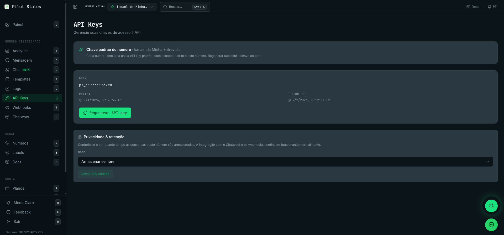

# Visão Geral da API Pilot Status

O Pilot Status é uma plataforma para envio de mensagens de WhatsApp (transacionais e de marketing/em massa) com controle de templates, versionamento e visibilidade operacional via painel, API e webhooks.

## Base URL

```text
https://pilotstatus.com.br/v1
```

## Autenticação

Toda requisição exige uma chave de API enviada no cabeçalho `x-api-key`. As chaves usam o prefixo `ps_`. Conectores MCP e apps OAuth se autenticam, em vez disso, com um token de acesso OAuth em `Authorization: Bearer` — veja [Tipos de chave](/pt-BR/api/key-types#o-que-cada-credencial-pode-chamar).

<Warning>
  Nunca envie uma chave `ps_` como `Authorization: Bearer`: um valor Bearer é lido como token de acesso OAuth, então uma chave enviada ali é recusada com `401` (`Invalid or expired access token`). `Authorization: Bearer` é só para os tokens de acesso OAuth que o Pilot Status emite para conectores MCP e apps OAuth. Quando `x-api-key` está presente, o cabeçalho Bearer é ignorado.
</Warning>

```bash
curl "https://pilotstatus.com.br/v1/messages/msg_abc" \
  -H "x-api-key: ps_your_key_here"
```

<Frame caption="Obtenha (ou regenere) sua chave na página API Keys do painel — uma chave padrão por número.">
  
</Frame>

### Escopos de chave

| Escopo | Vinculado a | Pode chamar |
| --- | --- | --- |
| **Escopo de número** (padrão) | Um número de WhatsApp | Todos os endpoints de ação/dados desse número: `POST /v1/messages/send`, status de mensagem, cancelamento, grupos, newsletters, templates, analytics, mídia |
| **Escopo de tenant** (chave de workspace) | O tenant (sem número) | Gerenciamento em nível de tenant: `/v1/numbers/*`, `/v1/remote-pairing/*`, `/v1/api-keys`, `/v1/branding`, `/v1/webhooks/*`, `/v1/subscription/extra-numbers`, `/v1/billing/*` e `/v1/embed/sessions` (superfície de conexão) |
| **Chave de conta** (`ps_account_`) | Você, o usuário | `/v1/workspaces*` (criar workspaces e suas chaves) e tudo o que uma chave de workspace faz, em qualquer workspace de que você é membro, escolhido com `x-workspace-id`, com o seu papel nele |

Consulte [Autenticação da API](/pt-BR/api/authentication) e [Tipos de chave](/pt-BR/api/key-types) para mais detalhes.

## Conceitos principais

- **Template**: um modelo de mensagem versionado referenciado por `templateId` nos envios via API. Para números **Meta**, os templates são submetidos à Meta para aprovação; para números **não oficiais (Pilot Status web)**, eles são criados localmente sem etapa de aprovação.
- **Message**: uma tentativa de envio criada por `POST /v1/messages/send`.
- **Webhooks**: eventos de entrega (sent/delivered/read/failed) e mensagens recebidas (reply/received/group).
- **Confirmações de leitura**: o status `READ`, o `readAt` e o webhook `message.read` só ocorrem quando o contato destinatário tem as confirmações de leitura do WhatsApp habilitadas.

## Fluxo típico de integração

<Steps>
  <Step title="Criar templates">
    Crie templates no painel (`/templates`).
  </Step>
  <Step title="Conectar o WhatsApp">
    Configure seu número/instância de WhatsApp no painel (`/profile` e `/numbers`).
  </Step>
  <Step title="Criar uma chave de API">
    Crie uma chave de API na página `/api-keys`.
  </Step>
  <Step title="Enviar mensagens">
    Envie mensagens com [`POST /v1/messages/send`](/pt-BR/api/messages/send).
  </Step>
  <Step title="Acompanhar a entrega">
    Consulte o status com [`GET /v1/messages/{messageId}`](/pt-BR/api/messages/status) e/ou consuma eventos via webhooks.
  </Step>
</Steps>

## Erros HTTP comuns

| Status | Significado |
| --- | --- |
| `400` | Payload inválido (ex.: telefone fora do formato E.164, campos obrigatórios ausentes) |
| `401` | Credencial ausente ou inválida (`x-api-key` ou `Authorization: Bearer` OAuth). O corpo traz só `error` — ex.: `Invalid API key` — e nenhum `code` |
| `403` | Chave válida, mas operação bloqueada (ex.: escopo de chave incorreto) |
| `404` | Recurso não encontrado dentro do escopo da chave — ou `ROUTE_NOT_FOUND`, o endpoint não existe ([abaixo](#endpoint-inexistente)) |
| `429` | Limite de taxa excedido, nos endpoints que documentam um limite |

## Corpo JSON malformado

Um corpo de requisição que **não é um JSON válido** — truncado (`{"quantity": 3`), com vírgula sobrando, codificado como formulário — é recusado antes de qualquer processamento:

```json
{
  "error": "The request body is not valid JSON | O corpo da requisição não é um JSON válido",
  "code": "INVALID_BODY"
}
```

- **Status `400`, código `INVALID_BODY`.** É um erro permanente do cliente: corrija o payload, não repita a requisição como está. Nada é enviado, cobrado, criado ou alterado. Em `POST /v1/messages/send` a recusa não reserva a `Idempotency-Key`, então a nova tentativa corrigida pode reutilizá-la.
- **Corpo vazio não é corpo malformado.** Nas rotas em que o corpo é opcional, não enviar corpo mantém o padrão documentado da rota — por exemplo, `POST /v1/subscription/extra-numbers` sem corpo continua comprando `quantity = 1`. As rotas que exigem corpo (`messages/send`, `templates`, `messages/cancel`, `messages/read`, `messages/typing`, `webhooks`) respondem esse mesmo `400 INVALID_BODY` a um corpo vazio.
- **JSON válido que não é objeto** (`null`, um array, uma string) não entra nesta verificação: cada rota responde com a sua própria validação. Em `POST /v1/webhooks` e `PATCH /v1/webhooks/{id}` a resposta é `400 INVALID_BODY` com `"The request body must be a JSON object | O corpo da requisição deve ser um objeto JSON"`.
- Autenticação e permissão vêm antes: uma chave inválida continua respondendo `401`/`403`, não `400`.

Decida pelo `code`, não pela mensagem. Antes desta verificação, um corpo malformado respondia `500` em algumas rotas e era lido silenciosamente como `{}` em outras.

## Endpoint inexistente

Um caminho sob `/v1` que não corresponde a nenhum endpoint responde `404` em JSON — qualquer método, sem exigir autenticação:

```json
{
  "error": "Not found",
  "code": "ROUTE_NOT_FOUND",
  "message": "No such endpoint: POST /v1/..."
}
```

`message` traz o método e o caminho chamados. Se você receber `ROUTE_NOT_FOUND`, confira a URL contra esta referência antes de qualquer outra coisa. Um caminho existente chamado com um método que ele não suporta responde `405` com corpo vazio.

## Avisos (WhatsApp / antispam)

<Warning>
  Envios em alto volume e não solicitados podem acionar os mecanismos antispam do WhatsApp (limites de taxa, bloqueios e banimentos). Você é responsável pelo opt-in/consentimento e pela conformidade com as leis aplicáveis e as políticas do WhatsApp.
</Warning>