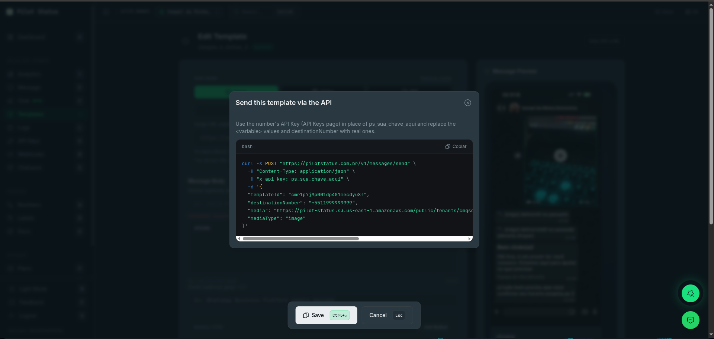

Templates definem conteúdo de mensagem reutilizável. Crie e gerencie-os no painel (`/templates`) **ou** via API REST pública (`/v1/templates`) e o servidor MCP (`templates_create` / `templates_update` / `templates_delete`). Ao enviar, referencie o template pelo `templateId` e passe um objeto `variables` com chaves correspondentes.

<Frame caption="Todo template tem uma chamada de API pronta — o modal Enviar via API do editor gera o curl exato com o templateId.">
  
</Frame>

<Note>
  URL base: `https://pilotstatus.com.br/v1`. Todo endpoint `/v1/templates` atua sobre **um número de WhatsApp**, que vem da credencial — veja [Autenticação e permissões](#autenticação-e-permissões).
</Note>

## Autenticação e permissões

Todo endpoint `/v1/templates*` atua sobre um único número de WhatsApp, e esse número sempre vem da credencial, nunca do corpo da requisição:

- **Chave de número** (`ps_number_`, em `x-api-key`): o próprio número dela.
- **Chave de workspace** (`ps_workspace_`), **chave de conta** (`ps_account_` com `x-workspace-id`) ou **token OAuth/MCP**: indique o número no header `x-whatsapp-number-id` (o id dele ou o id da instância, obtidos em `GET /v1/numbers`). Sem o header, a chamada recebe `403 TENANT_SCOPE_NOT_ALLOWED`.

Chaves de número e de workspace não carregam usuário, então nenhuma checagem de papel se aplica a elas. Chaves de conta e tokens OAuth agem com o **papel atual** do usuário no workspace:

| Endpoints | Permissão | Papéis |
| --- | --- | --- |
| `GET /v1/templates`, `GET /v1/templates/{id}`, `GET /v1/templates/{id}/insights` | `templates:read` | `OWNER`, `ADMIN`, `AGENT`, `ANALYST` |
| `POST /v1/templates`, `PUT /v1/templates/{id}`, `DELETE /v1/templates/{id}`, `POST /v1/templates/{id}/submit`, `POST /v1/templates/sync` | `templates:manage` | `OWNER`, `ADMIN` |

- Um papel sem a permissão recebe `403 PERMISSION_DENIED`.
- Um token OAuth autorizado só para alguns números recebe `403 NUMBER_NOT_IN_GRANT`, ou `404 TEMPLATE_NOT_FOUND`, para um template fora desses números.
- O `{id}` em todos os caminhos é o **id** do template (o `id` retornado por `GET /v1/templates`). O nome do template não é procurado: um nome no lugar do id recebe `404 TEMPLATE_NOT_FOUND`.

## Categoria

Definida no momento da criação; **não pode ser alterada depois**.

- **MARKETING** — mensagens promocionais (mais sensíveis às políticas do WhatsApp).
- **UTILITY** — mensagens transacionais (atualizações de conta, alertas, lembretes).
- **OTP** — mensagens de código único / de verificação.

## Estrutura do template

Apenas o **body** é obrigatório.

| Componente | Obrigatório | O que é |
| --- | --- | --- |
| **Header** | opcional | Texto ou um item de mídia (imagem, vídeo, PDF). |
| **Body** | **obrigatório** | Texto principal com placeholders `{{variable}}`. |
| **Footer** | opcional | Linha estática curta abaixo do body. |
| **Buttons** | opcional | Até 10 botões interativos. |

### Header

| Tipo | Valor | Observações |
| --- | --- | --- |
| `NONE` | — | Padrão. |
| `TEXT` | `text` | Até **60** caracteres, **0 ou 1** variável. Sem quebras de linha/emojis/formatação. |
| `IMAGE` | `url` ou `base64` | JPG/PNG. |
| `VIDEO` | `url` ou `base64` | MP4. |
| `DOCUMENT` | `url` ou `base64` | PDF. O nome de arquivo que o destinatário vê é definido no envio, com `mediaFilename` — veja [Nome do documento de um template](/pt-BR/guides/media-messages#nome-do-documento-de-um-template). |

- **API REST**: passe `header.url` (URL http(s) pública) ou `header.base64` (data URI) — o base64 é re-hospedado no servidor automaticamente.
- **MCP**: `header.url` **apenas** — base64 não é suportado via MCP.

<Note>
  **Não** existe header `LOCATION`.
</Note>

### Body

- Até **1024** caracteres.
- Variáveis escritas como `{{nome}}` (estilo nomeado).
- O body **não pode começar nem terminar com uma variável**.
- Emojis e múltiplas variáveis são permitidos.

### Footer

Texto estático de até **60** caracteres. **Sem variáveis.**

### Buttons

Até **10** botões no total; botões de resposta rápida e CTA podem ser combinados.

| Tipo | Campos | Limite |
| --- | --- | --- |
| `QUICK_REPLY` | `text` | até 10 |
| `URL` | `text`, `url` (estática ou dinâmica) | até 2 |
| `PHONE_NUMBER` | `text`, `phone_number` (E.164) | até 1 |
| `COPY_CODE` | `example` (código a copiar — só uma amostra em números oficiais) | até 1 |
| `PAYMENT_REQUEST` | `text`, `paymentType`, `example` (código PIX) | até 1 |

- **Botão de URL dinâmica**: a URL **termina com uma variável** (ex.: `https://loja.com/promo/{{link}}`) — no máximo uma variável, nunca no domínio. O valor de exemplo vai em `examples`. No envio, ela é preenchida pelo nome (`variables.link`). Um template criado no painel da Meta com placeholder numerado (`https://ctlnk.io/{{1}}`) é preenchido por `button_<N>` — veja [Placeholders de botão em templates criados na Meta](#placeholders-de-botão-em-templates-criados-na-meta).
- **Copy-code**: o valor vai no botão como `example` (array, ex.: `["PROMO10"]`), somente alfanumérico, até **15** caracteres. Não serve para chave PIX ou e-mail — para PIX use o botão `PAYMENT_REQUEST` abaixo. Em um **número oficial** esse `example` é só uma amostra: o código que o cliente copia vai em `variables` como `button_<N>` a cada envio — veja [Botões de copiar código em números oficiais](#botões-de-copiar-código-em-números-oficiais).

### Botão de pagamento PIX (`PAYMENT_REQUEST`)

Botão de pagamento do WhatsApp Pay Brasil: o cliente toca e copia o código PIX. É o caminho certo para PIX copia-e-cola — o `COPY_CODE` trava em 15 caracteres alfanuméricos e um BR Code tem 100-400 caracteres com pontuação.

O código é **por envio**: escreva uma variável no `example` do botão e mande o valor real em `variables` no envio, como qualquer outra variável.

```json
{ "type": "PAYMENT_REQUEST", "text": "Copiar código Pix",
  "paymentType": "pix_dynamic_code", "example": ["{{codigo_pix}}"] }
```

<Note>
  Esse botão depende de a Meta ter liberado **pagamentos** para a sua WhatsApp Business Account. A liberação é gradual e por conta — a própria Meta diz _"this feature is rolling out and might not be available yet for your WhatsApp Business account"_. Numa conta sem liberação, a Meta recusa a criação do template com `100` / subcode `2388128` (_"Button at index 0 has unexpected type (PAYMENT\_REQUEST)"_). Não há como consultar essa permissão pela API — só tentando criar.
</Note>

<Warning>
  Ao enviar, a variável do código PIX é **obrigatória**. Se ela faltar, o envio é recusado em vez de seguir: sem o parâmetro a Meta usaria o código de **exemplo** cadastrado no template, e o cliente pagaria para a conta errada.
</Warning>

O `ORDER_DETAILS` (card de pedido itemizado) pode ser montado, pré-visualizado e salvo — veja [Card de pedido itemizado](/pt-BR/concepts/templates#card-de-pedido-itemizado-orderdetails).

- Botões **são** permitidos junto com um header de vídeo ou documento (PDF).

## Variáveis & examples (obrigatório)

Ao criar/atualizar via REST ou MCP você **deve** incluir um objeto `examples` mapeando **cada** variável usada (body \+ texto do header \+ URL dinâmica) para um valor de exemplo real. O valor do copy-code é a única exceção (ele fica no botão).

```json
400 { "code": "TEMPLATE_EXAMPLES_REQUIRED", "details": { "missing": ["desconto"] } }
```

Após salvar, `GET /v1/templates/{id}` retorna todas as chaves detectadas no array `variables` de nível superior (um `string[]`) — forneça todas elas em `variables` no envio. Não há objeto `latestVersion` na resposta da API pública.

### Placeholders de botão em templates criados na Meta

Um template criado no WhatsApp Manager da Meta e sincronizado no Pilot Status (`source: "META"`) com placeholders posicionais numera a variável de um botão de URL dinâmica por conta própria: em `https://ctlnk.io/{{1}}`, esse `{{1}}` **não** é o `{{1}}` do body. Mande o valor dele como `variables["button_<N>"]`, em que `N` é a posição do botão na lista de botões do template, **começando em 1** — todos os botões contam, inclusive os estáticos. Passe só a parte variável (o sufixo da URL), não a URL inteira:

```json
"variables": { "1": "Maria", "2": "R$ 10,00", "3": "21/09/2026", "button_1": "Gggkf" }
```

- `GET /v1/templates` e `GET /v1/templates/{id}` listam a chave em `variables` — `["1", "2", "3", "button_1"]` para o template acima.
- Um envio sem ela, ou com valor vazio, é recusado com `400 MISSING_TEMPLATE_VARIABLES` (ou `INVALID_TEMPLATE_VARIABLE_VALUE`) nomeando a chave, em vez de ser aceito e falhar depois com o `131008` da Meta.
- Placeholders nomeados não mudam: um botão criado no Pilot Status como `https://loja.com/promo/{{link}}` é preenchido por `variables.link`.
- A mesma chave `button_<N>` leva o código de um botão de copiar código num número oficial — veja abaixo.

### Botões de copiar código em números oficiais

Para a Meta, o código digitado num botão `COPY_CODE` na criação é só um **exemplo**; o código que o cliente copia é um **parâmetro obrigatório de todo envio**. Por isso, num template aprovado pela Meta (`source: "META"` — todo template de um número oficial, criado no painel da Meta ou no Pilot Status), um botão de copiar código cujo valor **não** tem `{{variável}}` (um exemplo fixo como `PROMO10`) recebe o código como `variables["button_<N>"]`, com a mesma regra: `N` é a posição do botão na lista de botões do template, **começando em 1**, e todos os botões contam. Para os botões `[QUICK_REPLY, COPY_CODE]` com o exemplo `PROMO10`:

```json
"variables": { "button_2": "BLACKFRIDAY" }
```

- `GET /v1/templates` e `GET /v1/templates/{id}` listam a chave em `variables` — `button_4` para o template `promo_cupom` de [Criar via API REST](#criar-via-api-rest).
- Um envio sem ela, ou com valor vazio, é recusado com `400 MISSING_TEMPLATE_VARIABLES` (ou `INVALID_TEMPLATE_VARIABLE_VALUE`) nomeando a chave. O `example` mantém o limite da criação (15 caracteres alfanuméricos); para o código enviado, o limite da Meta é de 20 caracteres.
- Um botão de copiar código cujo exemplo é uma variável nomeada (`["{{cupom}}"]`) continua sendo preenchido por `variables.cupom`. O botão de código de um template de autenticação (OTP) continua recebendo o código do body.
- Números não oficiais (web/QR): o código também é gerado a cada envio — escreva-o no botão como `{{variável}}` (ex.: `["{{cupom}}"]`) e preencha em `variables`.

## Limites de caracteres

| Componente | Limite | Regras |
| --- | --- | --- |
| Header (texto) | 60 | Sem quebras de linha/emojis/formatação; no máximo 1 variável. |
| Body | 1024 | Não pode começar nem terminar com uma variável. |
| Footer | 60 | Sem variáveis. |
| Rótulo do botão | 25 | — |
| Valor do copy-code | 15 | Somente alfanumérico. |
| Código PIX (`PAYMENT_REQUEST`) | 2000 | Aceita pontuação; um BR Code real tem 100-400. |

## Criar via API REST

<CodeGroup>

```bash curl
curl -X POST https://pilotstatus.com.br/v1/templates \
  -H "Content-Type: application/json" \
  -H "x-api-key: ps_your_token_here" \
  -d '{
  "name": "promo_cupom",
  "category": "MARKETING",
  "language": "pt_BR",
  "body": {
    "header": { "type": "IMAGE", "url": "https://cdn.exemplo.com/banner.png" },
    "body":   { "text": "Oi {{nome}}! Use e ganhe {{desconto}} de desconto." },
    "footer": { "text": "Promoção por tempo limitado" },
    "buttons": [
      { "type": "QUICK_REPLY",  "text": "Quero!" },
      { "type": "URL",          "text": "Comprar", "url": "https://loja.com/promo/{{link}}" },
      { "type": "PHONE_NUMBER", "text": "Falar",   "phone_number": "+5511999998888" },
      { "type": "COPY_CODE",    "example": ["PROMO10"] }
    ]
  },
  "examples": { "nome": "Maria", "desconto": "10%", "link": "abc123" }
}'
```

```json Response 201
{ "id": "tmpl_123", "name": "promo_cupom", "category": "MARKETING", "metaStatus": "PENDING" }
```

</CodeGroup>

- `body` pode ser um **objeto** (recomendado), uma **string JSON** ou **texto simples** (templates só de body).
- Edite com `PUT /v1/templates/{id}` (mesmo formato; veja [Editar](#editar)); remova com `DELETE /v1/templates/{id}` — para um template Meta isso também pede à Meta para excluí-lo, e a resposta depende do que a Meta faz (veja [Excluir](#excluir)).
- `GET /v1/templates` retorna um array simples (sem paginação) com todos os templates que o número da chave pode usar; `GET /v1/templates/{id}` retorna um. Cada item tem `id`, `name`, `category`, `body` (o template guardado, como **string** JSON), `variables` (todas as chaves a informar no envio), `source` (`META` | `PILOT_STATUS`), `metaStatus` (o status da Meta como a Meta o informa — por exemplo `APPROVED`, `PENDING`, `REJECTED`, `PAUSED`, `DISABLED` — ou `null`), `metaLanguage` e `sendable` — em um número Meta apenas templates `META` com `metaStatus: "APPROVED"` são enviáveis; em um número que não é Meta, apenas templates `PILOT_STATUS`.

### Campos da criação

| Campo | Tipo | Observações |
| --- | --- | --- |
| `name` | string, **obrigatório** | Normalizado antes da validação: minúsculas, sem acentos, e qualquer sequência de outros caracteres vira `_`. Depois precisa casar com `[a-z0-9_]`, até 100 caracteres. Único por número (por WABA em número Meta). |
| `category` | `MARKETING` \| `UTILITY` \| `OTP` | Padrão `UTILITY`. |
| `language` | string | Código de idioma da Meta. Padrão `pt_BR`. |
| `body` | objeto \| string, **obrigatório** | Veja acima. |
| `examples` | objeto | Um valor de exemplo por variável — veja **Variáveis & examples** acima. |
| `variables`, `whatsappNumberId`, `metaWabaId` | — | Aceitos e **ignorados**: as variáveis são derivadas do `body`, e o número vem da chave. |

Qualquer outro campo no topo da requisição é recusado — veja `TEMPLATE_UNKNOWN_FIELDS` abaixo. Header, footer, botões e carrossel vão **dentro** de `body`.

### Erros da criação

| HTTP | `code` | Quando |
| --- | --- | --- |
| `400` | `INVALID_BODY` | O corpo da requisição não é um JSON válido. |
| `400` | `TEMPLATE_UNKNOWN_FIELDS` | Um campo no topo fora da lista acima (normalmente `buttons`, `header` ou `footer` ao lado de `body` em vez de dentro dele). Nada é criado. `error` vem em português, `errorEn` em inglês, e `details.unknownFields` lista os campos. |
| `400` | — | `{ "error": "Validation error", "details": { ... } }`: um campo não passou na validação (nome, categoria, idioma, limites do body); `details` traz as mensagens por campo. |
| `400` | `TEMPLATE_EXAMPLES_REQUIRED` | Uma variável está sem valor de exemplo em `examples`; `details.missing` lista quais. |
| `400` | `TEMPLATE_WEB_BUTTON_NOT_SUPPORTED` | O número da chave, que não é Meta, não consegue enviar um dos botões. `error` em português, `errorEn` em inglês. |
| `400` | `META_TEMPLATE_SUBMIT_FAILED` | A Meta recusou o template; `error` traz o motivo. Nada é salvo. |
| `404` | — | O número da chave não existe mais (só `error`). |
| `409` | — | Já existe um template com esse nome para este número. Só `error`, em português. |
| `422` | `TEMPLATE_MEDIA_UPLOAD_FAILED` | A mídia de `header.base64` não pôde ser decodificada ou rehospedada. |

## Editar

`PUT /v1/templates/{id}` substitui o conteúdo do template. Só `body` (obrigatório, nos mesmos formatos da criação) e `examples` são aplicados; `name`, `category`, `language`, `variables`, `whatsappNumberId` e `metaWabaId` são aceitos e **ignorados** — o nome, a categoria e o idioma de um template não podem ser alterados. Qualquer outro campo no topo recebe `400 TEMPLATE_UNKNOWN_FIELDS`, como na criação. Em um número Meta a nova versão é reenviada à Meta para aprovação e volta com `metaStatus: "PENDING"`.

```json Resposta 200
{
  "id": "tpl_01HZX...",
  "name": "promo_cupom",
  "category": "MARKETING",
  "body": "{\"body\":{\"text\":\"Oi {{nome}}!\"}}",
  "variables": ["nome"],
  "metaStatus": "PENDING"
}
```

`metaStatus` fica de fora quando o template não tem status (um template de número que não é Meta). Outros erros: `404 TEMPLATE_NOT_FOUND`, `400 INVALID_BODY`, `400` `Validation error`, `400 TEMPLATE_EXAMPLES_REQUIRED`, `400 TEMPLATE_WEB_BUTTON_NOT_SUPPORTED` (também para um botão `FLOW`, que este endpoint não consegue criar), `400 TEMPLATE_LIST_NOT_SUPPORTED_BY_META` (botão de lista num template que já está na Meta; a metade em inglês vem em `errorEN`), `422 TEMPLATE_MEDIA_UPLOAD_FAILED` e `400` só com `error` quando a Meta recusa o reenvio por outro motivo.

Quem decide se um template pode ser editado é a Meta. A regra publicada por ela é que um template aprovado pode ser editado no máximo uma vez a cada 24 horas e 10 vezes a cada 30 dias, mas na prática a Meta ainda pode recusar. Quando a Meta recusa por causa do estado atual do template (código `100`, subcódigo `2388003` da Graph: "Message templates can only be edited if they have been rejected."), a API retorna `409`:

```json Resposta 409
{
  "error": "Meta does not allow editing this template in its current state (only rejected templates can be edited). Create a new template with the change, or send the document at send time. | A Meta não permite editar este template no estado atual (só templates rejeitados podem ser editados). Crie um novo template com a alteração ou envie o documento no momento do envio.",
  "code": "TEMPLATE_NOT_EDITABLE",
  "meta_user_message": "Message templates can only be edited if they have been rejected."
}
```

- `code` é `TEMPLATE_NOT_EDITABLE`. `error` é uma frase bilíngue `English | Português`. `meta_user_message` é o texto da própria Meta, ou `null`.
- **Quando a Meta recusa uma edição, por qualquer motivo, nada muda na Pilot Status:** o template guardado mantém o corpo e o `metaStatus` anteriores, e continua igual ao que está na Meta. Antes, o corpo novo era guardado como `PENDING` mesmo com a recusa da Meta.
- **O que fazer:** crie um novo template com a alteração (`POST /v1/templates`, com outro nome). Se o que você queria mudar é o documento do cabeçalho, mantenha o template e envie o documento como parâmetro no momento do envio — o `media` por envio do `POST /v1/messages/send` ([Mídia com templates](/pt-BR/guides/media-messages#mídia-com-templates)).
- A ferramenta MCP `templates_update` passa por esta mesma rota e retorna o mesmo `409`.

## Enviar para a Meta

`POST /v1/templates/{id}/submit` envia um template para aprovação da Meta — o **Enviar para a Meta** do painel. Use para um template que nunca foi para a Meta (`source: "PILOT_STATUS"`), por exemplo um criado antes de o número ter conta do WhatsApp Business, ou para reenviar um rejeitado.

```bash curl
curl -X POST "https://pilotstatus.com.br/v1/templates/tpl_01HZX.../submit" \
  -H "x-api-key: ps_seu_token_aqui"
```

```json Resposta 200
{
  "id": "tpl_01HZX...",
  "name": "order_update",
  "source": "META",
  "metaStatus": "PENDING",
  "metaLanguage": "pt_BR",
  "sendable": false,
  "metaTemplateId": "1234567890123456"
}
```

- **O número vem da chave.** Ele precisa ser um número da Meta Cloud API com conta do WhatsApp Business; qualquer outro recebe `422 TEMPLATE_REQUIRES_META_NUMBER`. O corpo é vazio: qualquer campo, inclusive `whatsappNumberId`, recebe `400 UNKNOWN_FIELDS`.
- **O template precisa ser alcançável pelo número da chave**, como no `GET /v1/templates/{id}`; senão `404 TEMPLATE_NOT_FOUND`.
- **A Meta analisa de forma assíncrona.** A resposta normalmente diz `PENDING`; leia o resultado depois com `GET /v1/templates/{id}` ou atualize o catálogo inteiro com [`POST /v1/templates/sync`](#sincronizar-com-a-meta).
- **Erros** são bilíngues (`English | Português`) e têm `code`: as checagens de [Verificado antes de enviar à Meta](#verificado-antes-de-enviar-à-meta) (`400`, ex.: `TEMPLATE_URL_BLOCKED`, `TEMPLATE_BUTTON_INVALID`), `400 META_API_ERROR` quando a Meta recusa o envio (com o código da Meta em `meta_code`), `409 TEMPLATE_NOT_EDITABLE` quando a Meta não aceita mais mudanças no template no estado atual, `409 TEMPLATE_ALREADY_SUBMITTED` e `400 INVALID_BODY` quando o corpo não é um objeto JSON.
- Permissão `templates:manage`, a mesma do painel. Ferramenta MCP: `templates_submit`.

## Sincronizar com a Meta

`POST /v1/templates/sync` traz da Meta todos os templates da conta do WhatsApp Business da chave — o **Sincronizar com a Meta** do painel. Os templates que a Pilot Status ainda não tem são criados; os demais recebem o status, a categoria e o conteúdo atuais da Meta (por exemplo, um template `PENDING` que a Meta já aprovou).

```bash curl
curl -X POST "https://pilotstatus.com.br/v1/templates/sync" \
  -H "x-api-key: ps_seu_token_aqui"
```

```json Resposta 200
{ "created": 2, "updated": 5 }
```

- Mesma regra de número do envio: número da Meta Cloud API com conta do WhatsApp Business (senão `422 TEMPLATE_REQUIRES_META_NUMBER`), corpo vazio (`400 UNKNOWN_FIELDS`).
- **Uma sincronia por número de cada vez**, compartilhada com o painel. Enquanto uma roda, outra chamada recebe `429 TEMPLATE_SYNC_IN_PROGRESS` com `Retry-After: 120` (a trava dura no máximo 120 segundos e é liberada assim que a sincronia em andamento termina). Espere em vez de repetir em laço.
- Os erros da Meta são mapeados como no envio (`400 META_API_ERROR` com `meta_code`, `422 TEMPLATE_REQUIRES_META_NUMBER`).
- Permissão `templates:manage`. Ferramenta MCP: `templates_sync`.

## Excluir

`DELETE /v1/templates/{id}` **não retorna mais sucesso sempre.** Para um template Meta a exclusão é encaminhada à Meta, e o resultado depende do que a Meta faz:

| Resultado | HTTP | Corpo | Registro local |
| --- | --- | --- | --- |
| Removido dos dois lados | `200` | `{ "deleted": true, "id": "tmpl_123" }` | removido |
| A Meta **recusou** a exclusão | `409` | `META_TEMPLATE_DELETE_REFUSED` — veja abaixo | **mantido** |
| Template realmente ausente na Meta (404 de verdade) | `200` | `{ "deleted": true, "id": "tmpl_123" }` | removido |

- Um `200 { "deleted": true, "id" }` é a única resposta que significa que o template realmente sumiu — removido na Meta **e** localmente.
- Um `409` significa que **nada foi removido**: a Meta rejeitou a exclusão (ex.: o system token não tem permissão na WABA), ou nenhum número do seu workspace nessa WABA tem token da Meta, e então nem foi possível perguntar à Meta. O template ainda existe na Meta e o nome dele **continua reservado**. O registro local é mantido. Corrija a permissão e tente de novo.
- Um template sem conta do WhatsApp Business (template de um número que não é Meta) é apagado só localmente.

```json Resposta 409
{
  "error": "Template \"promo\" was NOT deleted: Meta refused the deletion. Reason: … It still exists on your WABA, consuming quota and keeping the name reserved (re-creating a template with the same name will fail). Fix the token's permission on that WABA and try again, or delete the template in Meta Business Manager.",
  "errorPT": "O template \"promo\" NÃO foi excluído: a Meta recusou a exclusão. Motivo: … ",
  "code": "META_TEMPLATE_DELETE_REFUSED",
  "template_name": "promo",
  "can_force_local_delete": true
}
```

- Diferente dos outros erros desta página, `error` vem só em inglês e o texto em português fica em `errorPT`.
- **`?force_local=true`** é a saída deliberada para um registro que não dá para apagar na Meta (normalmente uma WABA sem nenhum número conectado): quando a Meta recusa, ou não pode ser consultada, o registro local é apagado mesmo assim e você recebe `200 { "deleted": true, "id" }`. O template **continua na Meta**, e a próxima [sincronia](#sincronizar-com-a-meta) de um número dessa WABA o traz de volta. Use só depois de um `409`.
- Se a Meta informar que o template não existe (um 404 de verdade / "template does not exist"), o registro local obsoleto é removido e você ainda recebe `200 { "deleted": true, "id" }`.

### Prévia da exclusão (`dry_run`)

`DELETE /v1/templates/{id}?dry_run=true` **não apaga nada** e diz o que a exclusão faria. Mesma permissão e escopo da exclusão.

```json Resposta 200
{
  "dry_run": true,
  "action": "DELETE_ON_META_AND_LOCAL",
  "template": { "id": "tpl_01HZX...", "name": "promo", "category": "MARKETING", "source": "META", "meta_status": "APPROVED", "meta_language": "pt_BR", "meta_template_id": "1234567890123456" },
  "waba": { "id": "1581714517011340", "name": "Acme" },
  "via_number": { "id": "wn_01HZX...", "number": "+5511999990000", "display_name": "Acme" },
  "warnings": [
    "Irreversible: the template is deleted on Meta and in Pilot Status. Meta does not let the same name be reused for about 30 days.",
    "Meta deletes by name: every language version of \"promo\" on this WABA is deleted on Meta, not only this one."
  ]
}
```

- Funciona para qualquer template, em qualquer tipo de número. `action` é `DELETE_ON_META_AND_LOCAL` para um template ligado a uma conta do WhatsApp Business, ou `DELETE_LOCAL_ONLY` para um que não está (template de um número que não é Meta; `waba` e `via_number` vêm `null`, e `warnings` só avisa que a remoção é irreversível).
- Só o valor exato `true` gera a prévia; qualquer outro valor de `dry_run` executa a exclusão de verdade.
- **A Meta apaga pelo nome**: todas as versões de idioma desse nome na WABA são apagadas, não só a que você indicou.
- `via_number` é o número cujo token da Meta executa a exclusão. `null` num template da Meta significa que nenhum número do seu workspace nessa WABA tem token: a exclusão seria recusada com `409 META_TEMPLATE_DELETE_REFUSED`, e `warnings` ganha uma terceira linha dizendo isso.
- `warnings` vem em inglês.
- A ferramenta MCP `templates_delete` sempre mostra esta prévia antes e pede confirmação — veja [Servidor MCP](/pt-BR/integrations/mcp-server#confirmação-para-ferramentas-destrutivas).

## Insights

`GET /v1/templates/{id}/insights` retorna os números da Meta para um template: quantas mensagens foram enviadas, entregues e lidas, a taxa de leitura, os cliques em botões e uma série dia a dia. `{id}` é o id do template, como no `GET /v1/templates/{id}`.

```bash curl
curl "https://pilotstatus.com.br/v1/templates/tpl_01HZX.../insights?days=7" \
  -H "x-api-key: ps_seu_token_aqui"
```

```json Resposta 200
{
  "templateId": "tpl_01HZX...",
  "template": { "name": "boas_vindas", "status": "APPROVED", "category": "UTILITY", "language": "pt_BR", "qualityScore": "GREEN" },
  "days": 7,
  "totals": { "sent": 1240, "delivered": 1198, "read": 873 },
  "readRate": 0.7287,
  "clicks": [
    { "type": "quick_reply_button", "buttonContent": "Quero saber mais", "count": 112 },
    { "type": "url_button", "buttonContent": "https://exemplo.com.br/oferta", "count": 64 }
  ],
  "daily": [
    { "date": "2026-10-22", "sent": 180, "delivered": 175, "read": 130 },
    { "date": "2026-10-28", "sent": 175, "delivered": 167, "read": 120 }
  ]
}
```

- **`days`** é opcional: `7`, `30` ou `90`, padrão `30`. Qualquer outro valor retorna `400 INVALID_DAYS`.
- **`readRate`** é `read / delivered`, de 0 a 1. É `null` quando nada foi entregue na janela.
- **`daily`** tem uma entrada por dia (UTC), do mais antigo ao mais recente. **`clicks`** tem uma entrada por botão, com o tipo e o texto do botão informados pela Meta.
- **Os dados vêm das análises de templates da Meta:** granularidade diária, só os últimos 90 dias, e os dias mais recentes ainda podem estar sendo preenchidos — os números de ontem e de hoje podem crescer numa chamada posterior.
- **A primeira chamada** para uma conta do WhatsApp Business pode ativar os insights de templates dessa conta na Meta. Você não precisa fazer nada no Gerenciador de Negócios da Meta.
- **Acesso:** o mesmo do `GET /v1/templates/{id}` — permissão `templates:read`, e uma chave com escopo de número só vê templates dos seus números.
- **SDKs e integrações:** `client.templates.insights(id, { days })` (Node), `client.templates.insights(id, days=30)` (Python), a ferramenta MCP `templates_insights` e o nó do n8n **Template → Get Insights**.

| HTTP | `code` | Quando |
| --- | --- | --- |
| `400` | `INVALID_DAYS` | `days` não é `7`, `30` nem `90` |
| `404` | `TEMPLATE_NOT_FOUND` | O template não existe no escopo da chave |
| `409` | `TEMPLATE_NOT_ON_META` | O template nunca foi enviado à Meta (template só da Pilot Status) |
| `409` | `NO_META_NUMBER_FOR_WABA` | Nenhum número Meta conectado pertence à conta do WhatsApp Business do template |
| `422` | `TEMPLATE_INSIGHTS_UNAVAILABLE_SMB` | O número está no app WhatsApp Business (coexistência) — a Meta não fornece insights de templates para essas contas |
| `422` | `META_REJECTED` | A Meta recusou o pedido — a metade em inglês de `error` traz a mensagem da própria Meta |
| `503` | `META_UNAVAILABLE` | A Meta está temporariamente indisponível — tente de novo mais tarde |
| `500` | `INTERNAL_ERROR` | Erro inesperado no servidor |

Os erros usam o formato padrão `{ "error": "<English> | <Português>", "code": "..." }`, por exemplo `{ "error": "days must be one of 7, 30 or 90. | days deve ser 7, 30 ou 90.", "code": "INVALID_DAYS" }`.

Se nem a Meta nem a cópia local informarem o status ou o idioma do template, `template.status` vem como `"UNKNOWN"` e `template.language` como `""`.

## Templates de carrossel

Um **template de carrossel** é um template aprovado cujo `body` carrega um bloco `carousel`: uma faixa rolável na horizontal com **2 a 10** cartões de mídia, cada um com sua própria imagem, linha de texto e botões. Templates de carrossel são **exclusivos de números Meta** e sempre da categoria **MARKETING** — em um número Meta a criação é enviada à Meta como um componente `CAROUSEL`.

Diferente do [carrossel de sessão](/pt-BR/api/messages/send) (interativo, **somente resposta rápida** — um botão de URL ali retorna `400`), um cartão de carrossel de **template** pode combinar botões `QUICK_REPLY` **e** `URL` no mesmo cartão.

### O bloco `carousel`

Ele fica dentro de `body`, ao lado de `body.text` — a mensagem exibida **acima** dos cartões (o corpo do carrossel).

| Campo | O que é |
| --- | --- |
| `cardTemplate` | O **esqueleto** compartilhado que todo cartão deve seguir: uma decisão `hasBody` e uma lista `buttons` (tipos \+ ordem). |
| `cardTemplate.hasBody` | `true`/`false` — se todo cartão tem uma linha de texto. O body é **tudo-ou-nada** entre os cartões. |
| `cardTemplate.buttons` | Os **tipos e a ordem** dos botões que todo cartão repete, ex.: `[{ "type": "QUICK_REPLY" }, { "type": "URL" }]`. |
| `cards` | 2 a 10 cartões. Cada cartão só preenche sua própria `media`, o texto de `body` e os **valores** dos botões (`text`, `payload`, `url`). |

### Limites (validados na **criação e na atualização**)

Os mesmos limites e regras de mídia valem para `POST` (criar) **e** `PUT` (atualizar) — a validação não é mais pulada.

| Regra | Limite |
| --- | --- |
| Cartões | 2 a 10 |
| Botões por cartão | ≤ 2 |
| Body do cartão | ≤ 160 caracteres |
| Body da mensagem (`body.text`, acima dos cartões) | ≤ 1024 caracteres |
| Rótulo do botão (`text`) | ≤ 20 caracteres |
| Payload / id do botão | ≤ 256 caracteres |
| Body | tudo-ou-nada — ou todo cartão tem body, ou nenhum tem |
| Botões | todo cartão repete exatamente os tipos **e** a ordem de `cardTemplate.buttons` |

**Mídia do cartão** — cada `card.media.url` deve ser uma URL **https** pública terminada em `.png`, `.jpg`, `.jpeg` ou `.webp`, **sem query string**. A Meta aceita uma imagem inacessível com `200` e depois não entrega nada, então a URL é buscada e recusada antes do envio, com um erro tipado que nomeia o cartão problemático.

<Note>
  Um `header` de nível superior **não** é permitido com `carousel` (a mídia fica em cada cartão), e os botões dos cartões substituem os `buttons` de nível superior.
</Note>

### Criar um template de carrossel

<CodeGroup>

```bash curl
curl -X POST https://pilotstatus.com.br/v1/templates \
  -H "Content-Type: application/json" \
  -H "x-api-key: ps_your_token_here" \
  -d '{
  "name": "lancamentos_carrossel",
  "category": "MARKETING",
  "language": "pt_BR",
  "body": {
    "body": { "text": "Confira nossos lançamentos da semana!" },
    "carousel": {
      "cardTemplate": {
        "hasBody": true,
        "buttons": [{ "type": "QUICK_REPLY" }, { "type": "URL" }]
      },
      "cards": [
        {
          "media": { "format": "IMAGE", "url": "https://cdn.exemplo.com/tenis.png" },
          "body": "Tênis Runner — R$ 299",
          "buttons": [
            { "type": "QUICK_REPLY", "text": "Quero", "payload": "SKU-1" },
            { "type": "URL",         "text": "Ver produto", "url": "https://loja.com/p/tenis" }
          ]
        },
        {
          "media": { "format": "IMAGE", "url": "https://cdn.exemplo.com/jaqueta.png" },
          "body": "Jaqueta Wind — R$ 459",
          "buttons": [
            { "type": "QUICK_REPLY", "text": "Quero", "payload": "SKU-2" },
            { "type": "URL",         "text": "Ver produto", "url": "https://loja.com/p/jaqueta" }
          ]
        }
      ]
    }
  }
}'
```

```json Response 201
{ "id": "tmpl_car_1", "name": "lancamentos_carrossel", "category": "MARKETING", "metaStatus": "PENDING" }
```

</CodeGroup>

Aqui todo cartão repete o par `QUICK_REPLY` \+ `URL` declarado em `cardTemplate.buttons`, nessa ordem. Um cartão que omite um botão, troca a ordem ou muda um tipo é recusado antes do envio.

## Aprovação

- **Números Meta:** os templates são enviados à Meta para revisão ("Submit to Meta" em `/templates`, ou ao salvar). Categorias, idioma e status seguem as regras da Meta.
- **Números não oficiais (Pilot Status web):** os templates são criados localmente e ficam imediatamente utilizáveis — sem etapa de aprovação.

## Não suportado

`LOCATION` (header ou botão), `CATALOG`/`MPM`, `LIMITED_TIME_OFFER`, OTP **autofill/one-tap/zero-tap** e botões `VOICE_CALL`. (O `carousel` de sessão — a variante fora de template — está na referência de [Enviar mensagem](/pt-BR/api/messages/send).)

Botões `FLOW` **são** suportados em números Meta — veja [Enviar um Flow](/pt-BR/concepts/flows#enviar-um-flow). O `ORDER_DETAILS` (card de pedido itemizado) pode ser montado, pré-visualizado e salvo — veja [Card de pedido itemizado](/pt-BR/concepts/templates#card-de-pedido-itemizado-orderdetails) para o comportamento por tipo de número.

O `parameter_format` `NAMED` **é** suportado: um template criado no painel da Meta com variáveis nomeadas (`{{nome_do_cliente}}`) é importado com as variáveis certas e enviado com `parameter_name` em cada parâmetro.

## Erros de envio & rejeição

Botões de link/URL aceitam uma única variável que deve estar no **final** da URL e nunca no domínio; botões de chamada precisam do código do país (ex.: `+55`).

### Verificado antes de enviar à Meta

| Causa | Correção | Código Meta |
| --- | --- | --- |
| Body começa/termina com uma variável | Adicione texto literal nas extremidades | `2388299` |
| Combinação de botões acima dos limites | ≤10 no total, ≤10 quick-reply, ≤2 URL, ≤1 chamada, ≤1 copy-code | `100` |
| Botão de chamada sem código do país | Use E.164 (`+55 21 99999-8888`) | `192` |
| Botão de link em domínio placeholder (example.com…) | Use a URL real do seu negócio | `368/1346003` |
| Variável no domínio da URL | Variável apenas no final do path | `100` |
| Mais de uma variável na URL / não no final | Uma variável, no final | `100` |
| Copy-code com símbolos/espaços ou \>15 caracteres | Alfanumérico ≤15 | `100` |
| Footer contém uma variável | Remova-a | `2388073` |
| Header de texto com emoji/quebra de linha/formatação/2\+ variáveis | Texto simples, ≤1 variável | `2388047` |
| Campo acima do limite de caracteres | Header 60, body 1024, footer 60, botão 25 | `2388040` |

### Validação do lado da API

| Causa | Correção | Código Meta |
| --- | --- | --- |
| Variáveis demais em relação ao texto fixo | Adicione texto ou reduza as variáveis | `2388293` |
| Corpo de `POST /v1/templates` ou `PUT /v1/templates/{id}` não é JSON válido, inclusive vazio | Envie um objeto JSON válido — a resposta é `400 INVALID_BODY` antes de qualquer gravação ([Corpo JSON malformado](/pt-BR/api/overview#corpo-json-malformado)) | — |

### A Meta rejeitou o envio

| Causa | Correção | Código Meta |
| --- | --- | --- |
| Header de mídia mas número sem Meta App ID | Defina o App ID nas configurações do número | — |
| Parâmetro inválido (motivo da Meta exibido) | Revise o campo indicado | `100` |
| Conteúdo marcado como abusivo (geralmente o domínio da URL do botão) | Revise os links dos botões | `368/1346003` |
| Nome de exibição ainda não aprovado | Aguarde a aprovação da Meta | `131037` |
| Parâmetro obrigatório ausente (ex.: variável de botão não preenchida) | Preencha todas as variáveis do template — para placeholder numerado em botão de template criado no painel da Meta, como `button_<N>` | `131008` |
| Botão de pagamento não liberado para esta WABA | Aguarde a liberação de pagamentos pela Meta | `100/subcode 2388128` |
| Edição recusada: a Meta só permite editar templates rejeitados (`409 TEMPLATE_NOT_EDITABLE`) | Crie um novo template ou envie o documento no momento do envio — veja [Editar](#editar) | `100/subcode 2388003` |
| Link/variável de botão URL inválidos | Verifique o link e `{{…}}` | `100` |
| Falha no upload de mídia para a Meta | Arquivo do header acessível \+ formato válido | — |
| Arquivo do header muito grande / não suportado | Imagem ≤5MB JPEG/PNG, vídeo ≤16MB MP4, PDF ≤10MB | `131002/131003` |
| Número temporariamente bloqueado (política) | Resolva com a Meta | `368` |
| Token sem permissões do WhatsApp | Reconecte o número concedendo as permissões | `10/200/3` |
| Token inválido/expirado | Atualize o System Token | `190` |
| WABA inacessível/removida | Reconecte o número na Meta | `100/subcode 33` |

### Rejeitado após revisão

| Motivo | Código Meta |
| --- | --- |
| Conteúdo ameaçador/abusivo/que viola políticas | `ABUSIVE_CONTENT` |
| Categoria não corresponde ao conteúdo | `INCORRECT_CATEGORY` |
| Formatação: variáveis ruins/adjacentes, examples ausentes | `INVALID_FORMAT` |
| Template de utilidade com conteúdo promocional | — |
| Parece um golpe (genérico, urgência falsa) | `SCAM` |
| Idioma selecionado ≠ texto escrito | — |

### Bloqueios ao enviar (mesmo aprovado)

| Causa | Código Meta |
| --- | --- |
| Verificação de negócio não concluída | `141010` |
| Sem método de pagamento / fatura pendente na WABA | `131042 / 141006` |
| Template permanentemente desativado após pausas repetidas | `132016` |
| Template ainda não aprovado | — (a Pilot Status recusa antes de chamar a Meta: `META_TEMPLATE_NOT_APPROVED`) |
| Contagem de variáveis ≠ template aprovado | `132000` |
| Template pausado por queda de qualidade | `132015` |

## Erro comum ao enviar

`404` — template sem uma versão aprovada (não existe para a chave, ou o template Meta ainda não tem versão aprovada).