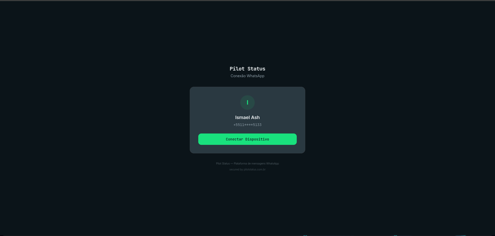

A página de conexão é a página pública em `https://connect.pilotstatus.com.br/connect/<token>`. Você a envia a um cliente para que **ele** conecte o número de WhatsApp dele ao **seu** workspace, sem conta no seu painel e sem que você precise ter o celular dele em mãos.

Ela não é uma tela do painel. Abre sem login, e o token na URL é a única credencial. Esta página descreve o que a pessoa do outro lado vê. Para **incorporá-la** no seu app (iframe, eventos `postMessage`, modo botão, estilo do botão), leia [Incorpore a Página de Conexão](/pt-BR/integrations/embed-connect).

<Frame caption="A página de conexão hospedada, com logo, cores e título do tenant.">
  
</Frame>

## De onde vem o link

Quem cria o link é você. Há dois caminhos:

- **No painel**: o fluxo de conexão da tela **Números** pode gerar um link de pareamento remoto em vez de mostrar o QR Code para você. Veja [Números](/pt-BR/dashboard/numbers).
- **Pela API ou MCP**: [`POST /v1/numbers/remote-pairing`](/pt-BR/api/numbers/remote-pairing), ou a ferramenta MCP `numbers_remote_pairing`. A resposta traz `remotePairingUrl`.

O link decide qual fluxo o cliente vê:

| Link | Fluxo na página | Validade |
| --- | --- | --- |
| Número web Pilot Status (QR, o padrão) | QR Code mais código de pareamento | **24 horas**, uso único |
| Meta, `metaFlow: "embedded"` | Botão do Embedded Signup do Facebook | **30 minutos** |
| Meta, `metaFlow: "credentials"` | Formulário com as credenciais da Cloud API | **30 minutos** |

## O que o cliente vê

A página é só em **português**. Os textos abaixo estão como aparecem nela.

### Cabeçalho e rodapé

No topo fica o seu logo, ou o nome da sua empresa se não houver logo, com um subtítulo. Os dois vêm da sua marca. A aba do navegador mostra o nome da sua empresa, ou *Conectar WhatsApp*.

No rodapé:

- *Pilot Status — Plataforma de mensagens WhatsApp*, a não ser que a sua marca esconda a Pilot Status.
- Um link **Precisa de ajuda?**, se a sua marca tiver URL de suporte.
- Um link pequeno **secured by pilotstatus.com.br**. Ele sempre aparece e não pode ser removido na página completa.

### Pareamento por QR (número web Pilot Status)

1. O cartão mostra o nome do número, a inicial dele e o número mascarado (por exemplo `+5511****9999`), mais o botão **Conectar Dispositivo** (*Preparando...* enquanto carrega).
2. Depois do clique, a página mostra **Escaneie o QR Code** com:
   - um **Código de pareamento** que é copiado ao clicar (**Copiar código**),
   - o QR Code,
   - a contagem **Expira em Ns**. Cada QR vale 40 segundos, e a página busca um novo sozinha.
3. As instruções dizem: abra o WhatsApp no celular, vá em **Menu > Dispositivos conectados > Conectar um dispositivo** e escaneie o QR Code ou digite o código de pareamento.
4. Quando o celular conecta, aparece **Conectado com sucesso!** — *O número WhatsApp foi conectado. Você pode fechar esta página.*

Se o workspace não puder receber mais um número (por exemplo, chegou ao limite do plano), o cliente lê uma frase neutra: *Este número não pode ser conectado agora. Fale com quem enviou este link.* Detalhes do plano nunca aparecem nesta página. Uma falha passageira diz *Erro ao gerar QR Code. Tente novamente.* e oferece **Tentar novamente**.

### Número oficial, Embedded Signup

1. O cartão mostra **Conectar WhatsApp Business**: *Você fará login no Facebook e escolherá o número da sua conta oficial do WhatsApp (Meta Cloud API). Nenhuma credencial é necessária aqui.*
2. O botão diz **Continuar com o Facebook** por padrão. O estilo de botão do seu link pode mudar o texto. Ele abre a janela da Meta, onde o cliente escolhe ou cria a conta comercial e o número.
3. No celular, um aviso sugere abrir o link num computador, porque a conexão com a Meta pode não ser concluída no celular. O aviso não aparece quando o link usa o fluxo de redirecionamento, que foi feito para o celular.
4. Se o cliente voltar à página depois de concluir no Facebook mas a página não tiver recebido o resultado, ela oferece **Concluiu no Facebook? Finalizar conexão**. Isso abre um campo de telefone (*Informe o número que você conectou no WhatsApp Business*) e o botão **Finalizar conexão**. Em seguida a página confirma que recebeu o pedido: o número aparece no painel em instantes se a Meta o conectou, senão a equipe da Pilot Status entra em contato.
5. Deu certo: **Conectado com sucesso!**

### Número oficial, formulário de credenciais

**Conectar WhatsApp Business** pede as credenciais da conta oficial, que ficam no Meta Business / WhatsApp Manager. Todos os campos são obrigatórios:

| Campo | Exemplo de preenchimento |
| --- | --- |
| **Nome** | *Ex.: Atendimento principal* |
| **Número** | `+55 11 99999-9999` |
| **Phone Number ID** | `123456789012345` |
| **WABA ID** | `098765432109876` |
| **System Token** | `EAA...` (campo oculto) |
| **App Secret** | `abcdef123456...` (campo oculto) |
| **App ID** | `1234567890` |

Abaixo dos campos há uma caixa, marcada por padrão: **Receber as mensagens automaticamente na Pilot Status (recomendado).** — *Configuramos o webhook desta conta (WABA) para você — sem passos manuais.* Marcada, a Pilot Status inscreve a conta (WABA) na Meta com a própria URL de callback e o verify token do número, e as mensagens recebidas chegam à Pilot Status sem passos manuais. Logo abaixo do rótulo, em letra menor: *Atenção: redireciona os webhooks de **toda a WABA**. Se este número já envia eventos para outra integração, ela deixa de recebê-los. Desmarque para configurar o webhook manualmente depois.*

<Warning>
  O redirecionamento vale para **toda a WABA**, não só para este número: se algum número dessa conta já envia eventos para outra integração, essa integração deixa de recebê-los. Quando o cliente **desmarca** a caixa, a página mostra na hora um aviso: *Você vai precisar colar a URL de callback e o Verify token nas configurações de webhook do seu app na Meta. Até fazer isso, nenhuma mensagem recebida chega à Pilot Status.*
</Warning>

O cliente envia em **Conectar** (*Conectando...* enquanto processa). Se a Meta ou a Pilot Status recusarem as credenciais, o erro aparece abaixo do botão. A página nunca mostra de volta o System Token nem o App Secret.

#### Quando o webhook ainda precisa ser configurado

A tela de sucesso depende de a WABA ter sido de fato redirecionada para a Pilot Status:

- **Redirecionada** (caixa marcada e a Meta aceitou a inscrição): o habitual **Conectado com sucesso!**.
- **Não redirecionada** — a caixa foi desmarcada, ou estava marcada mas a inscrição na Meta falhou: a página mostra **Falta um passo: configure o webhook na Meta** — *O número foi conectado, mas as mensagens recebidas só chegam à Pilot Status depois que você configurar o webhook no seu app da Meta.* Quando o redirecionamento foi pedido e falhou, o texto começa com *Não conseguimos configurar o webhook automaticamente para você.* Depois vêm:
  - **URL de Callback** e **Verify Token**, cada um com o botão **Copiar**;
  - os passos: 1. *Acesse o Meta App Dashboard* · 2. *WhatsApp → Configuração → Webhook* · 3. *Cole a URL de callback e o Verify token acima e clique em “Verificar e salvar”* · 4. *Assine os campos:* `messages`, `message_template_status_update`;
  - um aviso: *Copie o Verify token agora: ele não será mostrado de novo nesta página. Depois, o dono do workspace pode copiá-lo no card do número, na tela Números do painel.*

O número conectado dispara `number.connected` nos dois casos, e o payload diz se o webhook foi redirecionado (ele nunca leva o verify token). Depois, o **Proprietário** do workspace pode copiar o verify token de novo na linha do número, na tela [Números](/pt-BR/dashboard/numbers).

### Depois de conectar, link vencido, erros

- **Redirecionamento**: se o link foi criado com `redirectUrl` e a página não está incorporada, o navegador vai para lá cerca de 2,5 segundos depois de **Conectado com sucesso!**. Quando a configuração manual do webhook está na tela, não há redirecionamento automático — o verify token só aparece ali — e o cliente sai pelo botão **Continuar** depois de copiá-lo. Páginas incorporadas, em vez disso, mandam `connect:paired` para o app hospedeiro.
- **Link vencido ou já usado**: **Link expirado** — *Este link de pareamento expirou ou já foi utilizado. Solicite um novo link ao seu fornecedor.* O cliente não consegue renová-lo. Você cria um link novo.
- **Erros de rede**: mensagens como *Erro de conexão. Verifique sua internet.* Erros que podem ser repetidos mostram **Tentar novamente**.

## Marca

A aparência vem, em ordem de prioridade, de:

1. Parâmetros cosméticos na URL. Eles só valem depois que o token é validado.
2. O `branding` do próprio link.
3. A marca do seu workspace ([`/v1/branding`](/pt-BR/api/branding)).
4. O padrão da Pilot Status.

A tabela completa está em [Incorpore a Página de Conexão](/pt-BR/integrations/embed-connect).

## Quem pode criar o link

Criar link de pareamento é conectar um número, então exige a permissão `numbers:connect`. **Proprietário** e **Administrador** têm; Atendente e Analista não. A mesma permissão vale pela API e pelo MCP. Quem abre o link não precisa de conta nem de papel.

## Fazer pela API / MCP

| Etapa | API pública | Ferramenta MCP |
| --- | --- | --- |
| Criar o link | [`POST /v1/numbers/remote-pairing`](/pt-BR/api/numbers/remote-pairing) | `numbers_remote_pairing` |
| Acompanhar a conexão do número | [`GET /v1/numbers/{id}/status`](/pt-BR/api/numbers/status) | `numbers_status` |
| Ser avisado quando conectar | [Webhooks](/pt-BR/dashboard/webhooks), ou `connect:paired` quando incorporado | — |
| O que o cliente faz na página | Só na página. Os endpoints de token que ela chama são públicos e presos ao link. | — |

## Relacionados

- [Incorpore a Página de Conexão](/pt-BR/integrations/embed-connect): iframe, modo botão, eventos `postMessage`, estilo do botão.
- [Embedded Signup no seu app](/pt-BR/guides/embedded-signup).
- [API de pareamento remoto](/pt-BR/api/numbers/remote-pairing).
- [Números](/pt-BR/dashboard/numbers).
