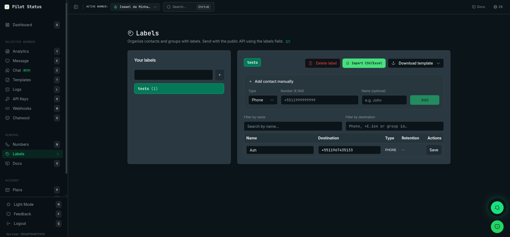

A tela **Labels** (`/labels`) organiza seus contatos e grupos de WhatsApp em listas com nome, como `vip` ou `clientes`. Você usa uma label para carregar destinatários num envio em massa na tela [Mensagem](/pt-BR/dashboard/send-messages), e a sua integração pode marcar contatos automaticamente passando `labels` no [`POST /v1/messages/send`](/pt-BR/api/messages/send).

As labels pertencem ao **workspace**, não a um número: todos os números do workspace veem as mesmas labels.

<Frame caption="A página Labels — organize contatos e grupos em labels, importe de CSV/Excel e depois passe labels no POST /v1/messages/send.">
  
</Frame>

## Como chegar

Na barra lateral, clique em **Labels**, no grupo **Workspace** (atalho de teclado: `B`). O título da página é **Labels**, com o subtítulo **Organize contatos por labels. Envie com a API pública usando o campo labels.** O ícone de link ao lado abre este site de documentação.

## Quem pode fazer o quê

| Ação | Owner | Admin | Agent | Analyst |
| --- | --- | --- | --- | --- |
| Abrir **Labels**, ver labels e contatos | Sim | Sim | Sim | Não |
| Criar uma label, adicionar, importar, editar e copiar contatos | Sim | Sim | Sim | Não |
| **Excluir label** | Sim | Sim | Não | Não |
| Ver o aviso **Retenção de dados (PII)** | Sim | Sim | Não | Não |

As permissões por trás: `contacts:read` abre a tela, `contacts:manage` cria labels e altera contatos, e `contacts:delete` exclui uma label (ela remove todos os vínculos de contato da label). O aviso de retenção depende de ler as API keys (`apikeys:read`), que só Owner e Admin têm. Veja [Papéis e permissões](/pt-BR/concepts/roles-and-permissions).

Esta tela não tem bloqueio por plano.

## O que você vê

### Aviso de retenção de dados (PII)

Quando pelo menos uma das suas API keys tem retenção de 0 dias, aparece no topo um aviso com o título **Retenção de dados (PII)**: **Alguma API key tem retenção 0: números podem ser apagados automaticamente conforme a política de retenção. Linhas de contato vindas da API pública mostram a retenção da key.** Veja [Retenção de dados e modos de PII](/pt-BR/trust/data-retention).

### Suas labels

O card da esquerda, **Suas labels**, lista cada label com a contagem de contatos, por exemplo `vip (12)`. Clique numa label para selecioná-la; a primeira label já vem selecionada quando a página abre.

Para criar uma label, digite o nome no campo do topo do card e aperte `Enter` ou clique em **+**. Os nomes são em snake_case: letras minúsculas, números e `_` (o campo converte o que você digita). Criar uma label com um nome que já existe seleciona a existente, em vez de fazer uma cópia. A tela diz **Label criada**.

### A label selecionada

O card da direita mostra o nome da label selecionada e as ações dela. Sem label, ele diz **Crie ou selecione uma label.**

- **Excluir label** — só Owner e Admin. Abre o diálogo **Excluir label?**: **Esta ação não pode ser desfeita. Todos os contatos vinculados a esta label serão removidos.**, com o número de contatos, e **Cancelar** ou **Excluir**. Os contatos saem só desta label; os mesmos destinos continuam nas outras labels.
- **Importar CSV/Excel** — adiciona à label selecionada os contatos de um arquivo `.xlsx`, `.xls` ou `.csv`. Veja [Importar contatos](#importar-contatos).
- **Baixar modelo** — baixa um modelo de importação (**Excel (.xlsx)** ou **CSV (.csv)**) com as colunas `name`, `destinationNumber` e `groupId` e duas linhas de exemplo.

### Adicionar contato manualmente

Em **Adicionar contato manualmente**:

1. Escolha o **Tipo**: **Telefone** ou **Grupo**.
2. Digite o **Número (E.164)**, como `+5511999999999`, ou o **ID do grupo**, que precisa terminar em `@g.us`.
3. Se quiser, digite o **Nome (opcional)**.
4. Clique em **Adicionar**.

Um número inválido mostra **Número inválido (use E.164, ex: +5511999999999)**; um ID de grupo sem `@g.us` mostra **ID do grupo deve terminar em @g.us**. Quando dá certo, a tela diz **Contato adicionado**.

### Lista de contatos

Os contatos da label selecionada. Estreite a lista com **Filtrar por nome** e **Filtrar por destino** (telefone em qualquer formato, E.164 ou ID de grupo); **Limpar filtros** zera os dois. Uma label vazia diz **Nenhum contato ainda. Use o formulário acima, importe CSV/Excel ou envie mensagens com labels pela API.**

| Coluna | O que mostra |
| --- | --- |
| **Nome** | O nome do contato, editável. |
| **Destino** | O telefone (E.164) ou o ID do grupo, editável. |
| **Tipo** | `PHONE` ou `GROUP`. |
| **Retenção** | Só nos contatos adicionados pela API: a retenção da API key que os adicionou, como `30d`, ou **0 dias (PII off)** em âmbar. Contatos adicionados pelo painel mostram `—`. |
| **Ações** | **Salvar** e **Copiar para…** |

A coluna **Retenção** é como você sabe quais contatos vieram da API: são os que têm valor nela. A API key em si nunca aparece.

### Editar um contato

Mude o nome ou o destino na linha e clique em **Salvar** nessa linha. Linhas editadas ficam âmbar com **Não salvo**, e um aviso lembra: **Há alterações não salvas. Clique em Salvar em cada linha para persistir.** Trocar um destino por um que a label já tem falha com **Destino já existe nesta label**.

### Copiar um contato para outra label

Em **Copiar para…**, busque e escolha outra label. O contato passa a estar também nessa label (**Contato copiado**). Se o destino já estiver lá, ele não é duplicado; um nome vazio no destino é preenchido.

<Note>
  A tela não tem botão para remover um único contato de uma label, nem exportação. Para tirar um contato, exclua e recrie a label, ou importe a lista que você quer numa label nova.
</Note>

## Importar contatos

Selecione uma label, clique em **Importar CSV/Excel** e escolha o arquivo. A importação:

- lê o telefone de uma coluna chamada `destinationNumber`, `number`, `numero`, `telefone` ou `phone`, e o nome de `name`;
- trata uma linha como **grupo** quando a coluna `groupId` (ou `group`) termina em `@g.us`;
- pula as linhas cujo telefone não é um número E.164 válido;
- atualiza o nome de um destino que já está na label quando ela o tem com o nome vazio.

Se nenhuma linha for válida, a tela diz **Nenhum contato válido no arquivo**. Senão, diz **Importação concluída** e recarrega a lista.

## Valores desta tela

Nada aqui aparece uma vez só. Labels e contatos ficam até você excluí-los, a menos que a [retenção](/pt-BR/trust/data-retention) da API key que adicionou um contato o apague.

## Fazer pela API / MCP

| Ação no painel | API (`/v1`) | Ferramenta MCP |
| --- | --- | --- |
| Marcar um destino com labels ao enviar (cria a label se preciso) | O campo `labels` do [`POST /v1/messages/send`](/pt-BR/api/messages/send) — veja [Labels](/pt-BR/api/labels) | `messages_send` com `labels` |
| Enviar para todos de uma label | Carregue a label na tela [Mensagem](/pt-BR/dashboard/send-messages) | Só no painel |
| Listar labels e contatos, criar uma label, adicionar, importar, editar, copiar contatos, excluir uma label | — | Só no painel |
